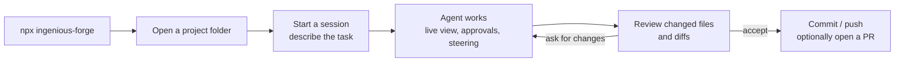
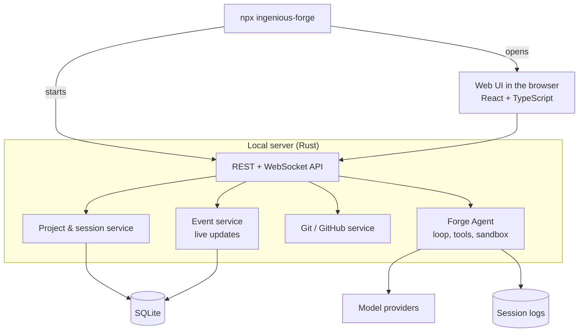

# Ingenious Forge — Product Requirements Document

| | |
|---|---|
| **Status** | Draft v0.5 |
| **Owner** | yokesh-ks |
| **Last updated** | 2026-10-30 |

---

## 1. Summary

Ingenious Forge is a web-native coding harness. Engineers open a project in the browser, give an AI coding agent a task, watch and steer its work live, review the changes, and commit them.

Forge ships as a **web UI launched with `npx`**. One command starts Forge on the user's machine and opens it in their browser — there is no desktop app or terminal UI to install. Every feature is delivered through the web interface, which keeps the product simple, accessible, and the same on macOS, Linux and Windows.

Forge is built in two stages:

1. **First release — Forge Agent + Forge Web UI**
   - **Forge Agent** — the coding agent: it reads and edits code, runs commands in a sandbox, asks for approval when it should, and keeps a durable session history.
   - **Forge Web UI** — a local server started by `npx` that runs the agent, and the browser interface that is the only way to use it: live session view, workspace panel, diff review and git actions.
2. **Later release — Forge Board**
   - A kanban board where every task gets its own isolated workspace and runs in parallel with others, ending in a reviewed, merged pull request.

## 2. Problem

| Problem | Forge's answer |
|---|---|
| Terminal-only agents are hard to follow: long scrolling output, no overview of what changed | A browser view that shows every message, tool call, command and diff as it happens, with a changed-files panel |
| Desktop apps must be installed and differ per OS | Nothing to install beyond Node.js: `npx ingenious-forge` and work in the browser, identical on every OS |
| Agents act without enough control or visibility | A sandbox by default, clear approval modes, and inline approval prompts |
| Reviewing and committing agent changes means jumping to other tools | Diff review and git actions in the same page as the session |
| *(Later)* Running several agents at once causes them to collide in one checkout | *(Forge Board)* One isolated worktree per task |

## 3. Goals and non-goals

### Goals — first release
- **G1** A complete coding agent that can take a task from description to finished change on its own.
- **G2** A web UI that is the single place to run, watch, steer and review the agent.
- **G3** One-command launch (`npx ingenious-forge`) that opens Forge in the browser.

### Goals — later releases
- **G4** A planning-to-merge workflow on a kanban board with parallel, isolated workspaces.
- **G5** An optional hosted team mode.

### Non-goals
- A desktop application. Forge is web-only.
- A terminal UI or editor extension as an alternative way to use Forge.
- Training or hosting our own models.
- Replacing the code editor.
- Version control systems other than git.

## 4. Users

| Persona | What they need from Forge |
|---|---|
| **Solo engineer** | Hand a coding task to an agent, follow its progress in the browser, and keep only the changes they like |
| **Reviewer** | See exactly what the agent did — commands, edits, reasoning — before accepting it |
| **CI / automation** | Headless runs triggered from scripts or pipelines with machine-readable results |
| *(Later)* **Team** | A shared board and visibility of agent work across members |

## 5. Core workflow (first release)

1. The user runs `npx ingenious-forge`; the browser opens on the Forge home page.
2. They pick a project folder (a git repository) or a recent project.
3. They start a session and describe the task, optionally attaching images.
4. The agent works. The user watches live, answers approval prompts, or steers it mid-turn.
5. The changed-files panel shows every file the agent touched with its diff. The user comments or asks for changes in the chat.
6. The user accepts: commit, push, and optionally open a pull request — all from the web UI. Or they discard the changes.

---

## 6. Features

Priority: **P0** = first release (MVP), **P1** = v1.0, **P2** = later.

### 6.1 Forge Agent

The agent that does the coding work. It runs on the local server, talks to a language model, and acts on the project through a fixed set of tools.

#### Agent loop — P0
The agent works in turns: it sends the conversation to the model, streams the reply, runs any tools the model asks for, feeds the results back, and repeats until the task is finished. Users can **interrupt** a turn at any point or **steer** it by sending a message while it is running; the agent picks the message up at its next step instead of starting over.

#### Built-in tools — P0
| Tool | What it does |
|---|---|
| **Shell** | Runs commands (build, test, install, grep) and returns output and exit code |
| **Read / search** | Reads files and searches the codebase by name or content |
| **Edit / patch** | Changes files with precise edits or multi-file patches; every change shows up as a diff |
| **List** | Explores directory structure |

#### Sandbox — P0
Every command the agent runs is confined by an operating-system sandbox on macOS, Linux and Windows. By default the agent can write only inside the project folder and has no network access; projects can widen this (for example, allow network for package installs). The current sandbox and writable folders are always visible in the UI.

#### Approval modes — P0
Users choose how much the agent may do without asking:
- **Ask** — approve every edit and command.
- **Auto-edit** — edits apply freely; commands need approval.
- **Full-auto** — everything runs inside the sandbox without prompts.

Approval prompts appear inline in the chat and can be answered "once" or "always for this command".

#### Project instructions (`AGENTS.md`) — P0
Each repository can hold an `AGENTS.md` file (and nested ones in subfolders) describing conventions, commands and do's and don'ts. The agent loads them automatically. `/init` generates a first version by inspecting the repository.

#### Models and reasoning effort — P0
Users pick the model provider, the model and the reasoning effort per session. Providers plug in through adapters, so new providers can be added without changing the agent.

#### Sessions and resume — P0
Every session is recorded as an append-only log of messages, tool calls and results. Sessions survive server restarts and can be resumed, forked, or replayed for debugging.

#### Context management — P1
When a long session approaches the model's context limit, older parts are summarized automatically so the agent can keep working without losing the thread.

#### Image input — P1
Screenshots, mockups and diagrams can be attached to a prompt; the agent uses them as context (for example, "make the page look like this").

#### Headless mode (`forge exec`) — P1
Runs a task without the UI, for scripts and CI pipelines only — it is an automation entry point, not an alternative interface for people. It prints progress, exits with a meaningful code, and can emit a JSON result describing what was changed.

#### MCP tools — P1
Users connect Model Context Protocol servers (local or remote) to give the agent extra tools — databases, issue trackers, documentation. An MCP page in settings adds servers, handles sign-in, and lists available tools.

#### Subagents — P1
The agent can hand focused jobs (research a module, write tests, investigate a failure) to helper agents that run in parallel and report back, keeping the main session focused.

#### Code review command (`/review`) — P1
Reviews uncommitted changes, a commit, or a whole branch and returns prioritized findings without changing any files.

#### Skills and hooks — P2
**Skills** are reusable instruction packs the agent loads when relevant (e.g. "release process"). **Hooks** run user scripts before or after tool calls (e.g. format after every edit, block certain commands).

#### Cloud tasks — P2
Send a task to a remote Forge environment, close the laptop, and apply the finished result to the local repository later.

### 6.2 Forge Web UI

How Forge is delivered and used: a local server that owns the agent and projects, and the browser interface that connects to it.

#### `npx` launch — P0
`npx ingenious-forge` downloads the package, starts the server on a free local port and opens the web UI in the default browser. Flags cover the port, host binding and whether to open the browser. Running the same command again updates to the latest version. The only prerequisites are Node.js and git.

#### Host server — P0
A single server process runs the agent and exposes it over HTTP and WebSocket to the web UI. It binds to `localhost` by default. Because state lives in the server, closing the browser tab does not stop a running agent; reopening the page reconnects to it, and several tabs can view the same session.

#### Projects and session list — P0
A home page lists recent projects and lets the user open a folder from disk. Inside a project, a sidebar lists its sessions (title, status, last activity) so the user can switch between them, resume old ones, or start a new one.

#### Live session view — P0
The agent's work streams into the browser as it happens: messages (rendered markdown and code), each tool call with its input and output, command output as it prints, and diffs as files change. Long sessions stay fast, and a dropped connection reconnects without losing or duplicating output.

#### Composer — P0
The message box for prompts, with slash commands (`/init`, `/model`, `/review`…), file mentions (`@path` with autocomplete), and a stop button while the agent is running. Messages sent during a turn steer the agent.

#### Approvals in the UI — P0
Approval requests appear as cards in the session with the exact command or edit, and Approve / Deny / Always-allow actions. The current approval mode and sandbox are shown in the session header and can be changed there.

#### Workspace panel — P0
Next to the chat: the project file tree with search, a file viewer, and an interactive terminal in the project folder.

#### Changed files and diff review — P0
A panel listing every file changed in the session, with unified or side-by-side diffs. The user can revert a single file or all changes, or select lines and send a comment about them to the agent.

#### Git actions — P0
From the UI: see the current branch and status, create a branch, commit (with a generated commit message the user can edit), and push.

#### Settings — P0
Model providers and API keys, default model and effort, default approval mode and sandbox rules, and the GitHub connection.

#### Typed API — P0
All data exchanged between server and browser is defined once in the backend and generated as TypeScript types for the frontend. CI fails if they drift apart.

#### Onboarding — P1
A first-run guide: check prerequisites, add a model provider, open a project, run a first task.

#### Pull requests — P1
Open a pull request from the session with a generated title and summary, and see its status.

#### Agent presets — P1
Named combinations of model, effort, approval mode and extra instructions, chosen when starting a session.

#### Browser notifications — P1
Notifications when the agent needs approval, finishes, or fails, so users can work in other tabs.

#### Plugin architecture — P1
Core capabilities — models, tools, sessions, file system, shell — are defined as interfaces with swappable implementations. New model providers, tools or sandbox backends are added as plugins without touching the core.

#### Open in editor — P1
A button that opens the project or a file in the user's own editor, for when they want to change something by hand.

#### Session sharing — P2
Share a read-only live link to a session so a teammate can watch an agent work.

#### Remote execution — P2
Run a project on another machine (over SSH) or in a container instead of locally, with the same UI.

#### Languages — P2
The UI can be translated; English first.

### 6.3 Forge Board (later release)

A kanban workflow added after the Agent and Web UI are stable. It builds on the same agent, sessions and UI. Priorities here apply within the Board release.

| Feature | Description | Priority in Board release |
|---|---|---|
| **Tasks and board** | Tasks with title, description and attachments on a board with columns Backlog, In Progress, In Review, Done, Cancelled; drag-and-drop and filters | Must |
| **Isolated workspaces** | Starting a task creates a git worktree on its own branch, so tasks don't collide with each other or the user's checkout; cleaned up automatically | Must |
| **Parallel tasks** | Several tasks run at once, each with its own agent session, terminal and dev server | Must |
| **Review and merge** | A task's changes are reviewed in the existing diff view; approval opens and can merge a PR | Must |
| **Multiple attempts** | Retry a task with a different model or effort and compare attempts | Should |
| **Subtasks** | Break a task into subtasks manually or by asking the agent | Should |
| **Built-in browser preview** | Embedded preview of the task's dev server with element inspection and device sizes | Should |
| **Pluggable agents** | Drive a workspace with a third-party command-line coding agent through an adapter | Could |
| **Task API (MCP)** | A built-in MCP server so agents can read, create and update tasks | Could |
| **Teams and cloud** | Organizations, members, sign-in, shared boards syncing in real time | Later |
| **More git hosts** | GitLab and Azure Repos in addition to GitHub | Later |

---

## 7. Non-functional requirements

| Area | Requirement |
|---|---|
| **Install** | `npx ingenious-forge` starts the server and opens the browser in under 30 s on a warm cache; nothing else to install besides Node.js and git |
| **Browsers** | Latest two versions of Chrome, Edge, Firefox and Safari; usable on tablet and phone screens |
| **Performance** | Streamed output appears in the UI < 200 ms after the model emits it; a session with thousands of steps scrolls smoothly |
| **Security** | Server listens on `localhost` only unless the user opts in; agent commands run sandboxed; secrets never reach the browser; API keys stored encrypted; destructive git operations require confirmation |
| **Reliability** | Sessions resume after a server restart; the browser reconnects without losing output |
| **Privacy** | All data stays on the user's machine; telemetry is opt-in |
| **Platforms** | macOS, Linux, Windows (WSL acceptable for MVP) |
| **Quality** | Unit and integration tests per module, browser end-to-end tests for core flows, type-drift checks in CI |

## 8. Architecture (first release)

- **Backend:** Rust, with modules `server`, `agent`, `services`, `git`, `db`, `api-types`, `utils`. The Board release adds a `board` service and a worktree manager.
- **Frontend:** React and TypeScript single-page app, served by the local server.
- **Distribution:** one npm package (`ingenious-forge`) that bundles prebuilt server binaries for macOS, Linux and Windows plus the built web UI. The `npx` entry script picks the right binary, starts it and opens the browser. No desktop app is built or shipped.

## 9. Release plan

| Phase | Scope | Exit criteria |
|---|---|---|
| **0 — Foundation** | Backend workspace, `npx` launcher, Forge Agent running one session, web chat streaming it | `npx ingenious-forge` opens the browser, and a prompt there edits a file and the diff appears |
| **1 — MVP** | All P0 features (Agent + Web UI) | A user completes a real coding task end to end — prompt, approvals, review, commit, push — without leaving the browser |
| **2 — v1.0** | All P1 features | The team uses Forge daily to build Forge |
| **3 — Forge Board** | Section 6.3 | Several tasks run in parallel in isolated worktrees and end as merged PRs |
| **4 — Cloud** | P2 features and team mode | A team shares projects and boards across machines |

## 10. Success metrics (first release)

| Metric | Target |
|---|---|
| Sessions whose changes the user commits | ≥ 60% |
| Time from `npx ingenious-forge` to first agent response for a new user | < 5 minutes |
| Sessions interrupted by a UI or connection error | < 1% |
| Weekly active users returning the following week | Tracked; trending up each release |

## 11. Risks and open questions

| # | Item | Mitigation / notes |
|---|---|---|
| R1 | Sandboxing on Windows | WSL for MVP |
| R2 | Agent changes that look right but don't work | The terminal in every session makes it quick to run tests before committing |
| R3 | Exposing the server beyond `localhost` by mistake | Off by default; explicit flag plus an access token when enabled |
| Q1 | Final name for the headless command (`forge exec`?) | |
| Q2 | Which model providers ship in the MVP | |
| Q3 | Hosted offering: InGeniousClan-hosted, self-host only, or both | |

## 12. Glossary

| Term | Meaning |
|---|---|
| **Project** | A git repository opened in Forge |
| **Session** | One conversation with the agent in a project, with its full history of messages, tool calls and changes |
| **Turn** | One round of the agent working in response to a message |
| **Approval mode** | How much the agent may do without asking the user |
| **Agent preset** | A named set of model, effort, approval mode and instructions |
| **Task** *(Board)* | A unit of work on the board |
| **Workspace** *(Board)* | An isolated git worktree and branch created for a task |
