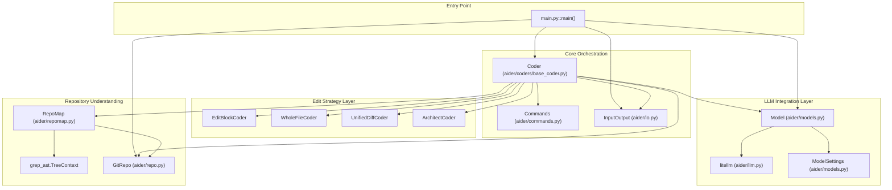
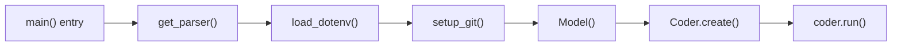
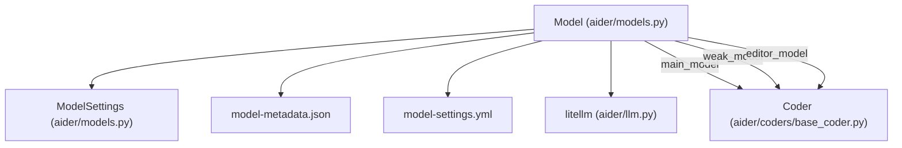
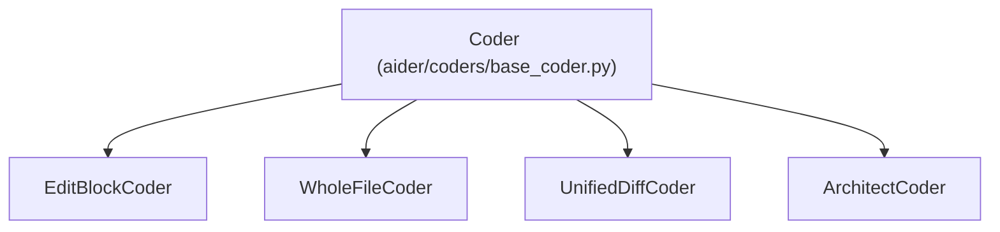
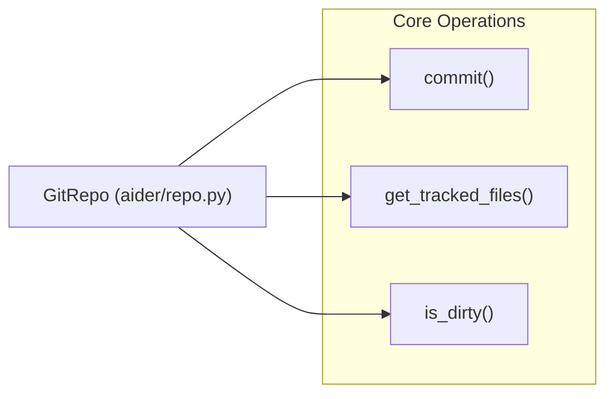
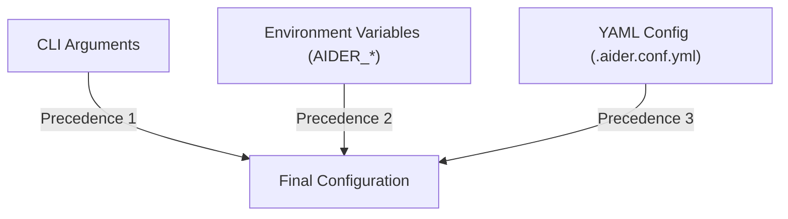

# Overview

Relevant source files

The following files were used as context for generating this wiki page:

- [HISTORY.md](HISTORY.md)
- [README.md](README.md)
- [aider/args.py](aider/args.py)
- [aider/coders/base_coder.py](aider/coders/base_coder.py)
- [aider/commands.py](aider/commands.py)
- [aider/io.py](aider/io.py)
- [aider/main.py](aider/main.py)
- [aider/models.py](aider/models.py)
- [aider/repo.py](aider/repo.py)
- [aider/repomap.py](aider/repomap.py)
- [aider/voice.py](aider/voice.py)
- [aider/website/HISTORY.md](aider/website/HISTORY.md)
- [aider/website/_data/blame.yml](aider/website/_data/blame.yml)
- [aider/website/assets/sample-analytics.jsonl](aider/website/assets/sample-analytics.jsonl)
- [aider/website/docs/config/adv-model-settings.md](aider/website/docs/config/adv-model-settings.md)
- [aider/website/docs/config/model-aliases.md](aider/website/docs/config/model-aliases.md)
- [aider/website/docs/faq.md](aider/website/docs/faq.md)
- [aider/website/docs/languages.md](aider/website/docs/languages.md)
- [aider/website/docs/leaderboards/index.md](aider/website/docs/leaderboards/index.md)
- [aider/website/docs/more/infinite-output.md](aider/website/docs/more/infinite-output.md)
- [aider/website/index.html](aider/website/index.html)
- [scripts/update-blame.sh](scripts/update-blame.sh)
- [tests/basic/test_io.py](tests/basic/test_io.py)

## Purpose and Scope

This document provides a high-level introduction to the Aider codebase architecture, explaining the primary components, their interactions, and the overall system design. Aider is an AI pair programming tool that integrates Large Language Models (LLMs) with version control and code editing workflows to assist developers in modifying existing codebases.

For detailed information about specific subsystems:
- **Installation and Setup**: see [Getting Started](#1.1)
- **Fundamental Terms**: see [Key Concepts and Terminology](#1.2)
- **Core Architecture Components**: see [Core Architecture](#2)
- **Edit Strategies**: see [Edit Strategies and Code Modification](#3)
- **Repository Context**: see [Repository Understanding and Context](#4)

## What is Aider?

Aider is a command-line AI coding assistant that enables developers to collaborate with LLMs to edit code within their existing repositories. Users can request changes through natural language, and Aider applies those changes using various edit formats optimized for different LLMs. The system automatically manages git commits, provides repository context to the LLM via a repo-map, and supports over 100 programming languages [README.md:40-102](). Aider is notable for its self-referential development; for example, 88% of the code in recent releases was written by Aider itself [README.md:35-36]().

**Sources:** [README.md:1-122](), [aider/coders/base_coder.py:88-123]()

## High-Level Architecture

Aider follows a layered architecture with the `Coder` class serving as the central orchestrator. The system separates concerns into distinct layers: user interfaces (CLI, GUI, file watcher), core orchestration, LLM integration, edit strategies, repository understanding, and version control.

### System Component Diagram

**Sources:** [aider/main.py:451-650](), [aider/coders/base_coder.py:88-123](), [aider/models.py:127-152](), [aider/repomap.py:42-82]()

## Core Components

### Application Entry Point

The `main()` function in `main.py` serves as the primary entry point, handling configuration loading from `.aider.conf.yml`, `.env`, and CLI arguments [aider/main.py:451-650](). It initializes the `GitRepo` [aider/main.py:101-152](), and instantiates the `Coder` through the `Coder.create()` factory method [aider/coders/base_coder.py:125-201]().

**Sources:** [aider/main.py:451-650](), [aider/args.py:35-65](), [aider/coders/base_coder.py:125-201]()

### Coder Orchestration

The `Coder` base class orchestrates all major subsystems, managing chat history, file tracking, and the LLM interaction loop [aider/coders/base_coder.py:88-123]().

| Responsibility | Implementation | Key Attributes/Methods |
|---------------|----------------|-------------|
| Message management | `done_messages`, `cur_messages` | [aider/coders/base_coder.py:160-175]() |
| File tracking | `abs_fnames`, `abs_read_only_fnames` | [aider/coders/base_coder.py:89-90]() |
| LLM interaction | `main_model` | [aider/coders/base_coder.py:127-140]() |
| Edit application | Edit strategy subclasses | `apply_updates()` |
| Repository context | `repo_map`, `repo` | [aider/coders/base_coder.py:91-95]() |
| Git integration | `GitRepo` | [aider/repo.py:52-788]() |

**Sources:** [aider/coders/base_coder.py:88-201](), [aider/repo.py:52-788]()

### Model and LLM Integration

The `Model` class encapsulates LLM configuration and technical capabilities [aider/models.py:127-152](). It uses `litellm` to support providers like OpenAI, Anthropic, and DeepSeek [aider/models.py:33-123]().

**Sources:** [aider/models.py:127-152](), [aider/models.py:33-123](), [aider/llm.py]()

### Edit Strategy System

Aider implements multiple edit strategies (subclasses of `Coder`) optimized for different model behaviors, such as Search/Replace blocks or whole-file rewrites [aider/coders/base_coder.py:190-201]().

**Sources:** [aider/coders/base_coder.py:190-201](), [aider/args.py:164-177]()

### Repository Understanding

The `RepoMap` class uses tree-sitter to build a map of the codebase, providing the LLM with relevant symbols and definitions without exceeding context limits [aider/repomap.py:42-82](). It uses ranked tags to identify important context [aider/repomap.py:135-142]().

**Sources:** [aider/repomap.py:42-167]()

### Git Integration

The `GitRepo` class manages version control, including auto-commits with AI-generated messages and co-authored attribution [aider/repo.py:52-788]().

**Sources:** [aider/repo.py:52-788]()

## Configuration System

Aider uses a multi-layered configuration approach with clear precedence: CLI arguments > environment variables > local configuration files [aider/args.py:36-42]().

**Sources:** [aider/args.py:36-42](), [aider/main.py:43-57]()