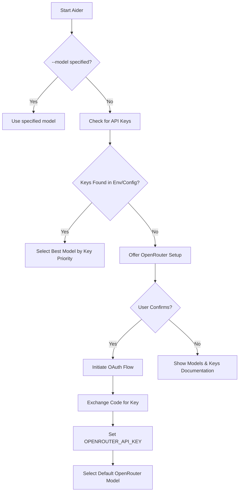
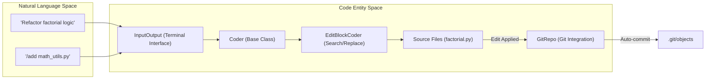

# Getting Started

<details>
<summary>Relevant source files</summary>

The following files were used as context for generating this wiki page:

- [.github/workflows/docker-build-test.yml](.github/workflows/docker-build-test.yml)
- [.github/workflows/docker-release.yml](.github/workflows/docker-release.yml)
- [.github/workflows/pages.yml](.github/workflows/pages.yml)
- [.github/workflows/release.yml](.github/workflows/release.yml)
- [aider/website/_includes/get-started.md](aider/website/_includes/get-started.md)
- [aider/website/_includes/help.md](aider/website/_includes/help.md)
- [aider/website/_posts/2024-05-13-models-over-time.md](aider/website/_posts/2024-05-13-models-over-time.md)
- [aider/website/docs/config/api-keys.md](aider/website/docs/config/api-keys.md)
- [aider/website/docs/install.md](aider/website/docs/install.md)
- [aider/website/docs/install/optional.md](aider/website/docs/install/optional.md)
- [aider/website/docs/more/edit-formats.md](aider/website/docs/more/edit-formats.md)
- [aider/website/docs/troubleshooting.md](aider/website/docs/troubleshooting.md)
- [aider/website/docs/troubleshooting/models-and-keys.md](aider/website/docs/troubleshooting/models-and-keys.md)
- [aider/website/docs/troubleshooting/token-limits.md](aider/website/docs/troubleshooting/token-limits.md)
- [aider/website/docs/usage.md](aider/website/docs/usage.md)
- [aider/website/docs/usage/images-urls.md](aider/website/docs/usage/images-urls.md)
- [aider/website/install.ps1](aider/website/install.ps1)
- [aider/website/install.sh](aider/website/install.sh)
- [docker/Dockerfile](docker/Dockerfile)

</details>


This page guides new users through the installation, initial setup, and first use of Aider. It covers the various installation methods, API key configuration via environment variables or configuration files, and the automated onboarding process.

## Installation

Aider is primarily distributed as a Python package and can be installed via several methods. The recommended approach is using `uv` or `pipx` to ensure dependencies are isolated.

### Recommended: Quick Install Scripts
The project provides automated scripts that install `uv` (if necessary) and then use it to install Aider in a managed environment.

*   **Mac & Linux:**
    ```bash
    curl -LsSf https://aider.chat/install.sh | sh
    ```
*   **Windows:**
    ```powershell
    powershell -ExecutionPolicy ByPass -c "irm https://aider.chat/install.ps1 | iex"
    ```

### Manual Installation Methods
| Method | Command | Notes |
| :--- | :--- | :--- |
| **uv** | `uv tool install --force --python python3.12 --with pip aider-chat@latest` | Recommended for speed and Python version management [aider/website/docs/install.md:54-59](). |
| **pipx** | `pipx install aider-chat` | Good for global CLI tool isolation [aider/website/docs/install.md:71-76](). |
| **pip** | `python -m pip install -U aider-chat` | Use within a virtual environment to avoid dependency conflicts [aider/website/docs/install.md:98-100](). |

Sources: [aider/website/docs/install.md:12-100](), [aider/website/install.sh:1-50]()

---

## Initial Setup and Onboarding

When Aider is launched, it performs an initialization sequence to detect the environment and ensure the user has a functional model to work with.

### Automatic Model Selection
If no model is specified via the `--model` flag, Aider attempts to select a default based on available environment variables [aider/website/docs/troubleshooting/models-and-keys.md:11-19]().

1.  **OpenRouter Detection**: If no keys are provided, Aider may offer to connect via OpenRouter [aider/website/docs/troubleshooting/models-and-keys.md:22-27]().
2.  **Provider Detection**: Aider looks for keys for major providers like Anthropic (Claude 3.7 Sonnet), OpenAI (o3-mini, gpt-4o), or DeepSeek (R1, V3) [aider/website/docs/troubleshooting/models-and-keys.md:31-49]().

### Onboarding Logic Flow
The following diagram illustrates the decision logic during the first launch.

**Aider Onboarding and Model Selection**

Sources: [aider/website/docs/troubleshooting/models-and-keys.md:11-55](), [aider/website/docs/install.md:14-23]()

---

## Configuration

Aider supports a multi-layered configuration system. Settings are loaded with precedence rules where command line arguments override environment variables and configuration files.

### API Key Configuration
Users can configure keys through environment variables or specific arguments.

*   **Environment Variables**: Best for storing various provider keys like `OPENAI_API_KEY`, `ANTHROPIC_API_KEY`, or `DEEPSEEK_API_KEY` [aider/website/docs/troubleshooting/models-and-keys.md:16-19]().
*   **Command Line**: Keys can be passed directly using `--api-key provider=key` [aider/website/docs/troubleshooting/models-and-keys.md:31-49]().

### Token Management
Aider monitors token usage and reports errors if a model's **context window** or **output token limit** is exceeded [aider/website/docs/troubleshooting/token-limits.md:8-14](). Users can manage context using:
*   `/tokens`: View current usage [aider/website/docs/troubleshooting/token-limits.md:59]().
*   `/drop`: Remove files from context [aider/website/docs/troubleshooting/token-limits.md:60]().
*   `/clear`: Clear chat history [aider/website/docs/troubleshooting/token-limits.md:61]().

Sources: [aider/website/docs/troubleshooting/models-and-keys.md:8-55](), [aider/website/docs/troubleshooting/token-limits.md:6-78]()

---

## First Use

Once installed and configured, Aider is typically run from the root of a git repository.

### Adding Files to Context
Aider needs to know which files it is allowed to edit. You can add files during startup or during the chat session.
*   **Startup**: `aider <file1> <file2>` [aider/website/docs/usage.md:16-18]().
*   **In-Chat**: Use the `/add` command [aider/website/docs/usage.md:42-46]().

### The Interaction Loop
Aider operates in a REPL where it:
1.  Accepts natural language instructions via the `InputOutput` interface.
2.  Analyzes files in the chat context and the `RepoMap`.
3.  Sends a prompt to the LLM using the configured `EditFormat`.
4.  Applies edits to local files.
5.  Automatically commits changes to Git via the `GitRepo` class [aider/website/docs/usage.md:88-89]().

**Natural Language to Code Entity Mapping**


### Optional Dependencies and Docker
*   **Playwright**: For web scraping via `/web <url>`. Requires `playwright install --with-deps chromium` [aider/website/docs/install/optional.md:32-49]().
*   **PortAudio**: For voice-to-code via `/voice`. Requires `libportaudio2` on Linux or `brew install portaudio` on Mac [aider/website/docs/install/optional.md:56-68]().
*   **Docker**: Aider provides a `Dockerfile` with two targets: `aider-full` (includes help, browser, and playwright) and `aider` (standard install) [docker/Dockerfile:35-80]().

Sources: [aider/website/docs/usage.md:9-93](), [aider/website/docs/install/optional.md:9-80](), [docker/Dockerfile:1-80]()