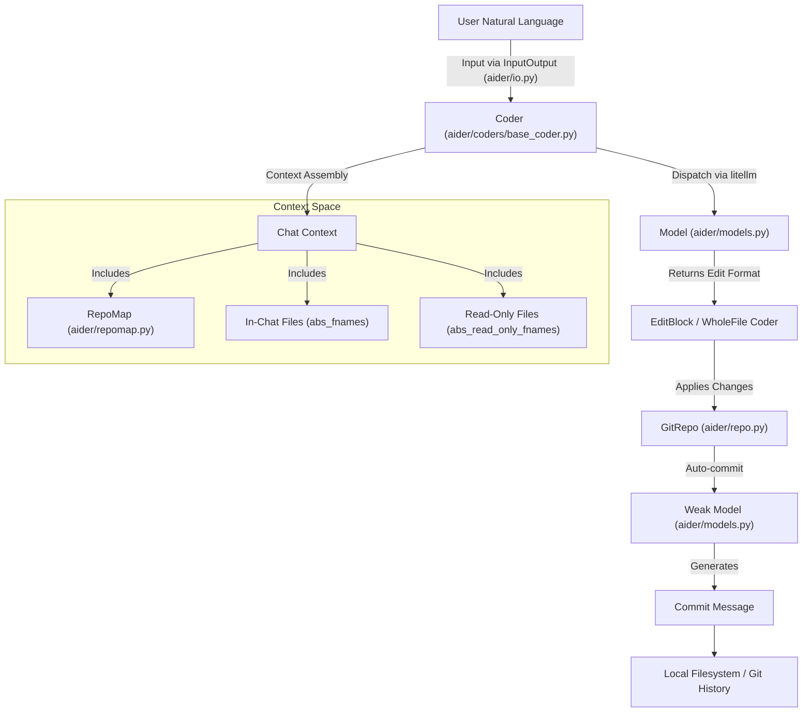
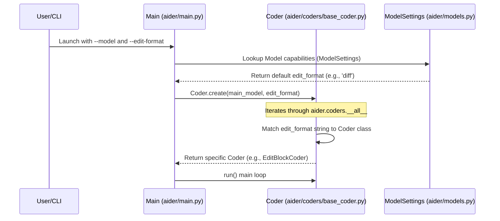

# Key Concepts and Terminology

Relevant source files

The following files were used as context for generating this wiki page:

- [HISTORY.md](HISTORY.md)
- [README.md](README.md)
- [aider/args.py](aider/args.py)
- [aider/coders/base_coder.py](aider/coders/base_coder.py)
- [aider/commands.py](aider/commands.py)
- [aider/io.py](aider/io.py)
- [aider/main.py](aider/main.py)
- [aider/models.py](aider/models.py)
- [aider/repo.py](aider/repo.py)
- [aider/repomap.py](aider/repomap.py)
- [aider/voice.py](aider/voice.py)
- [aider/website/HISTORY.md](aider/website/HISTORY.md)
- [aider/website/_data/blame.yml](aider/website/_data/blame.yml)
- [aider/website/assets/sample-analytics.jsonl](aider/website/assets/sample-analytics.jsonl)
- [aider/website/docs/config/adv-model-settings.md](aider/website/docs/config/adv-model-settings.md)
- [aider/website/docs/config/model-aliases.md](aider/website/docs/config/model-aliases.md)
- [aider/website/docs/faq.md](aider/website/docs/faq.md)
- [aider/website/docs/languages.md](aider/website/docs/languages.md)
- [aider/website/docs/leaderboards/index.md](aider/website/docs/leaderboards/index.md)
- [aider/website/docs/more/infinite-output.md](aider/website/docs/more/infinite-output.md)
- [aider/website/index.html](aider/website/index.html)
- [scripts/update-blame.sh](scripts/update-blame.sh)
- [tests/basic/test_io.py](tests/basic/test_io.py)

This page defines the fundamental concepts and technical terminology that underpin Aider's operation. It serves as a conceptual reference for understanding how Aider bridges the gap between natural language instructions and concrete codebase modifications.

## Edit Formats

Edit formats are the protocols Aider uses to instruct an LLM on how to communicate code changes. Instead of the LLM returning a full file every time, it uses specific "strategies" to minimize token usage and increase reliability.

The `Coder` class determines the appropriate format during initialization [aider/coders/base_coder.py:142-149](). Valid formats are dynamically gathered from registered coder classes [aider/coders/base_coder.py:190-201]().

| Format | Technical Description | Use Case |
|:---|:---|:---|
| `whole` | The LLM returns the entire content of the file. | Small files or weaker models [aider/models.py:131](). |
| `diff` | The LLM returns a search/replace block format. | Efficient updates to larger files [aider/website/docs/faq.md:164](). |
| `udiff` | A unified diff format. | Standardized patching. |
| `architect` | A two-stage reasoning format using an Architect and an Editor. | Complex refactoring and design [aider/commands.py:161-166](). |
| `ask` | No code changes; text-only response. | General questions about the code [aider/commands.py:197-199](). |

### Fencing
To prevent the LLM's output from being misinterpreted, Aider uses "fences" to wrap code blocks. The system supports multiple fence types, including triple backticks and XML-style tags like `<source>`, to handle nested code blocks [aider/coders/base_coder.py:73-85]().

Sources: [aider/coders/base_coder.py:73-85](), [aider/coders/base_coder.py:142-201](), [aider/commands.py:161-199](), [aider/models.py:131]().

## Repository Map (repo-map)

The repository map is a compressed representation of the entire codebase. It allows Aider to provide the LLM with "global context" without exceeding the token limit or overwhelming the model with irrelevant details [aider/website/docs/faq.md:22-28]().

*   **Implementation**: The `RepoMap` class uses `tree-sitter` via the `grep_ast` library to extract symbols (classes, functions, variables) [aider/repomap.py:15-19]().
*   **Ranking**: It identifies the most important parts of the repository using a PageRank-like algorithm applied to the symbol graph [aider/repomap.py:135-142]().
*   **Caching**: Tags and map data are cached in a SQLite-backed disk cache (`.aider.tags.cache.v{CACHE_VERSION}`) to ensure performance in large repositories [aider/repomap.py:43-47](), [aider/repomap.py:217-223]().

Sources: [aider/repomap.py:15-47](), [aider/repomap.py:135-142](), [aider/repomap.py:217-223](), [aider/website/docs/faq.md:22-28]().

## Chat Modes and File Management

Aider operates on a "chat context" that consists of specific files the LLM is allowed to modify or read.

*   **In-Chat Files**: Files explicitly added via `/add` or CLI arguments. These are stored in `abs_fnames` and are "editable" by the LLM [aider/coders/base_coder.py:89]().
*   **Read-Only Files**: Files added via `/read` or `--read`. These are stored in `abs_read_only_fnames`. The LLM can see their content for context but is instructed not to modify them [aider/coders/base_coder.py:90](), [aider/commands.py:84-85]().
*   **Chat Modes**: Users can switch between modes like `ask`, `code`, `architect`, or `context` using the `/chat-mode` command [aider/commands.py:138-172](). This internally raises a `SwitchCoder` exception to re-initialize the `Coder` instance with new parameters [aider/commands.py:30-34](), [aider/commands.py:200-203]().

Sources: [aider/coders/base_coder.py:89-90](), [aider/commands.py:30-34](), [aider/commands.py:84-85](), [aider/commands.py:138-203]().

## The Weak/Architect Model Pattern

Aider employs a multi-model strategy to optimize for both performance and cost. This is managed by the `Model` class and `ModelSettings` configuration [aider/models.py:128-151]().

### Three-Tier Architecture
1.  **Main Model**: The primary LLM used for complex reasoning and code generation (e.g., Claude 3.7 Sonnet, GPT-4o) [aider/models.py:30-31]().
2.  **Weak Model**: A smaller, faster model used for lightweight tasks like generating git commit messages and summarizing chat history [aider/models.py:132]().
3.  **Editor Model**: Used specifically in `architect` mode to apply the high-level changes designed by the Architect [aider/models.py:145-146]().

### Data Flow: From Intent to Code
The following diagram illustrates how user intent is transformed into codebase changes through these components.

**System Architecture: Natural Language to Code Entity Space**

Sources: [aider/coders/base_coder.py:88-122](), [aider/models.py:128-151](), [aider/repo.py:35](), [aider/repomap.py:42-47](), [aider/io.py:31]().

## Technical Terminology Reference

| Term | Code Reference | Description |
|:---|:---|:---|
| `abs_fnames` | [aider/coders/base_coder.py:89]() | Set of absolute paths for files the LLM is allowed to edit. |
| `abs_read_only_fnames` | [aider/coders/base_coder.py:90]() | Set of absolute paths for files provided as read-only context. |
| `litellm` | [aider/main.py:32]() | The underlying library used to provide a unified interface to LLM providers. |
| `SwitchCoder` | [aider/commands.py:30-34]() | Exception used to hot-swap the `Coder` instance when the model or mode changes. |
| `done_messages` | [aider/coders/base_coder.py:160]() | Historical messages in the current session that have been processed. |
| `reasoning_tag` | [aider/models.py:147]() | Config for handling "thinking" blocks (e.g., `<thought>`) from reasoning models. |
| `MODEL_ALIASES` | [aider/models.py:99]() | Mapping of short names (e.g., `sonnet`) to canonical model strings. |

### Component Interaction: Edit Strategy Selection

**Logic Flow: Coder Initialization and Format Selection**

Sources: [aider/main.py:23-26](), [aider/coders/base_coder.py:125-194](), [aider/models.py:128-151]().