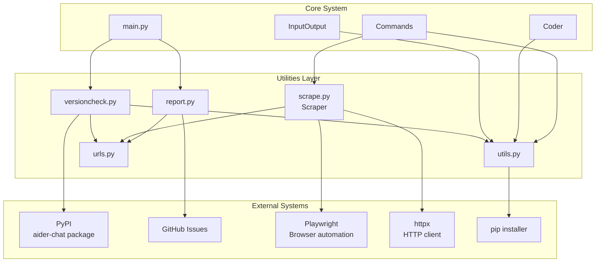
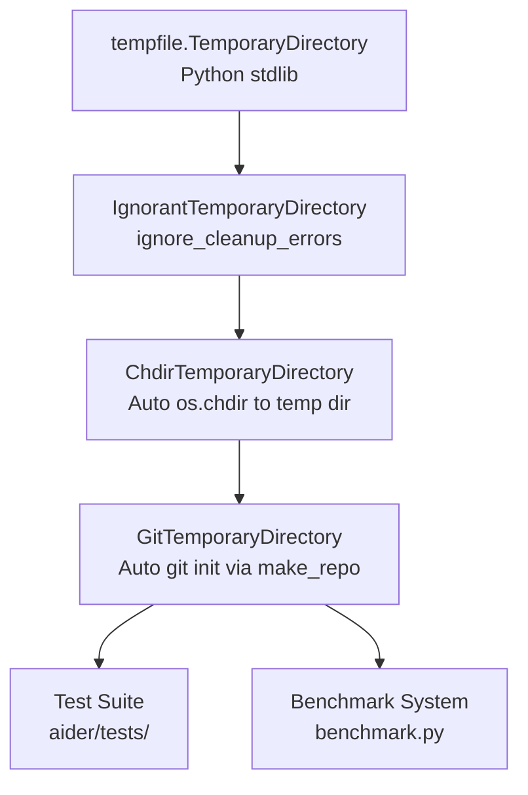

# Utilities and Supporting Systems

Relevant source files

The following files were used as context for generating this wiki page:

- [aider/dump.py](aider/dump.py)
- [aider/gui.py](aider/gui.py)
- [aider/report.py](aider/report.py)
- [aider/scrape.py](aider/scrape.py)
- [aider/urls.py](aider/urls.py)
- [aider/utils.py](aider/utils.py)
- [aider/versioncheck.py](aider/versioncheck.py)
- [scripts/update-docs.sh](scripts/update-docs.sh)

This document describes the utility functions and supporting infrastructure that underpin the Aider codebase. These utilities provide cross-cutting functionality including temporary directory management, path handling, web scraping, version checking, error reporting, and package installation.

For information about the help system and documentation utilities, see [Help and Documentation System](#11). For configuration-related utilities, see [Configuration System](#9.1).

## Overview

Aider's utility layer consists of several modules providing essential supporting functionality:

| Module | Purpose | Key Components |
|--------|---------|----------------|
| `aider/utils.py` | Core utility functions | `IgnorantTemporaryDirectory`, `safe_abs_path`, `format_messages`, `run_install` |
| `aider/scrape.py` | Web content scraping | `Scraper`, `install_playwright`, `html_to_markdown` |
| `aider/versioncheck.py` | Version management | `check_version`, `install_upgrade`, `VERSION_CHECK_FNAME` cache |
| `aider/report.py` | Error reporting | `exception_handler`, `report_github_issue`, system info collection |
| `aider/urls.py` | URL constants | Centralized documentation and repository links |
| `aider/dump.py` | Debugging | `dump()` function for variable inspection with stack traces |

These utilities are used throughout the codebase by the core orchestration layer, user interfaces, and command implementations.

Sources: [aider/utils.py:1-261](), [aider/scrape.py:1-122](), [aider/versioncheck.py:1-114](), [aider/report.py:1-161](), [aider/urls.py:1-18](), [aider/dump.py:1-30]()

## System Integration Architecture

**Utility System Integration**

This diagram shows how the utilities layer integrates with Aider's core systems and external services. The utilities provide shared functionality that is accessed by multiple core components.

Sources: [aider/utils.py:1-261](), [aider/scrape.py:79-209](), [aider/versioncheck.py:64-113](), [aider/report.py:37-93]()

## Core Utility Functions

The `aider/utils.py` module provides fundamental utilities used throughout the codebase. Key functionality includes temporary directory management, path operations, formatting helpers, and package installation.

For details, see [Core Utility Functions](#10.1).

### Temporary Directory Management

Aider provides specialized temporary directory context managers that handle platform-specific cleanup issues and common testing patterns:

**Temporary Directory Hierarchy**

Sources: [aider/utils.py:16-82]()

#### IgnorantTemporaryDirectory
The `IgnorantTemporaryDirectory` class [aider/utils.py:16-36]() wraps Python's `tempfile.TemporaryDirectory` to ignore cleanup errors (such as `OSError` or `PermissionError`) that frequently occur on Windows or during complex recursion [aider/utils.py:32-33]().

#### ChdirTemporaryDirectory
The `ChdirTemporaryDirectory` class [aider/utils.py:39-60]() extends the ignorant directory to automatically change the current working directory to the temporary path upon entry and restore the original `cwd` upon exit [aider/utils.py:50-56]().

#### GitTemporaryDirectory
The `GitTemporaryDirectory` class [aider/utils.py:62-71]() further extends the functionality by automatically initializing a Git repository in the temporary directory using `make_repo()` [aider/utils.py:73-82]().

### Path Handling and Formatting

Aider provides utilities like `safe_abs_path(res)` [aider/utils.py:96-102]() for reliable absolute path resolution that handles Windows 8.3 path issues. For chat processing, `format_messages()` [aider/utils.py:112-137]() converts complex message structures into displayable text, while `split_chat_history_markdown()` [aider/utils.py:148-196]() parses existing markdown logs back into structured chat history.

Sources: [aider/utils.py:96-102](), [aider/utils.py:112-196]()

## Error Reporting and Version Checking

Aider includes a robust system for maintaining software quality and keeping users up to date. 

For details, see [Error Reporting and Version Checking](#10.2).

### Exception Handler
The `report.py` module contains a global `exception_handler` [aider/report.py:94-155]() that intercepts uncaught exceptions. It sanitizes the stack trace by replacing full local paths with just the basenames [aider/report.py:113-124]() to protect user privacy and offers to open a pre-filled GitHub issue in the user's browser [aider/report.py:151]().

### Version Check System
The `versioncheck.py` module manages periodic checks against PyPI [aider/versioncheck.py:64-113](). It uses a local cache file `VERSION_CHECK_FNAME` (`~/.aider/caches/versioncheck`) [aider/versioncheck.py:12]() to ensure checks only happen once per day [aider/versioncheck.py:66-68]().

Sources: [aider/report.py:94-155](), [aider/versioncheck.py:12-113]()

## Package Installation Utilities

Aider supports just-in-time installation of optional dependencies to keep the base installation lightweight.

For details, see [Package Installation Utilities](#10.3).

### Just-in-Time Dependencies
Optional features like web scraping use `install_playwright(io)` [aider/scrape.py:40-76]() to check for requirements and prompt the user for installation if they are missing. It coordinates both the pip package and the browser binaries [aider/scrape.py:45-47]().

### Installation Helpers
The `run_install(cmd)` function [aider/utils.py:213-261]() handles the actual subprocess execution of `pip install`. It ensures `pip` is available via `ensurepip` [aider/utils.py:218-220]() and provides visual feedback using a `Spinner` [aider/utils.py:236]().

Sources: [aider/utils.py:213-261](), [aider/scrape.py:40-76]()

## GUI Utilities

The `aider/gui.py` module [aider/gui.py:1-148]() includes utility classes supporting the Streamlit-based web interface:

### CaptureIO Class
The `CaptureIO` class [aider/gui.py:17-36]() extends `InputOutput` to capture tool output for display in the GUI. It overrides `tool_output()`, `tool_error()`, and `tool_warning()` to store messages in a list [aider/gui.py:20-31]() that the Streamlit interface can later retrieve via `get_captured_lines()` [aider/gui.py:33-36]().

### State Management
The `State` class [aider/gui.py:52-62]() and `get_state()` resource [aider/gui.py:64-66]() provide persistent state management across Streamlit reruns. This allows the `Coder` instance, created via `get_coder()` [aider/gui.py:69-89](), to persist even when the browser refreshes.

Sources: [aider/gui.py:17-89]()