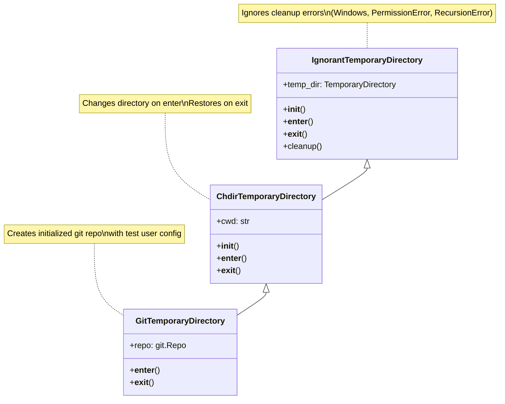
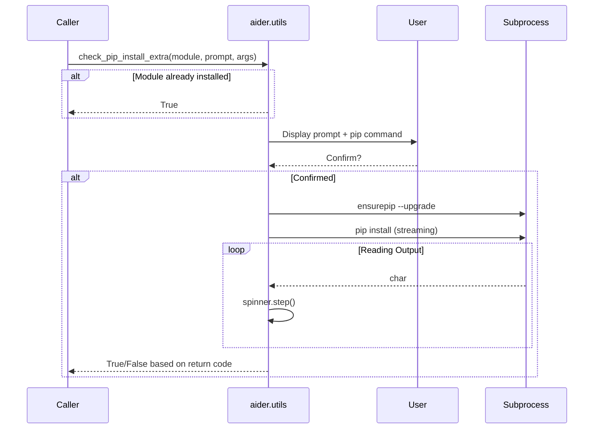
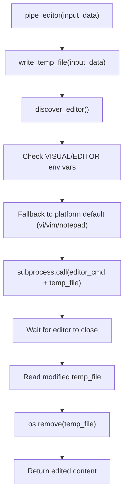

# Core Utility Functions

Relevant source files

The following files were used as context for generating this wiki page:

- [aider/dump.py](aider/dump.py)
- [aider/editor.py](aider/editor.py)
- [aider/gui.py](aider/gui.py)
- [aider/report.py](aider/report.py)
- [aider/scrape.py](aider/scrape.py)
- [aider/urls.py](aider/urls.py)
- [aider/utils.py](aider/utils.py)
- [aider/versioncheck.py](aider/versioncheck.py)
- [scripts/update-docs.sh](scripts/update-docs.sh)
- [tests/basic/test_editor.py](tests/basic/test_editor.py)

## Purpose and Scope

This document covers the core utility functions and helper classes that support Aider's core functionality. These utilities provide reusable operations for temporary directory management, Git repository operations, file system handling, package installation, message formatting, and common operations used throughout the codebase.

For information about error reporting and version checking, see [Error Reporting and Version Checking](#10.2). For configuration management, see [Configuration System](#9.1).

---

## Temporary Directory Management

Aider provides specialized temporary directory classes that handle cleanup gracefully across different platforms and Python versions, particularly addressing Windows cleanup issues.

### Directory Class Hierarchy

**Sources:** [aider/utils.py:16-71]()

### IgnorantTemporaryDirectory

The base temporary directory class that wraps Python's `tempfile.TemporaryDirectory` with robust error handling. It uses the `ignore_cleanup_errors` parameter on Python 3.10+ [aider/utils.py:18-19]() and manually handles cleanup failures on earlier versions.

| Feature | Description |
|---------|-------------|
| **Python 3.10+ behavior** | Uses built-in `ignore_cleanup_errors=True` [aider/utils.py:19]() |
| **Python <3.10 behavior** | Manually catches and ignores cleanup errors [aider/utils.py:21]() |
| **Error handling** | Swallows `OSError`, `PermissionError`, `RecursionError` [aider/utils.py:32-33]() |
| **Context manager** | Full support for `with` statements [aider/utils.py:23-27]() |

**Sources:** [aider/utils.py:16-37]()

### ChdirTemporaryDirectory

Extends `IgnorantTemporaryDirectory` to automatically change the working directory to the temporary directory on entry and restore the original directory on exit. It handles the edge case where the current working directory has been deleted [aider/utils.py:41-44](), storing `None` if `os.getcwd()` raises `FileNotFoundError`.

**Sources:** [aider/utils.py:39-60]()

### GitTemporaryDirectory

Extends `ChdirTemporaryDirectory` to create a fully initialized Git repository with test user configuration. This is primarily used in testing. The `make_repo()` helper function [aider/utils.py:73-82]() initializes a Git repository and configures `user.name` to "Test User" and `user.email` to "testuser@example.com".

**Sources:** [aider/utils.py:62-82]()

---

## File System Utilities

Aider provides several utilities for safe and cross-platform file system operations.

### Path Resolution

The `safe_abs_path()` function [aider/utils.py:96-102]() ensures paths are absolute and returns the full Windows path (not the 8.3 format). It attempts `Path(res).resolve()` and falls back to `Path(res).absolute()` if a `RuntimeError` or `OSError` occurs [aider/utils.py:98-101]().

### Image File Detection

The `is_image_file()` function [aider/utils.py:85-93]() checks if a file has an image extension based on the `IMAGE_EXTENSIONS` set [aider/utils.py:13](), which includes formats like `.png`, `.jpg`, `.webp`, and `.pdf`.

---

## Package Installation Utilities

Aider provides comprehensive utilities for managing package installations, particularly for optional dependencies like Playwright or voice support.

### Installation Flow

**Sources:** [aider/utils.py:199-257](), [aider/versioncheck.py:20-26]()

### run_install()

Executes the installation command [aider/utils.py:213-257](). It ensures `pip` is available via `ensurepip` [aider/utils.py:218-222]() and uses `subprocess.Popen` to stream output while displaying a `Spinner` [aider/utils.py:226-246]().

**Sources:** [aider/utils.py:213-257]()

---

## External Editor Integration

Aider allows users to edit content in their preferred system text editor through the `aider/editor.py` module.

### Editor Discovery and Usage

**Sources:** [aider/editor.py:70-147]()

### Key Editor Functions

- **`discover_editor(editor_override)`**: Determines the editor command. It checks environment variables `VISUAL` and `EDITOR` [aider/editor.py:85](). Defaults are `vi` (Nix), `vim` (Darwin), or `notepad` (Windows) [aider/editor.py:20-22, 99-105]().
- **`pipe_editor(input_data, suffix, editor)`**: The high-level function that creates a temporary file, launches the editor, and returns the result [aider/editor.py:115-147]().
- **`write_temp_file(input_data, suffix)`**: Uses `tempfile.mkstemp` to create a temporary file for editing [aider/editor.py:41-67]().

---

## Message Formatting and Chat Parsing

Aider provides utilities for formatting LLM conversation messages and parsing markdown-formatted chat history.

### format_messages()

Formats a list of message dictionaries into a human-readable string [aider/utils.py:112-137](). It handles:
- **Role headers**: Converts roles to uppercase (e.g., "USER", "ASSISTANT") [aider/utils.py:119]().
- **List content**: Iterates through items, specifically identifying image URLs [aider/utils.py:121-130]().
- **Function calls**: Appends function call details if present [aider/utils.py:133-135]().

### split_chat_history_markdown()

Parses a markdown string (often from a `.aider.chat.history.md` file) back into a list of message dictionaries [aider/utils.py:148-196]().
- **User messages**: Identified by lines starting with `#### ` [aider/utils.py:173]().
- **Assistant messages**: Standard text blocks following a user message [aider/utils.py:188-190]().
- **Tool messages**: Identified by lines starting with `> ` [aider/utils.py:163-169]().

**Sources:** [aider/utils.py:112-196]()

---

## Web Scraping Integration

Aider includes a `Scraper` class for converting web content to Markdown. It supports two backends: `playwright` (for JavaScript-heavy sites) and `httpx` (as a fallback).

| Method | Role |
|--------|------|
| `scrape(url)` | Main entry point; selects backend and converts HTML to Markdown [aider/scrape.py:98-122]() |
| `scrape_with_playwright(url)` | Uses Chromium to render pages and retrieve content [aider/scrape.py:143-192]() |
| `scrape_with_httpx(url)` | Fallback using standard HTTP requests [aider/scrape.py:194-209]() |
| `install_playwright(io)` | Helper to install the `aider-chat[playwright]` extra and Chromium [aider/scrape.py:40-76]() |

**Sources:** [aider/scrape.py:40-209]()

---

## Summary of Core Utilities

| Category | Key Entities | File |
|----------|--------------|------|
| **Temp Dirs** | `IgnorantTemporaryDirectory`, `GitTemporaryDirectory` | [aider/utils.py]() |
| **Paths** | `safe_abs_path` | [aider/utils.py]() |
| **Installers** | `run_install`, `get_pip_install` | [aider/utils.py]() |
| **Chat** | `format_messages`, `split_chat_history_markdown` | [aider/utils.py]() |
| **Editor** | `pipe_editor`, `discover_editor` | [aider/editor.py]() |
| **Scraping** | `Scraper`, `install_playwright` | [aider/scrape.py]() |

**Sources:** [aider/utils.py:1-257](), [aider/editor.py:1-148](), [aider/scrape.py:1-210]()