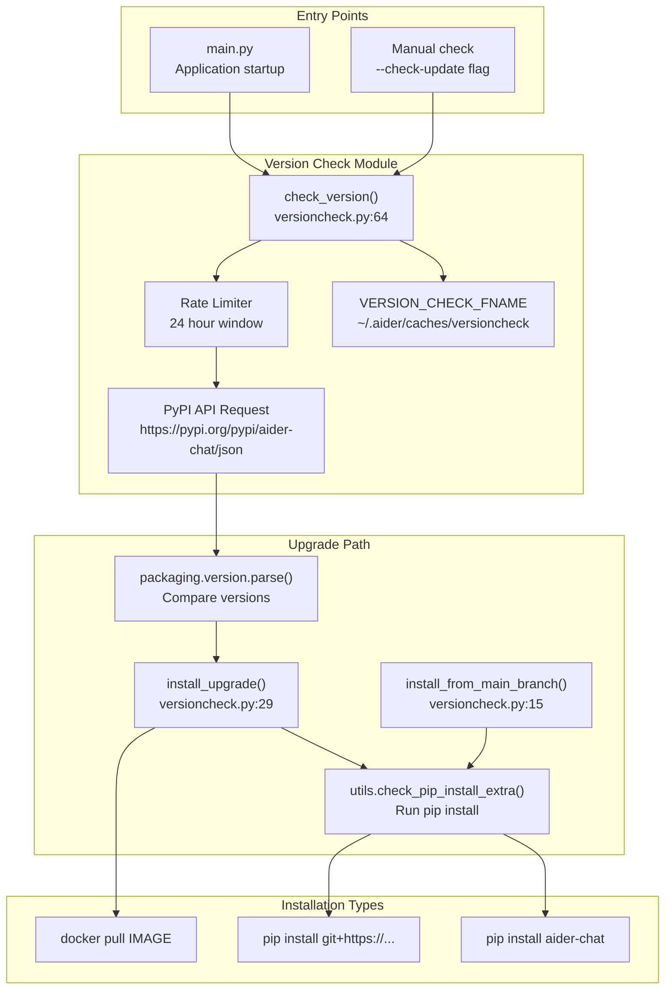
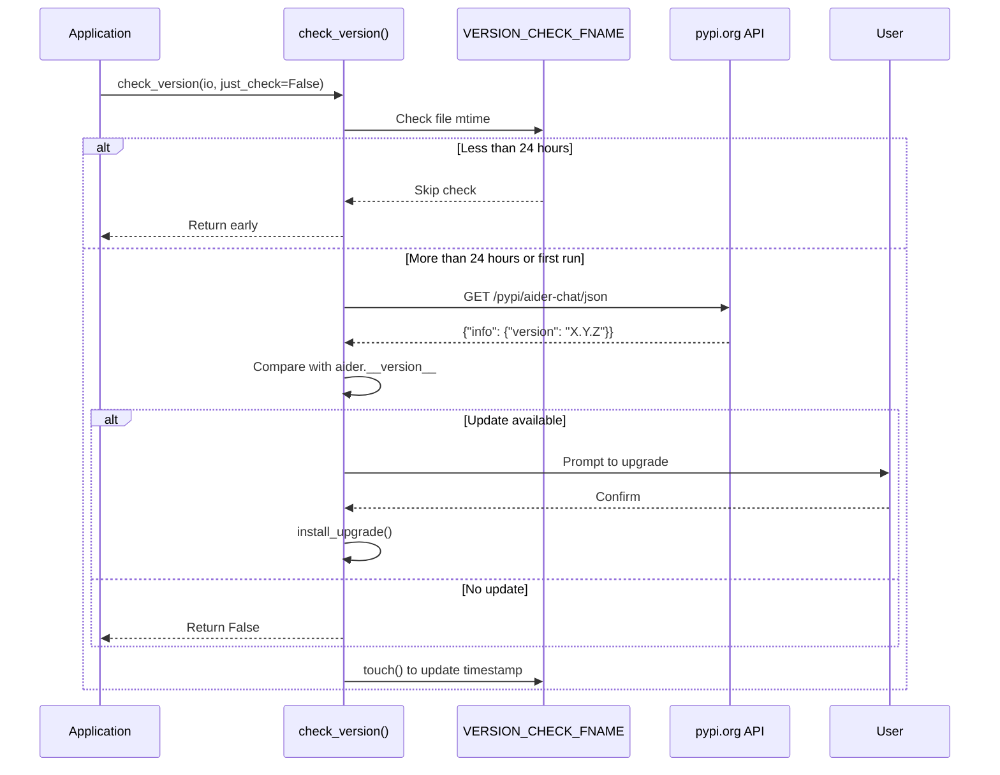
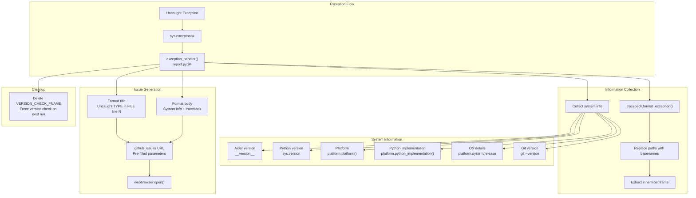
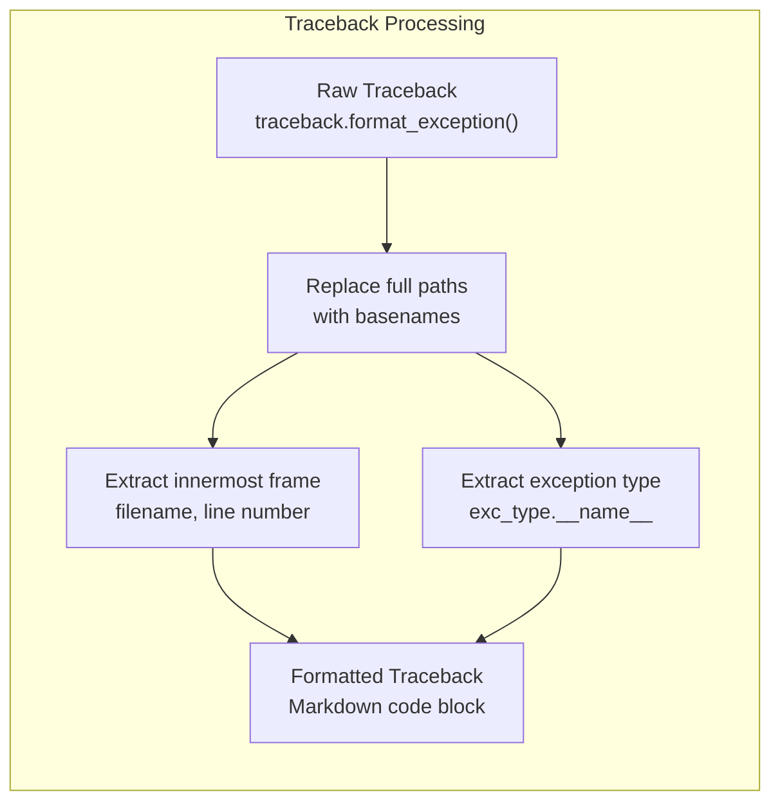
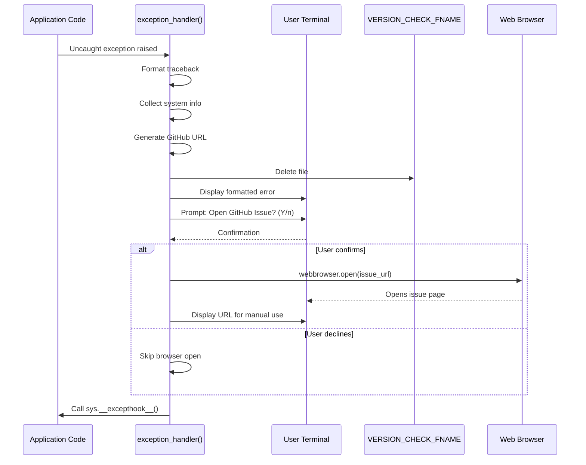

# Error Reporting and Version Checking

<details>
<summary>Relevant source files</summary>

The following files were used as context for generating this wiki page:

- [aider/exceptions.py](aider/exceptions.py)
- [aider/gui.py](aider/gui.py)
- [aider/report.py](aider/report.py)
- [aider/scrape.py](aider/scrape.py)
- [aider/urls.py](aider/urls.py)
- [aider/utils.py](aider/utils.py)
- [aider/versioncheck.py](aider/versioncheck.py)
- [aider/website/_includes/install.md](aider/website/_includes/install.md)
- [aider/website/docs/llms/bedrock.md](aider/website/docs/llms/bedrock.md)
- [aider/website/docs/llms/gemini.md](aider/website/docs/llms/gemini.md)
- [scripts/update-docs.sh](scripts/update-docs.sh)
- [tests/basic/test_exceptions.py](tests/basic/test_exceptions.py)

</details>


## Purpose and Scope

This document describes Aider's automated systems for checking for new versions on PyPI and reporting uncaught exceptions to GitHub. These systems ensure users are notified about updates and provide a streamlined mechanism for bug reporting with pre-filled system information.

For general utility functions used across the codebase, see page 10.1. For analytics and usage tracking, see page 12.1.

---

## Version Checking System

Aider automatically checks PyPI for new releases and prompts users to upgrade when a newer version is available. The system implements rate limiting to avoid excessive checks and supports both regular PyPI installations and Docker deployments.

### Version Check Components



**Version Check Decision Flow**

Sources: [aider/versioncheck.py:64-114](), [aider/versioncheck.py:12]()

### Rate Limiting Mechanism

The version check system uses a filesystem-based rate limiter to prevent excessive PyPI queries:

| Component | Value | Purpose |
|-----------|-------|---------|
| Cache File | `~/.aider/caches/versioncheck` | Timestamp marker for last check |
| Check Interval | 24 hours | Minimum time between checks |
| Touch Behavior | File timestamp updated on each check | Prevents multiple checks per day |
| Bypass | `just_check=True` parameter | Forces immediate check |

The rate limiter checks the modification time of `VERSION_CHECK_FNAME` and skips the check if less than 24 hours have elapsed since the last check.

Sources: [aider/versioncheck.py:12](), [aider/versioncheck.py:65-72]()

### PyPI Version Query



**PyPI Version Check Sequence**

Sources: [aider/versioncheck.py:64-114]()

The version check process:

1. Imports `requests` only when needed to keep startup fast [aider/versioncheck.py:75]().
2. Queries the PyPI JSON API for the latest version [aider/versioncheck.py:78]().
3. Compares using `packaging.version.parse()` for proper semantic versioning [aider/versioncheck.py:87-89]().
4. Updates the cache file timestamp regardless of success/failure [aider/versioncheck.py:94-95]().
5. Handles exceptions gracefully and reports errors via `io.tool_error()` [aider/versioncheck.py:90-92]().

Sources: [aider/versioncheck.py:74-96]()

### Installation Methods

Aider supports three upgrade paths, each handled differently:

#### PyPI Installation

The standard upgrade path uses `utils.check_pip_install_extra()` to:
- Prompt the user for confirmation.
- Build the pip command using `utils.get_pip_install()` [aider/utils.py:199-210]().
- Execute the installation via `utils.run_install()` which handles the subprocess and a `Spinner` [aider/utils.py:213-260]().
- Exit the application after successful upgrade to ensure the new version is used [aider/versioncheck.py:59]().

Sources: [aider/versioncheck.py:29-61](), [aider/utils.py:199-260]()

#### Docker Installation

When the `AIDER_DOCKER_IMAGE` environment variable is set, Aider detects it's running in a Docker container and provides Docker-specific upgrade instructions [aider/versioncheck.py:39-47]():

```python
docker_image = os.environ.get("AIDER_DOCKER_IMAGE")
if docker_image:
    text = f"""
{new_ver_text} To upgrade, run:

    docker pull {docker_image}
"""
```

Sources: [aider/versioncheck.py:39-47]()

#### Development Branch Installation

The `install_from_main_branch()` function installs directly from the GitHub repository using the `git+https` URL [aider/versioncheck.py:24]().

Sources: [aider/versioncheck.py:15-26]()

---

## Error Reporting System

Aider includes an automatic error reporting system that catches uncaught exceptions and generates pre-filled GitHub issue URLs with comprehensive system information.

### Exception Handler Architecture



**Exception Handler Data Flow**

Sources: [aider/report.py:94-155]()

### System Information Collection

The error reporter gathers comprehensive environment information to help diagnose issues:

| Information Type | Source | Example |
|-----------------|--------|---------|
| Aider version | `aider.__version__` | `0.86.3.dev` |
| Python version | `sys.version` | `3.11.0` |
| Platform | `platform.platform()` | `Linux-5.15.0-x86_64` |
| Python implementation | `platform.python_implementation()` | `CPython` |
| Virtual environment | `sys.prefix != sys.base_prefix` | `Yes` / `No` |
| OS details | `platform.system()`, `platform.release()` | `Linux 5.15.0 (64bit)` |
| Git version | `git --version` subprocess | `git version 2.39.0` |

Sources: [aider/report.py:16-35](), [aider/report.py:47-56]()

### Traceback Processing

The exception handler processes tracebacks to make them more readable while preserving essential information:



**Traceback Processing Pipeline**

The processing steps:

1. **Format Exception**: Uses `traceback.format_exception()` to get the full traceback [aider/report.py:110]().
2. **Path Simplification**: Replaces full file paths with basenames using `os.path.basename()` to avoid exposing user-specific paths [aider/report.py:112-124]().
3. **Frame Navigation**: Walks the traceback chain to find the innermost frame where the exception originated [aider/report.py:129-131]().
4. **Title Generation**: Creates a descriptive title using the exception type and location [aider/report.py:148]().

Sources: [aider/report.py:109-148]()

### GitHub Issue URL Generation

The system generates a GitHub issue URL with pre-filled query parameters using `urllib.parse.urlencode()` [aider/report.py:63]().

The URL structure:
- Base: `https://github.com/Aider-AI/aider/issues/new` (defined in `urls.py`) [aider/urls.py:11]().
- Query parameters:
  - `title`: Exception type and location.
  - `body`: System info + formatted traceback in markdown code block [aider/report.py:58-63]().

Sources: [aider/report.py:37-92](), [aider/urls.py:11]()

### User Interaction Flow



**Error Reporting User Interaction**

The user interaction includes:

1. **Error Display**: Full exception with system info printed to terminal [aider/report.py:66-67]().
2. **Confirmation Prompt**: "Open a GitHub Issue pre-filled with the above error in your browser? (Y/n)" [aider/report.py:70-71]().
3. **Browser Launch**: Attempts to open the default browser with the issue URL using `webbrowser.open()` [aider/report.py:79]().
4. **Fallback**: Prints the URL for manual copy-paste [aider/report.py:89]().

Sources: [aider/report.py:65-92]()

### Version Check Cache Deletion

When an uncaught exception occurs, the error handler deletes `VERSION_CHECK_FNAME` [aider/report.py:102-107](). This ensures that on the next run, Aider will immediately check for a new version rather than waiting for the 24-hour interval.

Sources: [aider/report.py:102-107](), [aider/versioncheck.py:12]()

---

## LLM Exception Handling

Aider uses a specialized system to categorize and manage exceptions from LLM providers (via `litellm`).

### LiteLLM Exception Classification

The `LiteLLMExceptions` class maps raw provider errors to `ExInfo` metadata, which dictates whether Aider should retry the request or provide specific troubleshooting advice to the user.

| Class/Entity | Purpose | Source |
| :--- | :--- | :--- |
| `ExInfo` | Dataclass holding exception `name`, `retry` flag, and `description`. | [aider/exceptions.py:7-10]() |
| `EXCEPTIONS` | A static list of known exception types and their retry behaviors. | [aider/exceptions.py:13-57]() |
| `LiteLLMExceptions` | Manager class that loads and retrieves info for `litellm` exceptions. | [aider/exceptions.py:60-114]() |

### Logic for Specific Errors

The `get_ex_info()` function performs deep inspection of exception instances to provide context-aware feedback [aider/exceptions.py:85-113]():

- **Insufficient Credits**: Detects `402` errors in `litellm.APIError` to advise the user to add credits [aider/exceptions.py:103-110]().
- **OpenRouter Issues**: Identifies connection failures or rate limits specific to the OpenRouter gateway [aider/exceptions.py:92-100]().
- **Dependency Missing**: Checks for missing `boto3` when using Amazon Bedrock [aider/exceptions.py:89-91]().

Sources: [aider/exceptions.py:85-114]()

---

## Implementation Details

### Constants and Configuration

| Constant | Value | Location | Purpose |
|----------|-------|----------|---------|
| `VERSION_CHECK_FNAME` | `~/.aider/caches/versioncheck` | [aider/versioncheck.py:12]() | Cache file for rate limiting |
| `github_issues` | `https://github.com/Aider-AI/aider/issues/new` | [aider/urls.py:11]() | Base URL for issue creation |
| `FENCE` | `` ``` `` | [aider/report.py:13]() | Markdown code fence delimiter |

### Version Comparison Logic

The version comparison uses `packaging.version.parse()` for proper semantic version ordering [aider/versioncheck.py:87-89]().

Sources: [aider/versioncheck.py:87-89]()