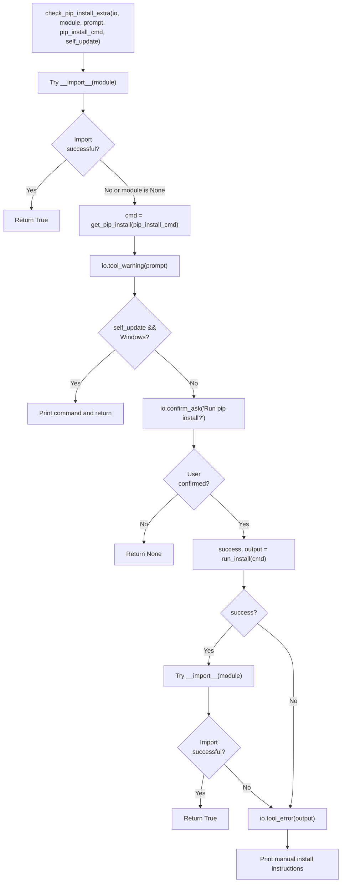
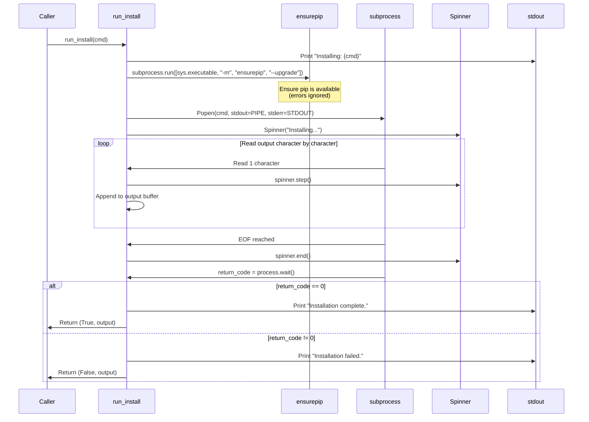
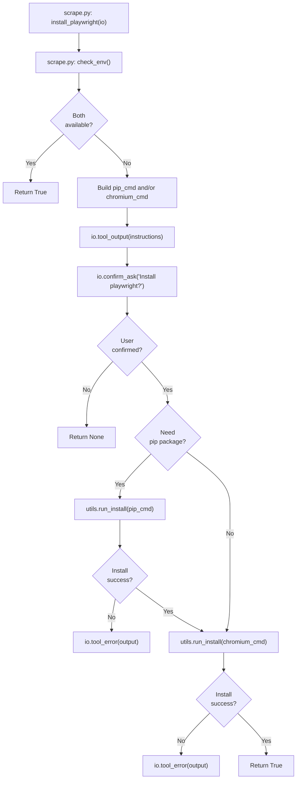
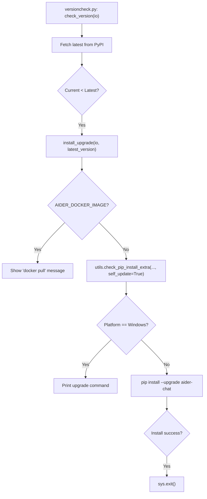

# Package Installation Utilities

Relevant source files

The following files were used as context for generating this wiki page:

- [.pre-commit-config.yaml](.pre-commit-config.yaml)
- [aider/gui.py](aider/gui.py)
- [aider/report.py](aider/report.py)
- [aider/scrape.py](aider/scrape.py)
- [aider/urls.py](aider/urls.py)
- [aider/utils.py](aider/utils.py)
- [aider/versioncheck.py](aider/versioncheck.py)
- [requirements.txt](requirements.txt)
- [requirements/common-constraints.txt](requirements/common-constraints.txt)
- [requirements/requirements-browser.txt](requirements/requirements-browser.txt)
- [requirements/requirements-dev.in](requirements/requirements-dev.in)
- [requirements/requirements-dev.txt](requirements/requirements-dev.txt)
- [requirements/requirements-help.in](requirements/requirements-help.in)
- [requirements/requirements-help.txt](requirements/requirements-help.txt)
- [requirements/requirements-playwright.txt](requirements/requirements-playwright.txt)
- [requirements/requirements.in](requirements/requirements.in)
- [scripts/pip-compile.sh](scripts/pip-compile.sh)
- [scripts/update-docs.sh](scripts/update-docs.sh)

## Purpose and Scope

This document describes the package installation utilities used throughout Aider to detect and install optional Python dependencies at runtime. These utilities provide a consistent, user-friendly interface for handling missing dependencies by prompting users to install them via `pip`, displaying progress with spinners, and gracefully handling installation failures.

Aider uses these utilities for just-in-time installation of optional features like Playwright for web scraping, voice-to-code dependencies, and self-updating the application.

**Sources:** [aider/utils.py:1-349]()

## Core Installation Functions

The package installation system is built around three primary functions in `aider/utils.py` that handle dependency checking, command construction, and installation execution.

### `check_pip_install_extra`

The main entry point function that checks if a Python module is available and optionally prompts the user to install it if missing.

Title: Flow of check_pip_install_extra

**Key behaviors:**
- **Early return**: If `module` is provided and already importable, returns `True` immediately [aider/utils.py:299-303]().
- **Self-update special case**: On Windows, self-update operations only display the command without executing it to avoid permission issues with replacing a running executable [aider/utils.py:311-315]().
- **Graceful failure**: On installation failure, displays the command for manual execution [aider/utils.py:334-336]().
- **Post-install verification**: After successful installation, re-attempts the import to verify availability [aider/utils.py:323-329]().

**Sources:** [aider/utils.py:298-336]()

### `get_pip_install`

Constructs a standardized `pip install` command with upgrade flags.

| Component | Value | Purpose |
|-----------|-------|---------|
| Executable | `sys.executable` | Uses the current Python interpreter [aider/utils.py:201]() |
| Module | `-m pip` | Ensures pip from current environment is used [aider/utils.py:202-203]() |
| Command | `install` | Install packages [aider/utils.py:204]() |
| Flag | `--upgrade` | Upgrade if already installed [aider/utils.py:205]() |
| Flag | `--upgrade-strategy only-if-needed` | Only upgrade dependencies if necessary [aider/utils.py:206-207]() |
| Arguments | `args` | Package specifications passed by caller [aider/utils.py:209]() |

**Sources:** [aider/utils.py:199-210]()

### `run_install`

Executes the pip install command with real-time progress feedback via a spinner and output capture.

Title: run_install Execution Sequence

**Key implementation details:**
- **Pre-flight check**: Runs `ensurepip --upgrade` to ensure pip is available before attempting installation [aider/utils.py:218-222]().
- **Character-by-character reading**: Reads stdout one character at a time to provide responsive spinner feedback [aider/utils.py:238-244]().
- **Merged streams**: Redirects stderr to stdout for unified output capture [aider/utils.py:229]().
- **Encoding handling**: Specifies `encoding=sys.stdout.encoding` with `errors="replace"` to handle non-UTF-8 output [aider/utils.py:233-234]().

**Sources:** [aider/utils.py:213-260]()

## Integration Points

The installation utilities are used by several high-level features to manage their specific requirements.

### Playwright Installation Flow

Playwright requires both the Python package and the Chromium browser binary. The `install_playwright` function in `aider/scrape.py` handles this two-stage process.

Title: install_playwright Logic

**Two-stage installation:**
1. **Python package**: `pip install aider-chat[playwright]` - installs the `playwright` Python library [aider/scrape.py:45]().
2. **Browser binary**: `python -m playwright install --with-deps chromium` - downloads the Chromium browser [aider/scrape.py:46-47]().

**Sources:** [aider/scrape.py:40-76]()

### Self-Update Installation Flow

The version checking system in `aider/versioncheck.py` uses `check_pip_install_extra` to upgrade Aider from PyPI or GitHub.

Title: Aider Self-Update Process

**Special handling:**
- **Docker**: Detects `AIDER_DOCKER_IMAGE` and instructs user to run `docker pull` [aider/versioncheck.py:39-47]().
- **Windows**: Only prints the command for self-updates as Windows file locking prevents live replacement [aider/utils.py:311-315]().
- **Exit after upgrade**: Calls `sys.exit()` after successful PyPI upgrade to ensure the new version is loaded on next run [aider/versioncheck.py:57-59]().

**Sources:** [aider/versioncheck.py:15-61](), [aider/utils.py:298-336]()

## Requirements and Dependency Files

Aider manages dependencies through several requirement files, which are used as inputs for the installation utilities.

| File | Purpose |
|------|---------|
| `requirements.txt` | Main production dependencies (autogenerated via `uv`) [requirements.txt:1-10]() |
| `requirements/requirements.in` | Source for production dependencies [requirements/requirements.in:1-51]() |
| `requirements/requirements-help.txt` | Dependencies for the RAG-based help system [requirements/requirements-help.txt:1-151]() |
| `requirements/requirements-browser.txt` | Dependencies for the Streamlit GUI [requirements/requirements-browser.txt:1-156]() |
| `requirements/common-constraints.txt` | Version constraints shared across all components [requirements/common-constraints.txt:1-302]() |

**Sources:** [requirements.txt:1-10](), [requirements/requirements.in:1-51](), [requirements/requirements-help.txt:1-151](), [requirements/common-constraints.txt:1-302]()

## Error Handling and Recovery

The installation utilities implement robust error handling to ensure graceful degradation.

### Platform-Specific Escaping
The `printable_shell_command` function uses `oslex` to ensure that commands displayed to the user are properly escaped for their specific shell (e.g., handling spaces or special characters differently on Windows vs. Linux).

**Sources:** [aider/utils.py:338-348]()

### Exception Sanitization
The `report.py` module includes an `exception_handler` that cleans up file paths in tracebacks before offering to report them to GitHub [aider/report.py:94-155](). It also ensures that the version check cache (`VERSION_CHECK_FNAME`) is cleared if an uncaught exception occurs, forcing a fresh check on next startup [aider/report.py:102-108]().

**Sources:** [aider/report.py:94-155](), [aider/report.py:102-108](), [aider/versioncheck.py:12]()