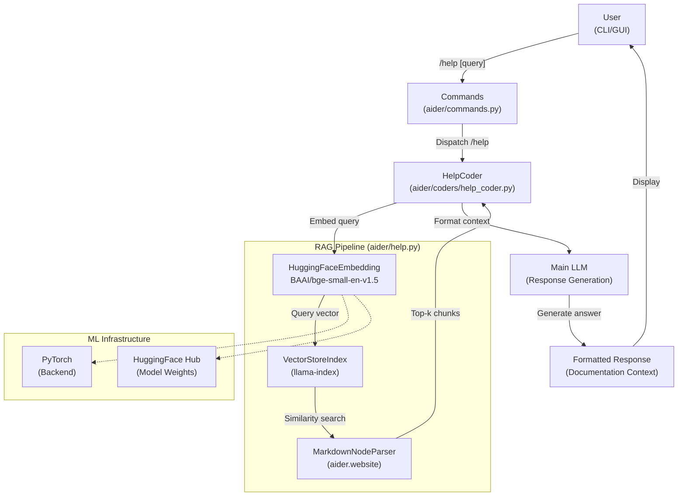
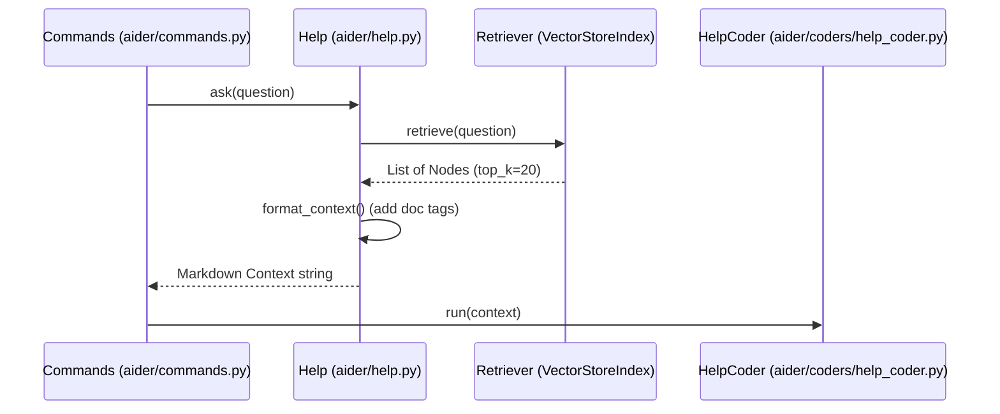

# Help and Documentation System

Relevant source files

The following files were used as context for generating this wiki page:

- [aider/help.py](aider/help.py)
- [scripts/issues.py](scripts/issues.py)
- [tests/basic/test_coder.py](tests/basic/test_coder.py)
- [tests/basic/test_commands.py](tests/basic/test_commands.py)
- [tests/basic/test_sanity_check_repo.py](tests/basic/test_sanity_check_repo.py)
- [tests/help/test_help.py](tests/help/test_help.py)

## Purpose and Scope

This document covers Aider's AI-powered help and documentation retrieval system, which uses embeddings and Retrieval-Augmented Generation (RAG) to provide contextual answers to user questions about Aider's functionality. The system enables users to ask questions via the `/help` command and receive answers derived from Aider's documentation corpus.

For information about the Commands dispatcher that handles the `/help` command, see [Commands and User Interactions](#2.3). For information about general LLM interactions, see [Model Management and LLM Integration](#2.4). For details on other specialized coder implementations, see [Edit Format Implementations](#3.1).

---

## System Architecture Overview

The Help and Documentation System integrates machine learning embeddings with a RAG framework to provide semantic search over Aider's documentation. When a user asks a question through the `/help` command, the system:

1.  Embeds the user's query using HuggingFace sentence transformers.
2.  Retrieves relevant documentation chunks using vector similarity search via `llama-index` [aider/help.py:133-143]().
3.  Formats the retrieved context for presentation or LLM processing [aider/help.py:145-163]().
4.  Returns answers directly or passes context to a specialized coder for synthesis.

### Help System Component Architecture

**Sources:** [aider/help.py:133-163](), [aider/help.py:139]()

---

## Help System Architecture

The Help System is built on `llama-index` integration and local embedding models to ensure efficient retrieval without constant API calls for embedding generation. For details, see [Help System Architecture](#11.1).

### llama-index Integration
The system uses `llama-index` core components to manage the retrieval pipeline. It utilizes a `MarkdownNodeParser` [aider/help.py:91]() to split the Aider website documentation (retrieved from `aider.website` via `importlib_resources` [aider/help.py:34-40]()) into semantic nodes [aider/help.py:108-124]().

### HuggingFace Embeddings (bge-small-en-v1.5)
User queries and documentation chunks are embedded using the `BAAI/bge-small-en-v1.5` model [aider/help.py:139](). This model provides 384-dimensional vectors and is optimized for CPU-based inference. Parallelism is enabled via the `TOKENIZERS_PARALLELISM` environment variable [aider/help.py:138]().

### Local Cache and Persistence
The system persists the vector index locally in a version-specific cache directory located at `~/.aider/caches/help.[version]` [aider/help.py:93](). If the cache is corrupt or missing, the system automatically rebuilds it by parsing the package files [aider/help.py:102-128]().

---

## HelpCoder and Context Assembly

The `/help` command is processed by a specialized workflow that gathers documentation context before generating a response. For details, see [HelpCoder and Context Assembly](#11.2).

### HelpCoder and /help Command
When the user issues a `/help` command, the `Commands` dispatcher invokes the help system [tests/help/test_help.py:64](). The `Help` class [aider/help.py:133]() handles the retrieval of the top-20 most relevant documentation fragments using a similarity retriever [aider/help.py:143]().

### Context Assembly Process
The system assembles context by wrapping retrieved nodes in `<doc>` tags, including the source URL as metadata [aider/help.py:154-161](). URLs are derived from file paths via the `fname_to_url` utility [aider/help.py:42-81](), which maps local website source files to their hosted counterparts on `https://aider.chat/`.

### Help Context Assembly Sequence

**Sources:** [aider/help.py:143-163](), [tests/help/test_help.py:51-75]()

---

## Dependencies and Installation

The help system requires the `[help]` extra, which includes dependencies like `llama-index` and `huggingface` embedding providers.

### Graceful Installation
If a user attempts to use `/help` without the necessary dependencies, Aider provides an interactive prompt to install them via `install_help_extra` [aider/help.py:18-30](). This function uses `utils.check_pip_install_extra` [aider/help.py:24]() to trigger the installation of `aider-chat[help]` and the CPU-specific PyTorch wheels [aider/help.py:19-23]().

| Component | Code Reference | Purpose |
|------------|---------|---------|
| `Help` Class | [aider/help.py:133]() | Main interface for RAG operations |
| `get_index` | [aider/help.py:84]() | Manages index persistence and creation |
| `fname_to_url` | [aider/help.py:42]() | Maps source docs to aider.chat URLs |
| `install_help_extra`| [aider/help.py:18]() | JIT installation of help dependencies |

**Sources:** [aider/help.py:18-30](), [aider/help.py:133-143]()