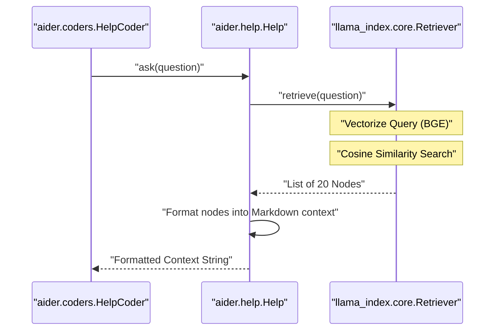

# Help System Architecture

<details>
<summary>Relevant source files</summary>

The following files were used as context for generating this wiki page:

- [.pre-commit-config.yaml](.pre-commit-config.yaml)
- [aider/help.py](aider/help.py)
- [requirements.txt](requirements.txt)
- [requirements/common-constraints.txt](requirements/common-constraints.txt)
- [requirements/requirements-browser.txt](requirements/requirements-browser.txt)
- [requirements/requirements-dev.in](requirements/requirements-dev.in)
- [requirements/requirements-dev.txt](requirements/requirements-dev.txt)
- [requirements/requirements-help.in](requirements/requirements-help.in)
- [requirements/requirements-help.txt](requirements/requirements-help.txt)
- [requirements/requirements-playwright.txt](requirements/requirements-playwright.txt)
- [requirements/requirements.in](requirements/requirements.in)
- [scripts/issues.py](scripts/issues.py)
- [scripts/pip-compile.sh](scripts/pip-compile.sh)
- [tests/basic/test_coder.py](tests/basic/test_coder.py)
- [tests/basic/test_commands.py](tests/basic/test_commands.py)
- [tests/basic/test_sanity_check_repo.py](tests/basic/test_sanity_check_repo.py)
- [tests/help/test_help.py](tests/help/test_help.py)

</details>


## Purpose and Scope

This document describes the architecture of Aider's AI-powered help system, which uses embeddings and Retrieval Augmented Generation (RAG) to provide contextual documentation assistance. The system indexes Aider's documentation and retrieves relevant sections in response to user queries, enabling natural language help searches via the `/help` command.

The system is built on `llama-index` and utilizes local HuggingFace embeddings to ensure privacy and offline capability for the retrieval phase.

## System Overview

The help system implements a RAG pipeline that:

1.  Indexes Aider's documentation using `BAAI/bge-small-en-v1.5` embeddings [aider/help.py:139-139]().
2.  Persists the index in a local cache directory specific to the Aider version: `~/.aider/caches/help.vX` [aider/help.py:93-93]().
3.  Retrieves the top 20 relevant documentation fragments for a given query [aider/help.py:143-143]().
4.  Injects these fragments into a specialized `HelpCoder` context to generate a natural language response [aider/help.py:145-163]().

## Core Architecture

The help system is encapsulated in the `Help` class [aider/help.py:133-164]() and relies on `llama-index-core` for the vector store and retrieval logic.

### Component Overview

```mermaid
graph TB
    subgraph "User Interface"
        Commands["aider.commands.Commands<br/>cmd_help()"]
        HelpCoder["aider.coders.HelpCoder<br/>LLM Response Generation"]
    end
    
    subgraph "Retrieval Pipeline (aider.help.Help)"
        Retriever["VectorStoreIndex.as_retriever<br/>similarity_top_k=20"]
        EmbedModel["HuggingFaceEmbedding<br/>bge-small-en-v1.5"]
    end
    
    subgraph "Storage & Cache"
        CacheDir["~/.aider/caches/help.vX/"]
        StorageContext["StorageContext<br/>Vector & Doc Store"]
    end
    
    subgraph "Data Ingestion"
        WebsiteDocs["aider.website/*.md<br/>Markdown Source"]
        MDParser["MarkdownNodeParser<br/>Chunking Logic"]
    end
    
    Commands -->|Query| HelpCoder
    HelpCoder -->|ask()| Retriever
    Retriever -->|Retrieves| StorageContext
    StorageContext -.->|Persists to| CacheDir
    WebsiteDocs -->|Read| MDParser
    MDParser -->|Nodes| StorageContext
    EmbedModel -->|Vectorize| Retriever
```

**Sources:** [aider/help.py:84-164](), [requirements/requirements-help.txt:151-158]()

## Embedding Model Configuration

Aider uses the `BAAI/bge-small-en-v1.5` model via `llama-index-embeddings-huggingface`. This model is chosen for its high performance in semantic retrieval tasks while remaining small enough for local execution.

| Property | Value | Source |
| :--- | :--- | :--- |
| Model Name | `BAAI/bge-small-en-v1.5` | [aider/help.py:139-139]() |
| Integration | `llama-index-embeddings-huggingface` | [aider/help.py:136-136]() |
| Parallelism | `TOKENIZERS_PARALLELISM=true` | [aider/help.py:138-138]() |
| Requirements | `torch`, `numpy`, `llama-index` | [requirements/requirements-help.in:1-8]() |

**Sources:** [aider/help.py:133-140](), [requirements/requirements-help.in:1-14]()

## Indexing and Retrieval Pipeline

The indexing process transforms raw Markdown files from the Aider website into a searchable vector index.

### 1. Document Loading and Parsing
The system iterates through all `.md` files in the `aider.website` package using `importlib_resources` [aider/help.py:33-40](). It excludes specific patterns defined in `exclude_website_pats` [aider/help.pats:1-13](), [aider/help.py:111-112]().
- **Parser**: `MarkdownNodeParser` from `llama-index` is used to chunk the documents semantically [aider/help.py:91-91](), [aider/help.py:106-106]().
- **Metadata**: Each document is tagged with its filename, extension, and a generated URL [aider/help.py:118-122]().

### 2. URL Mapping
The `fname_to_url` function converts local file paths within the package into public `https://aider.chat/` URLs [aider/help.py:42-81](). This allows the AI to provide direct links to the web documentation in its help responses.

### 3. Local Caching
The index is stored in the user's home directory to avoid re-indexing on every session.
- **Path**: `~/.aider/caches/help.{aider_version}` [aider/help.py:93-93]().
- **Persistence**: Uses `StorageContext.persist()` [aider/help.py:128-128]().
- **Validation**: If the cache directory is corrupted or invalid (e.g., `JSONDecodeError`), it is deleted and rebuilt [aider/help.py:102-103]().

### Retrieval Flow



**Sources:** [aider/help.py:84-164]()

## Integration with HelpCoder

The `HelpCoder` uses the output of `Help.ask()` to answer user questions. The retrieved context is structured with custom XML-like tags to help the LLM identify the source URLs of the information.

### Context Formatting
The `Help.ask` method wraps each retrieved documentation fragment in `<doc from_url="...">` tags [aider/help.py:154-161]().

```markdown
# Question: how do I use the repo map?

# Relevant docs:

<doc from_url="https://aider.chat/docs/repomap.html">
The repo map is a concise representation of your codebase...
</doc>
```

**Sources:** [aider/help.py:145-163]()

## Installation and Dependencies

The help system requires additional dependencies not included in the core Aider install to keep the base package lightweight.

- **Help Extras**: Users can install these via `pip install aider-chat[help]` [aider/help.py:20-20]().
- **JIT Installation**: The `install_help_extra` function handles the just-in-time installation of `llama-index-embeddings-huggingface` and CPU-optimized `torch` [aider/help.py:18-30]().
- **CPU Optimization**: The installer specifically targets the CPU version of PyTorch to avoid massive GPU-related downloads [aider/help.py:22-22]().

**Sources:** [aider/help.py:18-31](), [requirements/requirements-help.txt:1-20]()

## Performance and Caching

| Feature | Implementation | Source |
| :--- | :--- | :--- |
| **Indexing** | Performed once per Aider version update. | [aider/help.py:93-93]() |
| **Search Latency** | Optimized via `similarity_top_k=20`. | [aider/help.py:143-143]() |
| **Storage** | Local disk via `StorageContext`. | [aider/help.py:98-101]() |
| **Threading** | `TOKENIZERS_PARALLELISM` enabled for faster embedding. | [aider/help.py:138-138]() |

**Sources:** [aider/help.py:93-143]()