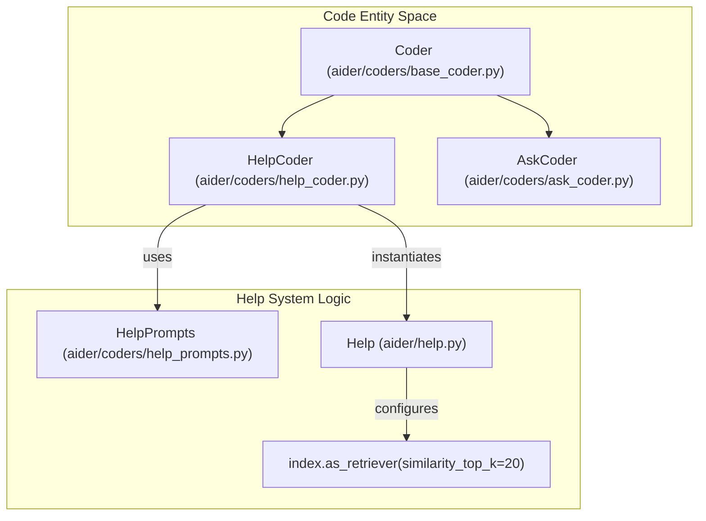
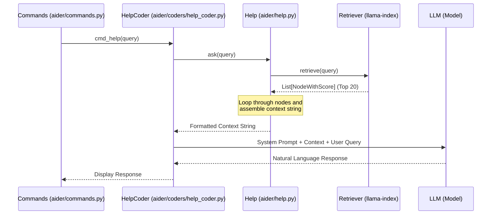
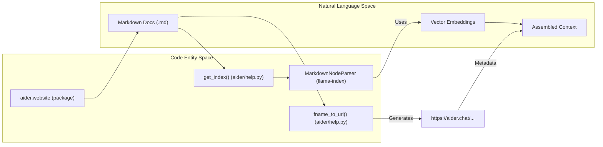

# HelpCoder and Context Assembly

Relevant source files

The following files were used as context for generating this wiki page:

- [aider/coders/ask_coder.py](aider/coders/ask_coder.py)
- [aider/coders/editblock_fenced_coder.py](aider/coders/editblock_fenced_coder.py)
- [aider/coders/help_coder.py](aider/coders/help_coder.py)
- [aider/coders/patch_coder.py](aider/coders/patch_coder.py)
- [aider/coders/search_replace.py](aider/coders/search_replace.py)
- [aider/coders/udiff_coder.py](aider/coders/udiff_coder.py)
- [aider/help.py](aider/help.py)
- [scripts/issues.py](scripts/issues.py)
- [tests/basic/test_coder.py](tests/basic/test_coder.py)
- [tests/basic/test_commands.py](tests/basic/test_commands.py)
- [tests/basic/test_sanity_check_repo.py](tests/basic/test_sanity_check_repo.py)
- [tests/help/test_help.py](tests/help/test_help.py)

This page documents the `HelpCoder` class and how it processes help queries via the `/help` command. It explains the retrieval-augmented generation (RAG) pipeline that assembles documentation context from the top-20 retrieved fragments and uses the specialized `help_prompts` system to provide natural language assistance about Aider itself.

## HelpCoder Class Overview

`HelpCoder` is a specialized implementation of the `Coder` base class [aider/coders/help_coder.py:6](). Unlike coders designed for code modification (like `EditBlockCoder` or `UnifiedDiffCoder`), `HelpCoder` is designed for interaction with Aider's internal documentation.

Title: HelpCoder Hierarchy and Components

**Key Implementation Details:**
- **Edit Format**: It uses the `help` edit format [aider/coders/help_coder.py:9]().
- **No-op Edits**: Both `get_edits()` and `apply_edits()` are implemented as empty or no-op methods because `HelpCoder` never modifies source files [aider/coders/help_coder.py:12-16]().
- **Prompts**: It uses `HelpPrompts` to define the system instructions for the LLM [aider/coders/help_coder.py:10]().

Sources: [aider/coders/help_coder.py:1-17](), [aider/help.py:133-143]()

## Context Assembly Pipeline

When a user issues a `/help <query>` command, the system transitions from the main `Coder` to a `HelpCoder` instance. The core of the assembly happens in the `Help` class within `aider/help.py`.

### Retrieval and Fragment Injection

The `Help.ask(question)` method is the primary entry point for context assembly. It retrieves the top-20 most relevant documentation nodes and wraps them in a specific XML-like format for the LLM [aider/help.py:145-163]().

Title: Help Query Sequence

**The Context Assembly Logic:**
1. **Top-K Retrieval**: The retriever is configured to fetch the top 20 fragments (`similarity_top_k=20`) [aider/help.py:143]().
2. **Metadata Injection**: For each fragment (node), the system extracts the `url` from metadata [aider/help.py:155-157]().
3. **XML Fencing**: Fragments are wrapped in `<doc from_url="..."> ... </doc>` tags [aider/help.py:159-161]().
4. **Header Construction**: The assembled string starts with `# Question: {question}` followed by `# Relevant docs:` [aider/help.py:148-152]().

Sources: [aider/help.py:143-163](), [aider/coders/help_coder.py:6-11]()

## Integration with the Commands System

The `/help` command is handled by the `Commands` class. It triggers a `SwitchCoder` exception to swap the active coder to `HelpCoder` [aider/commands.py:15]().

| Step | Entity | Action |
|:---|:---|:---|
| 1 | `Commands.cmd_help` | Receives the user's question as a string [tests/help/test_help.py:64](). |
| 2 | `Help` Class | Uses `HuggingFaceEmbedding` with `BAAI/bge-small-en-v1.5` to vectorize the query [aider/help.py:136-139](). |
| 3 | `llama-index` | Performs vector search against the local cache located at `~/.aider/caches/help.vX` [aider/help.py:93-101](). |
| 4 | `HelpCoder` | Receives the assembled context and sends it to the LLM [aider/coders/help_coder.py:6-11](). |

Sources: [aider/help.py:93-101](), [aider/help.py:136-143](), [tests/help/test_help.py:51-74]()

## Help System Prompts

The `HelpPrompts` class (referenced in `HelpCoder`) provides the behavioral guardrails for the AI when acting as a help assistant [aider/coders/help_coder.py:10](). Its role is to:
- Instruct the LLM to use *only* the provided documentation fragments to answer.
- Maintain the persona of an Aider expert.
- Format responses using Markdown for clarity in the terminal.

Sources: [aider/coders/help_coder.py:10](), [aider/coders/base_coder.py:10]()

## Data Flow: From URL to Context

The system maps local markdown files from the `aider.website` package to public URLs to provide better attribution in help responses.

Title: Document to Context Data Flow

**URL Mapping Logic (`fname_to_url`):**
- **Root Conversion**: Paths containing `website` are truncated to the relative path after `website` [aider/help.py:57-63]().
- **Extension Handling**: `index.md` becomes the directory root; other `.md` files become `.html` [aider/help.py:73-76]().
- **Exclusions**: Files in `_includes` are ignored [aider/help.py:66-67]().

Sources: [aider/help.py:42-81](), [aider/help.py:109-124]()

## Summary of Differences

| Feature | `HelpCoder` | `AskCoder` | `EditBlockCoder` |
|:---|:---|:---|:---|
| **Primary Goal** | Explain Aider usage | Explain repository code | Modify repository code |
| **Context Source** | `aider.website` docs | Tracked files + Repo Map | Tracked files + Repo Map |
| **Edit Format** | `help` [aider/coders/help_coder.py:9]() | `ask` [aider/coders/ask_coder.py:8]() | `diff-fenced` [aider/coders/editblock_fenced_coder.py:9]() |
| **Persistence** | Stateless help session | Chat history | Chat history + Git commits |
| **Search Method** | Vector RAG (Top 20) | Repo Map (PageRank) | Repo Map (PageRank) |

Sources: [aider/coders/help_coder.py:6-17](), [aider/coders/ask_coder.py:5-9](), [aider/help.py:143-163](), [aider/coders/editblock_fenced_coder.py:6-11]()