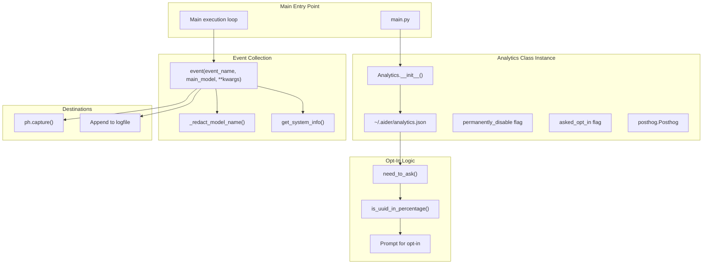
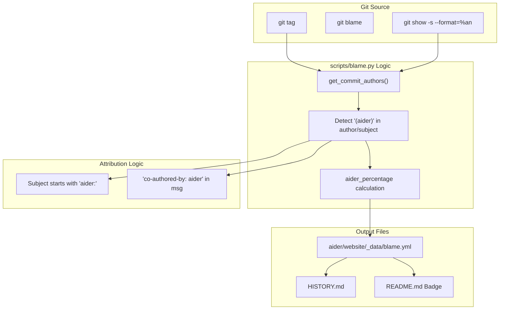

# Analytics and Self-Improvement

Relevant source files

The following files were used as context for generating this wiki page:

- [HISTORY.md](HISTORY.md)
- [aider/analytics.py](aider/analytics.py)
- [aider/website/HISTORY.md](aider/website/HISTORY.md)
- [aider/website/_data/blame.yml](aider/website/_data/blame.yml)
- [aider/website/docs/more/analytics.md](aider/website/docs/more/analytics.md)
- [scripts/update-blame.sh](scripts/update-blame.sh)
- [tests/basic/test_analytics.py](tests/basic/test_analytics.py)

This document describes how Aider tracks usage patterns through an opt-in analytics system and measures its ability to write its own code. For information about configuring analytics settings, see [Configuration System](#9.1). For information about version management and releases, see [Build and Version Management](#9.3).

## Purpose and Scope

Aider implements two complementary systems for understanding and improving its performance:

1. **Usage Analytics**: Optional telemetry collection to understand how users interact with Aider, which models they use, and what errors they encounter. For details, see [Usage Analytics](#12.1).
2. **Self-Referential Development Metrics**: Git-based analysis tracking the percentage of Aider's codebase written by Aider itself, known as the "Singularity" metric. For details, see [Self-Referential Development Metrics](#12.2).

Both systems prioritize privacy while providing actionable insights for development.

---

## Usage Analytics

The analytics system is implemented in the `Analytics` class located in `aider/analytics.py` [aider/analytics.py:60-79](). It provides opt-in telemetry collection with strong privacy guarantees, tracking usage patterns, model selection, and error types.

### Core Components and Class Structure

**Analytics Class Architecture and Data Flow**

The `Analytics` class maintains state in `~/.aider/analytics.json` [aider/analytics.py:137-141]() with three key fields: `uuid`, `permanently_disable`, and `asked_opt_in` [aider/analytics.py:174-179](). The percentage-based sampling uses the first 6 hex digits of the UUID to determine eligibility; by default, Aider enables analytics for a random 10% subset of users [aider/analytics.py:15-18](), [aider/analytics.py:46-52]().

### Event Collection and Privacy
Events are collected via the `event()` method [aider/analytics.py:213](). To protect privacy, Aider:
- Redacts unknown model names to `provider/REDACTED` by checking against `model_info_manager` [aider/analytics.py:195-204]().
- Only collects platform metadata like `python_version` and `os_platform` [aider/analytics.py:186-193]().
- Never collects code, chat messages, or API keys [aider/website/docs/more/analytics.md:14-16]().

Aider uses PostHog for analytics collection [aider/analytics.py:9-10](), [aider/website/docs/more/analytics.md:110](). Users can configure custom PostHog hosts and project keys via CLI flags [aider/analytics.py:82-83](), [aider/website/docs/more/analytics.md:112-113]().

For detailed event types, PostHog integration details, and the sample-analytics.jsonl format, see [Usage Analytics](#12.1).

**Sources:** [aider/analytics.py:1-236](), [aider/website/docs/more/analytics.md:1-128](), [tests/basic/test_analytics.py:1-137]()

---

## Self-Referential Development Metrics

Aider tracks what percentage of its own code is written by Aider itself, published as the "Singularity" metric in release notes [HISTORY.md:20](), [HISTORY.md:29](). This is computed by analyzing git blame data across releases.

### Git Blame Analysis Pipeline

The metric is computed using a pipeline that includes `scripts/update-blame.sh` [scripts/update-blame.sh:1-9]() and the `blame.py` script, which identifies commits where Aider was the author.

**Blame Analysis Pipeline: From Git History to Published Metrics**

### The "Singularity" Metric
Aider is considered the author of a line if the git commit history attributes the change to "Paul Gauthier (aider)" or similar identifiers [aider/website/_data/blame.yml:8](). These statistics are aggregated per release, with recent releases often showing Aider writing 60-80% of the new code [HISTORY.md:43](), [HISTORY.md:99](). In version 0.86.0, Aider wrote 88% of the code [HISTORY.md:29]().

The results are stored in `aider/website/_data/blame.yml` [aider/website/_data/blame.yml:1-32](), which includes per-file counts of lines attributed to human authors versus Aider [aider/website/_data/blame.yml:6-26]().

For details on the `blame.py` pipeline, `blame.yml` data format, and per-release attribution statistics, see [Self-Referential Development Metrics](#12.2).

**Sources:** [scripts/update-blame.sh:1-9](), [aider/website/_data/blame.yml:1-93](), [HISTORY.md:1-122](), [aider/website/HISTORY.md:1-110]()