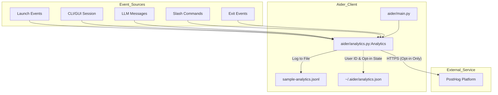
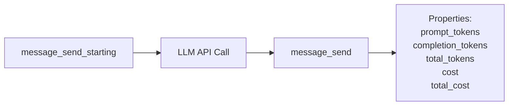

# Usage Analytics

<details>
<summary>Relevant source files</summary>

The following files were used as context for generating this wiki page:

- [README.md](README.md)
- [aider/analytics.py](aider/analytics.py)
- [aider/website/assets/sample-analytics.jsonl](aider/website/assets/sample-analytics.jsonl)
- [aider/website/docs/config/adv-model-settings.md](aider/website/docs/config/adv-model-settings.md)
- [aider/website/docs/config/model-aliases.md](aider/website/docs/config/model-aliases.md)
- [aider/website/docs/faq.md](aider/website/docs/faq.md)
- [aider/website/docs/leaderboards/index.md](aider/website/docs/leaderboards/index.md)
- [aider/website/docs/more/analytics.md](aider/website/docs/more/analytics.md)
- [aider/website/docs/more/infinite-output.md](aider/website/docs/more/infinite-output.md)
- [aider/website/index.html](aider/website/index.html)
- [tests/basic/test_analytics.py](tests/basic/test_analytics.py)

</details>


## Purpose and Scope

Aider includes an opt-in analytics system designed to collect anonymous usage data. This system helps the developers understand how Aider is used in the wild, which models are most popular, which features are being utilized, and where errors occur. The system is built on [PostHog](https://posthog.com/) and is designed with privacy in mind: it never collects source code, chat messages, API keys, or personal information [aider/website/docs/more/analytics.md:12-17]().

## Analytics Architecture

### System Components and Data Flow

The analytics system is centered around the `Analytics` class in `aider/analytics.py`. It manages user identification, opt-in status, and event dispatching to both a local log file and the remote PostHog service.

Title: Analytics System Data Flow


Sources: [aider/analytics.py:60-80](), [aider/analytics.py:102-108](), [aider/analytics.py:137-141]()

### Key Functions and Classes

- **`Analytics` Class**: The primary interface for tracking. It initializes the PostHog client and manages the local `analytics.json` file which stores the anonymous UUID and opt-in status [aider/analytics.py:60-119]().
- **`event(event_name, ...)`**: The main method used throughout the codebase to record an action. It redacts model names to ensure only known or provider-prefixed names are sent [aider/analytics.py:213-240]().
- **`is_uuid_in_percentage(uuid_str, percent)`**: A deterministic function used to sample a specific percentage of the user base for the opt-in prompt [aider/analytics.py:30-52]().
- **`get_system_info()`**: Collects non-identifying environment data: Python version, OS platform, machine architecture, and Aider version [aider/analytics.py:186-193]().

Sources: [aider/analytics.py:30-193]()

## Event Types and Properties

### Core Session Events

| Event Type | Trigger | Key Properties |
|------------|---------|----------------|
| `launched` | Aider process starts | None |
| `cli session` | Interactive CLI session begins | `main_model`, `weak_model`, `editor_model`, `edit_format` |
| `gui session` | Streamlit GUI session begins | None |
| `exit` | Process terminates | `reason` (e.g., "Exit flag set", "Unknown edit format") |

Sources: [aider/website/assets/sample-analytics.jsonl:4-5](), [aider/website/assets/sample-analytics.jsonl:45-50]()

### Repository and Configuration Events

| Event Type | Trigger | Key Properties |
|------------|---------|----------------|
| `repo` | Repository detected | `num_files` (integer file count) |
| `no-repo` | No git repository found | None |
| `auto_commits` | Auto-commit setting initialized | `enabled` (boolean) |
| `model warning` | Model configuration issue | `main_model`, `weak_model`, `editor_model` |

Sources: [aider/website/assets/sample-analytics.jsonl:1-3](), [aider/website/assets/sample-analytics.jsonl:36-37]()

### Message and Token Events

The `message_send` event is critical for tracking model performance and costs. It includes detailed token usage and calculated costs based on model metadata.

Title: Message Event Lifecycle


Sources: [aider/website/assets/sample-analytics.jsonl:53-54]()

## Opt-In and Privacy Logic

### The Opt-In Mechanism

Aider uses a deterministic sampling method to decide which users to prompt for analytics. By default, 10% of users (defined by `PERCENT = 10` in `aider/analytics.py:15`) are asked if they wish to opt-in during their first run [aider/analytics.py:15-52]().

1.  **UUID Generation**: On first run, a random UUID4 is generated and saved to `~/.aider/analytics.json` [aider/analytics.py:147-154]().
2.  **Sampling**: The `is_uuid_in_percentage` function checks if the first 6 characters of the UUID hex string fall below a threshold calculated from the target percentage [aider/analytics.py:18-52]().
3.  **Prompting**: If the user falls in the sample and hasn't been asked yet, Aider prompts for permission [aider/website/docs/more/analytics.md:59-70]().

### Model Name Redaction

To prevent accidental leakage of sensitive information (like local file paths used as model names in some providers), the `_redact_model_name` function filters model identifiers:
- If the model is in Aider's known model database (retrieved via `model_info_manager`), the full name is kept [aider/analytics.py:199-201]().
- If the model name contains a `/`, only the provider prefix is kept, and the rest is replaced with `REDACTED` [aider/analytics.py:202-203]().
- Otherwise, it returns `None` [aider/analytics.py:204]().

Sources: [aider/analytics.py:195-204]()

## Configuration and Log Format

### Custom PostHog Integration

Users can redirect analytics to their own PostHog instance using CLI flags:
- `--analytics-posthog-project-api-key KEY`
- `--analytics-posthog-host HOST`

These are passed to the `Analytics` constructor and override the default Aider project settings [aider/analytics.py:73-83]().

### The sample-analytics.jsonl Format

Aider maintains a sample of its own developer's analytics for transparency. The format is JSON Lines, where each line is a standalone JSON object [aider/website/assets/sample-analytics.jsonl:1-50]().

```json
{
  "event": "message_send", 
  "properties": {
    "main_model": "gemini/gemini-2.5-pro", 
    "edit_format": "ask", 
    "prompt_tokens": 10006, 
    "completion_tokens": 81, 
    "total_tokens": 10087, 
    "cost": 0.0133175
  }, 
  "user_id": "c42c4e6b-f054-44d7-ae1f-6726cc41da88", 
  "time": 1755100406
}
```

Sources: [aider/website/assets/sample-analytics.jsonl:54](), [aider/website/docs/more/analytics.md:77-83]()

## Transparency Metrics

Aider uses its own analytics and git history to publish "Singularity" and usage metrics.

- **Singularity**: Tracks the percentage of new code in Aider written by Aider itself, currently reported at 88% [README.md:35-36]().
- **Tokens/week**: Aggregated volume of tokens processed by the Aider user base, currently at 15B [README.md:31-32]().
- **PyPI Installs**: Total installations, reported at 6.8M [README.md:29-30]().

These metrics are dynamically injected into the documentation and README using `cog` scripts that process the analytics data [aider/website/index.html:65-86]().

Sources: [README.md:27-38](), [aider/website/index.html:70-85]()