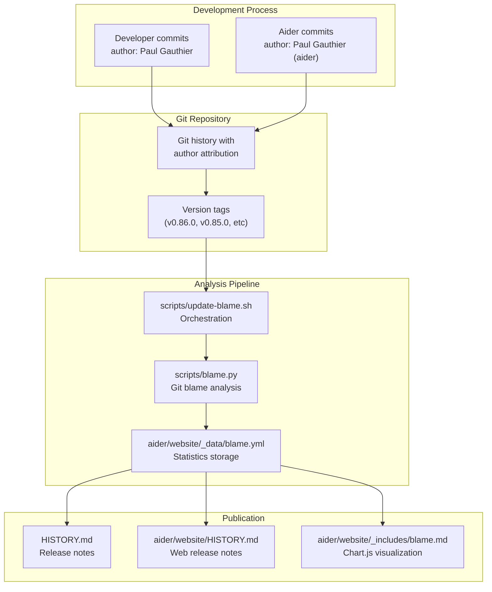
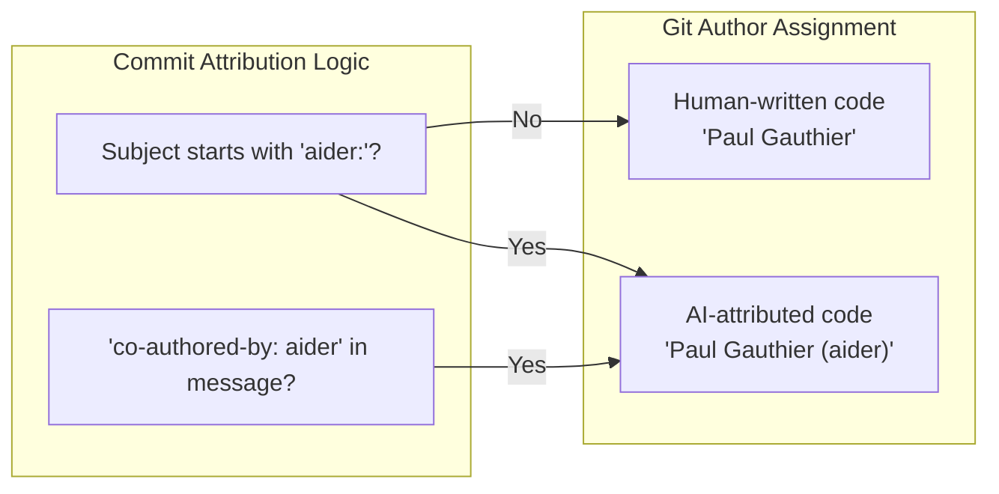

# Self-Referential Development Metrics

<details>
<summary>Relevant source files</summary>

The following files were used as context for generating this wiki page:

- [HISTORY.md](HISTORY.md)
- [aider/website/HISTORY.md](aider/website/HISTORY.md)
- [aider/website/_data/blame.yml](aider/website/_data/blame.yml)
- [aider/website/_includes/blame.md](aider/website/_includes/blame.md)
- [aider/website/docs/git.md](aider/website/docs/git.md)
- [aider/website/docs/install/docker.md](aider/website/docs/install/docker.md)
- [scripts/blame.py](scripts/blame.py)
- [scripts/update-blame.sh](scripts/update-blame.sh)

</details>


## Purpose and Scope

This document describes how Aider tracks and reports the percentage of its own codebase that was written by Aider itself—a metric referred to as the "Singularity" percentage. This self-referential metric demonstrates Aider's ability to develop and improve its own code through AI pair programming.

For information about general usage analytics and event tracking, see [Usage Analytics](#12.1).

## Overview

Aider maintains a unique metric that tracks what percentage of new code in each release was written by Aider itself rather than human developers. This "Singularity" metric serves multiple purposes:

- **Quality Indicator**: Demonstrates Aider's ability to work on real-world, complex codebases.
- **Dogfooding Evidence**: Shows the development team actively uses Aider for its own development.
- **Marketing Signal**: Provides quantifiable proof of capabilities.
- **Transparency**: Publicly documents AI contribution to the project.

The metric typically ranges from 60-92% across recent releases, with historical values documented for every release since v0.6.0.

Sources: [HISTORY.md:20](), [HISTORY.md:29](), [HISTORY.md:87](), [HISTORY.md:99](), [aider/website/HISTORY.md:10-13]()

## System Architecture

### Overall Data Flow

The pipeline starts with code commits and ends with updated documentation and website charts.



Sources: [scripts/update-blame.sh:1-9](), [scripts/blame.py:107-134](), [aider/website/_data/blame.yml:1-32](), [aider/website/_includes/blame.md:24-30]()

### Git Author Attribution System

The foundation of the system is git's built-in author attribution. Aider distinguishes AI-written code through naming conventions detected by `scripts/blame.py`.



The `get_commit_authors` function in `scripts/blame.py` scans commit subjects and full messages for "aider:" prefixes or "co-authored-by: aider" strings to append the `(aider)` suffix to the author name.

Sources: [scripts/blame.py:88-101](), [aider/website/docs/git.md:59-80]()

## Blame Analysis Pipeline

### Script Execution

The blame analysis is triggered via `scripts/update-blame.sh`, which defaults to starting from `v0.1.0`.

```bash
#!/bin/bash
set -e
VERSION=${1:-v0.1.0}
./scripts/blame.py "$VERSION" --all --output aider/website/_data/blame.yml
```

Sources: [scripts/update-blame.sh:1-9]()

### Blame Data Structure

The output YAML file (`aider/website/_data/blame.yml`) contains detailed statistics for each release.

| Field | Description |
| :--- | :--- |
| `aider_percentage` | Computed metric (AI lines / total lines × 100) |
| `aider_total` | Total lines written by Aider in this release |
| `end_date` | Date of the end tag |
| `end_tag` | Git version tag for the end of the range |
| `file_counts` | Dictionary mapping file paths to author line counts |
| `grand_total` | Aggregate line counts per author |
| `total_lines` | Sum of all new lines in the release |

Sources: [aider/website/_data/blame.yml:1-31](), [scripts/blame.py:114-133]()

### Calculation Methodology

The `blame(start_tag, end_tag)` function in `scripts/blame.py` performs the core calculation:
1. **Commit Retrieval**: Identifies all commit hashes between tags using `git rev-list` via `get_all_commit_hashes_between_tags` [scripts/blame.py:71-81]().
2. **Author Mapping**: Maps each commit to a human or AI author via `get_commit_authors` [scripts/blame.py:88-101]().
3. **File Filtering**: Only source files (e.g., `.py`, `.sh`, `.js`) are included. Documentation, prompt files (`prompts.py`), and specific website assets are excluded [scripts/blame.py:38-50]().
4. **Line Counting**: Uses `get_counts_for_file` to aggregate lines per author across the filtered file list [scripts/blame.py:54-61]().
5. **Percentage Calculation**: `aider_percentage = (aider_total / total_lines) * 100` [scripts/blame.py:64]().

Sources: [scripts/blame.py:29-69]()

## Publication and Display

### Release Notes Integration

Each release in `HISTORY.md` and `aider/website/HISTORY.md` includes the singularity metric as a standard bullet point.

```markdown
### Aider v0.86.0
- Expanded GPT-5 model support...
- Aider wrote 88% of the code in this release.
```

Sources: [HISTORY.md:29](), [HISTORY.md:87](), [HISTORY.md:99](), [aider/website/HISTORY.md:52](), [aider/website/HISTORY.md:110]()

### Chart Visualization

The `aider/website/_includes/blame.md` file uses `Chart.js` to render the Singularity data visually on the website.

- **blameChart**: A bar chart showing "Aider's percent of new code by release" [aider/website/_includes/blame.md:21-107]().
- **linesChart**: A stacked bar chart showing the raw volume of "Aider" vs "Human" lines per release [aider/website/_includes/blame.md:109-160]().

The charts iterate over `site.data.blame` (populated from `blame.yml`) to generate JavaScript data arrays [aider/website/_includes/blame.md:24-53]().

Sources: [aider/website/_includes/blame.md:1-163]()

## Historical Trends and Analysis

### Release-by-Release Statistics

Sample data from `aider/website/_data/blame.yml` demonstrates the granularity of tracking:

| Release | Start Tag | End Tag | Aider % | Total Lines |
| :--- | :--- | :--- | :--- | :--- |
| v0.6.0 | v0.5.0 | v0.6.0 | 31.33% | 150 |
| v0.7.0 | v0.6.0 | v0.7.0 | 14.36% | 1455 |
| v0.8.0 | v0.7.0 | v0.8.0 | 7.94% | 1751 |
| v0.9.0 | v0.8.0 | v0.9.0 | 18.95% | 897 |

Sources: [aider/website/_data/blame.yml:1-237]()

### Evolution of AI Contribution

The `HISTORY.md` file tracks the role of Aider in its own development over time:
- **v0.84.0**: 79% [HISTORY.md:99]()
- **v0.85.0**: 21% [HISTORY.md:87]()
- **v0.86.0**: 88% [HISTORY.md:29]()
- **main branch**: 62% [HISTORY.md:20]()

Note: The percentage fluctuates based on the nature of the release (e.g., architectural changes vs. feature additions).

Sources: [HISTORY.md:1-110]()

## Implementation Details

### Key Functions and Classes

| Entity | Role |
| :--- | :--- |
| `blame(start_tag, end_tag)` | Main entry point for analyzing a specific tag range [scripts/blame.py:29](). |
| `get_commit_authors(commits)` | Logic for detecting "aider" vs human authorship based on commit metadata [scripts/blame.py:88](). |
| `process_all_tags_since(start_tag)` | Iterates through git tags to build the full history for YAML output [scripts/blame.py:107](). |
| `get_latest_version_tag()` | Helper to find the most recent `vX.Y.0` tag to use as a starting point [scripts/blame.py:137](). |

Sources: [scripts/blame.py:1-143]()

### File Exclusions and Inclusions

The system selectively counts files to ensure the metric reflects substantive logic changes rather than documentation or boilerplate.

**Included Extensions/Paths:**
- `.js`, `.py`, `.scm`, `.sh` [scripts/blame.py:41]()
- `Dockerfile`, `Gemfile` [scripts/blame.py:41]()
- GitHub Workflows (`.github/workflows/*.yml`) [scripts/blame.py:42]()
- Aider Resources (`aider/resources/*.yml`) [scripts/blame.py:43]()
- Specific website files and language test fixtures [scripts/blame.py:44-45]()

**Excluded Patterns:**
- `prompts.py` (AI instructions/templates) [scripts/blame.py:47]()
- `tests/fixtures/watch` (Testing artifacts) [scripts/blame.py:48]()
- `install.ps1`, `install.sh` (Installation scripts) [scripts/blame.py:49]()

Sources: [scripts/blame.py:15-50]()