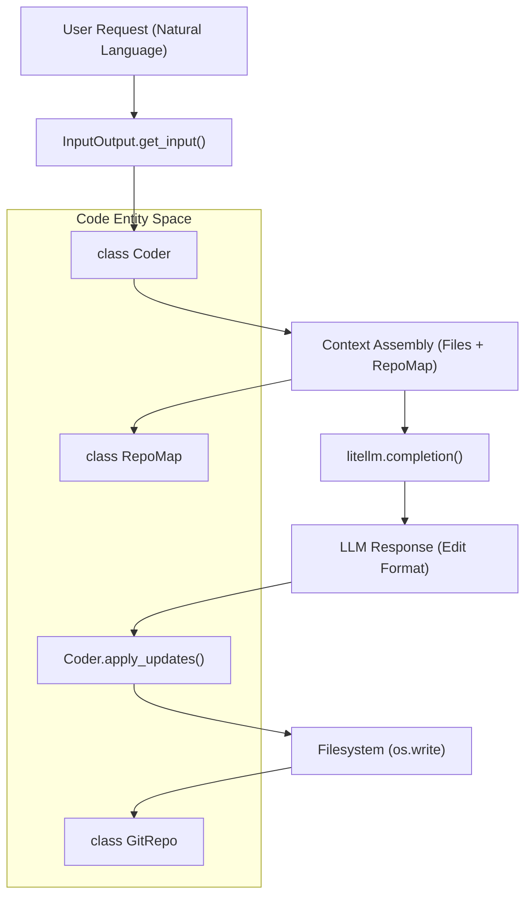
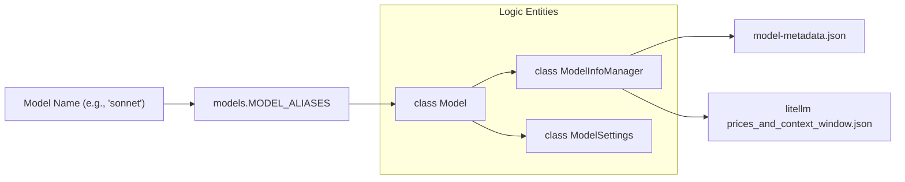

# Glossary

Relevant source files

The following files were used as context for generating this wiki page:

- [.gitignore](.gitignore)
- [HISTORY.md](HISTORY.md)
- [MANIFEST.in](MANIFEST.in)
- [README.md](README.md)
- [aider/__init__.py](aider/__init__.py)
- [aider/args.py](aider/args.py)
- [aider/coders/base_coder.py](aider/coders/base_coder.py)
- [aider/commands.py](aider/commands.py)
- [aider/help_pats.py](aider/help_pats.py)
- [aider/io.py](aider/io.py)
- [aider/llm.py](aider/llm.py)
- [aider/main.py](aider/main.py)
- [aider/models.py](aider/models.py)
- [aider/repo.py](aider/repo.py)
- [aider/repomap.py](aider/repomap.py)
- [aider/resources/__init__.py](aider/resources/__init__.py)
- [aider/resources/model-metadata.json](aider/resources/model-metadata.json)
- [aider/resources/model-settings.yml](aider/resources/model-settings.yml)
- [aider/voice.py](aider/voice.py)
- [aider/website/HISTORY.md](aider/website/HISTORY.md)
- [aider/website/_data/blame.yml](aider/website/_data/blame.yml)
- [aider/website/_data/polyglot_leaderboard.yml](aider/website/_data/polyglot_leaderboard.yml)
- [aider/website/assets/sample-analytics.jsonl](aider/website/assets/sample-analytics.jsonl)
- [aider/website/docs/config/adv-model-settings.md](aider/website/docs/config/adv-model-settings.md)
- [aider/website/docs/config/model-aliases.md](aider/website/docs/config/model-aliases.md)
- [aider/website/docs/faq.md](aider/website/docs/faq.md)
- [aider/website/docs/languages.md](aider/website/docs/languages.md)
- [aider/website/docs/leaderboards/by-release-date.md](aider/website/docs/leaderboards/by-release-date.md)
- [aider/website/docs/leaderboards/index.md](aider/website/docs/leaderboards/index.md)
- [aider/website/docs/more/infinite-output.md](aider/website/docs/more/infinite-output.md)
- [aider/website/index.html](aider/website/index.html)
- [benchmark/Dockerfile](benchmark/Dockerfile)
- [benchmark/benchmark.py](benchmark/benchmark.py)
- [pyproject.toml](pyproject.toml)
- [scripts/update-blame.sh](scripts/update-blame.sh)
- [scripts/versionbump.py](scripts/versionbump.py)
- [tests/basic/test_io.py](tests/basic/test_io.py)
- [tests/basic/test_models.py](tests/basic/test_models.py)
- [tests/basic/test_reasoning.py](tests/basic/test_reasoning.py)

This glossary defines technical terms, architectural patterns, and domain-specific jargon used within the Aider codebase. It serves as a reference for onboarding engineers to understand the mapping between conceptual features and implementation details.

## Core Concepts

### Coder
The central orchestration class that manages the lifecycle of a chat session. It handles context assembly, interaction with LLMs, and applying edits to the local filesystem.
*   **Implementation**: `Coder` in [aider/coders/base_coder.py:88-123]().
*   **Factory**: The `Coder.create` method is the primary way to instantiate a coder, handling model selection and state migration when switching modes [aider/coders/base_coder.py:125-201]().
*   **Subclasses**: Various specialized coders like `EditBlockCoder`, `WholeFileCoder`, and `ArchitectCoder` inherit from this base to implement specific [Edit Formats](#edit-format).

### Edit Format
A strategy or protocol used by the LLM to describe file modifications. Different models perform better with different formats (e.g., search/replace blocks vs. whole file rewrites).
*   **Selection Logic**: Default formats are defined per-model in `model-settings.yml` [aider/resources/model-settings.yml]() and resolved during coder creation [aider/coders/base_coder.py:142-149]().
*   **Common Formats**: `diff` (search/replace blocks), `whole` (entire file rewrite), `architect` (plan then edit), `ask` (read-only).

### Repo Map (Repository Map)
A condensed representation of the entire codebase provided to the LLM. It uses `tree-sitter` to extract symbols (classes, functions, methods) and ranks them using a PageRank-like algorithm to fit the most relevant context into the LLM's window.
*   **Implementation**: `RepoMap` in [aider/repomap.py:42-88]().
*   **Logic**: It identifies "Lines of Interest" (LOI) to show the LLM where important definitions exist without sending the full file [aider/repomap.py:135-142]().
*   **Caching**: Tags and map data are cached in a versioned directory (e.g., `.aider.tags.cache.v4`) to avoid re-parsing unchanged files [aider/repomap.py:43-43]().

### Main / Weak / Editor Model
Aider utilizes a multi-tier model strategy to optimize for cost, speed, and reasoning capability:
1.  **Main Model**: The primary LLM used for complex coding tasks (e.g., Claude 3.7 Sonnet, GPT-4o) [aider/models.py:30-30]().
2.  **Weak Model**: A cheaper, faster model used for lightweight tasks like generating commit messages or summarizing chat history [aider/models.py:132-132]().
3.  **Editor Model**: A specialized model (often the same as the Main model or a high-performance variant) used in Architect Mode to apply the proposed changes [aider/models.py:145-145]().

**Sources**: [aider/coders/base_coder.py:88-201](), [aider/models.py:30-145](), [aider/repomap.py:42-142]().

---

## Technical Terms & Jargon

| Term | Definition | Code Pointer |
| :--- | :--- | :--- |
| **Architect Mode** | A two-step workflow where an "Architect" model plans changes and an "Editor" model implements them. | `ArchitectCoder` in [aider/commands.py:161-166]() |
| **Chat Summary** | The process of condensing long chat histories into a smaller token footprint to preserve context window space. | `ChatSummary` in [aider/history.py]() |
| **Fencing** | The use of specific delimiters (like triple backticks or XML tags) to wrap code blocks in LLM responses. | `all_fences` in [aider/coders/base_coder.py:77-85]() |
| **Linter Reflection** | An automated loop where Aider runs a linter on its own edits and feeds errors back to the LLM for fixing. | `Coder.auto_lint` in [aider/coders/base_coder.py:105-105]() |
| **Reasoning Tokens** | Tokens generated by "thinking" models (like DeepSeek R1 or Claude 3.7) that represent internal reasoning. | `REASONING_TAG` in [aider/reasoning_tags.py:40-45]() |
| **Singularity** | A self-referential metric representing the percentage of Aider's own code written by Aider. | `blame.yml` in [aider/website/_data/blame.yml]() |
| **Thinking Budget** | A configuration for models that support internal reasoning, limiting the number of "thinking" tokens. | `get_thinking_tokens` in [aider/coders/base_coder.py:223-224]() |

**Sources**: [aider/coders/base_coder.py:77-224](), [aider/commands.py:161-166](), [aider/reasoning_tags.py:40-45]().

---

## Architectural Diagrams

### From Natural Language to Code Modification
This diagram serves to bridge the "Natural Language Space" (user intent) to the "Code Entity Space" (classes and methods) by illustrating the flow through `Coder` and `GitRepo`.

**Sources**: [aider/coders/base_coder.py:88-123](), [aider/io.py:186-215](), [aider/repomap.py:103-167](), [aider/repo.py:35-35]().

### Model Resolution and Capability Mapping
This diagram shows how user-provided model names or aliases are resolved into technical capabilities and pricing via `ModelInfoManager`.

**Sources**: [aider/models.py:92-116](), [aider/models.py:161-243](), [aider/resources/model-settings.yml](), [aider/resources/model-metadata.json]().

---

## File and Class References

### `aider/coders/base_coder.py`
*   `Coder`: The base class for all AI pair programming logic [aider/coders/base_coder.py:88]().
*   `Coder.create()`: Factory method to instantiate specific coder types [aider/coders/base_coder.py:125]().
*   `all_fences`: Defines the various code block delimiters recognized by the system [aider/coders/base_coder.py:77-85]().

### `aider/models.py`
*   `ModelSettings`: Dataclass defining how a specific LLM should behave (e.g., `use_repo_map`, `edit_format`) [aider/models.py:128-151]().
*   `MODEL_ALIASES`: Dictionary mapping short names like `sonnet`, `4o`, or `r1` to full provider strings [aider/models.py:99-123]().
*   `ModelInfoManager`: Manages retrieval of context windows and pricing data from local and remote sources [aider/models.py:161-178]().

### `aider/repomap.py`
*   `RepoMap`: Handles the generation of the tree-sitter based codebase map [aider/repomap.py:42]().
*   `TAGS_CACHE_DIR`: Location where symbol tags are stored to speed up map generation [aider/repomap.py:43]().
*   `get_ranked_tags_map`: The core algorithm for selecting the most relevant code snippets for the context window [aider/repomap.py:135-142]().

### `aider/io.py`
*   `InputOutput`: Manages terminal UI, including `rich` markdown rendering and `prompt_toolkit` input [aider/io.py:31]().
*   `AutoCompleter`: Logic for providing file and command completions in the terminal [aider/io.py:91]().
*   `MarkdownStream`: Handles incremental rendering of LLM responses in the terminal [aider/io.py:36]().

### `aider/commands.py`
*   `Commands`: Dispatches slash commands (e.g., `/add`, `/drop`, `/undo`) [aider/commands.py:36]().
*   `SwitchCoder`: A special exception used to trigger a coder re-initialization when changing models or modes [aider/commands.py:30-34]().

**Sources**: [aider/coders/base_coder.py:1-201](), [aider/models.py:1-243](), [aider/repomap.py:1-150](), [aider/io.py:1-215](), [aider/commands.py:1-203]().