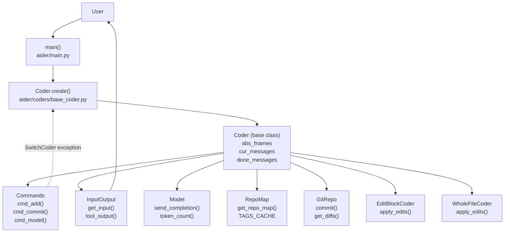
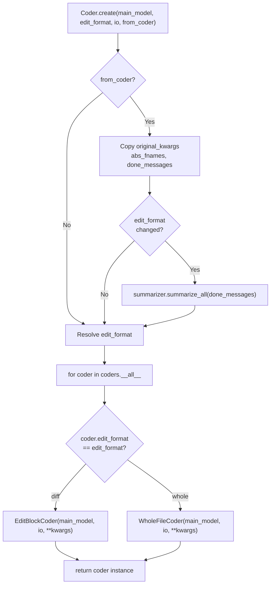
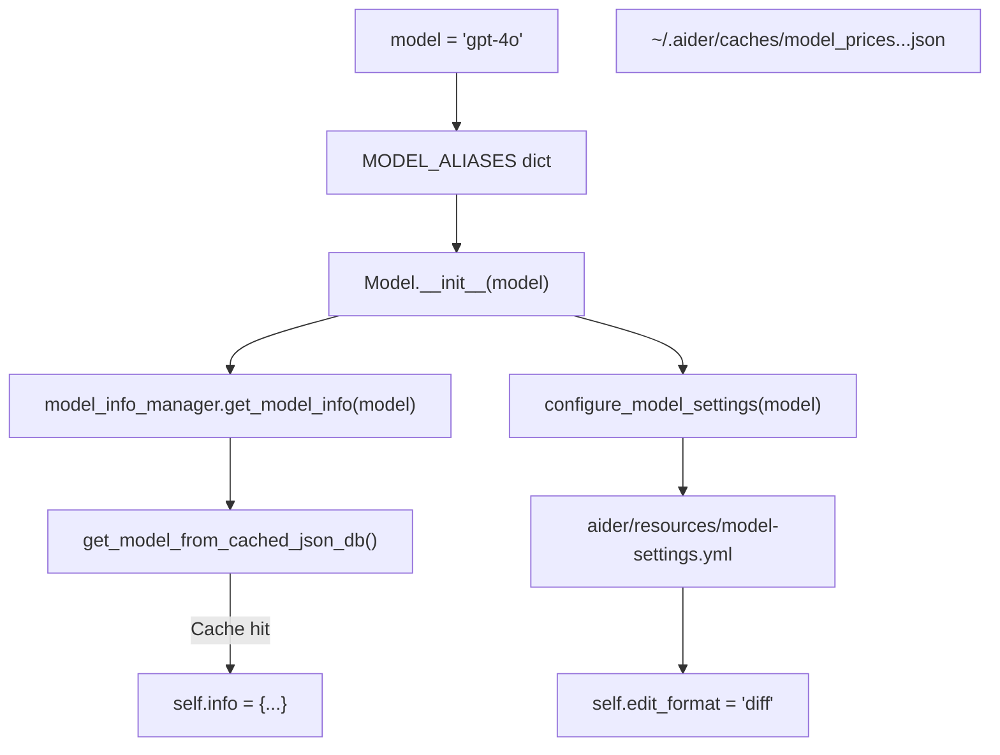
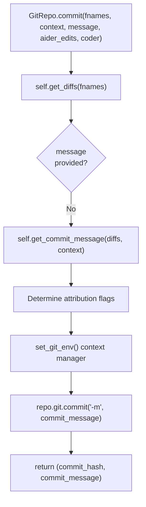
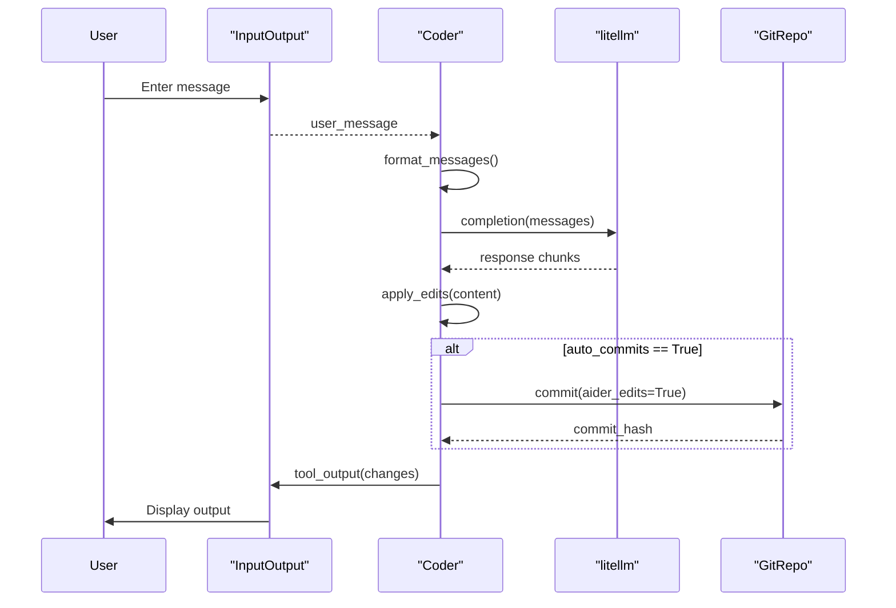

# Core Architecture

Relevant source files

The following files were used as context for generating this wiki page:

- [MANIFEST.in](MANIFEST.in)
- [aider/__init__.py](aider/__init__.py)
- [aider/args.py](aider/args.py)
- [aider/coders/base_coder.py](aider/coders/base_coder.py)
- [aider/commands.py](aider/commands.py)
- [aider/help_pats.py](aider/help_pats.py)
- [aider/io.py](aider/io.py)
- [aider/llm.py](aider/llm.py)
- [aider/main.py](aider/main.py)
- [aider/models.py](aider/models.py)
- [aider/repo.py](aider/repo.py)
- [aider/repomap.py](aider/repomap.py)
- [aider/voice.py](aider/voice.py)
- [aider/website/docs/languages.md](aider/website/docs/languages.md)
- [aider/website/docs/leaderboards/by-release-date.md](aider/website/docs/leaderboards/by-release-date.md)
- [pyproject.toml](pyproject.toml)
- [scripts/versionbump.py](scripts/versionbump.py)
- [tests/basic/test_io.py](tests/basic/test_io.py)

## Purpose and Scope

This document describes the fundamental architectural components of Aider and how they interact to enable AI-assisted pair programming. It covers the core orchestration layer, major subsystems, and the flow of requests through the system.

Detailed documentation for specific subsystems can be found in the following child pages:
- [Application Entry Point and Main Loop](#2.1) — Covers `main.py`, initialization, and the execution loop.
- [Coder Orchestration System](#2.2) — Covers the `Coder` base class and interaction orchestration.
- [Commands and User Interactions](#2.3) — Covers the `Commands` class and slash command processing.
- [Model Management and LLM Integration](#2.4) — Covers the `Model` class and `litellm` integration.
- [Input/Output and Terminal Interface](#2.5) — Covers `InputOutput` and terminal handling.

## Architectural Overview

Aider follows a layered architecture with the `Coder` class as the central orchestrator. The system coordinates between user input, LLM interactions, code understanding, version control, and file operations.

**High-Level Component Interaction**

Sources: [aider/main.py:451-1000](), [aider/coders/base_coder.py:88-543](), [aider/commands.py:30-33]()

## Central Orchestrator: The Coder Class

The `Coder` class ([aider/coders/base_coder.py:88-2257]()) is the heart of Aider's architecture. It manages the lifecycle of chat interactions, coordinates between subsystems, and maintains state throughout the session. For details, see [Coder Orchestration System](#2.2).

**Coder Class Responsibilities and Key Attributes**

| Responsibility | Key Attributes | Key Methods | Location |
|---------------|----------------|---------|----------|
| File Management | `abs_fnames`, `abs_read_only_fnames` | `add_rel_fname()`, `drop_rel_fname()` | [aider/coders/base_coder.py:89-91]() |
| Message History | `cur_messages`, `done_messages` | `format_messages()` | [aider/coders/base_coder.py:395-403]() |
| Repository Integration | `repo`, `repo_map` | `get_repo_map()`, `get_repo_messages()` | [aider/coders/base_coder.py:91-95]() |
| Model Communication | `main_model` | `send_message()`, `send_completion()` | [aider/coders/base_coder.py:418-424]() |
| Git Operations | `repo` | `repo.commit()` | [aider/coders/base_coder.py:409-413]() |
| Cost Tracking | `total_cost`, `message_cost` | Updated in `send_completion()` | [aider/coders/base_coder.py:384-388]() |

**Coder Creation and Initialization**

The `Coder.create()` factory method ([aider/coders/base_coder.py:124-201]()) instantiates the appropriate coder subclass based on the `edit_format`. This allows switching between different edit strategies while maintaining state.

Sources: [aider/coders/base_coder.py:124-201](), [aider/coders/base_coder.py:160-168]()

## Core Components

### Application Entry and Initialization

The `main()` function ([aider/main.py:451-1000]()) orchestrates the startup sequence, handling configuration and validation. For details, see [Application Entry Point and Main Loop](#2.1).

The system loads configuration with specific precedence ([aider/main.py:461-505]()):
1. Home directory: `~/.aider.conf.yml`
2. Git root: `<git_root>/.aider.conf.yml`
3. Current directory: `./.aider.conf.yml`
4. Command-line arguments (highest priority)

Sources: [aider/main.py:451-757](), [aider/args.py:35-42]()

### Command System

The `Commands` class ([aider/commands.py:36-1500]()) implements the slash command interface and acts as a bridge between user actions and coder operations. For details, see [Commands and User Interactions](#2.3).

The `SwitchCoder` exception ([aider/commands.py:30-33]()) enables commands like `/model` to trigger coder recreation. When raised, the exception is caught in the main loop ([aider/main.py:994-1004]()), and a new `Coder` is created.

Sources: [aider/commands.py:255-333](), [aider/main.py:994-1004]()

### Model Management

The `Model` class ([aider/models.py:317-838]()) encapsulates LLM configuration and manages API communication via `litellm`. For details, see [Model Management and LLM Integration](#2.4).

**Model Configuration Hierarchy**

Sources: [aider/models.py:317-420](), [aider/models.py:149-314](), [aider/models.py:87-111]()

### Input/Output System

The `InputOutput` class ([aider/io.py:230-1063]()) manages terminal interactions, formatting, and file operations. For details, see [Input/Output and Terminal Interface](#2.5).

The `AutoCompleter` class ([aider/io.py:91-228]()) provides context-aware completions for commands, file paths, and tokens from source files ([aider/io.py:127-146]()).

Sources: [aider/io.py:230-373](), [aider/io.py:91-228]()

### Git Integration

The `GitRepo` class ([aider/repo.py:52-742]()) provides git repository operations, including commits with attribution.

**GitRepo Core Operations**

Sources: [aider/repo.py:131-318](), [aider/repo.py:326-373](), [aider/repo.py:39-50]()

## Request Processing Flow

The complete request processing flow shows how user input becomes code changes and git commits.

**End-to-End Request Flow**

Sources: [aider/coders/base_coder.py:876-945](), [aider/coders/base_coder.py:1597-1782]()