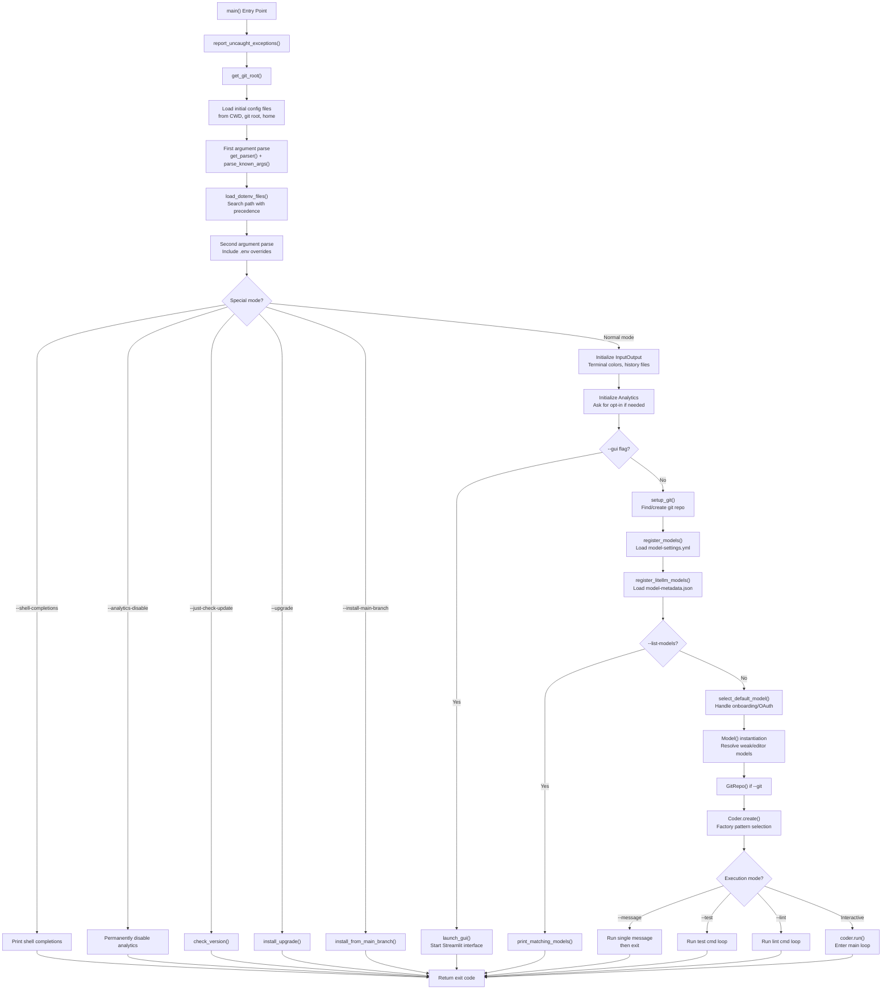
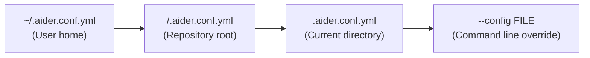
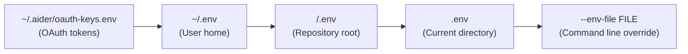
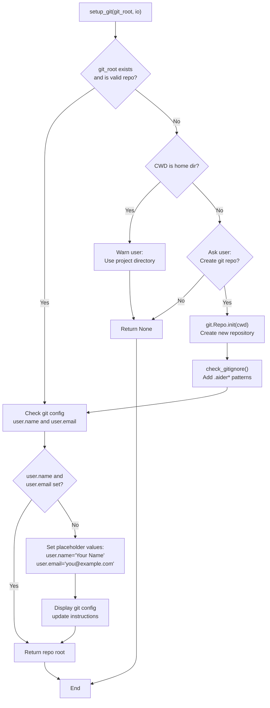
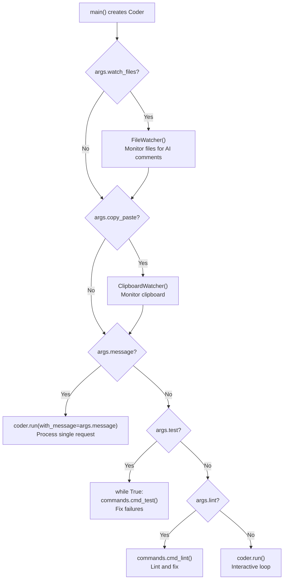

# Application Entry Point and Main Loop

<details>
<summary>Relevant source files</summary>

The following files were used as context for generating this wiki page:

- [aider/args.py](aider/args.py)
- [aider/coders/base_coder.py](aider/coders/base_coder.py)
- [aider/commands.py](aider/commands.py)
- [aider/io.py](aider/io.py)
- [aider/main.py](aider/main.py)
- [aider/models.py](aider/models.py)
- [aider/onboarding.py](aider/onboarding.py)
- [aider/repo.py](aider/repo.py)
- [aider/repomap.py](aider/repomap.py)
- [aider/voice.py](aider/voice.py)
- [aider/website/docs/languages.md](aider/website/docs/languages.md)
- [pytest.ini](pytest.ini)
- [tests/basic/test_io.py](tests/basic/test_io.py)
- [tests/basic/test_main.py](tests/basic/test_main.py)
- [tests/basic/test_model_info_manager.py](tests/basic/test_model_info_manager.py)
- [tests/basic/test_ssl_verification.py](tests/basic/test_ssl_verification.py)
- [tests/scrape/test_scrape.py](tests/scrape/test_scrape.py)

</details>


## Purpose and Scope

This page documents the main entry point for the aider application, specifically the `main()` function in [aider/main.py](). It covers the initialization sequence, configuration loading, argument parsing, and the flow that occurs before control is handed to the Coder system. For information about the Coder orchestration layer itself, see [Coder Orchestration System](#2.2). For details about command-line argument definitions, see [Command Line Interface](#5.1).

**Sources:** [aider/main.py:1-1000]()

---

## The `main()` Function

The application entry point is the `main()` function defined at [aider/main.py:451](). This function accepts optional parameters to support both command-line invocation and programmatic usage:

| Parameter | Type | Purpose |
|-----------|------|---------|
| `argv` | `list[str]` or `None` | Command-line arguments; defaults to `sys.argv[1:]` |
| `input` | IO object or `None` | Input stream for testing/embedding |
| `output` | IO object or `None` | Output stream for testing/embedding |
| `force_git_root` | `str` or `None` | Override git root detection |
| `return_coder` | `bool` | If `True`, return the Coder instance instead of running it |

The function returns an integer exit code (typically 0 for success, 1 for error) or a Coder instance if `return_coder=True`.

**Sources:** [aider/main.py:451-452]()

---

## Initialization Flow Overview



**Sources:** [aider/main.py:451-1000](), [aider/main.py:876-892](), [aider/report.py:1-50]()

---

## Configuration File Loading

Aider uses a hierarchical configuration system where settings from multiple sources are merged with a specific precedence order. The configuration is loaded in two phases: YAML/config files first, then `.env` files.

### YAML Configuration Search Path

The `get_parser()` function in [aider/args.py:35]() sets up the configuration file search order using `configargparse.ArgumentParser`:



Files are processed in order, with later files overriding earlier ones. The logic at [aider/main.py:464-477]() constructs this list.

### Environment Variable Loading

The `load_dotenv_files()` function at [aider/main.py:361-387]() loads `.env` files in a similar hierarchical manner:



Each file loaded sets `override=True` so later values replace earlier ones. The OAuth keys file is explicitly prepended to ensure it's loaded first (but potentially overridden).

### Precedence Summary

The final precedence order (highest to lowest) is:

1. Command-line arguments (`--option value`)
2. Environment variables with `AIDER_` prefix (configured via `auto_env_var_prefix` in [aider/args.py:41]())
3. Current directory `.env` and `.aider.conf.yml`
4. Git root `.env` and `.aider.conf.yml`
5. Home directory `.env` and `.aider.conf.yml`
6. OAuth keys from `~/.aider/oauth-keys.env`

**Sources:** [aider/main.py:361-387](), [aider/main.py:464-494](), [aider/args.py:35-42]()

---

## Argument Parsing with ConfigArgParse

Aider uses the `configargparse` library which extends `argparse` to support configuration files. The parser is defined in `get_parser()` at [aider/args.py:35]().

### Two-Pass Parsing

The `main()` function performs argument parsing twice:

```python
# First pass - before .env loading
parser = get_parser(default_config_files, git_root)
args, unknown = parser.parse_known_args(argv)

# Load .env files based on first pass
loaded_dotenvs = load_dotenv_files(git_root, args.env_file, args.encoding)

# Second pass - include .env variables
args = parser.parse_args(argv)
```

This two-pass approach at [aider/main.py:496-504]() ensures that:
1. The `--env-file` argument is respected when loading environment variables.
2. Environment variables can influence final argument values.

### Argument Groups

Arguments are organized into logical groups in [aider/args.py:55-700]():

| Group | Purpose | Key Arguments |
|-------|---------|---------------|
| Main model | Primary LLM selection | `--model`, `files` |
| API Keys and settings | Authentication | `--openai-api-key`, `--set-env`, `--api-key` |
| Model settings | Model behavior | `--edit-format`, `--weak-model`, `--reasoning-effort`, `--thinking-tokens` |
| Repomap settings | Context building | `--map-tokens`, `--map-refresh` |
| History Files | Persistence | `--input-history-file`, `--chat-history-file` |
| Output settings | Display formatting | `--pretty`, `--dark-mode`, `--stream` |
| Git settings | Version control | `--git`, `--auto-commits`, `--dirty-commits` |

**Sources:** [aider/main.py:479-504](), [aider/args.py:35-700]()

---

## Special Execution Modes

Before entering the main application flow, `main()` checks for several special modes that cause early exit:

### Shell Completion Generation

At [aider/main.py:506-510](), the `--shell-completions` flag generates shell completion scripts for bash/zsh/fish using `shtab`.

### Analytics Management

At [aider/main.py:515-517](), the `--analytics-disable` flag permanently disables telemetry via the `Analytics` class.

### Version Check and Update

The following flags trigger version-related operations and exit:

- `--just-check-update`: Check for updates without installing ([aider/main.py:722-725]())
- `--upgrade`: Install the latest version from PyPI ([aider/main.py:732-735]())
- `--install-main-branch`: Install from the GitHub main branch ([aider/main.py:727-730]())

### GUI Mode

At [aider/main.py:666-673](), the `--gui` flag launches the Streamlit web interface via `launch_gui()` at [aider/main.py:233-268](). It first checks if `streamlit` is installed using `utils.check_pip_install_extra` [aider/main.py:208-214]().

**Sources:** [aider/main.py:506-743](), [aider/main.py:233-268](), [aider/main.py:208-214]()

---

## Git Repository Initialization

Git repository setup occurs in discovery and optional creation phases.

### Git Root Discovery

The `get_git_root()` function at [aider/main.py:60-66]() attempts to find the git repository root using `git.Repo(search_parent_directories=True)`.

### Repository Setup or Creation

The `setup_git()` function at [aider/main.py:101-152]() is called later in the initialization flow:



### Gitignore Management

The `check_gitignore()` function at [aider/main.py:155-206]() ensures that aider's working files are excluded from git by adding `.aider*` and `.env` (if present) to the `.gitignore` file.

**Sources:** [aider/main.py:60-66](), [aider/main.py:101-152](), [aider/main.py:155-206](), [aider/main.py:740-743]()

---

## Model Registration and Selection

Model registration is a two-stage process that loads operational settings and technical metadata.

### Model Settings Registration

The `register_models()` function at [aider/main.py:335-358]() loads `.aider.model.settings.yml` files. These files contain model configuration like `edit_format`, `use_repo_map`, and behavioral flags defined in the `ModelSettings` dataclass [aider/models.py:128-151]().

### Model Metadata Registration

The `register_litellm_models()` function at [aider/main.py:390-410]() loads `.aider.model.metadata.json` files. These files contain technical specifications like `max_input_tokens`, `max_output_tokens`, and cost information, managed by the `ModelInfoManager` [aider/models.py:161-240]().

### Model Selection with Onboarding

The `select_default_model()` function at [aider/onboarding.py:116-151]() (called at [aider/main.py:777]()) handles the welcome flow and OAuth for new users if no model is specified and no keys are found. It uses `try_to_select_default_model` [aider/onboarding.py:44-76]() to check for environment keys and `offer_openrouter_oauth` [aider/onboarding.py:79-113]() if needed.

### Model Instance Creation

After selection, a `Model` instance is created at [aider/main.py:822-828]():

```python
main_model = models.Model(
    args.model,
    weak_model=args.weak_model,
    editor_model=args.editor_model,
    editor_edit_format=args.editor_edit_format,
    verbose=args.verbose,
)
```

The `Model` class at [aider/models.py:312]() handles alias resolution via `MODEL_ALIASES` [aider/models.py:99-123]() and selects appropriate sub-models for weak and editor tasks.

**Sources:** [aider/main.py:335-358](), [aider/main.py:390-410](), [aider/main.py:777-828](), [aider/models.py:128-151](), [aider/models.py:312-353](), [aider/onboarding.py:44-151]()

---

## Coder Creation and Execution

The final initialization step creates a `Coder` instance and begins execution.

### Coder Factory Pattern

The `Coder.create()` class method at [aider/coders/base_coder.py:125-202]() uses a factory pattern to instantiate the correct coder subclass (e.g., `ArchitectCoder`, `EditBlockCoder`) based on the requested `edit_format`.

### Main Execution Flow



The `coder.run()` method at [aider/coders/base_coder.py:876-892]() implements the core interaction loop.

**Sources:** [aider/main.py:876-1000](), [aider/coders/base_coder.py:125-202](), [aider/coders/base_coder.py:876-892]()

---

## Main Interaction Loop

The main loop consists of input collection, message preprocessing, and message execution.

### Input Collection Phase

The `get_input()` method at [aider/coders/base_coder.py:898-910]() prepares context and calls `InputOutput.get_input()`. This delegates to `PromptSession.prompt()` at [aider/io.py:787](), using an `AutoCompleter` [aider/io.py:91-228]() for tab completions of files and slash commands.

### Message Preprocessing Phase

The `run_one()` method at [aider/coders/base_coder.py:924-944]() orchestrates processing. The `preproc_user_input()` method at [aider/coders/base_coder.py:912-922]() checks if the input is a command using `self.commands.is_command(inp)`.

### Command Execution Branch

If a command is detected, it is dispatched via `self.commands.run(inp)` [aider/commands.py:255-333](). This method matches the input against available commands and calls the corresponding `cmd_<name>` method.

### Message Execution Phase

If the input is not a command, it is sent to the LLM via `send_message()` [aider/coders/base_coder.py:859-862](). This triggers the LLM completion, edit extraction, and application cycle.

**Sources:** [aider/coders/base_coder.py:898-944](), [aider/io.py:91-228](), [aider/commands.py:255-333]()

---

## Loop Control Flow and Exit

### Interrupt Handling

The `keyboard_interrupt()` method at [aider/coders/base_coder.py:986-1000]() implements double Ctrl-C detection to prevent accidental exits.

### Return Modes

The `main()` function supports returning an integer exit code or the `Coder` instance itself (if `return_coder=True`) [aider/main.py:451-452](). In `return_coder` mode, it automatically sets `yes_always = True` [aider/main.py:546-547]().

### Error Handling

Uncaught exceptions are handled by `report_uncaught_exceptions()` [aider/report.py](), which is installed at the very start of `main()` [aider/main.py:452]().

**Sources:** [aider/main.py:451-452](), [aider/main.py:546-547](), [aider/coders/base_coder.py:986-1000](), [aider/report.py:1-50]()