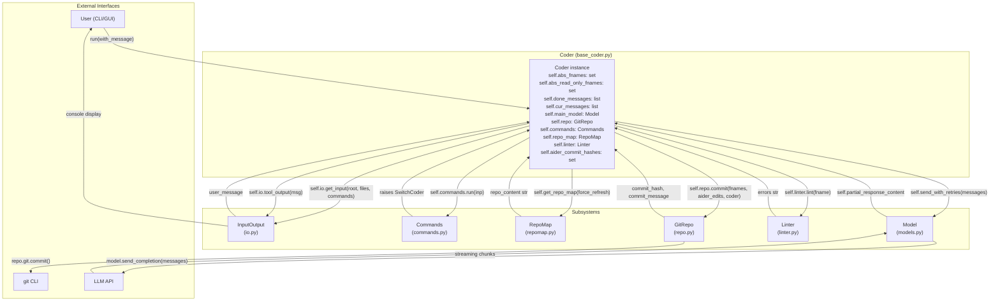
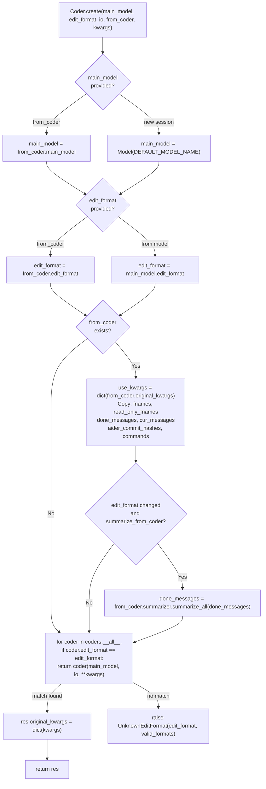
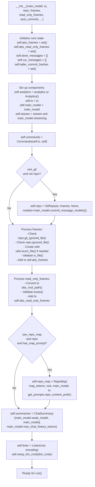
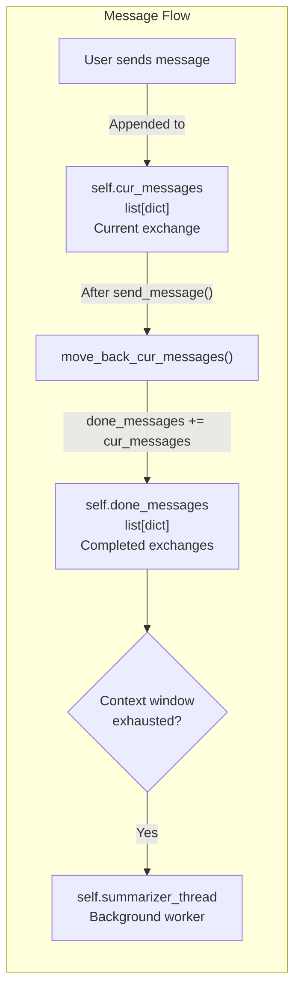
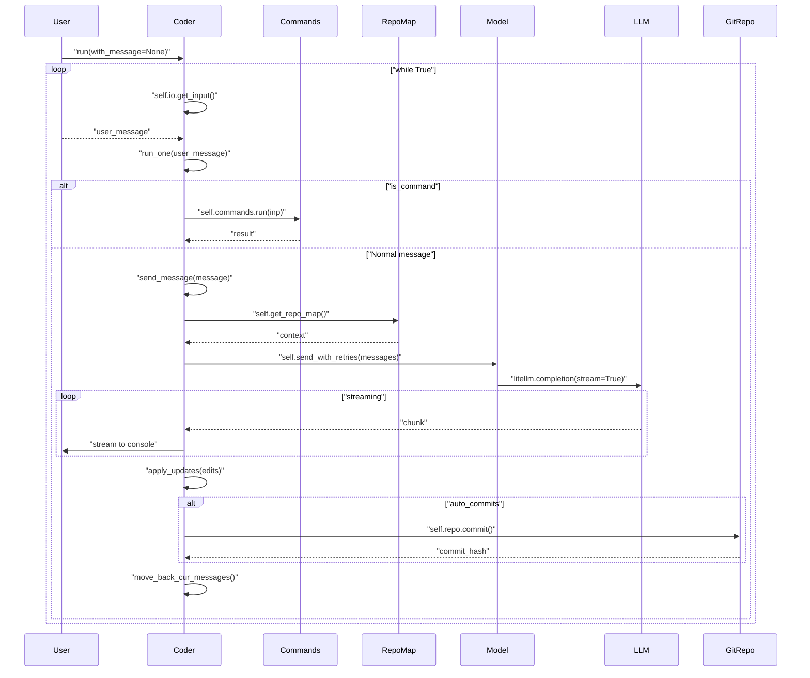
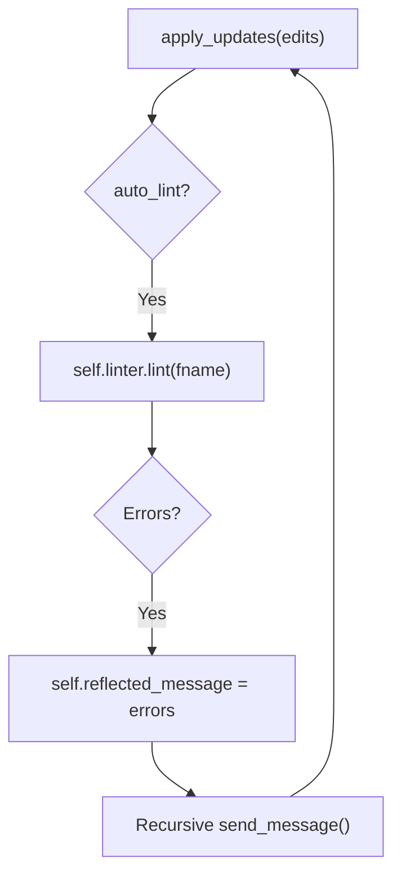

# Coder Orchestration System

Relevant source files

The following files were used as context for generating this wiki page:

- [aider/args.py](aider/args.py)
- [aider/coders/base_coder.py](aider/coders/base_coder.py)
- [aider/coders/chat_chunks.py](aider/coders/chat_chunks.py)
- [aider/commands.py](aider/commands.py)
- [aider/help.py](aider/help.py)
- [aider/io.py](aider/io.py)
- [aider/main.py](aider/main.py)
- [aider/models.py](aider/models.py)
- [aider/repo.py](aider/repo.py)
- [aider/repomap.py](aider/repomap.py)
- [aider/voice.py](aider/voice.py)
- [aider/website/docs/languages.md](aider/website/docs/languages.md)
- [scripts/issues.py](scripts/issues.py)
- [tests/basic/test_coder.py](tests/basic/test_coder.py)
- [tests/basic/test_commands.py](tests/basic/test_commands.py)
- [tests/basic/test_io.py](tests/basic/test_io.py)
- [tests/basic/test_sanity_check_repo.py](tests/basic/test_sanity_check_repo.py)
- [tests/help/test_help.py](tests/help/test_help.py)

The `Coder` class in [aider/coders/base_coder.py:88-123]() is the central orchestrator that coordinates all subsystems in Aider. It manages the complete lifecycle of AI-assisted code editing: accepting user input, maintaining conversation state, generating code context, communicating with LLMs, applying code changes, and committing to git.

**Related Pages:** See [Edit Format Implementations](3.1) for edit format details, [Commands and User Interactions](2.3) for command processing, and [Model Management and LLM Integration](2.4) for model configuration.

## Core Responsibilities

The `Coder` class orchestrates eight primary subsystems:

| Subsystem | Key Attributes/Methods | Purpose |
|-----------|------------------------|---------|
| **Message History** | `done_messages`, `cur_messages`, `move_back_cur_messages()` | Maintains conversation state, manages token limits via summarization. |
| **File Management** | `abs_fnames`, `abs_read_only_fnames`, `add_rel_fname()`, `drop_rel_fname()` | Tracks editable and read-only files in the chat session. |
| **Model Integration** | `main_model`, `weak_model`, `send_with_retries()`, `send_completion()` | Communicates with LLMs, handles retries, and manages reasoning/thinking tokens. |
| **Context Generation** | `repo_map`, `get_repo_map()`, `get_repo_messages()` | Generates relevant code context using PageRank-based RepoMap. |
| **Edit Processing** | `get_edits()`, `apply_updates()`, `aider_edited_files` | Parses and applies AI-generated code changes based on specific edit formats. |
| **Version Control** | `repo`, `aider_commit_hashes`, `commit_before_message` | Manages git commits and tracks AI-authored changes via `GitRepo`. |
| **Command Routing** | `commands`, `preproc_user_input()` | Delegates slash commands to the `Commands` subsystem. |
| **Quality Control** | `linter`, `auto_lint`, `auto_test`, `reflected_message` | Runs linting/testing with a reflection loop for error correction. |

**Sources:** [aider/coders/base_coder.py:88-123](), [aider/coders/base_coder.py:299-543](), [aider/repo.py:131-152]()

## Orchestration Architecture

**Diagram: Coder Subsystem Orchestration with Code Entities**

**Sources:** [aider/coders/base_coder.py:88-123](), [aider/coders/base_coder.py:299-543](), [aider/io.py:11-38](), [aider/commands.py:36-52](), [aider/repo.py:35-152](), [aider/models.py:121-151]()

## Coder Factory Pattern

The factory method `Coder.create()` at [aider/coders/base_coder.py:124-201]() selects the correct `Coder` subclass by matching `edit_format` against registered coder classes. When switching modes via `/chat-mode` [aider/commands.py:138-203](), it preserves state through `from_coder.original_kwargs` and may call `summarizer.summarize_all()` [aider/coders/base_coder.py:163]() to prevent confusing the new LLM with incompatible message history.

**Diagram: `Coder.create()` Factory Pattern**

**Sources:** [aider/coders/base_coder.py:124-201](), [aider/commands.py:138-203](), [aider/models.py:30]()

## Initialization

The `__init__()` method at [aider/coders/base_coder.py:299-543]() initializes subsystems in sequence: analytics, I/O, model, commands, repository, file tracking, repo mapping, summarization, and linting. Files are validated and tracked in `abs_fnames` or `abs_read_only_fnames`.

**Diagram: `__init__()` Initialization Sequence**

**Sources:** [aider/coders/base_coder.py:299-543](), [aider/repo.py:101-152](), [aider/history.py:30]()

## Core State Management

### File Tracking
The Coder maintains two primary file collections:
- `abs_fnames`: A `set` of absolute paths for editable files in the chat [aider/coders/base_coder.py:89]().
- `abs_read_only_fnames`: A `set` of absolute paths for reference files [aider/coders/base_coder.py:90]().

Files are added via `add_rel_fname()` [aider/coders/base_coder.py:556-564]() and removed via `drop_rel_fname()`.

### Message History
The Coder maintains a two-tier message history:
- `self.cur_messages`: Messages from the current user request and AI response [aider/coders/base_coder.py:403]().
- `self.done_messages`: Completed message exchanges from previous interactions [aider/coders/base_coder.py:395]().

When context limits are reached, `ChatSummary` at [aider/history.py:30]() is used to condense history. The method `move_back_cur_messages()` [aider/coders/base_coder.py:1036-1046]() moves messages from current to done.

**Diagram: Message History State Management**

**Sources:** [aider/coders/base_coder.py:395-403](), [aider/coders/base_coder.py:1002-1034](), [aider/coders/base_coder.py:1036-1046]()

### Commit Tracking
The `self.aider_commit_hashes` set tracks all commits made by Aider during the session [aider/coders/base_coder.py:92](). This enables the `/undo` command [aider/commands.py:555-579]() to safely revert only Aider-initiated changes via `GitRepo.commit()` [aider/repo.py:131]().

**Sources:** [aider/coders/base_coder.py:92](), [aider/commands.py:555-579](), [aider/repo.py:131]()

## Request Processing Pipeline

The processing pipeline is defined across three main methods:
1. `run()` [aider/coders/base_coder.py:876-893](): The main interactive loop that waits for user input.
2. `run_one()` [aider/coders/base_coder.py:924-944](): Dispatches input to slash commands or the LLM.
3. `send_message()` [aider/coders/base_coder.py:1135-1389](): Assembles context (RepoMap, file contents), calls the LLM, parses streaming responses, and applies edits.

**Diagram: Request Processing Pipeline**

**Sources:** [aider/coders/base_coder.py:876-893](), [aider/coders/base_coder.py:924-944](), [aider/coders/base_coder.py:1135-1389]()

## Integration with Subsystems

### Context Generation via RepoMap
The `get_repo_map()` method [aider/coders/base_coder.py:709-748]() identifies relevant code symbols by:
1. Extracting identifiers from the current message via `get_ident_mentions()` [aider/coders/base_coder.py:678-682]().
2. Matching identifiers to file stems via `get_ident_filename_matches()` [aider/coders/base_coder.py:684-707]().
3. Requesting a ranked map from the `RepoMap` subsystem [aider/repomap.py:103]().

### Command Integration
The Coder delegates slash commands to the `Commands` subsystem [aider/coders/base_coder.py:912-922](). Commands like `/add` [aider/commands.py:746-805]() update the Coder's file state, while `/model` [aider/commands.py:87-112]() raises a `SwitchCoder` exception to trigger reconfiguration.

### Quality Control and Reflection
The Coder implements a reflection loop in `run_one()` [aider/coders/base_coder.py:932-944](). If `auto_lint` is enabled [aider/coders/base_coder.py:105](), lint errors detected by `Linter.lint()` are fed back to the LLM as a new message, allowing it to correct its own mistakes up to `max_reflections` [aider/coders/base_coder.py:101]() times.

**Diagram: Lint and Test Feedback Loop**

**Sources:** [aider/coders/base_coder.py:101-109](), [aider/coders/base_coder.py:525-531](), [aider/coders/base_coder.py:932-944](), [aider/repomap.py:103]()