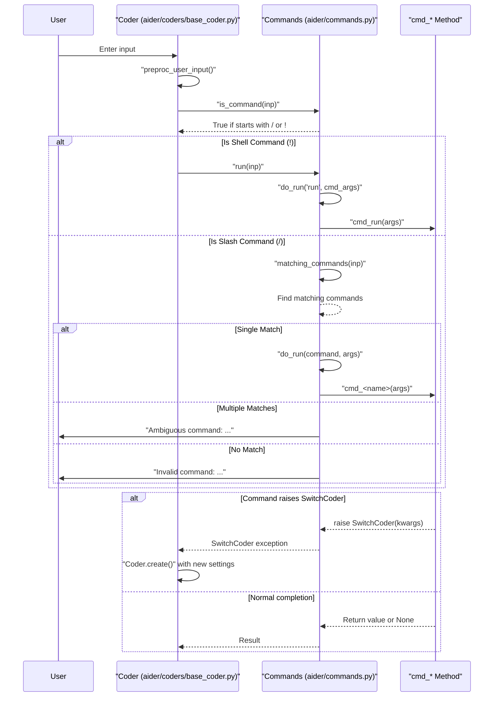
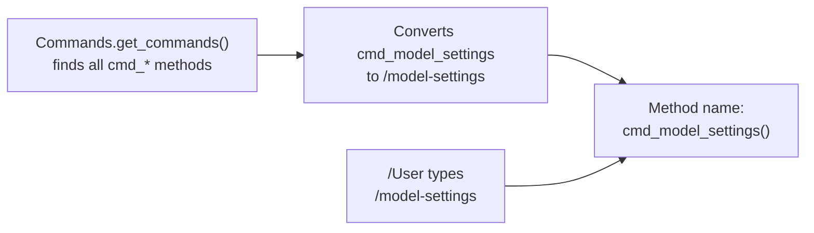
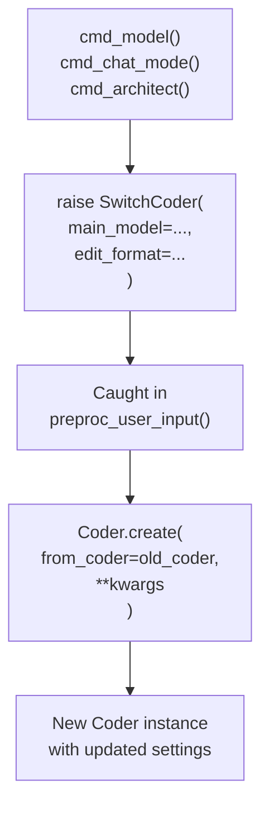
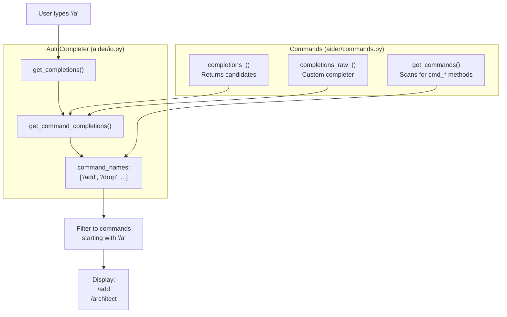
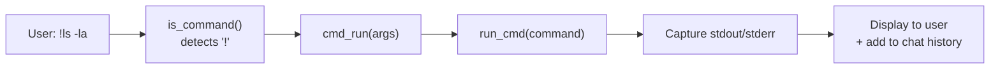
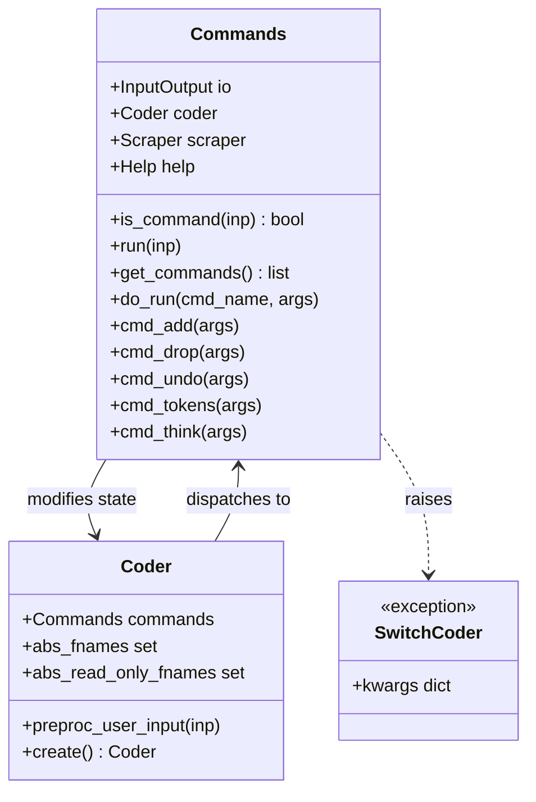

# Commands and User Interactions

Relevant source files

The following files were used as context for generating this wiki page:

- [aider/args.py](aider/args.py)
- [aider/coders/base_coder.py](aider/coders/base_coder.py)
- [aider/commands.py](aider/commands.py)
- [aider/help.py](aider/help.py)
- [aider/io.py](aider/io.py)
- [aider/main.py](aider/main.py)
- [aider/models.py](aider/models.py)
- [aider/repo.py](aider/repo.py)
- [aider/repomap.py](aider/repomap.py)
- [aider/voice.py](aider/voice.py)
- [aider/website/docs/languages.md](aider/website/docs/languages.md)
- [aider/website/docs/usage/commands.md](aider/website/docs/usage/commands.md)
- [scripts/issues.py](scripts/issues.py)
- [tests/basic/test_coder.py](tests/basic/test_coder.py)
- [tests/basic/test_commands.py](tests/basic/test_commands.py)
- [tests/basic/test_io.py](tests/basic/test_io.py)
- [tests/basic/test_sanity_check_repo.py](tests/basic/test_sanity_check_repo.py)
- [tests/help/test_help.py](tests/help/test_help.py)

This document describes how Aider processes slash commands and shell commands that users enter during interactive chat sessions. It covers the `Commands` class that dispatches command methods, the auto-completion system, and the mechanisms for switching between different coding modes. For information about the main chat loop and message processing, see [Coder Orchestration System](2.2). For details on terminal input/output and styling, see [Input/Output and Terminal Interface](2.5).

## Overview

The command system allows users to interact with Aider through slash commands (e.g., `/add`, `/commit`) and shell commands (prefixed with `!`). The `Commands` class acts as a dispatcher that:

- Detects commands in user input via prefix matching (`/` or `!`) [[aider/commands.py:255-256]]().
- Routes commands to appropriate handler methods [[aider/commands.py:287-298]]().
- Provides tab-completion for commands and their arguments [[aider/io.py:148-185]]().
- Manages file additions, model switching, and repository operations [[aider/commands.py:87-1360]]().
- Can trigger mode changes by raising `SwitchCoder` exceptions [[aider/commands.py:30-34]]().

Sources: [[aider/commands.py:36-333]](), [[aider/coders/base_coder.py:912-922]]()

## Command Detection and Dispatch Flow

The following diagram illustrates how a user's input string is identified as a command and routed to the correct execution logic within the `Commands` class.

Title: "Command Dispatch Sequence"

**Command Dispatch Process**

1. **Input Preprocessing**: `preproc_user_input()` checks if input is a command using `Commands.is_command()` [[aider/coders/base_coder.py:912-922]]().
2. **Command Type Detection**: The system checks for `/` (slash command) or `!` (shell command) [[aider/commands.py:255-256]]().
3. **Command Matching**: `matching_commands()` finds commands that match the input prefix [[aider/commands.py:300-310]]().
4. **Execution**: `do_run()` invokes the corresponding `cmd_*` method [[aider/commands.py:287-298]]().
5. **Mode Switching**: Commands can raise `SwitchCoder` to trigger coder recreation [[aider/commands.py:30-34]]().

Sources: [[aider/commands.py:255-333]](), [[aider/coders/base_coder.py:912-922]]()

## Command Method Convention

All commands follow a naming convention where methods starting with `cmd_` automatically become available commands. The method name is converted from snake_case to dash-case for user input.

Title: "Command Method Discovery"

**Implementation Details**:
- `get_commands()` scans `self` for methods starting with `cmd_` [[aider/commands.py:276-285]]().
- `do_run()` converts dash-case back to snake_case and invokes the method [[aider/commands.py:287-298]]().
- Each command method receives a single `args` string parameter containing everything after the command name.

Sources: [[aider/commands.py:276-298]]()

## Available Commands by Category

### File Management Commands

| Command | Method | Description | Sources |
|---------|--------|-------------|---------|
| `/add` | `cmd_add()` | Add files to the chat context | [[aider/commands.py:744-851]]() |
| `/drop` | `cmd_drop()` | Remove files from chat context | [[aider/commands.py:853-930]]() |
| `/read-only` | `cmd_read_only()` | Add files as read-only references | [[aider/commands.py:932-969]]() |

### Git Operations

| Command | Method | Description | Sources |
|---------|--------|-------------|---------|
| `/commit` | `cmd_commit()` | Commit changes to repository | [[aider/commands.py:337-354]]() |
| `/undo` | `cmd_undo()` | Undo last aider commit | [[aider/commands.py:553-655]]() |
| `/diff` | `cmd_diff()` | Show diff since last message | [[aider/commands.py:657-695]]() |
| `/git` | `cmd_git()` | Run git command | [[aider/commands.py:1303-1315]]() |

### Chat History and Model Configuration

| Command | Method | Description | Sources |
|---------|--------|-------------|---------|
| `/clear` | `cmd_clear()` | Clear chat history | [[aider/commands.py:411-415]]() |
| `/tokens` | `cmd_tokens()` | Report token usage | [[aider/commands.py:445-551]]() |
| `/model` | `cmd_model()` | Switch main model | [[aider/commands.py:87-112]]() |
| `/think` | `cmd_think()` | Toggle the thinking token budget | [[aider/commands.py:1438-1447]]() |
| `/thinking-tokens` | `cmd_thinking_tokens()` | Set specific thinking token budget | [[aider/commands.py:1411-1436]]() |
| `/reasoning-effort`| `cmd_reasoning_effort()`| Set reasoning effort level (low/med/high) | [[aider/commands.py:1385-1409]]() |

### Interaction Modes

| Command | Method | Description | Sources |
|---------|--------|-------------|---------|
| `/ask` | `cmd_ask()` | Switch to ask mode (no edits) | [[aider/commands.py:1362-1372]]() |
| `/code` | `cmd_code()` | Switch to code mode (edits) | [[aider/commands.py:1374-1383]]() |
| `/architect` | `cmd_architect()` | Toggle architect mode | [[aider/commands.py:1347-1360]]() |
| `/chat-mode` | `cmd_chat_mode()` | Switch edit format/mode | [[aider/commands.py:138-203]]() |

Sources: [[aider/commands.py:87-1447]]()

## SwitchCoder Exception Mechanism

The `SwitchCoder` exception is a control flow mechanism that allows commands to trigger the creation of a new `Coder` instance with different settings (like switching from GPT-4 to Claude).

Title: "Coder Mode Switching Flow"

**SwitchCoder Flow**:

1. **Command raises exception**: `cmd_model()` raises `SwitchCoder(main_model=model, edit_format=...)` [[aider/commands.py:112]]().
2. **Exception contains kwargs**: `SwitchCoder.__init__()` stores model/format parameters [[aider/commands.py:30-34]]().
3. **Caught by coder**: `preproc_user_input()` detects command and invokes it [[aider/coders/base_coder.py:916-917]]().
4. **New coder created**: The exception is caught and triggers `Coder.create(from_coder=self, **kwargs)` [[aider/coders/base_coder.py:133-201]]().
5. **Context preserved**: Chat history, files, and settings are migrated from the old coder to the new one [[aider/coders/base_coder.py:153-188]]().

Sources: [[aider/commands.py:30-34]](), [[aider/commands.py:87-203]](), [[aider/coders/base_coder.py:133-201]]()

## Auto-Completion System

The `AutoCompleter` class in `aider/io.py` provides intelligent tab-completion for both command names and their arguments.

Title: "Auto-Completion Architecture"

**Completion Types**:

1. **Command Name Completion**: Completes partial command names [[aider/io.py:148-154]]().
2. **Argument Completion via `completions_*`**: Returns a list of candidates, such as model names for `/model` [[aider/commands.py:266-274]]().
3. **Raw Path Completion via `completions_raw_*`**: Custom completer for file paths used in commands like `/add` [[aider/commands.py:258-264]]().

Sources: [[aider/io.py:91-228]](), [[aider/commands.py:205-274]]()

## Shell Command Execution

Shell commands are entered with a `!` prefix and executed directly via the `cmd_run()` method.

Title: "Shell Command Execution Pipeline"

**Shell Command Implementation**:
- `cmd_run()` executes shell commands [[aider/commands.py:971-1024]]().
- It uses the `run_cmd()` utility which handles subprocess management [[aider/run_cmd.py:1-42]]().
- Output is formatted and added to the chat history using templates from `prompts.py` so the LLM is aware of the command result [[aider/prompts.py:36-43]]().

Sources: [[aider/commands.py:971-1024]](), [[aider/prompts.py:36-43]]()

## File Management Commands

File commands modify the set of files tracked in the current coding session.

1. **`/add`** [[aider/commands.py:744-851]]():
   - Parses space-separated file patterns.
   - Expands globs using `glob.glob()`.
   - Prompts to create non-existent files if `io.confirm_ask` is true.
   - Updates `coder.abs_fnames` set.

2. **`/drop`** [[aider/commands.py:853-930]]():
   - Removes files from `coder.abs_fnames`.
   - Supports dropping by exact path or by basename if unambiguous.

3. **`/read-only`** [[aider/commands.py:932-969]]():
   - Adds files to `coder.abs_read_only_fnames`.
   - These files are included in the prompt for context but the LLM is instructed not to modify them.

Sources: [[aider/commands.py:744-969]]()

## Commands Class Architecture

The `Commands` class manages the lifecycle and execution of all slash commands.

Title: "Commands System Class Diagram"

**Initialization**:
- `Commands` is initialized with references to `InputOutput` and `Coder` [[aider/commands.py:53-86]]().
- It stores persistent state for voice processing, web scraping, and help systems.

Sources: [[aider/commands.py:36-86]](), [[aider/coders/base_coder.py:431-432]]()