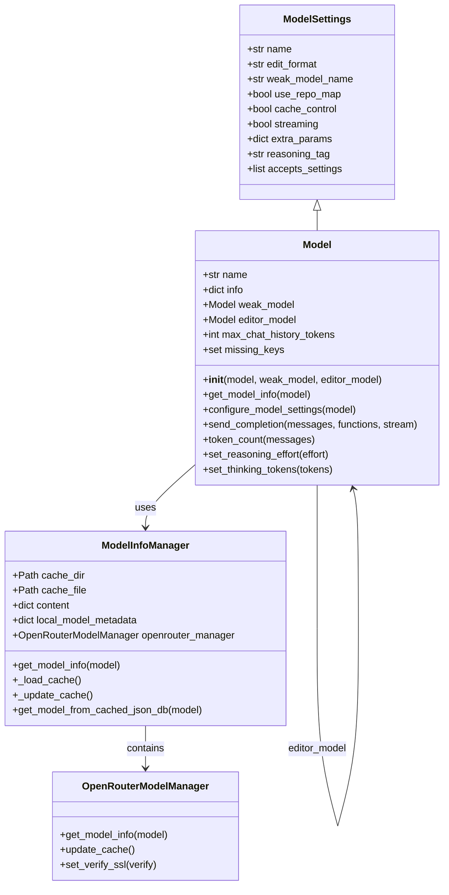
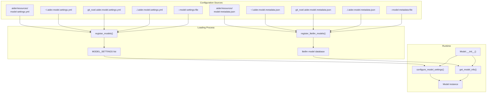
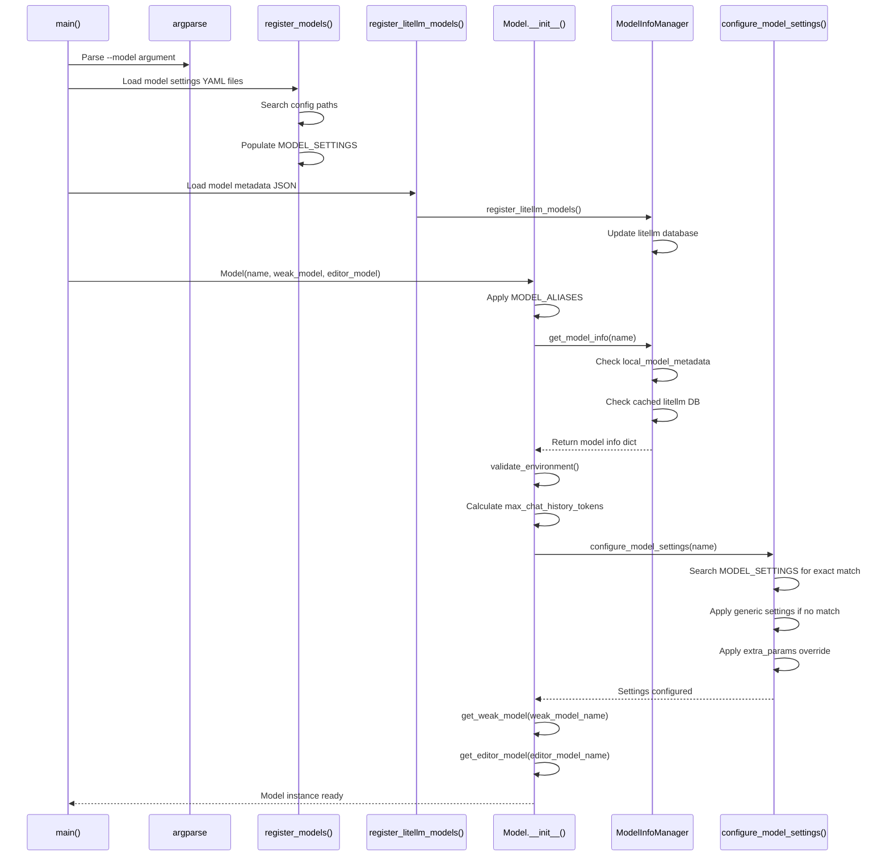
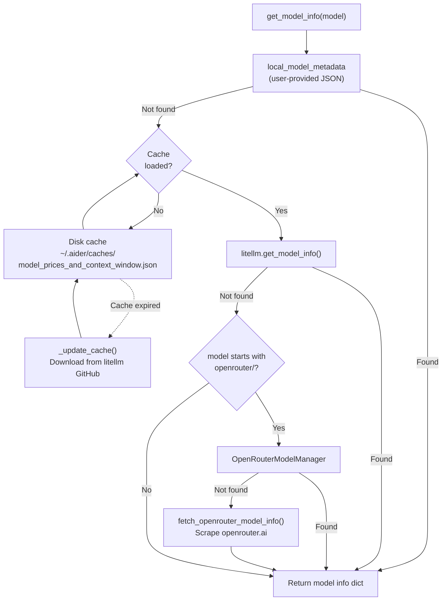
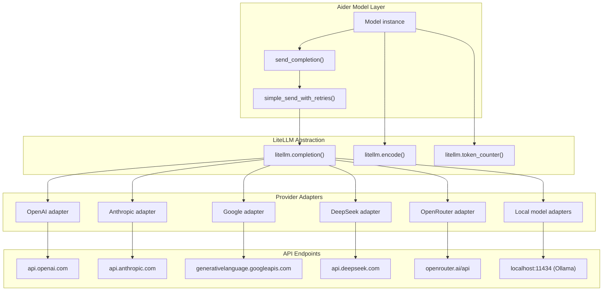

# Model Management and LLM Integration

Relevant source files

The following files were used as context for generating this wiki page:

- [MANIFEST.in](MANIFEST.in)
- [aider/__init__.py](aider/__init__.py)
- [aider/args.py](aider/args.py)
- [aider/coders/base_coder.py](aider/coders/base_coder.py)
- [aider/commands.py](aider/commands.py)
- [aider/exceptions.py](aider/exceptions.py)
- [aider/help_pats.py](aider/help_pats.py)
- [aider/io.py](aider/io.py)
- [aider/llm.py](aider/llm.py)
- [aider/main.py](aider/main.py)
- [aider/models.py](aider/models.py)
- [aider/repo.py](aider/repo.py)
- [aider/repomap.py](aider/repomap.py)
- [aider/resources/__init__.py](aider/resources/__init__.py)
- [aider/resources/model-metadata.json](aider/resources/model-metadata.json)
- [aider/resources/model-settings.yml](aider/resources/model-settings.yml)
- [aider/voice.py](aider/voice.py)
- [aider/website/_data/polyglot_leaderboard.yml](aider/website/_data/polyglot_leaderboard.yml)
- [aider/website/_includes/install.md](aider/website/_includes/install.md)
- [aider/website/docs/languages.md](aider/website/docs/languages.md)
- [aider/website/docs/leaderboards/by-release-date.md](aider/website/docs/leaderboards/by-release-date.md)
- [aider/website/docs/llms/bedrock.md](aider/website/docs/llms/bedrock.md)
- [aider/website/docs/llms/gemini.md](aider/website/docs/llms/gemini.md)
- [pyproject.toml](pyproject.toml)
- [scripts/versionbump.py](scripts/versionbump.py)
- [tests/basic/test_exceptions.py](tests/basic/test_exceptions.py)
- [tests/basic/test_io.py](tests/basic/test_io.py)
- [tests/basic/test_models.py](tests/basic/test_models.py)
- [tests/basic/test_reasoning.py](tests/basic/test_reasoning.py)

This document explains how Aider manages LLM models, handles configuration, integrates with multiple providers through litellm, and implements its multi-tier model architecture.

## Overview

Aider supports 200+ LLM models from multiple providers (OpenAI, Anthropic, Google, DeepSeek, OpenRouter, local models) through a unified model management system. The system handles model configuration, metadata, API integration, and provides a three-tier architecture (main/weak/editor models) to optimize cost and performance.

**Key Components:**
- `Model` class: Core model abstraction with configuration and API integration [aider/models.py:317-358]().
- `ModelSettings` dataclass: Per-model behavioral settings [aider/models.py:128-151]().
- `ModelInfoManager`: Metadata caching and provider information [aider/models.py:161-183]().
- Configuration files: `model-settings.yml` [aider/models.py:155-159]() and `model-metadata.json` [aider/models.py:130-131]().
- LiteLLM integration: Multi-provider API abstraction layer [aider/llm.py:1-50]().

Sources: [aider/models.py:1-400](), [aider/main.py:32-32]()

## Model Class Architecture

The `Model` class extends `ModelSettings` to combine configuration data with runtime functionality. Each `Model` instance can reference other `Model` instances as its weak or editor model, creating a flexible multi-tier architecture [aider/models.py:317-358]().

Model Management Structure:

Sources: [aider/models.py:128-151](), [aider/models.py:317-358](), [aider/models.py:161-240]()

## Model Configuration System

Configuration files are loaded in a specific order with later files overriding earlier ones. The `register_models()` function loads YAML settings files into the global `MODEL_SETTINGS` list [aider/models.py:1100-1110](), while `register_litellm_models()` loads JSON metadata into the litellm database [aider/models.py:1140-1150]().

Configuration Loading Logic:

**Configuration Search Path:**
1. Package resources (`aider/resources/`) [aider/models.py:155-159]()
2. Home directory (`~/.aider.model.settings.yml`) [aider/args.py:121-125]()
3. Git root (`git_root/.aider.model.settings.yml`) [aider/args.py:121-125]()
4. Current directory (`./.aider.model.settings.yml`) [aider/args.py:121-125]()
5. Command line (`--model-settings-file`) [aider/args.py:121-125]()

Sources: [aider/main.py:335-358](), [aider/models.py:153-160](), [aider/args.py:121-131]()

## Model Initialization Flow

The initialization sequence ensures model configuration is loaded before creating `Model` instances. The `Model.__init__()` method resolves aliases, retrieves metadata, validates API keys, and recursively creates weak/editor model instances [aider/models.py:317-358]().

Sources: [aider/main.py:756-828](), [aider/models.py:317-358](), [aider/models.py:373-420]()

## ModelInfoManager and Metadata Caching

The `ModelInfoManager` class provides a multi-layered approach to retrieving model metadata:

**Cache Strategy:**
- **Local metadata**: User-provided JSON files via `local_model_metadata` [aider/models.py:172]().
- **Disk cache**: 24-hour TTL cache of litellm's model database [aider/models.py:166-170]().
- **LiteLLM API**: Runtime lookup in litellm's model registry [aider/models.py:237-241]().
- **OpenRouter cache**: Pre-cached OpenRouter model database via `OpenRouterModelManager` [aider/models.py:177]().

Sources: [aider/models.py:161-312](), [aider/models.py:237-262](), [aider/models.py:264-311]()

## LiteLLM Integration Architecture

The `litellm` library provides a unified interface for calling different LLM providers. Aider's `Model` class wraps litellm calls with retry logic, error handling, and streaming support [aider/models.py:720-850]().

Provider Integration Data Flow:

Sources: [aider/models.py:632-930](), [aider/llm.py:1-50](), [aider/main.py:32-32]()

## Three-Tier Model System

The three-tier architecture optimizes cost and performance by delegating tasks to specialized models:

**Main Model:**
- Primary coding model specified via `--model` [aider/args.py:60-64]().
- Handles edit generation and complex reasoning.
- Configured via `main_model.edit_format`, `main_model.use_repo_map`, etc [aider/models.py:128-151]().

**Weak Model:**
- Specified via `--weak-model` [aider/args.py:185-192]() or `weak_model_name` in settings.
- Used for commit messages [aider/models.py:607-608]().
- Used for chat history summarization [aider/coders/base_coder.py:510-513]().

**Editor Model:**
- Specified via `--editor-model` [aider/args.py:194-198]() or `editor_model_name` in settings.
- Used in architect mode to implement high-level plans [aider/args.py:172-177]().

Sources: [aider/models.py:588-630](), [aider/coders/base_coder.py:510-513](), [aider/args.py:185-205]()

## Special Model Features

### Reasoning and Thinking Tokens

Aider supports models with extended reasoning capabilities like Claude 3.7 and o1/o3:

- **Reasoning Effort**: Set via `--reasoning-effort` [aider/args.py:139-142]() for o1/o3 models. Values: `"low"`, `"medium"`, `"high"`. Stored in `extra_params["reasoning_effort"]` [aider/models.py:673-673]().
- **Thinking Tokens**: Set via `--thinking-tokens` [aider/args.py:144-150]() for models like Claude 3.7. Controls the budget for internal reasoning. Stored in `extra_params["thinking"]["budget_tokens"]` [aider/models.py:698-698]().
- **Reasoning Tags**: For models that output reasoning in specific tags (e.g., `<thought>`), Aider can extract and display this separately using `reasoning_tag` configuration [aider/models.py:147-147]().

Sources: [aider/models.py:657-705](), [aider/args.py:139-150](), [aider/reasoning_tags.py:40-45]()

### Prompt Caching and Warming

Aider integrates provider-specific caching features to reduce latency and cost:

- **Cache Control**: Enabled via `model.cache_control` flag [aider/models.py:140-140](). It adds breakpoints to messages for Anthropic's prompt caching.
- **Cache Warming**: Aider can keep the prompt cache "warm" by sending periodic pings in a background thread `cache_warming_thread` [aider/coders/base_coder.py:115-115](). This is configured via `--cache-keepalive-pings` [aider/args.py:221-224]().

Sources: [aider/models.py:140-141](), [aider/coders/base_coder.py:114-116](), [aider/args.py:221-224]()

## Model Validation and Sanity Checks

Before starting a chat, Aider performs several checks:

1. **Environment Validation**: The `validate_environment()` method checks if required API keys are present by calling `litellm.validate_environment(model_name)` [aider/models.py:934-946]().
2. **Sanity Checks**: The `sanity_check_models()` function validates model configuration, checking for metadata and edit format compatibility [aider/models.py:972-1009]().
3. **Missing Keys**: If keys are missing, Aider identifies them and can prompt the user or fail gracefully with a `MissingAPIKeyError` [aider/coders/base_coder.py:65-66]().

Sources: [aider/models.py:934-1009](), [aider/coders/base_coder.py:65-66](), [aider/main.py:101-101]()