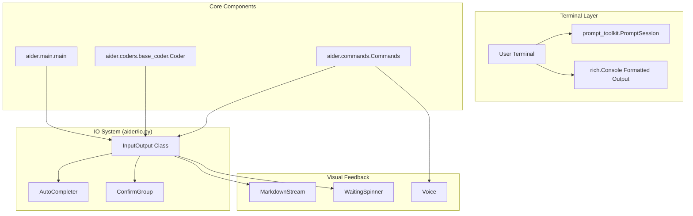
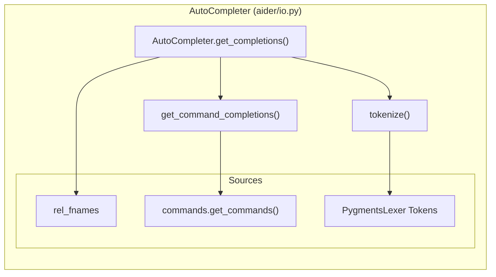
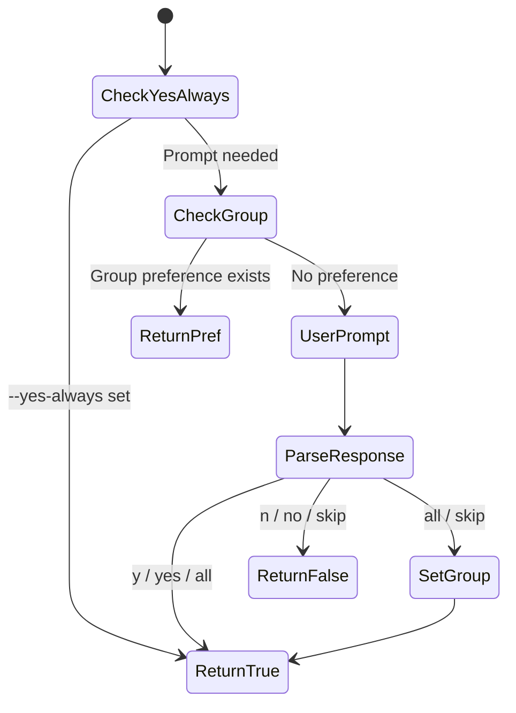

# Input/Output and Terminal Interface

Relevant source files

The following files were used as context for generating this wiki page:

- [aider/args.py](aider/args.py)
- [aider/coders/base_coder.py](aider/coders/base_coder.py)
- [aider/commands.py](aider/commands.py)
- [aider/io.py](aider/io.py)
- [aider/main.py](aider/main.py)
- [aider/mdstream.py](aider/mdstream.py)
- [aider/models.py](aider/models.py)
- [aider/repo.py](aider/repo.py)
- [aider/repomap.py](aider/repomap.py)
- [aider/voice.py](aider/voice.py)
- [aider/waiting.py](aider/waiting.py)
- [aider/website/_includes/multi-line.md](aider/website/_includes/multi-line.md)
- [aider/website/docs/config/editor.md](aider/website/docs/config/editor.md)
- [aider/website/docs/languages.md](aider/website/docs/languages.md)
- [tests/basic/test_io.py](tests/basic/test_io.py)

The Input/Output system provides all terminal interaction capabilities in Aider, including user input collection, output formatting, auto-completion, markdown streaming, and the waiting/spinner system. This system handles both simple text-based I/O for basic terminals and rich formatted output with colors, markdown rendering, and interactive prompts for capable terminals.

For information about how commands are processed after input is received, see [Commands and User Interactions (2.3)](). For details on chat history storage and formatting, see [Message Formatting and Chat History (3.5)]().

## System Architecture

The `InputOutput` class serves as the central interface between the user's terminal and Aider's core components. It integrates with `prompt_toolkit` for advanced input features and `Rich` for formatted output.

### Terminal Interaction Components

**Sources:** [aider/io.py:237-797](), [aider/main.py:551-580](), [aider/coders/base_coder.py:129](), [aider/waiting.py:171-193]()

## InputOutput Class Initialization

The `InputOutput` class is configured with extensive options for terminal appearance, history files, and behavioral settings. It detects terminal capabilities and handles graceful fallbacks.

| Configuration Category | Key Parameters | Default Values |
|----------------------|----------------|----------------|
| **Visual Style** | `pretty`, `user_input_color`, `assistant_output_color` | `pretty=True`, hex-colors initialized in `__init__` |
| **Input Modes** | `fancy_input`, `multiline_mode`, `editing_mode` | `fancy_input=True`, `multiline_mode=False` |
| **History Files** | `input_history_file`, `chat_history_file` | `.aider.input.history`, `.aider.chat.history.md` |
| **Confirmation** | `yes_always`, `notifications` | `yes_always=False` |
| **Encoding** | `encoding`, `line_endings` | `encoding="utf-8"`, `line_endings="platform"` |

**Sources:** [aider/io.py:237-373](), [aider/io.py:339-367](), [aider/args.py:532-580]()

## User Input Collection System

The input system provides two modes: fancy input with `prompt_toolkit` features (auto-completion, syntax highlighting, history) and simple input using Python's built-in `input()` function for "dumb" terminals [aider/io.py:683-714]().

### Auto-completion Implementation
The `AutoCompleter` class provides context-aware completions. It tokenizes current files using `Pygments` lexers to provide identifier completions and handles command-specific arguments [aider/io.py:127-146]().

**Sources:** [aider/io.py:91-228](), [aider/io.py:127-146](), [aider/io.py:186-228]()

### Voice Input
The `Voice` class in `aider/voice.py` provides audio recording and transcription using the OpenAI Whisper model [aider/voice.py:169-171](). It integrates with `sounddevice` for recording and `pydub` for audio format conversion [aider/voice.py:45-47]().

**Sources:** [aider/voice.py:33-180](), [aider/commands.py:465-492]()

## Visual Feedback and Waiting Systems

Aider provides two main mechanisms for feedback during long-running LLM tasks: the `WaitingSpinner` and `MarkdownStream`.

### Waiting Spinner
The `WaitingSpinner` runs in a separate background thread to provide a "live" feel while waiting for LLM responses.

- **Implementation**: Uses `threading.Thread` to run a loop that updates the terminal [aider/waiting.py:171-193]().
- **Animation**: The `Spinner` class pre-renders ASCII or Unicode frames that bounce back and forth [aider/waiting.py:23-104]().
- **Cleanup**: The spinner is "killable" and ensures the cursor is restored and the line is cleared upon stopping [aider/waiting.py:162-169]().

**Sources:** [aider/waiting.py:23-193](), [aider/coders/base_coder.py:50]()

### Markdown Streaming
The `MarkdownStream` class progressively displays LLM output. It uses `rich.live.Live` to maintain a sliding window of visible content while streaming [aider/mdstream.py:168-170]().

- **Stable vs Unstable Lines**: It splits output into "stable" older lines (printed directly to console) and "unstable" recent lines (rendered in the Live window) to play nicely with terminal scrollback [aider/mdstream.py:150-165]().
- **Adaptive Throttling**: It measures render time and adjusts `min_delay` to maintain smooth rendering [aider/mdstream.py:172-185]().

**Sources:** [aider/mdstream.py:92-218](), [aider/io.py:36]()

## Confirmation Dialog System

The `confirm_ask()` method provides flexible user confirmation with support for grouped decisions and persistent preferences [aider/io.py:965-1092]().

### Confirmation Logic

- **ConfirmGroup**: Allows the user to "Apply all" or "Skip all" for a set of related operations (e.g., adding multiple files) [aider/io.py:81-90]().
- **Explicit Yes**: Certain dangerous operations can require an explicit "yes" even if `--yes-always` is set [aider/io.py:1016-1020]().

**Sources:** [aider/io.py:965-1092](), [aider/io.py:81-90]()

## Output Formatting and Styling

`InputOutput` uses `Rich` to provide colored and formatted output.

| Method | Style | Purpose |
|--------|-------|---------|
| `tool_output()` | `tool_output_color` | General information and announcements |
| `tool_error()` | `tool_error_color` | Errors (red by default) |
| `tool_warning()` | `tool_warning_color` | Warnings (orange by default) |
| `assistant_output()` | `assistant_output_color` | LLM responses (blue by default) |

- **Color Normalization**: Hex colors are automatically prefixed with `#` if missing via `ensure_hash_prefix` [aider/io.py:46-54]().
- **Style Validation**: Styles are validated against `RichStyle` to ensure they are compatible with the terminal [aider/io.py:374-398]().

**Sources:** [aider/io.py:798-897](), [aider/io.py:46-54](), [aider/io.py:374-398]()

## File I/O Operations

`InputOutput` encapsulates file access to handle encoding and concurrent write issues.

- **Write with Retry**: `write_text` includes exponential backoff and retries when encountering `PermissionError`, common on Windows if another process has locked the file [aider/io.py:453-511]().
- **Encoding Support**: It attempts to read files using the user-specified encoding, falling back to safe defaults [aider/io.py:435-452]().

**Sources:** [aider/io.py:435-511](), [aider/io.py:314-316]()