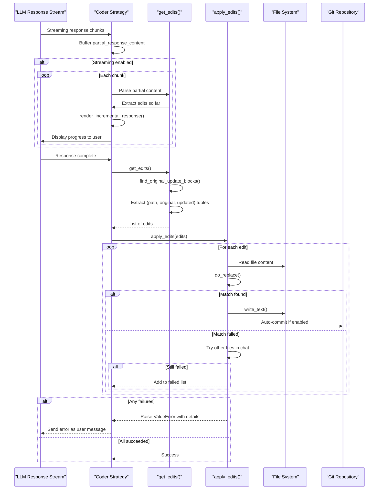
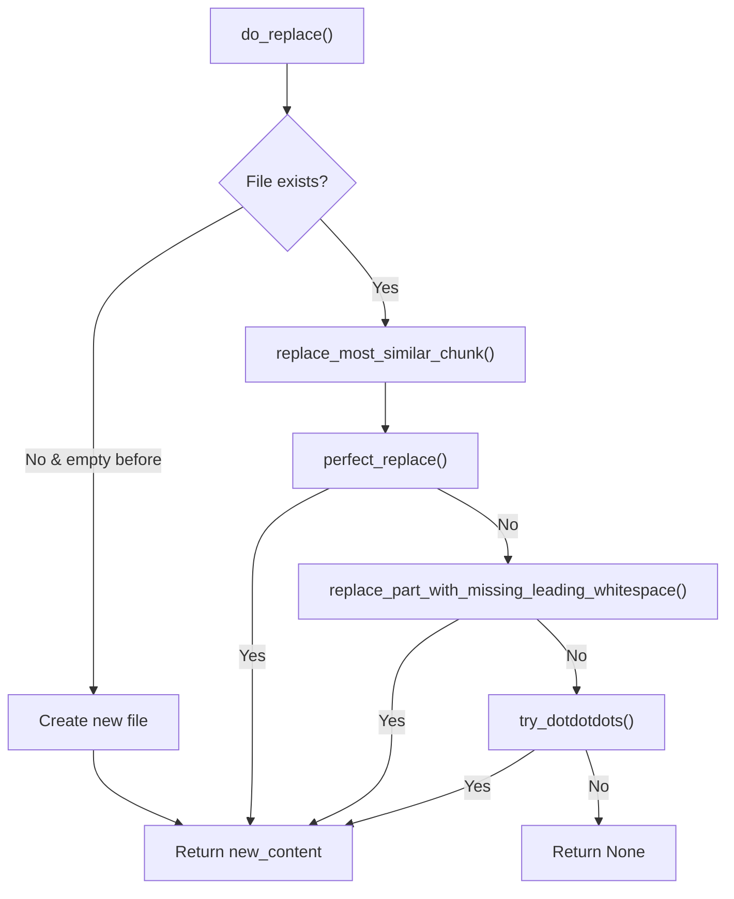

# Edit Strategies and Code Modification

<details>
<summary>Relevant source files</summary>

The following files were used as context for generating this wiki page:

- [aider/coders/__init__.py](aider/coders/__init__.py)
- [aider/coders/ask_prompts.py](aider/coders/ask_prompts.py)
- [aider/coders/base_prompts.py](aider/coders/base_prompts.py)
- [aider/coders/editblock_coder.py](aider/coders/editblock_coder.py)
- [aider/coders/editblock_func_coder.py](aider/coders/editblock_func_coder.py)
- [aider/coders/editblock_func_prompts.py](aider/coders/editblock_func_prompts.py)
- [aider/coders/editblock_prompts.py](aider/coders/editblock_prompts.py)
- [aider/coders/patch_prompts.py](aider/coders/patch_prompts.py)
- [aider/coders/shell.py](aider/coders/shell.py)
- [aider/coders/single_wholefile_func_coder.py](aider/coders/single_wholefile_func_coder.py)
- [aider/coders/single_wholefile_func_prompts.py](aider/coders/single_wholefile_func_prompts.py)
- [aider/coders/udiff_prompts.py](aider/coders/udiff_prompts.py)
- [aider/coders/wholefile_coder.py](aider/coders/wholefile_coder.py)
- [aider/coders/wholefile_func_coder.py](aider/coders/wholefile_func_coder.py)
- [aider/coders/wholefile_func_prompts.py](aider/coders/wholefile_func_prompts.py)
- [aider/coders/wholefile_prompts.py](aider/coders/wholefile_prompts.py)
- [aider/diffs.py](aider/diffs.py)

</details>


## Purpose and Scope

This document explains Aider's strategy pattern implementation for applying code changes from LLM responses to source files. Different LLMs excel at different response formats, so Aider implements multiple edit strategies that can be selected based on the model being used.

For details on individual coder implementations, see [Edit Format Implementations](#3.1). For the search/replace matching algorithms, see [Search and Replace Logic](#3.2). For prompt engineering details, see [Prompt Engineering and Templates](#3.4).

## The Strategy Pattern Architecture

Aider implements the Strategy pattern to separate the algorithm for extracting and applying code edits from the core orchestration logic. Each edit strategy is a subclass of the `Coder` base class, implementing a common interface while providing different parsing and application logic.

```mermaid
graph TB
    subgraph "Base Interface"
        Coder["Coder (base_coder.py)<br/>Abstract Interface"]
    end
    
    subgraph "Text-Based Strategies"
        EditBlock["EditBlockCoder (editblock_coder.py)<br/>edit_format: diff<br/>SEARCH/REPLACE blocks"]
        EditFenced["EditBlockFencedCoder (editblock_fenced_coder.py)<br/>edit_format: diff-fenced<br/>Fenced SEARCH/REPLACE"]
        WholeFile["WholeFileCoder (wholefile_coder.py)<br/>edit_format: whole<br/>Complete file replacement"]
        UDiff["UnifiedDiffCoder (udiff_coder.py)<br/>edit_format: udiff<br/>Unified diff format"]
        UDiffSimple["UnifiedDiffSimpleCoder (udiff_simple.py)<br/>edit_format: udiff-simple<br/>Simplified diff"]
        Patch["PatchCoder (patch_coder.py)<br/>edit_format: patch<br/>V4A patch format"]
    end
    
    subgraph "Special Purpose"
        Ask["AskCoder (ask_coder.py)<br/>Questions only, no edits"]
        Context["ContextCoder (context_coder.py)<br/>File selection mode"]
        Help["HelpCoder (help_coder.py)<br/>Documentation lookup"]
    end
    
    subgraph "Architect Mode"
        Architect["ArchitectCoder (architect_coder.py)<br/>Two-stage workflow"]
    end
    
    subgraph "Editor Variants"
        EditorEdit["EditorEditBlockCoder (editor_editblock_coder.py)"]
        EditorWhole["EditorWholeFileCoder (editor_whole_coder.py)"]
        EditorFenced["EditorDiffFencedCoder (editor_diff_fenced_coder.py)"]
    end
    
    Coder --> EditBlock
    Coder --> EditFenced
    Coder --> WholeFile
    Coder --> UDiff
    Coder --> UDiffSimple
    Coder --> Patch
    Coder --> Ask
    Coder --> Context
    Coder --> Help
    Coder --> Architect
    Coder --> EditorEdit
    Coder --> EditorWhole
    Coder --> EditorFenced
```



Sources: [aider/coders/__init__.py:1-34](), [aider/coders/editblock_coder.py:15-19](), [aider/coders/wholefile_coder.py:10-14]()

## Core Interface Methods

Each coder strategy implements three key methods that define how LLM responses are processed into file modifications:

| Method | Purpose | Return Type |
|--------|---------|-------------|
| `get_edits()` | Parse LLM response to extract edit operations | List of edit tuples |
| `apply_edits(edits)` | Apply extracted edits to the filesystem | None or raises ValueError |
| `render_incremental_response(final)` | Display streaming updates to user | Formatted string |

The `Coder` base class defines the orchestration loop that calls these methods. For details, see [Edit Format Implementations](#3.1).

Sources: [aider/coders/editblock_coder.py:21-36](), [aider/coders/wholefile_coder.py:16-22](), [aider/coders/base_coder.py:3-10]()

## Edit Format Characteristics

| Format | Class | Primary Use Case | Logic Summary |
|--------|-------|------------------|---------------|
| `diff` | `EditBlockCoder` | Targeted edits | Uses `SEARCH/REPLACE` blocks to match and swap lines. |
| `whole` | `WholeFileCoder` | Complete rewrites | Overwrites the entire file with new content. |
| `udiff` | `UnifiedDiffCoder` | Git-style patches | Parsed similar to `diff -U0` output. |
| `patch` | `PatchCoder` | V4A diff format | Uses `*** Begin Patch` markers and 3-line context. |
| `func` | `SingleWholeFileFunctionCoder` | Tool-calling models | Uses JSON function arguments to write file content. |

Sources: [aider/coders/editblock_coder.py:15-18](), [aider/coders/wholefile_coder.py:10-13](), [aider/coders/udiff_prompts.py:16-17](), [aider/coders/patch_prompts.py:28-31](), [aider/coders/single_wholefile_func_coder.py:8-14]()

## Edit Processing Pipeline

The following diagram shows how an LLM response flows through the edit strategy system to modify source files:



Sources: [aider/coders/editblock_coder.py:21-124](), [aider/coders/wholefile_coder.py:22-128](), [aider/coders/base_coder.py:3-10]()

## SEARCH/REPLACE Block Format

The `EditBlockCoder` strategy uses a distinctive block format that separates the search pattern from the replacement text. This is documented in the system prompts to guide the LLM.

```
path/to/file.py
<<<<<<< SEARCH
def old_function():
    return "old"
=======
def old_function():
    return "new"
>>>>>>> REPLACE
```

The `EditBlockPrompts` class defines the strict rules for these blocks, requiring exact character-for-character matching in the `SEARCH` section.

Sources: [aider/coders/editblock_prompts.py:120-159](), [aider/coders/editblock_coder.py:93-97]()

## Whole File Format

The `WholeFileCoder` strategy expects the LLM to provide complete file contents. The parser identifies filenames by looking for lines immediately before fence markers.

1. **Filename detection**: Heuristics check the line before the opening fence (e.g., `path/to/filename.js`) [aider/coders/wholefile_coder.py:54-62]().
2. **Fallback**: If only one file is in the chat context, it may default to that file [aider/coders/wholefile_coder.py:77-79]().
3. **Application**: `apply_edits` simply calls `io.write_text` with the new content [aider/coders/wholefile_coder.py:124-128]().

Sources: [aider/coders/wholefile_coder.py:54-84](), [aider/coders/wholefile_coder.py:124-128](), [aider/coders/wholefile_prompts.py:42-62]()

## Matching and Replacement Logic

The `EditBlockCoder` employs a sophisticated matching process to handle LLM imperfections. For details, see [Search and Replace Logic](#3.2).



Sources: [aider/coders/editblock_coder.py:134-183](), [aider/coders/editblock_coder.py:51-53]()

### Ellipsis Handling

The `try_dotdotdots` function allows LLMs to elide large chunks of unchanging code using `...` markers. It splits the blocks into pieces and applies them sequentially if the non-elided parts match exactly.

Sources: [aider/coders/editblock_coder.py:190-218]()

## Diff Generation and Display

Aider provides visual feedback during the edit process. The `diffs.py` module contains utilities for calculating partial updates during streaming.

- **Progress Bar**: `create_progress_bar` generates a visual indicator of how much of a file has been processed (e.g., `[██████░░░░]`) [aider/diffs.py:26-33]().
- **Partial Diffs**: `diff_partial_update` generates a unified diff even when the LLM has only finished part of the file [aider/diffs.py:43-102]().

For details, see [Diff Generation and Display](#3.3).

Sources: [aider/diffs.py:26-33](), [aider/diffs.py:43-102](), [aider/coders/wholefile_coder.py:130-141]()

## Error Handling and Reflection

When an edit fails to match, Aider does not simply fail. It raises a `ValueError` containing a detailed diagnostic message. This message is then sent back to the LLM as a new user message, allowing the model to "reflect" and correct the `SEARCH` block.

The error message includes:
- Which blocks failed [aider/coders/editblock_coder.py:84-85]().
- A `SearchReplaceNoExactMatch` error [aider/coders/editblock_coder.py:92]().
- Suggestions from `find_similar_lines` to show the LLM what the file actually contains [aider/coders/editblock_coder.py:98-106]().

Sources: [aider/coders/editblock_coder.py:79-124](), [aider/coders/editblock_coder.py:98-106]()

## Deprecated Function-Call Strategies

Aider includes several "Function" coders that were designed for early OpenAI tool-calling APIs. These are largely deprecated or refactored into the modern text-based strategies.

- `EditBlockFunctionCoder`: Deprecated, required refactor for `get_edits` [aider/coders/editblock_func_coder.py:61]().
- `WholeFileFunctionCoder`: Deprecated [aider/coders/wholefile_func_coder.py:47]().
- `SingleWholeFileFunctionCoder`: Still used for specific "func" format requirements [aider/coders/single_wholefile_func_coder.py:8-9]().

Sources: [aider/coders/editblock_func_coder.py:61](), [aider/coders/wholefile_func_coder.py:47](), [aider/coders/single_wholefile_func_coder.py:8-9]()