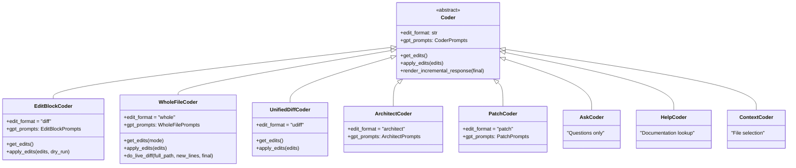
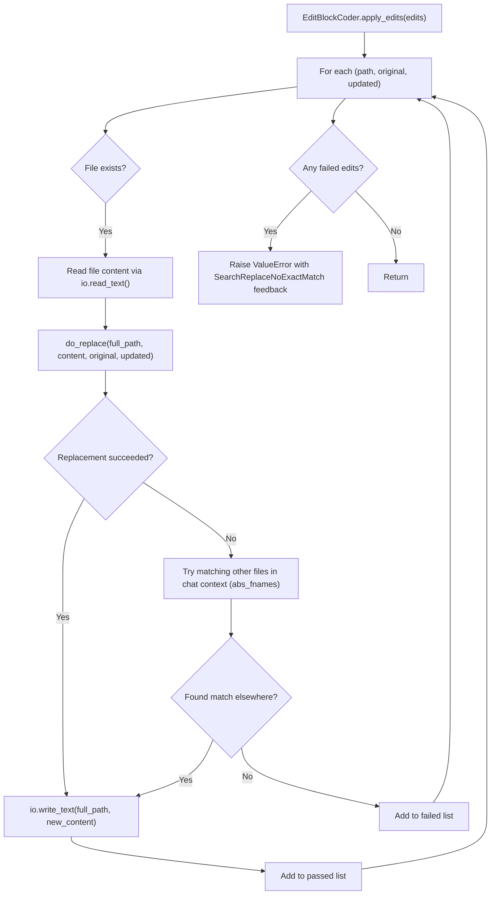
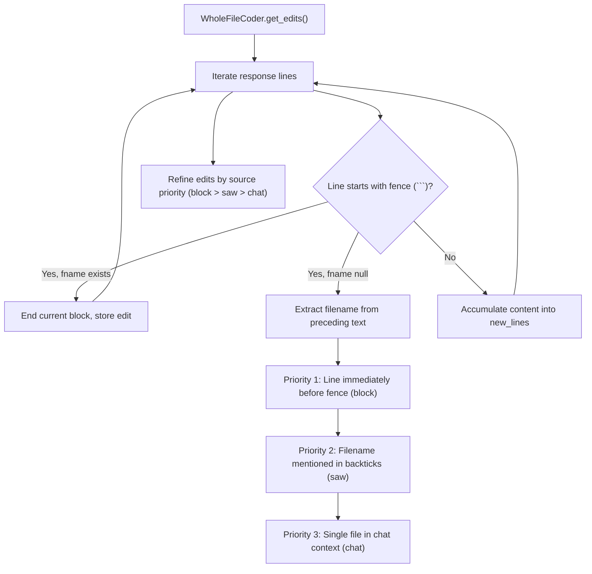

# Edit Format Implementations

<details>
<summary>Relevant source files</summary>

The following files were used as context for generating this wiki page:

- [aider/coders/__init__.py](aider/coders/__init__.py)
- [aider/coders/architect_coder.py](aider/coders/architect_coder.py)
- [aider/coders/architect_prompts.py](aider/coders/architect_prompts.py)
- [aider/coders/ask_coder.py](aider/coders/ask_coder.py)
- [aider/coders/context_coder.py](aider/coders/context_coder.py)
- [aider/coders/context_prompts.py](aider/coders/context_prompts.py)
- [aider/coders/editblock_coder.py](aider/coders/editblock_coder.py)
- [aider/coders/editblock_fenced_coder.py](aider/coders/editblock_fenced_coder.py)
- [aider/coders/editblock_fenced_prompts.py](aider/coders/editblock_fenced_prompts.py)
- [aider/coders/editblock_func_coder.py](aider/coders/editblock_func_coder.py)
- [aider/coders/editblock_func_prompts.py](aider/coders/editblock_func_prompts.py)
- [aider/coders/editor_diff_fenced_coder.py](aider/coders/editor_diff_fenced_coder.py)
- [aider/coders/editor_diff_fenced_prompts.py](aider/coders/editor_diff_fenced_prompts.py)
- [aider/coders/editor_editblock_coder.py](aider/coders/editor_editblock_coder.py)
- [aider/coders/editor_editblock_prompts.py](aider/coders/editor_editblock_prompts.py)
- [aider/coders/editor_whole_coder.py](aider/coders/editor_whole_coder.py)
- [aider/coders/editor_whole_prompts.py](aider/coders/editor_whole_prompts.py)
- [aider/coders/help_coder.py](aider/coders/help_coder.py)
- [aider/coders/patch_coder.py](aider/coders/patch_coder.py)
- [aider/coders/search_replace.py](aider/coders/search_replace.py)
- [aider/coders/single_wholefile_func_coder.py](aider/coders/single_wholefile_func_coder.py)
- [aider/coders/single_wholefile_func_prompts.py](aider/coders/single_wholefile_func_prompts.py)
- [aider/coders/udiff_coder.py](aider/coders/udiff_coder.py)
- [aider/coders/wholefile_coder.py](aider/coders/wholefile_coder.py)
- [aider/coders/wholefile_func_coder.py](aider/coders/wholefile_func_coder.py)
- [aider/coders/wholefile_func_prompts.py](aider/coders/wholefile_func_prompts.py)
- [aider/diffs.py](aider/diffs.py)
- [aider/website/_data/architect.yml](aider/website/_data/architect.yml)
- [aider/website/_posts/2024-09-26-architect.md](aider/website/_posts/2024-09-26-architect.md)
- [aider/website/_sass/custom/custom.scss](aider/website/_sass/custom/custom.scss)
- [aider/website/docs/usage/modes.md](aider/website/docs/usage/modes.md)

</details>


## Purpose and Scope

This document describes the various coder implementations in Aider that handle different edit formats for code modifications. Each coder class implements a specific strategy for parsing LLM responses and applying code changes to files. For information about the base `Coder` orchestration system, see [Core Architecture](2.2). For details on search/replace matching algorithms, see [Search and Replace Logic](3.2). For prompt templates that guide LLM behavior, see [Prompt Engineering and Templates](3.4).

## Coder Implementation Architecture

Aider implements the Strategy pattern for code modifications, where each concrete coder class provides a different edit format. All coders inherit from the base `Coder` class and implement key methods for parsing and applying changes.

### Class Hierarchy and Edit Formats



**Sources:** [aider/coders/base_coder.py](), [aider/coders/__init__.py:1-34]()

The `edit_format` attribute identifies each coder's format, which is used in model configuration to determine which strategy a specific LLM should use. Each coder has an associated prompts class (e.g., `EditBlockPrompts` [aider/coders/editblock_coder.py:19](), `WholeFilePrompts` [aider/coders/wholefile_coder.py:14]()) providing system instructions for that format.

## EditBlockCoder - SEARCH/REPLACE Format

`EditBlockCoder` is the primary implementation for models capable of precise line-based editing. It uses a SEARCH/REPLACE block format where the LLM identifies a specific block of code and provides its replacement.

### Edit Format Structure

The expected format uses three separators to delimit sections:

```
<<<<<<< SEARCH
original code to find
=======
replacement code
>>>>>>> REPLACE
```

### Parsing and Application Logic

The `get_edits()` method [aider/coders/editblock_coder.py:21-36]() uses `find_original_update_blocks()` to extract these blocks from the LLM stream. It handles shell commands and identifies which file the block belongs to.



**Sources:** [aider/coders/editblock_coder.py:41-124](), [aider/coders/editblock_coder.py:51-65]()

### Replacement Strategies

The `do_replace()` function tries multiple matching strategies in order:
1. **Perfect match**: Exact line-by-line comparison via `perfect_replace()` [aider/coders/editblock_coder.py:146-155]().
2. **Whitespace flexible**: Handles cases where the LLM ignores leading indentation via `replace_part_with_missing_leading_whitespace()` [aider/coders/editblock_coder.py:141-143]().
3. **Ellipsis expansion**: The `try_dotdotdots()` function handles `...` placeholders representing elided code within a block [aider/coders/editblock_coder.py:190-240]().

## WholeFileCoder - Complete File Replacement

`WholeFileCoder` replaces entire files. It is less token-efficient but easier for models that struggle with precise line-matching (like reasoning-heavy models).

### Parsing Logic

The `get_edits()` method [aider/coders/wholefile_coder.py:22-122]() implements a state machine to detect filenames and their corresponding fenced code blocks.



**Sources:** [aider/coders/wholefile_coder.py:22-122](), [aider/coders/wholefile_coder.py:108-121]()

## Architect Mode and Two-Stage Editing

Architect mode separates "reasoning" from "editing" by using two different models or two distinct steps [aider/website/docs/usage/modes.md:111-141]().

1. **Architect model**: Proposes a solution in natural language or high-level descriptions. This is handled by `ArchitectCoder` [aider/coders/architect_coder.py]().
2. **Editor model**: Receives the architect's proposal and generates specific file edits. This is typically implemented by classes like `EditorEditBlockCoder` [aider/coders/editor_editblock_coder.py](), `EditorWholeFileCoder` [aider/coders/editor_whole_coder.py](), or `EditorDiffFencedCoder` [aider/coders/editor_diff_fenced_coder.py]().

This approach has produced SOTA results on code editing benchmarks by allowing the architect model to focus on logic while the editor model handles formatting [aider/website/_posts/2024-09-26-architect.md:12-26]().

**Sources:** [aider/website/docs/usage/modes.md:111-151](), [aider/website/_posts/2024-09-26-architect.md:1-26](), [aider/coders/__init__.py:29-32]()

## UnifiedDiffCoder - Standard Diff Format

The `UnifiedDiffCoder` [aider/coders/udiff_coder.py:46-119]() uses a format similar to standard `diff -u` output. It is highly efficient but requires the LLM to strictly follow the unified diff syntax.

- **Parsing**: The `get_edits` method identifies diff headers and hunks [aider/coders/udiff_coder.py:52-67]().
- **Application**: The `apply_edits` method uses `do_replace` which attempts to apply hunks even if context lines don't match perfectly, utilizing `apply_hunk` [aider/coders/udiff_coder.py:151-199]().

**Sources:** [aider/coders/udiff_coder.py:46-119](), [aider/coders/udiff_coder.py:121-145]()

## Specialized Coder Implementations

| Class | Format / Mode | Purpose |
|-------|---------------|---------|
| `PatchCoder` | `"patch"` | Implements a custom patch format with `ADD`, `DELETE`, and `UPDATE` actions [aider/coders/patch_coder.py:17-40](). |
| `AskCoder` | `"ask"` | Used for discussion. It answers questions without making code changes [aider/website/docs/usage/modes.md:12](). |
| `HelpCoder` | `"help"` | Answers questions about Aider's usage and configuration using documentation context [aider/website/docs/usage/modes.md:14](). |
| `ContextCoder` | `"context"` | Used to help the LLM suggest which files should be added to the chat context [aider/coders/context_coder.py](). |

**Sources:** [aider/coders/__init__.py:1-34](), [aider/website/docs/usage/modes.md:9-15](), [aider/coders/patch_coder.py:17-40]()

## Deprecated Function-Based Coders

Aider previously supported OpenAI function-calling (tools) for edits. These are largely deprecated but remain in the codebase:

- **`EditBlockFunctionCoder`**: Used a `replace_lines` function schema [aider/coders/editblock_func_coder.py:10-58]().
- **`WholeFileFunctionCoder`**: Used a `write_file` function schema [aider/coders/wholefile_func_coder.py:9-44]().
- **`SingleWholeFileFunctionCoder`**: A simplified version for writing a single file via `write_file` [aider/coders/single_wholefile_func_coder.py:8-35]().

**Sources:** [aider/coders/editblock_func_coder.py:60-61](), [aider/coders/wholefile_func_coder.py:46-47](), [aider/coders/single_wholefile_func_coder.py:11-35]()