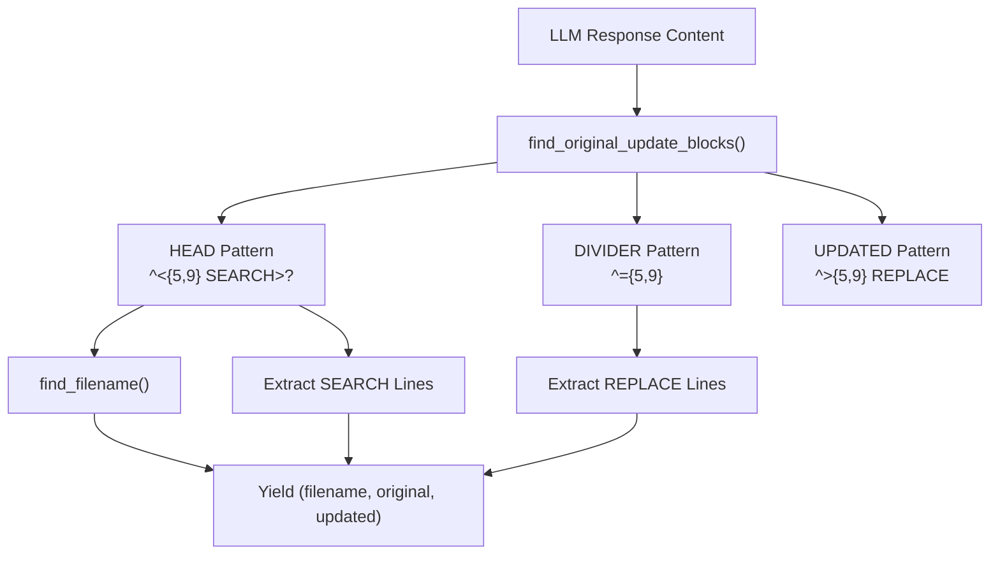
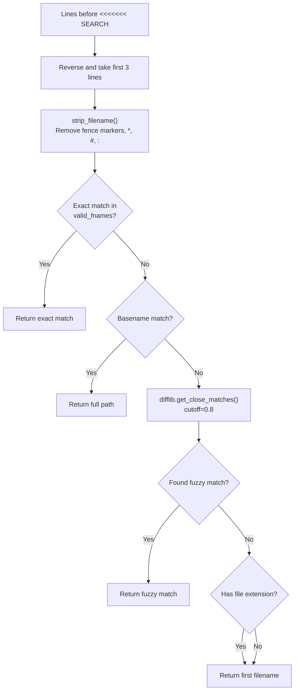
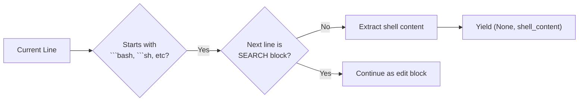
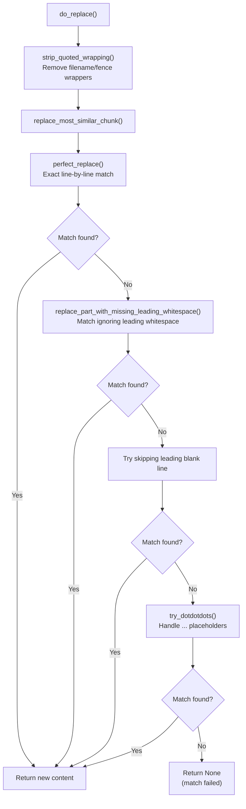
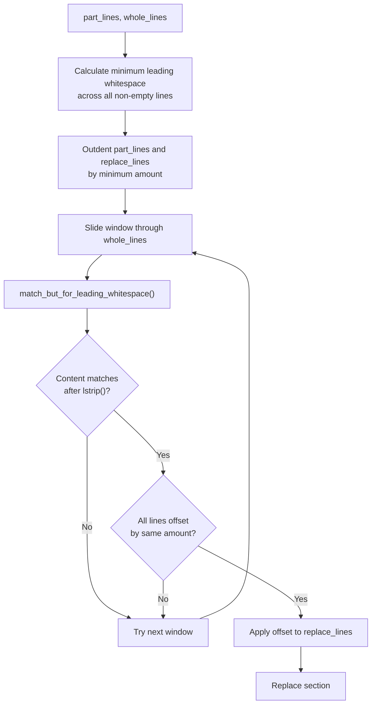
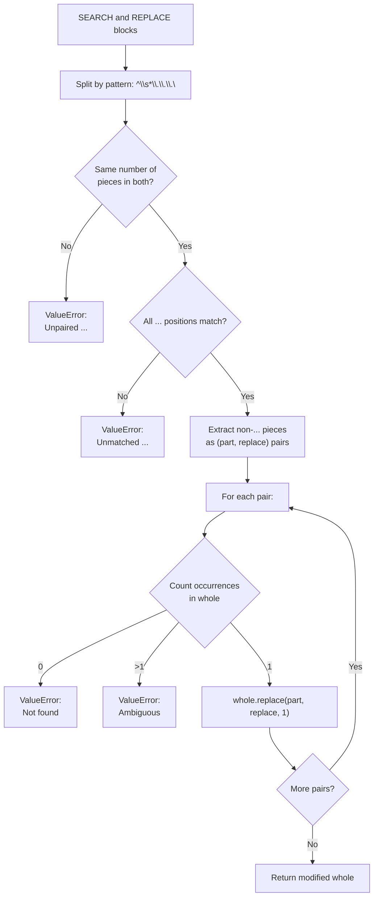
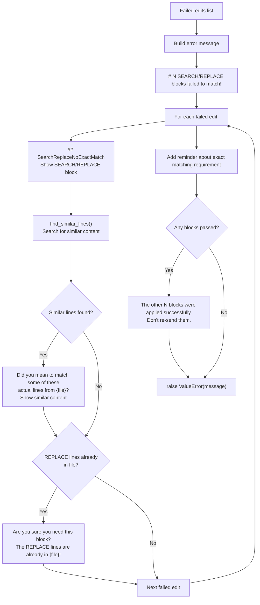

# Search and Replace Logic

<details>
<summary>Relevant source files</summary>

The following files were used as context for generating this wiki page:

- [aider/coders/ask_coder.py](aider/coders/ask_coder.py)
- [aider/coders/editblock_fenced_coder.py](aider/coders/editblock_fenced_coder.py)
- [aider/coders/help_coder.py](aider/coders/help_coder.py)
- [aider/coders/patch_coder.py](aider/coders/patch_coder.py)
- [aider/coders/search_replace.py](aider/coders/search_replace.py)
- [aider/coders/udiff_coder.py](aider/coders/udiff_coder.py)
- [aider/website/docs/ctags.md](aider/website/docs/ctags.md)
- [aider/website/examples/README.md](aider/website/examples/README.md)
- [tests/basic/test_editblock.py](tests/basic/test_editblock.py)
- [tests/basic/test_find_or_blocks.py](tests/basic/test_find_or_blocks.py)
- [tests/fixtures/chat-history-search-replace-gold.txt](tests/fixtures/chat-history-search-replace-gold.txt)
- [tests/fixtures/chat-history.md](tests/fixtures/chat-history.md)

</details>


This document explains the sophisticated search and replace algorithms used by the `EditBlockCoder` class to apply code modifications. The EditBlockCoder uses a SEARCH/REPLACE block format where the LLM provides original code to search for and replacement code to insert. The logic must handle imperfect matches, whitespace variations, ellipsis placeholders, and provide helpful error messages when matches fail.

For information about the overall EditBlockCoder implementation and prompt engineering, see [Edit Format Implementations (3.1)](). For diff generation and display, see [Diff Generation and Display (3.3)]().

## SEARCH/REPLACE Block Format

The EditBlockCoder expects LLM responses containing blocks in this format:

```
filename.py
<<<<<<< SEARCH
original code to find
=======
replacement code
>>>>>>> REPLACE
```

The parser extracts these blocks and attempts to locate the SEARCH content in the target file, replacing it with the REPLACE content. The system is designed to be fault-tolerant, handling common LLM mistakes like incorrect indentation, spurious blank lines, and code elision with ellipsis (`...`).

**Sources:** [aider/coders/editblock_coder.py:386-396]()

## Block Parsing and Extraction

### Pattern Matching

The parser uses regular expressions to identify SEARCH/REPLACE block boundaries. It is robust enough to handle variations in the number of comparison symbols (typically 7, but accepts 5-9).



The parser iterates through response lines in `find_original_update_blocks`, detecting block boundaries and extracting the filename, original text, and updated text as tuples.

**Sources:** [aider/coders/editblock_coder.py:386-396](), [aider/coders/editblock_coder.py:439-536]()

### Filename Extraction

Filenames are extracted from the lines immediately preceding the SEARCH block using a flexible algorithm that handles markdown fences and fuzzy matching.



The `find_filename()` function implements a multi-stage matching strategy to associate code blocks with the correct files in the `Coder`'s context. It supports exact matching, basename matching, and fuzzy matching via `difflib`.

**Sources:** [aider/coders/editblock_coder.py:538-600](), [aider/coders/editblock_coder.py:408-436](), [tests/basic/test_editblock.py:20-51]()

### Shell Command Extraction

The parser also recognizes fenced shell code blocks (bash, sh, zsh, etc.) and extracts them as executable commands rather than edit blocks. This allows the LLM to suggest shell operations alongside file edits.



**Sources:** [aider/coders/editblock_coder.py:451-485](), [tests/basic/test_find_or_blocks.py:60-63]()

## Matching Strategies

The core replacement logic in `replace_most_similar_chunk()` attempts multiple strategies in order of decreasing precision:

### Strategy Cascade



**Sources:** [aider/coders/editblock_coder.py:157-188](), [aider/coders/editblock_coder.py:364-383]()

### Perfect Match Strategy

The `perfect_replace()` function performs exact tuple comparison of line sequences. It is the most restrictive and accurate strategy.

| Step | Description | Code Reference |
|------|-------------|----------------|
| 1 | Convert `part_lines` to tuple | [aider/coders/editblock_coder.py:147]() |
| 2 | Slide window through `whole_lines` | [aider/coders/editblock_coder.py:150-151]() |
| 3 | Compare tuples for equality | [aider/coders/editblock_coder.py:152]() |
| 4 | Replace matching section | [aider/coders/editblock_coder.py:153]() |

**Sources:** [aider/coders/editblock_coder.py:146-154]()

### Whitespace Handling Strategy

LLMs frequently produce SEARCH blocks with incorrect indentation. The `replace_part_with_missing_leading_whitespace()` function handles this by finding the minimum leading whitespace and matching the "shape" of the code.



**Sources:** [aider/coders/editblock_coder.py:243-273](), [aider/coders/editblock_coder.py:276-293]()

### Ellipsis Handling Strategy

LLMs sometimes use `...` to indicate unchanged code sections. The `try_dotdotdots()` function validates and processes these by splitting the SEARCH and REPLACE blocks into chunks. It ensures that the number of `...` markers matches in both blocks and that each non-ellipsis piece appears exactly once in the file.



**Sources:** [aider/coders/editblock_coder.py:190-240]()

### Fuzzy Matching (Disabled)

The codebase includes a `replace_closest_edit_distance()` function using `SequenceMatcher` for fuzzy matching, but it is currently disabled in the main `replace_most_similar_chunk` cascade to prevent accidental incorrect edits.

**Sources:** [aider/coders/editblock_coder.py:184-187](), [aider/coders/editblock_coder.py:296-329](), [tests/basic/test_editblock.py:53-70]()

## Application Flow

### Edit Application Process

The `EditBlockCoder.apply_edits` method iterates through the parsed blocks. If a block fails to apply to its specified file, it attempts to find a match in other files currently in the chat session.

```mermaid
sequenceDiagram
    participant EC as EditBlockCoder
    participant Parser as find_original_update_blocks
    participant Replacer as do_replace
    participant Strategy as replace_most_similar_chunk
    participant FS as File System
    
    EC->>Parser: parse LLM response
    Parser-->>EC: edits = [(path, original, updated), ...]
    
    loop For each edit
        EC->>Replacer: do_replace(path, original, updated)
        Replacer->>Strategy: try matching strategies
        
        alt Match found
            Strategy-->>Replacer: new_content
            Replacer-->>EC: new_content
            EC->>FS: write_text(path, new_content)
            EC->>EC: Mark as passed
        else No match for specified file
            EC->>EC: Try all other files in chat
            loop For each chat file
                EC->>Replacer: do_replace(chat_file, original, updated)
                Replacer->>Strategy: try matching strategies
                
                alt Match found in alternate file
                    Strategy-->>Replacer: new_content
                    Replacer-->>EC: new_content
                    EC->>FS: write_text(alternate_file, new_content)
                    EC->>EC: Mark as passed
                    break
                else Continue searching
                    EC->>EC: Try next file
                end
            end
        end
        
        alt Still no match
            EC->>EC: Mark as failed
        end
    end
    
    alt Any edits failed
        EC->>EC: raise ValueError with diagnostics
    end
```

**Sources:** [aider/coders/editblock_coder.py:38-124]()

## Error Handling and Diagnostics

### Failed Match Response

When SEARCH blocks fail to match, the system constructs detailed error messages to help the LLM correct its mistake. This includes detecting if the `REPLACE` content is already present in the file.



**Sources:** [aider/coders/editblock_coder.py:79-124]()

### Similar Line Detection

The `find_similar_lines()` function uses `SequenceMatcher` to locate the most similar content in the file, providing "Did you mean?" suggestions to the LLM.

| Parameter | Purpose | Default |
|-----------|---------|---------|
| `search_lines` | Failed SEARCH block content | - |
| `content_lines` | Actual file content | - |
| `threshold` | Minimum similarity ratio | 0.6 |

**Sources:** [aider/coders/editblock_coder.py:602-628]()

## Alternative Search and Replace Implementations

While `EditBlockCoder` is the primary user of the logic above, other coders use different search and replace mechanisms:

### Unified Diff Coder (`udiff`)
The `UnifiedDiffCoder` uses standard unified diff formats. It implements `apply_hunk` and `apply_partial_hunk` to apply changes. It also uses `flexible_search_and_replace` from the `search_replace` module. It handles file creation if the hunk starts with empty context.

**Sources:** [aider/coders/udiff_coder.py:46-51](), [aider/coders/udiff_coder.py:121-144](), [aider/coders/udiff_coder.py:151-200]()

### Patch Coder (`patch`)
The `PatchCoder` implements a custom patch format. It uses `find_context` and `find_context_core` to locate the correct lines in a file with varying levels of "fuzz" (exact, rstrip, or full strip). It handles multi-section updates via `peek_next_section`.

**Sources:** [aider/coders/patch_coder.py:59-94](), [aider/coders/patch_coder.py:96-191](), [aider/coders/patch_coder.py:218-230]()

### Search Replace Module Utilities
The `aider/coders/search_replace.py` module provides advanced utilities like `RelativeIndenter`, which transforms code into a relative indentation format to make it easier to match blocks across different indentation levels. It also includes `map_patches` which uses `diff_match_patch` to adjust patch offsets.

**Sources:** [aider/coders/search_replace.py:18-81](), [aider/coders/search_replace.py:106-171](), [aider/coders/search_replace.py:193-226]()