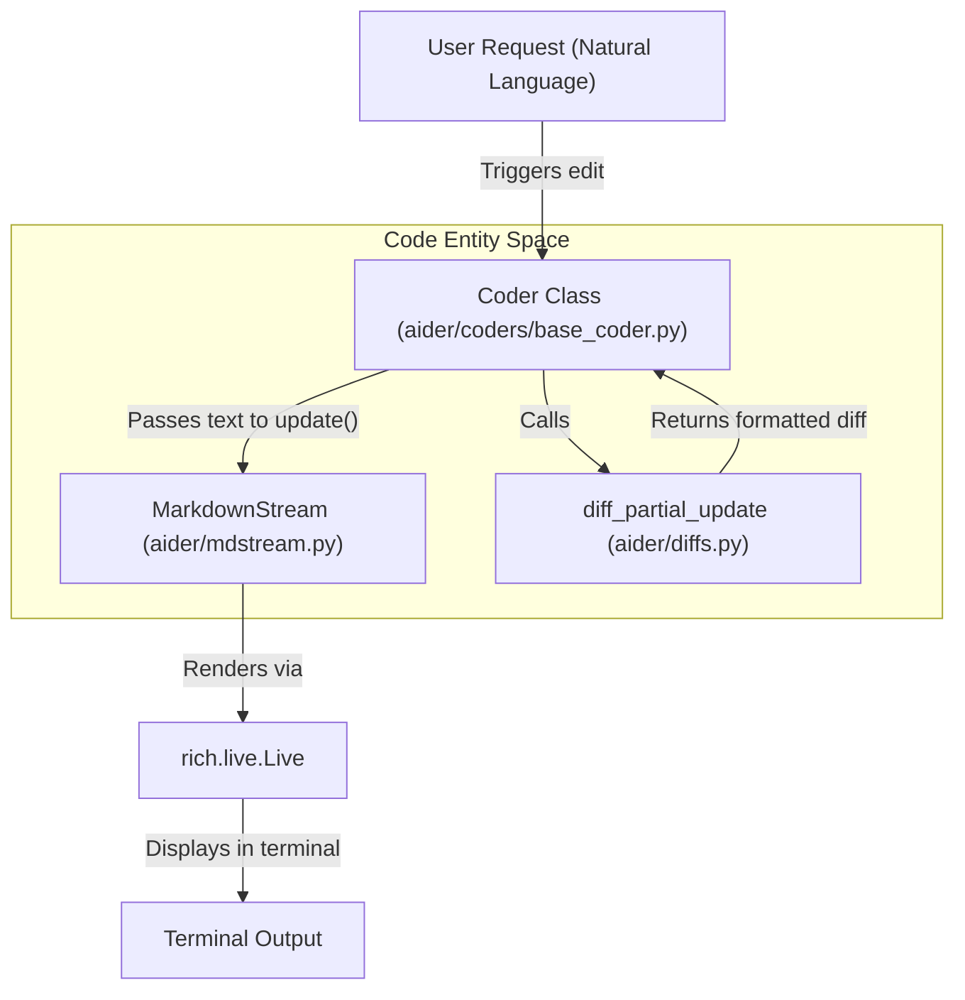
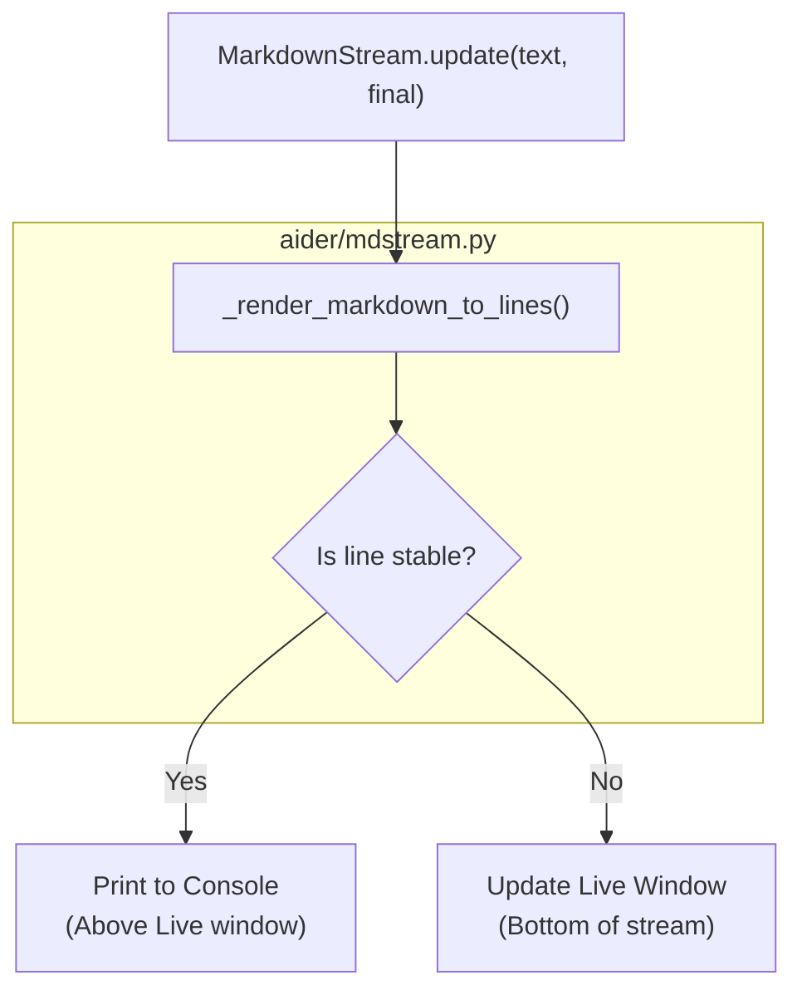

# Diff Generation and Display

Relevant source files

The following files were used as context for generating this wiki page:

- [aider/coders/__init__.py](aider/coders/__init__.py)
- [aider/coders/editblock_coder.py](aider/coders/editblock_coder.py)
- [aider/coders/editblock_func_coder.py](aider/coders/editblock_func_coder.py)
- [aider/coders/editblock_func_prompts.py](aider/coders/editblock_func_prompts.py)
- [aider/coders/single_wholefile_func_coder.py](aider/coders/single_wholefile_func_coder.py)
- [aider/coders/single_wholefile_func_prompts.py](aider/coders/single_wholefile_func_prompts.py)
- [aider/coders/wholefile_coder.py](aider/coders/wholefile_coder.py)
- [aider/coders/wholefile_func_coder.py](aider/coders/wholefile_func_coder.py)
- [aider/coders/wholefile_func_prompts.py](aider/coders/wholefile_func_prompts.py)
- [aider/diffs.py](aider/diffs.py)
- [aider/mdstream.py](aider/mdstream.py)
- [aider/waiting.py](aider/waiting.py)

This document describes how Aider generates and displays diffs to show code changes to users during incremental LLM responses. This covers the diff generation algorithms, progress bar visualization, and integration with coder implementations for real-time change preview via the `MarkdownStream` utility.

## Overview

When an LLM streams a response containing code modifications, Aider generates and displays unified diffs incrementally to show the user what changes are being made in real-time. This feedback is critical for monitoring progress and catching potential issues early.

The diff system handles a unique challenge: generating meaningful diffs when the LLM has only provided a partial update to a file. Aider must distinguish between lines that are truly being deleted versus lines that simply haven't been reached yet in the streaming response.

### Natural Language to Code Entity Mapping: Diff Workflow
The following diagram bridges the user's natural language request to the specific code entities responsible for visualizing the resulting changes.

**Sources:** [aider/coders/wholefile_coder.py:16-21](), [aider/mdstream.py:92-98](), [aider/diffs.py:43-48]()

## Core Diff Generation Algorithm

The diff generation system is implemented in `aider/diffs.py`, centered around the `diff_partial_update()` function.

### The diff_partial_update Function
The `diff_partial_update()` function generates a unified diff between original file content and a partial update, while intelligently handling incomplete updates. [aider/diffs.py:43-102]().

1.  **Identify completion point**: Calls `find_last_non_deleted()` to determine where the update ends. [aider/diffs.py:60-60]().
2.  **Truncate original**: Removes lines from `lines_orig` that are beyond the update boundary to avoid showing them as "deleted". [aider/diffs.py:73-73]().
3.  **Add progress indicator**: Appends a progress bar to `lines_updated` (unless `final=True`). [aider/diffs.py:75-76]().
4.  **Generate unified diff**: Uses `difflib.unified_diff()` with a context of 5 lines. [aider/diffs.py:78-78]().
5.  **Format output**: Wraps in a fenced code block with appropriate backticks to avoid conflicts with content. [aider/diffs.py:86-98]().

### Finding the Last Non-Deleted Line
The `find_last_non_deleted()` function determines how much of the original file has been processed. [aider/diffs.py:105-124](). It uses `difflib.ndiff()` to produce a sequence of line-level operations:
*   `' '` prefix: line unchanged. [aider/diffs.py:114-116]().
*   `'-'` prefix: line only in original (deleted). [aider/diffs.py:117-119]().
*   `'+'` prefix: line only in updated (added). [aider/diffs.py:120-122]().

By tracking unchanged lines, the function determines the last line in the original that has been "accounted for" in the update. [aider/diffs.py:116-116]().

### Progress Bar Visualization
The `create_progress_bar()` function generates a visual representation of update completion. [aider/diffs.py:26-33]().
*   Uses `█` for filled blocks and `░` for empty blocks. [aider/diffs.py:27-28]().
*   The progress bar is included in the diff output with line counts: ` 145 / 200 lines [███████████████░░░░░░░░░░░░░░░] 72%`. [aider/diffs.py:71-71]().

**Sources:** [aider/diffs.py:26-124]()

## Incremental Display via MarkdownStream

The `MarkdownStream` class in `aider/mdstream.py` handles the progressive display of markdown content (including diffs) with a live updating window. [aider/mdstream.py:92-98]().

### Live Rendering Logic
`MarkdownStream` maintains a sliding window of visible content while streaming. It splits output into "stable" older lines and "unstable" recent lines. [aider/mdstream.py:156-165](). Stable lines are printed to the console above the live window to ensure they remain in the terminal scrollback buffer. [aider/mdstream.py:163-164]().

**Sources:** [aider/mdstream.py:149-218]()

### Key Classes in mdstream.py
| Class | Purpose | Source |
| :--- | :--- | :--- |
| `NoInsetCodeBlock` | Renders syntax highlighting without extra padding. | [aider/mdstream.py:52-59]() |
| `LeftHeading` | Renders left-justified headings (h1 with heavy borders). | [aider/mdstream.py:61-79]() |
| `NoInsetMarkdown` | Custom Markdown class using the specialized elements above. | [aider/mdstream.py:81-89]() |
| `MarkdownStream` | Orchestrates the `rich.live.Live` display and throttles updates. | [aider/mdstream.py:92-104]() |

**Sources:** [aider/mdstream.py:52-104]()

## Integration with Coder Implementations

Different coder implementations integrate diff display during incremental response rendering.

### WholeFileCoder
The `WholeFileCoder` uses `do_live_diff()` to display changes as the LLM streams file content. [aider/coders/wholefile_coder.py:130-144]().
*   It reads the original file content from disk via `self.io.read_text()`. [aider/coders/wholefile_coder.py:132-132]().
*   It calls `diffs.diff_partial_update()` to generate the formatted diff string. [aider/coders/wholefile_coder.py:136-140]().

### EditBlockCoder Matching and Diffs
While `EditBlockCoder` primarily uses SEARCH/REPLACE blocks, it provides detailed feedback when a match fails. [aider/coders/editblock_coder.py:84-124]().
*   If an edit fails, it raises a `ValueError` containing a representation of the failed SEARCH block. [aider/coders/editblock_coder.py:124-124]().
*   It uses `find_similar_lines()` to suggest corrections to the LLM based on fuzzy matching. [aider/coders/editblock_coder.py:98-98]().
*   It handles elided code (using `...`) via `try_dotdotdots()` to match blocks where the LLM skipped unchanged code. [aider/coders/editblock_coder.py:190-211]().

### Function Call Diffs
Implementations like `WholeFileFunctionCoder` and `SingleWholeFileFunctionCoder` also utilize the diffing utility.
*   `SingleWholeFileFunctionCoder.live_diffs()` generates diffs for content provided via tool/function calls. [aider/coders/single_wholefile_func_coder.py:66-85]().
*   `WholeFileFunctionCoder.live_diffs()` performs similar logic for multiple files in a single function call. [aider/coders/wholefile_func_coder.py:89-108]().

**Sources:** [aider/coders/wholefile_coder.py:130-144](), [aider/coders/editblock_coder.py:84-211](), [aider/coders/single_wholefile_func_coder.py:66-85](), [aider/coders/wholefile_func_coder.py:89-108]()

## Implementation Details and Edge Cases

### Assertion for Line Endings
The diff system includes assertions to ensure line consistency. All lines except the last must end with newlines. [aider/diffs.py:36-41]().

### Backtick Selection
To prevent diff content from breaking the markdown fencing, `diff_partial_update` dynamically selects the number of backticks (3 to 9) required to wrap the diff. [aider/diffs.py:86-98]().

### Handling New Files
When a file is being created (it does not yet exist), `WholeFileCoder` defaults to showing the new content inside a standard code block rather than a diff. [aider/coders/wholefile_coder.py:143-144]().

### Waiting Spinner
Before the LLM starts streaming, Aider uses `WaitingSpinner` to indicate activity. [aider/waiting.py:171-180](). This spinner is managed in a background thread and is stopped once the `MarkdownStream` starts receiving content. [aider/waiting.py:186-193](), [aider/mdstream.py:167-170]().

**Sources:** [aider/diffs.py:36-98](), [aider/coders/wholefile_coder.py:143-144](), [aider/waiting.py:171-193](), [aider/mdstream.py:167-170]()