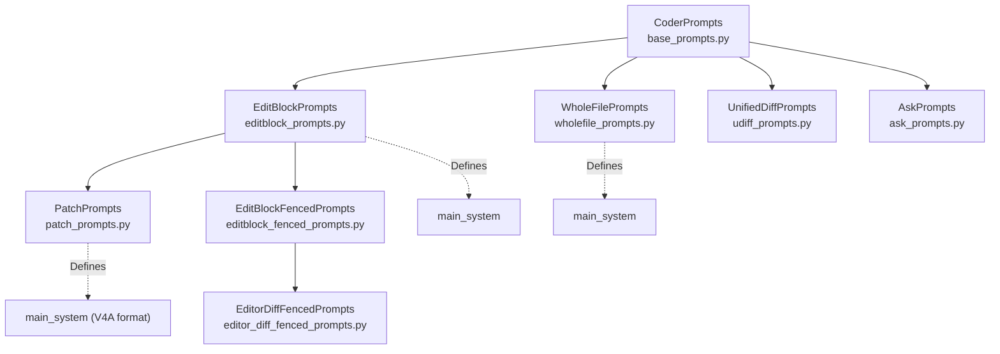
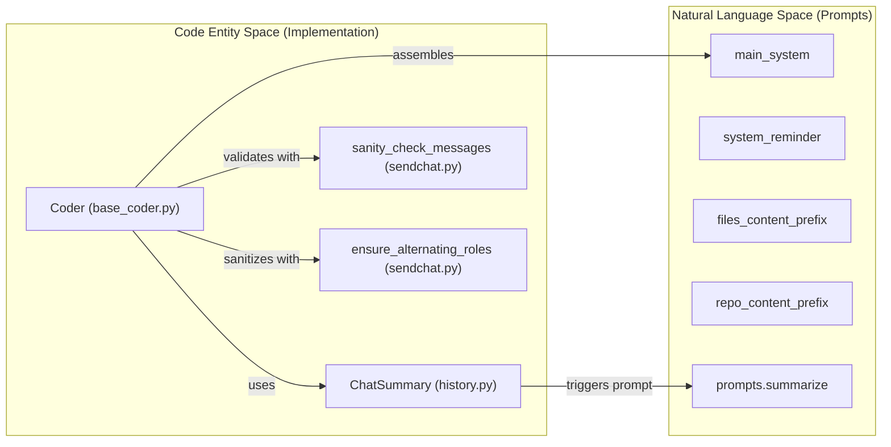

# Prompt Engineering and Templates

Relevant source files

The following files were used as context for generating this wiki page:

- [aider/coders/ask_prompts.py](aider/coders/ask_prompts.py)
- [aider/coders/base_prompts.py](aider/coders/base_prompts.py)
- [aider/coders/editblock_fenced_prompts.py](aider/coders/editblock_fenced_prompts.py)
- [aider/coders/editblock_prompts.py](aider/coders/editblock_prompts.py)
- [aider/coders/editor_diff_fenced_coder.py](aider/coders/editor_diff_fenced_coder.py)
- [aider/coders/editor_diff_fenced_prompts.py](aider/coders/editor_diff_fenced_prompts.py)
- [aider/coders/editor_editblock_prompts.py](aider/coders/editor_editblock_prompts.py)
- [aider/coders/editor_whole_prompts.py](aider/coders/editor_whole_prompts.py)
- [aider/coders/patch_prompts.py](aider/coders/patch_prompts.py)
- [aider/coders/shell.py](aider/coders/shell.py)
- [aider/coders/udiff_prompts.py](aider/coders/udiff_prompts.py)
- [aider/coders/wholefile_prompts.py](aider/coders/wholefile_prompts.py)
- [aider/history.py](aider/history.py)
- [aider/prompts.py](aider/prompts.py)
- [aider/sendchat.py](aider/sendchat.py)
- [tests/basic/test_sendchat.py](tests/basic/test_sendchat.py)

Aider uses prompt templates to guide LLM behavior and enforce specific output formats. The prompt system is organized into base classes that define common message patterns, extended by mode-specific implementations for different edit formats.

The `CoderPrompts` base class in [aider/coders/base_prompts.py:1-61]() defines the foundational template structure, with subclasses like `EditBlockPrompts`, `WholeFilePrompts`, `UnifiedDiffPrompts`, and `PatchPrompts` providing format-specific instructions. Each `Coder` instance accesses its prompts through the `self.gpt_prompts` attribute.

## Prompt Class Hierarchy

### Class Inheritance Structure

Each prompt class defines attributes that are accessed by the corresponding `Coder` subclass. For example, `EditBlockPrompts` defines the system instructions for the SEARCH/REPLACE format [aider/coders/editblock_prompts.py:7-30]().

Sources: [aider/coders/base_prompts.py:1-61](), [aider/coders/editblock_prompts.py:7-30](), [aider/coders/wholefile_prompts.py:6-15](), [aider/coders/udiff_prompts.py:7-17](), [aider/coders/patch_prompts.py:7-33](), [aider/coders/ask_prompts.py:6-12](), [aider/coders/editblock_fenced_prompts.py:6-143](), [aider/coders/editor_diff_fenced_prompts.py:6-12]().

## Prompt Template Attributes

The `CoderPrompts` base class defines template attributes that control LLM behavior. Subclasses override these to implement format-specific instructions.

### Core Template Attributes

| Attribute | Type | Purpose | Example |
|-----------|------|---------|---------|
| `main_system` | `str` | Primary system message defining LLM role | "Act as an expert software developer..." [aider/coders/editblock_prompts.py:8]() |
| `system_reminder` | `str` | Format enforcement rules appended to messages | "# *SEARCH/REPLACE block* Rules..." [aider/coders/editblock_prompts.py:120]() |
| `example_messages` | `list` | Few-shot examples of correct format | User/assistant Q&A pairs [aider/coders/editblock_prompts.py:31-118]() |
| `files_content_prefix` | `str` | Introduces file contents | "I have *added these files to the chat*..." [aider/coders/base_prompts.py:24-28]() |
| `repo_content_prefix` | `str` | Introduces repository map | "Here are summaries of some files..." [aider/coders/base_prompts.py:45-49]() |

### Behavior Modifier Attributes

| Attribute | Purpose | Implementation |
|-----------|---------|--------------|
| `lazy_prompt` | Prevents placeholder code comments | "You NEVER leave comments describing code without implementing it!" [aider/coders/base_prompts.py:12-15]() |
| `overeager_prompt` | Limits scope of changes | "Do what they ask, but no more." [aider/coders/base_prompts.py:17-20]() |

Sources: [aider/coders/base_prompts.py:1-61](), [aider/coders/editblock_prompts.py:1-173](), [aider/coders/ask_prompts.py:14-18]().

## Message Assembly and History Management

### Message Context Mapping

### Chat History Summarization
As conversations grow, Aider uses the `ChatSummary` class to compress history [aider/history.py:7-13]. If the token count exceeds `max_tokens` [aider/history.py:15-18], it recursively summarizes older parts of the conversation using the `prompts.summarize` template [aider/prompts.py:46-59]. The summary is written in the first person ("I asked you...") to maintain context continuity [aider/prompts.py:55-58].

### Message Sanitization
Before sending to the LLM, Aider ensures messages adhere to provider requirements:
- **Alternating Roles**: `ensure_alternating_roles` inserts empty messages if consecutive messages have the same role [aider/sendchat.py:29-61].
- **Sanity Checks**: `sanity_check_messages` verifies that the last non-system message is from the user [aider/sendchat.py:5-26].

Sources: [aider/history.py:7-123](), [aider/prompts.py:46-62](), [aider/sendchat.py:5-61]().

## Edit Strategy Templates

### SEARCH/REPLACE (EditBlock)
The primary format for precise code modification. It requires the LLM to provide a unique block of existing code to find and the new code to replace it with [aider/coders/editblock_prompts.py:120-159]. 

### V4A Patch Format
Implemented in `PatchPrompts` [aider/coders/patch_prompts.py:7-33], this is a specialized variation of the edit block format that uses `*** Begin Patch` and `*** Update File:` markers [aider/coders/patch_prompts.py:116-129]. It consolidates all changes for a single file into one block and uses context lines (starting with a space) to identify locations [aider/coders/patch_prompts.py:136-145].

### Unified Diff (UDiff)
Guides the LLM to output changes in a format similar to `diff -U0`. It uses `---` and `+++` file headers and `@@ ... @@` hunk markers [aider/coders/udiff_prompts.py:74-109].

### Whole File
The simplest but most token-intensive format. The LLM must return the entire updated content of the file [aider/coders/wholefile_prompts.py:42-62].

Sources: [aider/coders/editblock_prompts.py:120-159](), [aider/coders/patch_prompts.py:116-160](), [aider/coders/udiff_prompts.py:74-109](), [aider/coders/wholefile_prompts.py:42-62]().

## Specialized Task Prompts

### Git Commits
When auto-committing changes, Aider uses `prompts.commit_system` to generate concise, one-line messages in the imperative mood (e.g., "fix: ...") [aider/prompts.py:8-22].

### Command Outputs
When a user runs a shell command via `/run`, the output is formatted for the LLM using the `run_output` template [aider/prompts.py:36-43].

### Ask Mode
The `AskPrompts` guide the LLM to act as a "code analyst" rather than an editor, focusing on explanations and plans rather than generating diffs [aider/coders/ask_prompts.py:7-18].

Sources: [aider/prompts.py:8-43](), [aider/coders/ask_prompts.py:7-18]().