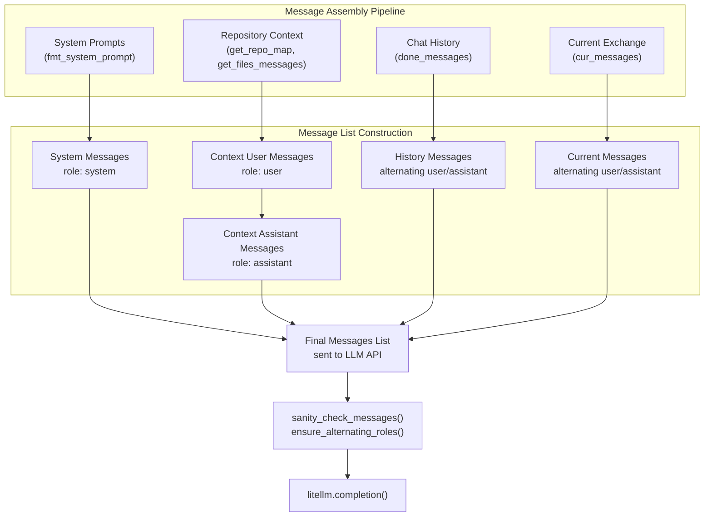
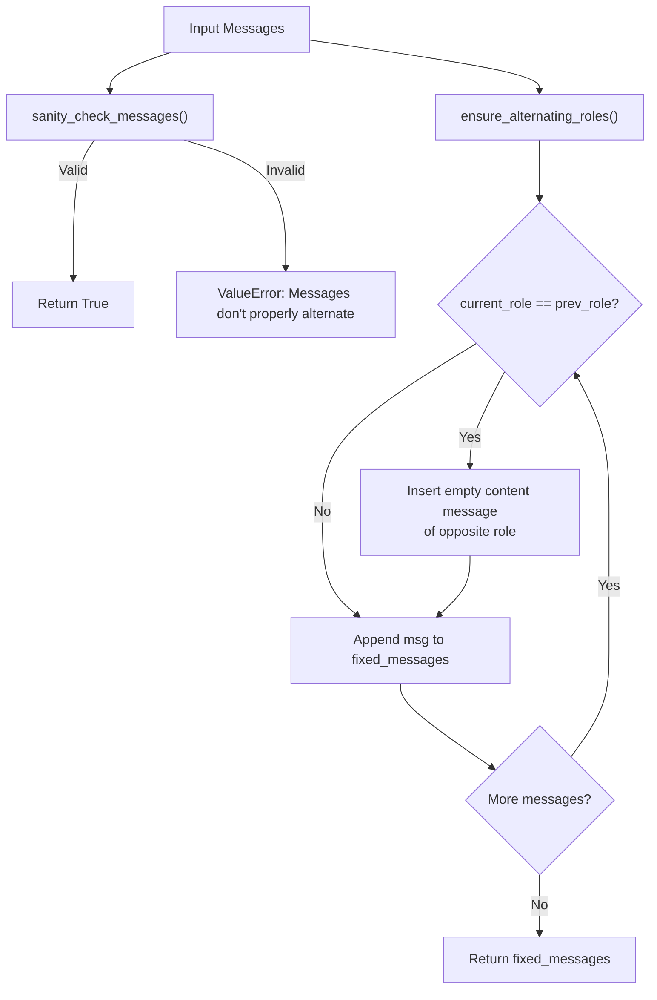
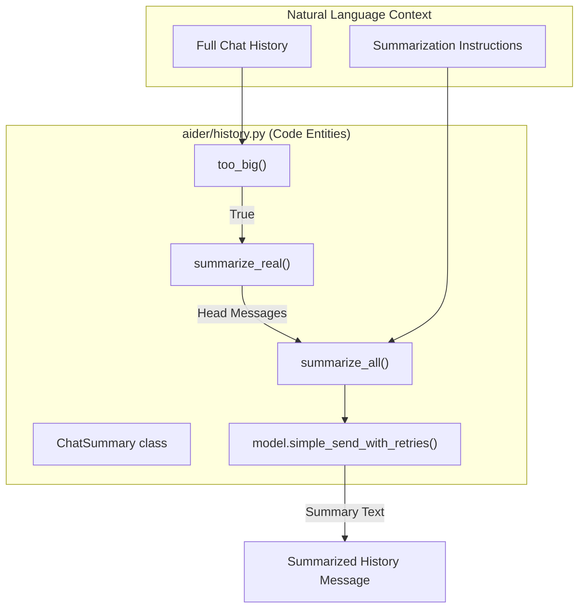

# Message Formatting and Chat History

Relevant source files

The following files were used as context for generating this wiki page:

- [aider/coders/udiff_simple.py](aider/coders/udiff_simple.py)
- [aider/coders/udiff_simple_prompts.py](aider/coders/udiff_simple_prompts.py)
- [aider/history.py](aider/history.py)
- [aider/prompts.py](aider/prompts.py)
- [aider/sendchat.py](aider/sendchat.py)
- [tests/basic/test_history.py](tests/basic/test_history.py)
- [tests/basic/test_repo.py](tests/basic/test_repo.py)
- [tests/basic/test_sendchat.py](tests/basic/test_sendchat.py)
- [tests/scrape/test_playwright_disable.py](tests/scrape/test_playwright_disable.py)

This document explains how Aider formats messages before sending them to LLMs and manages conversation history over extended sessions. It covers the message structure, role alternation requirements, chat history accumulation, and automatic summarization via `ChatSummary`.

For information about the actual prompts and templates used in messages, see [aider/prompts.py](). For model-specific message handling and token counting, see [aider/models.py]().

## Message Structure and Layers

Aider constructs a layered message structure before each LLM API call. Messages are assembled from multiple sources and formatted into a standardized sequence that provides the LLM with system instructions, repository context, conversation history, and the current user request.

### Natural Language Space to Code Entity Space: Message Assembly
The following diagram maps the logical parts of a chat message to the internal code methods and variables that generate them.

**Sources:** [aider/coders/base_coder.py:750-815](), [aider/sendchat.py:5-61]()

### System Messages
System messages contain the core instructions that define the LLM's behavior. These are formatted via `fmt_system_prompt()` and include:
- **Main system prompt**: Instructions for the edit format, coding style, and general behavior.
- **System reminder**: Reinforces key instructions to maintain consistency.

System messages are constructed fresh for each request and cannot be cached between messages.
**Sources:** [aider/coders/base_coder.py:452-461]()

### Context Messages
Context messages provide the LLM with information about the codebase and files. These are structured as user/assistant pairs to maintain role alternation:

| Context Type | User Message Content | Assistant Reply |
|--------------|---------------------|-----------------|
| **Repository Map** | `repo_content_prefix` + ranked tags from `get_repo_map()` | "Ok, I won't try and edit those files without asking first." |
| **Read-Only Files** | `read_only_files_prefix` + file contents | "Ok, I will use these files as references." |
| **Chat Files** | `files_content_prefix` + editable file contents | `files_content_assistant_reply` or "Ok." |

**Sources:** [aider/coders/base_coder.py:750-815]()

## Message Role Alternation

LLM APIs (especially Anthropic and some OpenAI-compatible providers) require messages to alternate between `user` and `assistant` roles. Aider enforces this through validation and automatic correction in `aider/sendchat.py`.

**Sources:** [aider/sendchat.py:5-61]()

### sanity_check_messages()
Validates that messages properly alternate between `user` and `assistant` roles:
- Ignores `system` messages when checking alternation [aider/sendchat.py:15-16]().
- Verifies that the last non-system message is from the `user` [aider/sendchat.py:26]().
- Raises `ValueError` if validation fails, including a formatted dump of the messages [aider/sendchat.py:18-20]().

**Sources:** [aider/sendchat.py:5-26]()

### ensure_alternating_roles()
Automatically fixes messages with consecutive same-role entries by inserting empty "opposite role" messages:
- If two consecutive `user` messages are found, it inserts `{"role": "assistant", "content": ""}` [aider/sendchat.py:53-54]().
- If two consecutive `assistant` messages are found, it inserts `{"role": "user", "content": ""}` [aider/sendchat.py:55-56]().

**Sources:** [aider/sendchat.py:29-61]()

## Chat History Management and Summarization

The `ChatSummary` class handles the logic for reducing the size of the conversation history while preserving critical context.

### The Summarization Algorithm
When history exceeds `max_tokens`, `ChatSummary` performs the following:

1. **Tokenization**: It calculates the token count for each message using the model's `token_count` method [aider/history.py:20-25]().
2. **Splitting**: It splits the messages into a "head" (older messages) and a "tail" (recent messages). It attempts to keep roughly half of `max_tokens` for the tail [aider/history.py:48-57]().
3. **Head Summarization**: The head is summarized into a single user message using the `summarize_all()` method [aider/history.py:87]().
4. **Recursive Refinement**: If the combined summary and tail are still too large, it recurses via `summarize_real()` [aider/history.py:96]().

### summarize_all()
This method performs the actual LLM call to generate the summary:
- It formats the messages into a plain text representation prefixed with `# USER` or `# ASSISTANT` [aider/history.py:99-108]().
- It uses `prompts.summarize` as the system instruction [aider/history.py:110]().
- The prompt instructs the LLM to write in the first person as the user, referencing the assistant as "you" [aider/prompts.py:55-58]().
- It requires the inclusion of function names, libraries, and filenames referenced in code blocks [aider/prompts.py:51-52]().

**Sources:** [aider/history.py:7-124](), [aider/prompts.py:46-61]()

### Chat History Summarization Flow
The following diagram maps the summarization process to specific functions in `aider/history.py`.

**Sources:** [aider/history.py:7-124](), [aider/prompts.py:46-61]()

## Message Content Formatting

### File Content Formatting
Files are formatted with fencing characters to clearly delimit content. The fence characters are selected to avoid conflicts with content.

### Edit Format Changes
When switching edit formats (e.g., via `/model`), old assistant messages may be summarized to prevent the LLM from being confused by previous structural instructions.

**Sources:** [aider/coders/base_coder.py:156-168]()

### Commit Message Generation
Aider uses the same messaging infrastructure to generate commit messages. The `GitRepo.get_commit_message` method sends a list of messages to the LLM containing the `commit_system` prompt and the git diff [aider/prompts.py:8-22]().

**Sources:** [aider/prompts.py:8-22](), [tests/basic/test_repo.py:131-154]()