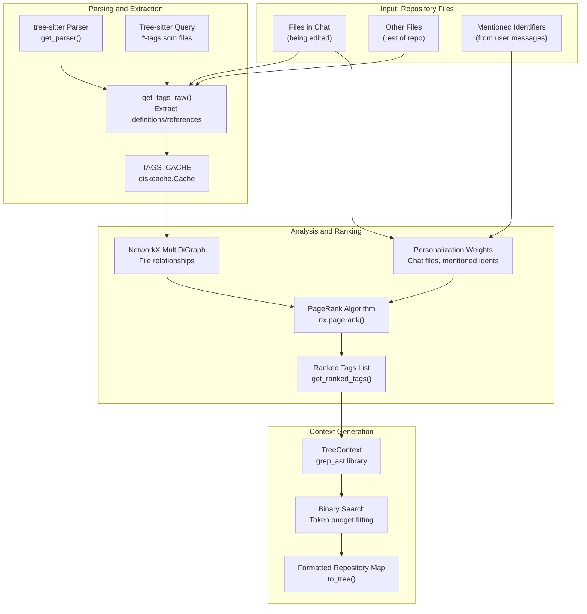
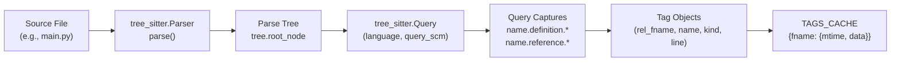
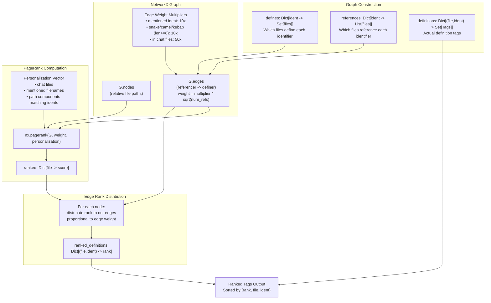
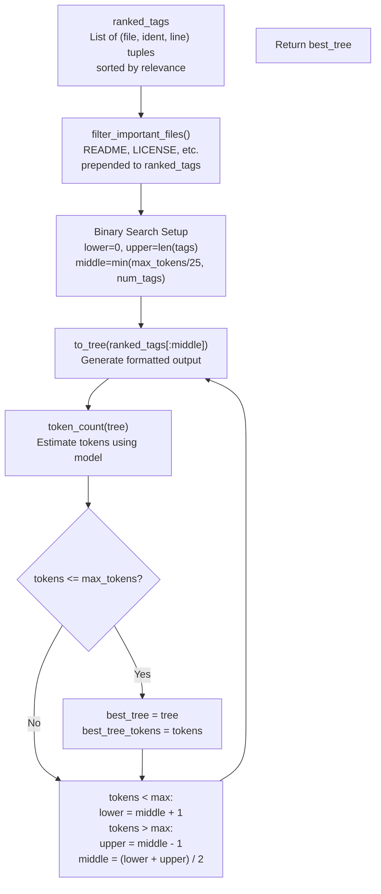

# Repository Understanding and Context

<details>
<summary>Relevant source files</summary>

The following files were used as context for generating this wiki page:

- [aider/args.py](aider/args.py)
- [aider/coders/base_coder.py](aider/coders/base_coder.py)
- [aider/commands.py](aider/commands.py)
- [aider/io.py](aider/io.py)
- [aider/main.py](aider/main.py)
- [aider/models.py](aider/models.py)
- [aider/queries/tree-sitter-language-pack/bash-tags.scm](aider/queries/tree-sitter-language-pack/bash-tags.scm)
- [aider/queries/tree-sitter-languages/bash-tags.scm](aider/queries/tree-sitter-languages/bash-tags.scm)
- [aider/repo.py](aider/repo.py)
- [aider/repomap.py](aider/repomap.py)
- [aider/voice.py](aider/voice.py)
- [aider/website/docs/languages.md](aider/website/docs/languages.md)
- [tests/basic/test_io.py](tests/basic/test_io.py)
- [tests/basic/test_repomap.py](tests/basic/test_repomap.py)
- [tests/fixtures/languages/bash/test.sh](tests/fixtures/languages/bash/test.sh)
- [tests/fixtures/languages/clojure/test.clj](tests/fixtures/languages/clojure/test.clj)
- [tests/fixtures/languages/python/test.py](tests/fixtures/languages/python/test.py)
- [tests/fixtures/languages/tsx/test.tsx](tests/fixtures/languages/tsx/test.tsx)
- [tests/fixtures/languages/typescript/test.ts](tests/fixtures/languages/typescript/test.ts)

</details>


This document explains how Aider understands codebases and provides relevant context to language models. This is the foundation that enables Aider to work effectively on large codebases by intelligently selecting which code to include in LLM prompts.

For details on the repository mapping algorithm, see [Repository Mapping System](#4.1). For file tracking, see [File Management and Tracking](#4.2). For git operations, see [Git Integration and Version Control](#4.3). For file watching, see [File Watching and AI Comments](#4.4). For code quality features, see [Code Quality and Linting](#4.5).

## Purpose and Scope

Aider must solve a fundamental challenge: language models have limited context windows, but codebases can be arbitrarily large. This system addresses that challenge by:

1.  **Analyzing code structure** using tree-sitter parsers to extract definitions and references [aider/repomap.py:279-336]().
2.  **Ranking code relevance** using graph algorithms to identify which code is most important [aider/repomap.py:365-574]().
3.  **Generating compact representations** that fit within token limits while maximizing usefulness [aider/repomap.py:629-706]().
4.  **Maintaining context caches** to avoid redundant parsing and analysis [aider/repomap.py:43](), [aider/repomap.py:217-225]().

The result is a "repository map" that the LLM receives alongside the actual files being edited, providing essential context about the broader codebase.

## Core Components

The repository understanding system consists of several interconnected components:

Title: Repository Understanding Architecture

Sources: [aider/repomap.py:1-868]()

## The RepoMap Class

The `RepoMap` class is the central orchestrator of repository understanding. It is instantiated by the `Coder` class [aider/coders/base_coder.py:47]() and used throughout the coding session.

| Component | Purpose | Key Methods |
| :--- | :--- | :--- |
| `RepoMap` | Main class coordinating repository analysis | `get_repo_map()`, `get_ranked_tags()` |
| `TAGS_CACHE` | Disk-based cache for parsed tags | Stores file mtimes and extracted tags |
| `tree_cache` | In-memory cache for rendered trees | Caches `TreeContext` outputs |
| `map_cache` | Cache for complete repository maps | Keyed by chat files and parameters |

Sources: [aider/repomap.py:42-88]()

### Initialization Parameters

The `RepoMap.__init__()` method accepts several configuration parameters:

*   `map_tokens`: Maximum tokens to allocate for the repository map (default 1024) [aider/repomap.py:49]().
*   `map_mul_no_files`: Multiplier when no files are in chat (default 8) [aider/repomap.py:56]().
*   `root`: Repository root directory [aider/repomap.py:50]().
*   `main_model`: Model instance for token counting [aider/repomap.py:51]().
*   `refresh`: Cache refresh strategy (`"auto"`, `"always"`, `"files"`, `"manual"`) [aider/repomap.py:57]().
*   `max_context_window`: Maximum context window size for the model [aider/repomap.py:55]().

Sources: [aider/repomap.py:47-87]()

## Tag Extraction Process

Tags are the fundamental units of code understanding. A `Tag` is a named tuple containing:

```python
Tag = namedtuple("Tag", "rel_fname fname line name kind".split())
```

Where `kind` is either `"def"` (definition) or `"ref"` (reference) [aider/repomap.py:29]().

Title: Tag Extraction Pipeline

Sources: [aider/repomap.py:29](), [aider/repomap.py:233-264](), [aider/repomap.py:279-336]()

### Language Support via Tree-sitter Queries

Aider uses tree-sitter query files (`*-tags.scm`) to extract language-specific tags. These queries define patterns for identifying definitions and references:

*   Definitions: Captured as `name.definition.*` [aider/repomap.py:293-295]().
*   References: Captured as `name.reference.*` [aider/repomap.py:313-315]().

The query files are loaded from `aider/queries/tree-sitter-language-pack/` or `aider/queries/tree-sitter-languages/` [aider/repomap.py:805-829]().

## Relevance Ranking with PageRank

Aider uses PageRank to rank code relevance based on the graph of definitions and references.

Title: PageRank-Based Relevance Ranking

Sources: [aider/repomap.py:365-574]()

### Personalization Strategy

The PageRank algorithm accepts a personalization vector that biases results toward certain files [aider/repomap.py:374-445]():

| Condition | Personalization Weight | Purpose |
| :--- | :--- | :--- |
| File in chat | `100 / num_files` | Prioritize code related to files being edited |
| Filename mentioned | `100 / num_files` | Include files the user explicitly mentioned |
| Path component matches mentioned identifier | `100 / num_files` | Include files whose paths contain mentioned symbols |

## Context Generation and Token Budget

After ranking tags, Aider generates a compact representation using a binary search algorithm [aider/repomap.py:629-706]().

Title: Token Budget Binary Search

Sources: [aider/repomap.py:629-706]()

## Git Integration and Version Control

Aider integrates deeply with Git via the `GitRepo` class [aider/repo.py:52]().

*   **Auto-commits**: Aider automatically commits changes after successful edits [aider/repo.py:131]().
*   **Attribution**: Handles author/committer names and `Co-authored-by` trailers [aider/repo.py:149-200]().
*   **Undo**: The `/undo` command reverts the last commit [aider/commands.py:22]().

Sources: [aider/repo.py:1-200](), [aider/commands.py:1-100]()

## Code Quality and Linting

The `Linter` class provides language-specific syntax checking [aider/linter.py:37]().

*   **Python Linting**: Combines `compile()` checks and tree-sitter syntax validation [aider/linter.py:118-135]().
*   **Feedback Loop**: Lint errors are formatted with `TreeContext` and fed back to the LLM to trigger a "lint-and-fix" cycle [aider/linter.py:111-116]().

Sources: [aider/linter.py:1-254](), [aider/run_cmd.py:1-133]()

## Supported Languages

Aider supports repository mapping and linting for over 60 languages [aider/website/docs/languages.md:55-132](). This is powered by `tree-sitter-language-pack` and language-specific `tags.scm` files [aider/repomap.py:805-829]().

Sources: [aider/repomap.py:832-849](), [aider/website/docs/languages.md:1-265]()