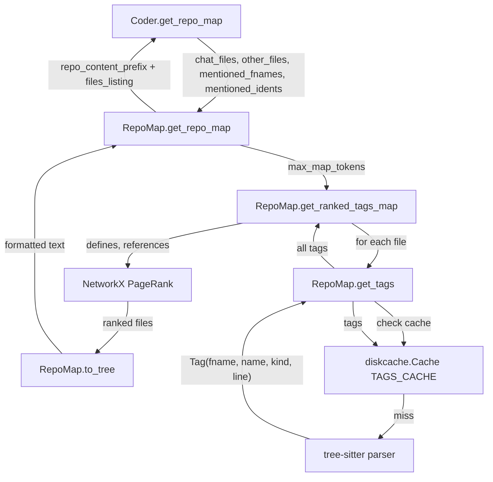
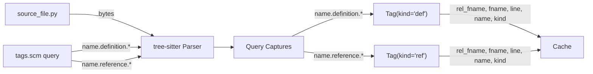
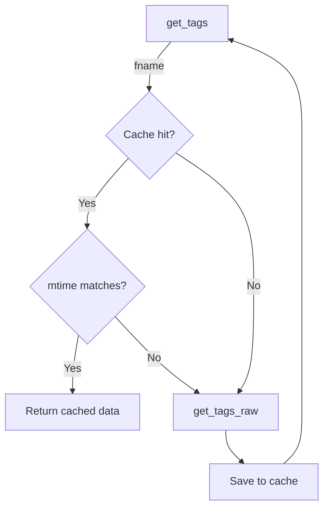
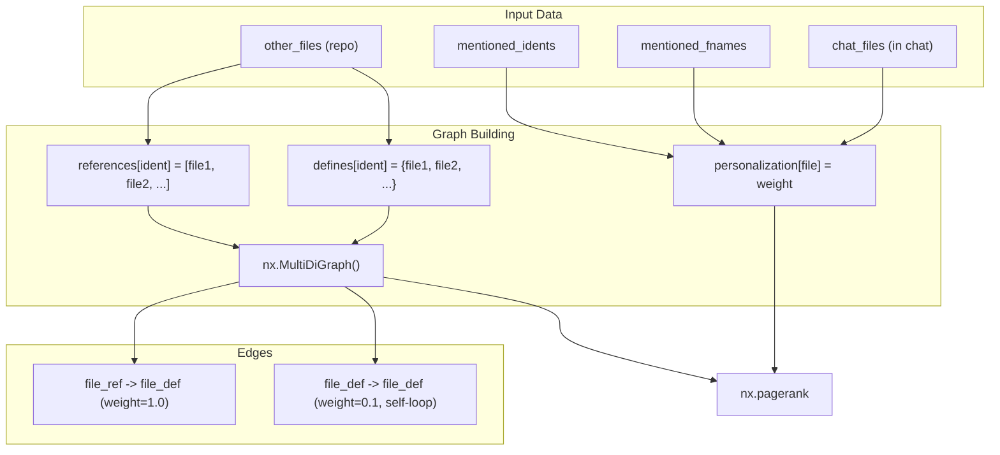

# Repository Mapping System

<details>
<summary>Relevant source files</summary>

The following files were used as context for generating this wiki page:

- [aider/args.py](aider/args.py)
- [aider/coders/base_coder.py](aider/coders/base_coder.py)
- [aider/commands.py](aider/commands.py)
- [aider/io.py](aider/io.py)
- [aider/main.py](aider/main.py)
- [aider/models.py](aider/models.py)
- [aider/queries/tree-sitter-language-pack/arduino-tags.scm](aider/queries/tree-sitter-language-pack/arduino-tags.scm)
- [aider/queries/tree-sitter-language-pack/bash-tags.scm](aider/queries/tree-sitter-language-pack/bash-tags.scm)
- [aider/queries/tree-sitter-language-pack/c-tags.scm](aider/queries/tree-sitter-language-pack/c-tags.scm)
- [aider/queries/tree-sitter-language-pack/chatito-tags.scm](aider/queries/tree-sitter-language-pack/chatito-tags.scm)
- [aider/queries/tree-sitter-language-pack/commonlisp-tags.scm](aider/queries/tree-sitter-language-pack/commonlisp-tags.scm)
- [aider/queries/tree-sitter-language-pack/cpp-tags.scm](aider/queries/tree-sitter-language-pack/cpp-tags.scm)
- [aider/queries/tree-sitter-language-pack/d-tags.scm](aider/queries/tree-sitter-language-pack/d-tags.scm)
- [aider/queries/tree-sitter-language-pack/dart-tags.scm](aider/queries/tree-sitter-language-pack/dart-tags.scm)
- [aider/queries/tree-sitter-language-pack/elisp-tags.scm](aider/queries/tree-sitter-language-pack/elisp-tags.scm)
- [aider/queries/tree-sitter-language-pack/elixir-tags.scm](aider/queries/tree-sitter-language-pack/elixir-tags.scm)
- [aider/queries/tree-sitter-language-pack/elm-tags.scm](aider/queries/tree-sitter-language-pack/elm-tags.scm)
- [aider/queries/tree-sitter-language-pack/gleam-tags.scm](aider/queries/tree-sitter-language-pack/gleam-tags.scm)
- [aider/queries/tree-sitter-languages/bash-tags.scm](aider/queries/tree-sitter-languages/bash-tags.scm)
- [aider/repo.py](aider/repo.py)
- [aider/repomap.py](aider/repomap.py)
- [aider/voice.py](aider/voice.py)
- [aider/website/docs/languages.md](aider/website/docs/languages.md)
- [scripts/tsl_pack_langs.py](scripts/tsl_pack_langs.py)
- [tests/basic/test_io.py](tests/basic/test_io.py)
- [tests/basic/test_repomap.py](tests/basic/test_repomap.py)
- [tests/fixtures/languages/bash/test.sh](tests/fixtures/languages/bash/test.sh)
- [tests/fixtures/languages/clojure/test.clj](tests/fixtures/languages/clojure/test.clj)
- [tests/fixtures/languages/python/test.py](tests/fixtures/languages/python/test.py)
- [tests/fixtures/languages/tsx/test.tsx](tests/fixtures/languages/tsx/test.tsx)
- [tests/fixtures/languages/typescript/test.ts](tests/fixtures/languages/typescript/test.ts)

</details>


The Repository Mapping System provides the LLM with structured context about code not directly included in the chat. It uses tree-sitter to parse source files, extracts code definitions and references, ranks files by relevance using graph analysis, and generates a token-budgeted summary of the most important code entities. This allows the LLM to understand the broader codebase structure and make informed decisions about which files to modify.

For information about how files are added to and managed within the chat context itself, see [File Management and Tracking](aider/repo.py:52-130)(). For information about Git integration, see [Git Integration and Version Control](aider/repo.py:131-200)().

## Architecture Overview

The repo map system operates as a multi-stage pipeline that transforms source code into ranked, token-budgeted context for the LLM.



**Core Components:**

| Component | File | Purpose |
|-----------|------|---------|
| `RepoMap` | [aider/repomap.py:42-88]() | Main orchestrator, manages token budgets and caching. |
| `get_repo_map()` | [aider/repomap.py:103-167]() | Entry point, determines token budget and returns formatted context. |
| `get_ranked_tags_map()` | [aider/repomap.py:365-485]() | Extracts tags from all files and builds the reference graph. |
| `rank_tags()` | [aider/repomap.py:487-577]() | Runs PageRank algorithm to rank files by relevance. |
| `to_tree()` | [aider/repomap.py:579-699]() | Formats ranked tags into tree structure within token budget. |

Sources: [aider/repomap.py:42-699]()

## Tag Extraction with Tree-Sitter

The repo map system uses tree-sitter parsers to extract code definitions and references from source files. Each language has a corresponding tree-sitter grammar with a `tags.scm` query file that defines what constitutes a "definition" vs. a "reference".

### Tag Structure



Each `Tag` is a named tuple containing:

| Field | Type | Description |
|-------|------|-------------|
| `rel_fname` | str | Relative path from repo root. |
| `fname` | str | Absolute file path. |
| `line` | int | Line number where tag appears (-1 for references). |
| `name` | str | Identifier name (function, class, variable, etc.). |
| `kind` | str | Either "def" (definition) or "ref" (reference). |

**Tag Extraction Process:**

1. **Language Detection**: [aider/repomap.py:280-282]() uses `filename_to_lang()` from `grep-ast` to determine the language.
2. **Parser Initialization**: [aider/repomap.py:285-287]() gets the tree-sitter parser and language via `get_parser()` and `get_language()`.
3. **Query Loading**: [aider/repomap.py:291-294]() loads the corresponding `tags.scm` file from `aider.queries` resources.
4. **Parsing**: [aider/repomap.py:296-302]() parses the source code and runs the query to extract captures.
5. **Tag Creation**: [aider/repomap.py:318-336]() creates `Tag` objects for each capture, distinguishing between definitions (`name.definition.*`) and references (`name.reference.*`).
6. **Fallback References**: [aider/repomap.py:338-363]() if a file has definitions but no references, uses Pygments lexer to extract all identifiers as references.

Sources: [aider/repomap.py:29-30](), [aider/repomap.py:279-364]()

## Caching System

The repo map uses `diskcache.Cache` to avoid re-parsing files that haven't changed. The cache is invalidated based on file modification time.



**Cache Implementation:**

- **Location**: [aider/repomap.py:43]() defines `TAGS_CACHE_DIR = ".aider.tags.cache.v{CACHE_VERSION}"`.
- **Initialization**: [aider/repomap.py:217-222]() creates a `Cache` object at `{repo_root}/.aider.tags.cache.v{version}/`.
- **Cache Key**: Absolute file path (`fname`).
- **Cache Value**: Dictionary with `{"mtime": float, "data": [Tag, ...]}`.
- **Lookup**: [aider/repomap.py:240-251]() checks if cached mtime matches current file mtime.
- **Error Handling**: [aider/repomap.py:177-215]() falls back to an in-memory dictionary if SQLite errors occur.

The `CACHE_VERSION` is incremented when the tag extraction logic changes (e.g., [aider/repomap.py:35-37]()).

Sources: [aider/repomap.py:33-43](), [aider/repomap.py:177-264]()

## Reference Graph and PageRank

The repo map builds a directed graph where nodes are files and edges represent code references. Files are then ranked using NetworkX's PageRank algorithm with personalization based on chat context.

### Graph Construction



**Personalization Logic** ([aider/repomap.py:374-445]()):

The PageRank algorithm is biased toward files that are contextually relevant:

| Condition | Personalization Weight | Code Reference |
|-----------|----------------------|----------------|
| File in `chat_fnames` | `100 / len(fnames)` | [aider/repomap.py:424-426]() |
| File in `mentioned_fnames` | `100 / len(fnames)` | [aider/repomap.py:428-430]() |
| File path component in `mentioned_idents` | `100 / len(fnames)` | [aider/repomap.py:432-445]() |

**Edge Creation** ([aider/repomap.py:475-485]()):

For each identifier that appears in both `defines` and `references`:
- For each file that **references** the identifier.
- For each file that **defines** the identifier.
- Add edge: `referencing_file -> defining_file` with `weight=1.0`.

Self-loop edges with `weight=0.1` are added for definitions without references to prevent isolated nodes ([aider/repomap.py:465-471]()).

**PageRank Execution** ([aider/repomap.py:487-520]()):
Returns a dictionary mapping each file to its PageRank score. Higher scores indicate more important files given the current context.

Sources: [aider/repomap.py:365-577]()

## Token Budget Management

The repo map must fit within the LLM's context window. The system dynamically calculates token budgets and formats output to stay within limits.

### Token Budget Calculation

**Budget Calculation** ([aider/repomap.py:120-132]()):

When no files are in the chat, the budget is expanded using `map_mul_no_files`:
```python
target = min(
    int(max_map_tokens * self.map_mul_no_files),
    self.max_context_window - padding,
)
```

**Token Counting** ([aider/repomap.py:89-101]()):

For efficiency, large texts are sampled by every 100th line to estimate the total token count.

Sources: [aider/repomap.py:89-167]()

## Output Formatting

The `to_tree()` method formats the ranked tags into a hierarchical tree structure that shows file paths and their definitions.

### Format Structure

**File Tree Example:**
```
aider/
  repomap.py
    class RepoMap
      def __init__(self, map_tokens=1024, root=None, ...)
      def get_repo_map(self, chat_files, other_files, ...)
```

**Implementation** ([aider/repomap.py:579-699]()):

1. **Ranking**: Files are sorted by PageRank score.
2. **Budget Tracking**: Accumulates tokens as files are added.
3. **File Selection**: Includes files until token budget is exhausted.
4. **Definition Display**: Shows class/function definitions with indentation using `grep-ast`'s `TreeContext`.
5. **Truncation**: If budget is exceeded, definitions are truncated using ellipsis (`...`).

Sources: [aider/repomap.py:579-699]()

## Supported Languages

The repo map system supports 130+ languages through tree-sitter parsers. Languages with "Repo map" support have corresponding `tags.scm` query files.

**Language Support Categories:**

| Category | Count | Example Languages |
|----------|-------|-------------------|
| Full support (repo map + linter) | 40+ | Python, JavaScript, TypeScript, Go, Rust, Java, C/C++ |
| Linter only | 90+ | Bash, YAML, JSON, Markdown, CSS |

Full list available at [aider/website/docs/languages.md:55-261]().

**Adding Language Support:**

To add repo map support for a new language:
1. Ensure the language is supported by [tree-sitter-language-pack](https://github.com/Goldziher/tree-sitter-language-pack).
2. Obtain or create a `tags.scm` file from the language's tree-sitter grammar.
3. Place it in `aider/queries/tree-sitter-languages/` or use the `scripts/tsl_pack_langs.py` utility to download it ([scripts/tsl_pack_langs.py:22-39]()).

Sources: [aider/website/docs/languages.md:1-265](), [aider/repomap.py:291-294](), [scripts/tsl_pack_langs.py:1-146]()