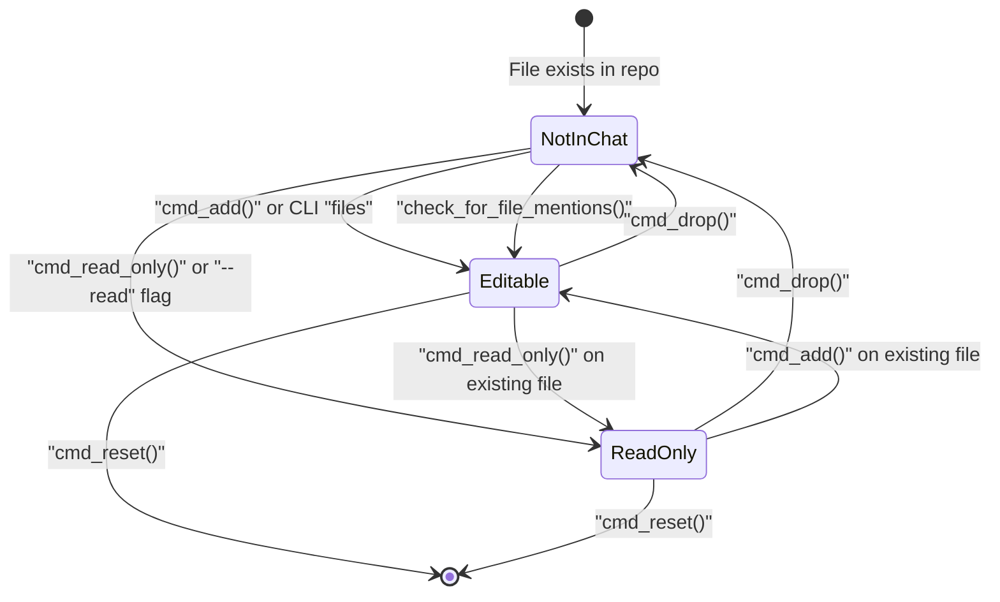
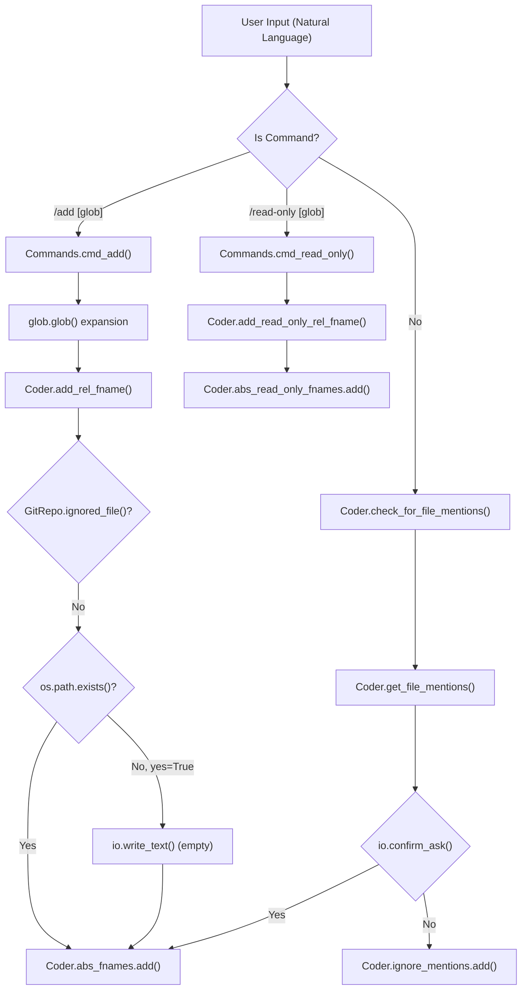
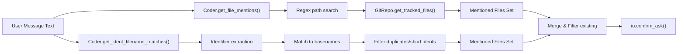
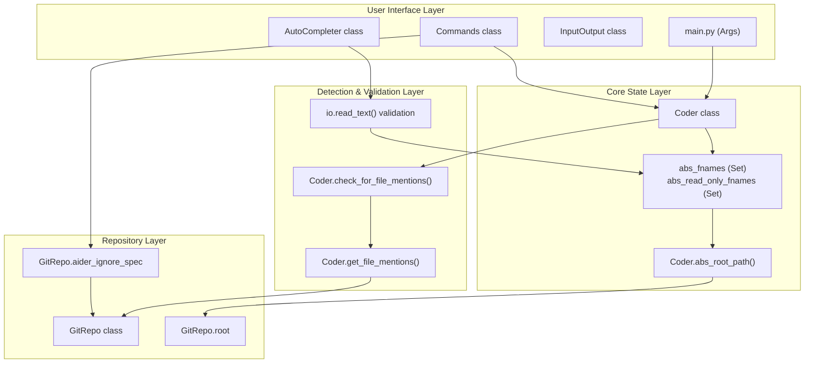

# File Management and Tracking

Relevant source files

The following files were used as context for generating this wiki page:

- [aider/args.py](aider/args.py)
- [aider/coders/base_coder.py](aider/coders/base_coder.py)
- [aider/commands.py](aider/commands.py)
- [aider/help.py](aider/help.py)
- [aider/io.py](aider/io.py)
- [aider/main.py](aider/main.py)
- [aider/models.py](aider/models.py)
- [aider/repo.py](aider/repo.py)
- [aider/repomap.py](aider/repomap.py)
- [aider/special.py](aider/special.py)
- [aider/voice.py](aider/voice.py)
- [aider/website/docs/languages.md](aider/website/docs/languages.md)
- [scripts/issues.py](scripts/issues.py)
- [tests/basic/test_coder.py](tests/basic/test_coder.py)
- [tests/basic/test_commands.py](tests/basic/test_commands.py)
- [tests/basic/test_io.py](tests/basic/test_io.py)
- [tests/basic/test_sanity_check_repo.py](tests/basic/test_sanity_check_repo.py)
- [tests/help/test_help.py](tests/help/test_help.py)

## Purpose and Scope

This document describes how Aider manages and tracks files within a chat session. It covers the mechanisms for adding files (both editable and read-only), detecting file mentions in user input, path resolution, encoding validation, and special handling for critical files. This system forms the foundation for providing context to the LLM about which files to work with.

For information about how file contents are incorporated into prompts and repo maps, see [Repository Mapping System (4.1)](). For git-related operations on files, see [Git Integration and Version Control (4.3)]().

---

## File Types and State Management

Aider maintains two distinct sets of files in each chat session, stored in the `Coder` class:

| File Set | Attribute | Purpose | Can be Modified by LLM |
|----------|-----------|---------|----------------------|
| Editable Files | `abs_fnames` | Files the LLM can edit and modify | Yes |
| Read-Only Files | `abs_read_only_fnames` | Files provided as context only | No |

Both sets store **absolute file paths** as strings in Python `set` objects. This design ensures no duplicates and provides O(1) lookup performance.

### File State Transitions

The following diagram illustrates how files transition between states based on user commands and system detection.

Title: File State Transitions

**Sources:** [aider/coders/base_coder.py:89-90](), [aider/coders/base_coder.py:172-173](), [aider/commands.py:85-86](), [aider/args.py:56-58]()

---

## File Addition Mechanisms

### Command-Line Initialization

Files can be specified when launching Aider through command-line arguments:

- **Positional arguments**: `aider file1.py file2.py` adds editable files. [aider/args.py:56-58]()
- **`--read` flag**: `aider --read docs/api.md` adds read-only files. [aider/args.py:270-275]()

The initialization logic in `main.py` processes these arguments and resolves paths before creating the `Coder` instance. Read-only file paths provided via args are tracked in `Commands.original_read_only_fnames` to allow persistence across resets. [aider/commands.py:85](), [aider/main.py:679-688]()

### Interactive File Addition

The following diagram bridges the Natural Language space of user commands to the code entities that process them.

Title: Natural Language to Code Entity Mapping (File Addition)

**The `/add` Command**

The `/add` command handles glob expansion via `glob.glob` and validates file existence. If a file doesn't exist and the user is in "yes" mode, Aider creates an empty file. [aider/commands.py:743-840](), [tests/basic/test_commands.py:35-49]()

**The `/read-only` Command**

Similar to `/add`, but places files in `abs_read_only_fnames`. These files provide context to the LLM but cannot be modified. The command can move files from editable to read-only status if they're already in chat. [aider/commands.py:926-996]()

---

## File Mention Detection System

### Detection Strategies

Aider automatically detects when users mention files in their messages using two complementary detection strategies.

Title: File Mention Detection Flow

**Pattern-Based Detection**

The `get_file_mentions()` method searches for file path patterns in user input, including absolute paths, relative paths, and quoted paths. It validates these against the repository's tracked files. [aider/coders/base_coder.py:1651-1730]()

**Identifier-Based Matching**

Aider extracts identifiers from user messages and matches them against file basenames. It filters out short identifiers (minimum length 5) and avoids adding files with ambiguous basenames (e.g., if multiple files share the same name in different directories). [aider/coders/base_coder.py:678-707](), [tests/basic/test_coder.py:175-204]()

**Sources:** [aider/coders/base_coder.py:678-707](), [aider/coders/base_coder.py:1651-1730](), [tests/basic/test_coder.py:175-204]()

---

## Path Resolution and Encoding

### Absolute Path Normalization

All relative file paths are resolved through `abs_root_path()`, which canonicalizes paths using `utils.safe_abs_path()`. This ensures all file paths are stored consistently in absolute form, enabling reliable comparisons and lookups. [aider/coders/base_coder.py:566-574]()

### Encoding Validation

Aider validates file encodings during content retrieval. The `io.read_text()` method is used to read file contents, and the `AutoCompleter` handles potential `UnicodeDecodeError` or `IsADirectoryError` when tokenizing files for completion. [aider/io.py:133-141](), [tests/basic/test_io.py:138-160]()

---

## File Removal and Filtering

### The `/drop` Command

The `/drop` command removes files from both editable and read-only sets. It supports individual filenames, glob patterns, and wildcards (e.g., `/drop *`). [aider/commands.py:842-924]()

### Gitignore and .aiderignore

When adding files, Aider checks `.gitignore` patterns and a special `.aiderignore` file. The `.aiderignore` file allows users to specify patterns that Aider should always ignore, even if they aren't in `.gitignore`. [aider/args.py:22-28](), [aider/main.py:155-207](), [aider/repo.py:52-60]()

### Important Files List

Aider maintains a list of "important files" in `aider/special.py`. The function `filter_important_files` is used by the `RepoMap` to prioritize files that are central to the repository's structure (e.g., `README.md`, `requirements.txt`, `package.json`). [aider/special.py:1-20](), [aider/repomap.py:22]()

---

## File Management Architecture

The following diagram summarizes the system architecture for file management, showing the interaction between UI, core logic, and the repository layer.

Title: File Management Component Architecture

**Sources:** [aider/coders/base_coder.py:88-123](), [aider/commands.py:36-66](), [aider/io.py:91-126](), [aider/main.py:101-152](), [aider/repo.py:52-60]()