# Git Integration and Version Control

Relevant source files

The following files were used as context for generating this wiki page:

- [aider/coders/udiff_simple.py](aider/coders/udiff_simple.py)
- [aider/coders/udiff_simple_prompts.py](aider/coders/udiff_simple_prompts.py)
- [aider/help.py](aider/help.py)
- [aider/website/docs/git.md](aider/website/docs/git.md)
- [aider/website/docs/install/docker.md](aider/website/docs/install/docker.md)
- [scripts/blame.py](scripts/blame.py)
- [scripts/issues.py](scripts/issues.py)
- [tests/basic/test_coder.py](tests/basic/test_coder.py)
- [tests/basic/test_commands.py](tests/basic/test_commands.py)
- [tests/basic/test_history.py](tests/basic/test_history.py)
- [tests/basic/test_repo.py](tests/basic/test_repo.py)
- [tests/basic/test_sanity_check_repo.py](tests/basic/test_sanity_check_repo.py)
- [tests/help/test_help.py](tests/help/test_help.py)
- [tests/scrape/test_playwright_disable.py](tests/scrape/test_playwright_disable.py)

This document explains how Aider integrates with Git for version control, including automatic commits, attribution, and repository management. It covers the `GitRepo` class, commit attribution logic, auto-commit behavior, git-related commands, and repository initialization.

For information about file management and tracking in the chat session, see page 4.2 (File Management and Tracking).

## Overview of Git Integration

Aider deeply integrates with Git to track all code changes made during chat sessions. The system automatically detects Git repositories, creates commits for LLM-generated changes, and provides commands for managing the version control workflow [aider/website/docs/git.md:7-22]().

**Git Integration Architecture**

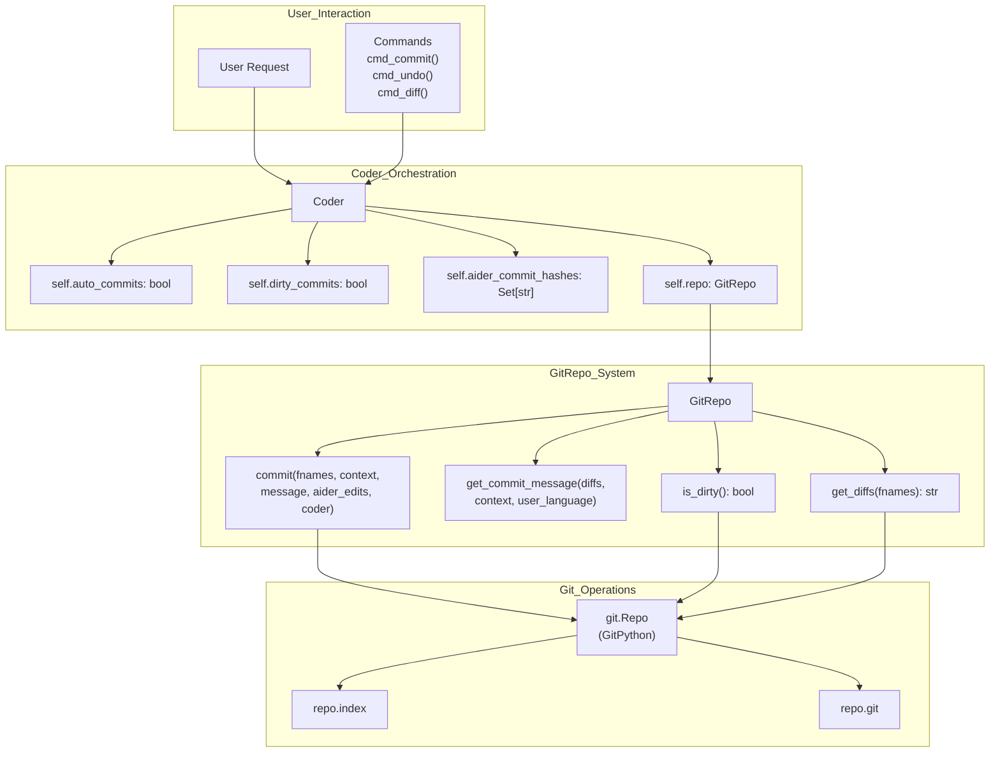

Sources: [aider/repo.py:52-448](), [tests/basic/test_commands.py:15-20](), [aider/website/docs/git.md:25-34]()

## GitRepo Class

The `GitRepo` class in [aider/repo.py]() serves as the primary interface for all Git operations. It wraps the GitPython library and provides Aider-specific functionality.

### Initialization and Configuration

**GitRepo Initialization Flow**

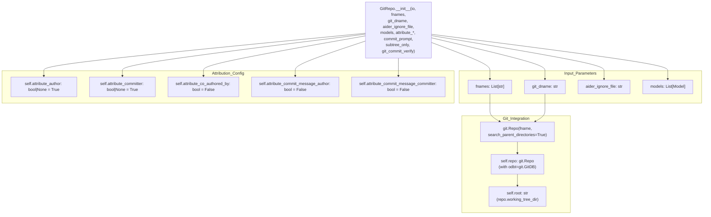

Sources: [aider/repo.py:62-130](), [tests/basic/test_repo.py:34-38]()

| Parameter | Type | Default | Description |
|-----------|------|---------|-------------|
| `io` | InputOutput | Required | IO interface for user interaction |
| `fnames` | List[str] | Required | Files to track in repository |
| `git_dname` | str | None | Directory containing git repo |
| `aider_ignore_file` | str | None | Path to .aiderignore file |
| `models` | List[Model] | None | Models for commit message generation |
| `attribute_author` | bool\|None | True | Modify author name with "(aider)" |
| `attribute_committer` | bool\|None | True | Modify committer name with "(aider)" |
| `attribute_commit_message_author` | bool | False | Prefix commit message with "aider:" |
| `attribute_commit_message_committer` | bool | False | Prefix commit message with "aider:" |
| `attribute_co_authored_by` | bool | False | Add Co-authored-by trailer |
| `subtree_only` | bool | False | Only consider current subtree |
| `git_commit_verify` | bool | True | Enable commit signature verification |

Sources: [aider/repo.py:62-92](), [aider/website/docs/git.md:38-77]()

## Commit Attribution System

Aider provides a sophisticated attribution system to track whether changes were made by AI or by the user, with multiple configuration options [aider/website/docs/git.md:59-77]().

### Attribution Logic Flow

**commit() Attribution Decision Tree**

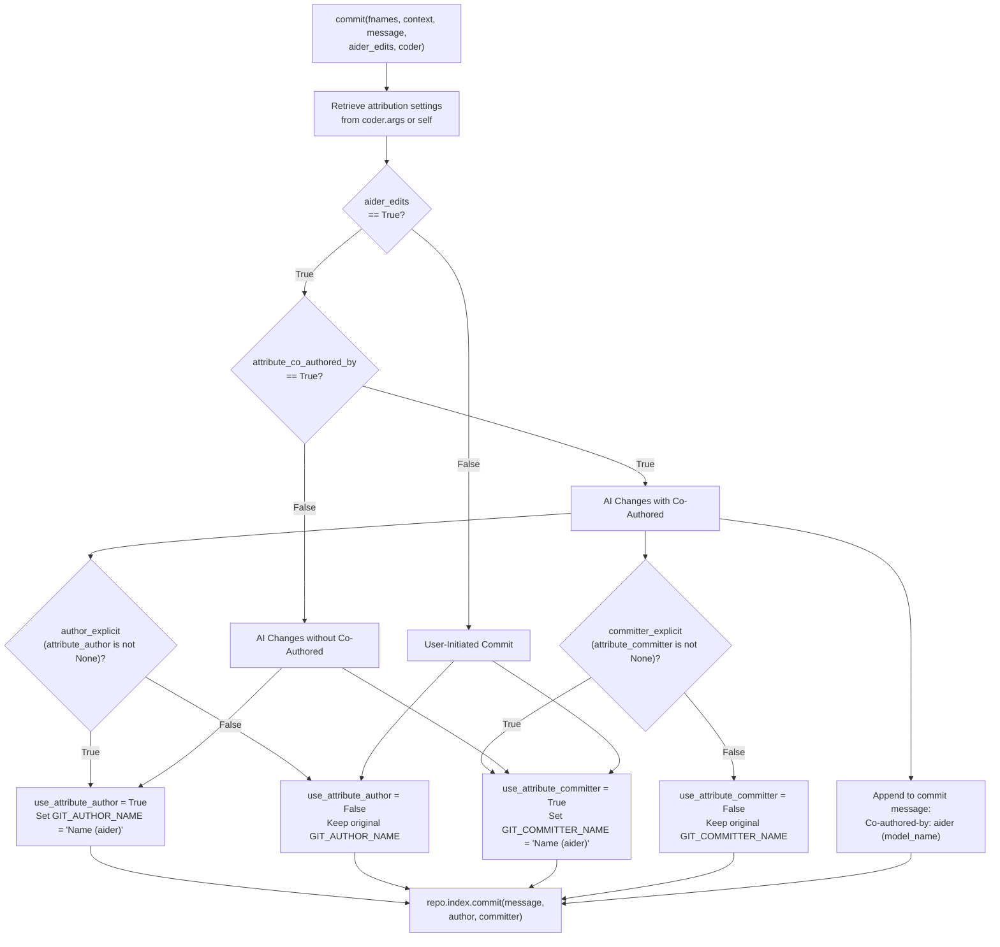

Sources: [aider/repo.py:131-200](), [aider/repo.py:218-267](), [scripts/blame.py:88-101]()

### Attribution Behavior Summary

| Scenario | `aider_edits` | `attribute_co_authored_by` | Author Name | Committer Name | Trailer |
|----------|---------------|---------------------------|-------------|----------------|---------|
| AI edit (default) | True | False | You (aider) | You (aider) | None |
| AI edit w/ Co-author | True | True | You | You | Co-authored-by added |
| AI edit w/ explicit author | True | True + `--attribute-author` | You (aider) | You | Co-authored-by added |
| User commit (default) | False | N/A | You | You (aider) | None |
| User commit w/ no-committer | False + `--no-attribute-committer` | N/A | You | You | None |

Sources: [aider/repo.py:148-200](), [aider/website/docs/git.md:59-77]()

### Implementation of Attribution

The commit method applies attribution using Git environment variables and commit parameters. It uses the `set_git_env` [aider/repo.py:39-50]() context manager to temporarily override environment variables.

**Attribution Implementation Sequence**

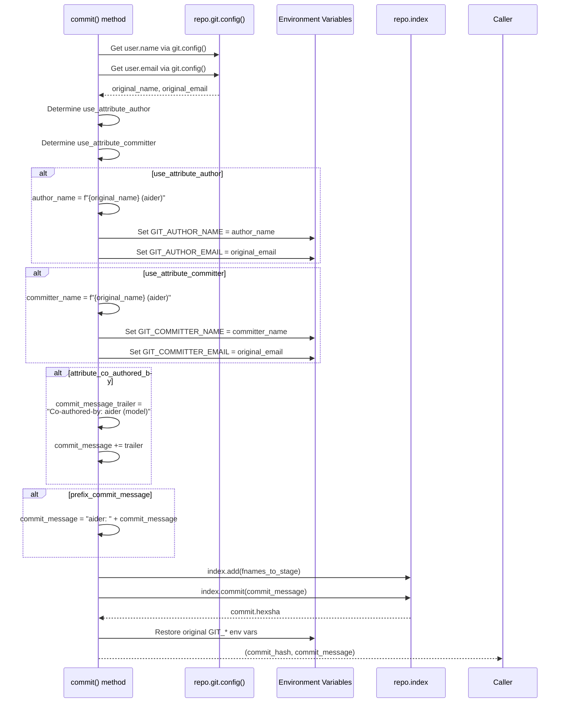

Sources: [aider/repo.py:39-50](), [aider/repo.py:268-313](), [tests/basic/test_repo.py:192-195]()

## Auto-Commits and Dirty Commits

Aider provides flags that control automatic commit behavior: `auto_commits` and `dirty_commits` [aider/website/docs/git.md:38-44]().

### Auto-Commits

When `auto_commits=True`, Aider automatically commits all LLM-generated changes to Git after each successful code modification [aider/website/docs/git.md:19-21]().

**Auto-Commit Flow After LLM Edits**

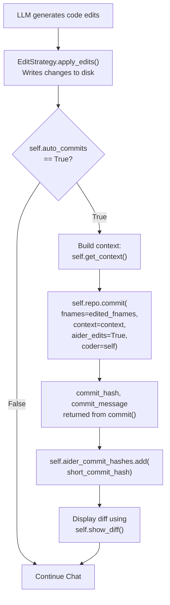

Sources: [aider/repo.py:131-315](), [tests/basic/test_coder.py:25-53]()

### Dirty Commits

When `dirty_commits=True`, Aider will commit any uncommitted changes in the repository before making LLM edits [aider/website/docs/git.md:20-21](). This ensures a clean baseline.

**Dirty Commit Flow Before Processing User Request**

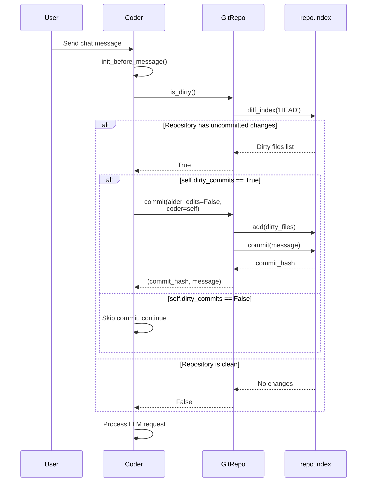

Sources: [aider/repo.py:396-403](), [tests/basic/test_coder.py:82-102]()

## Git-Related Commands

Aider provides several slash commands for Git operations that users can invoke during chat sessions [aider/website/docs/git.md:25-34]().

### /commit Command

The `/commit` command manually commits changes made outside the chat, optionally with a custom message [aider/website/docs/git.md:31]().

**cmd_commit() Execution Flow**

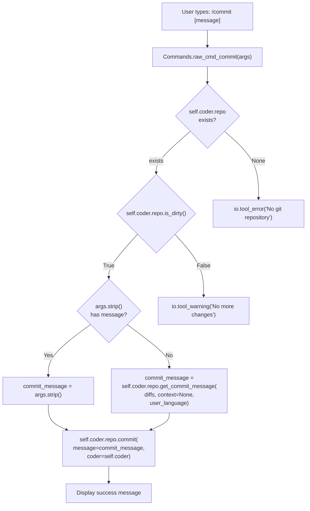

Sources: [tests/basic/test_commands.py:15-20](), [aider/website/docs/git.md:31]()

### /undo Command

The `/undo` command undoes the last commit made by Aider in the current session [aider/website/docs/git.md:30](). It performs extensive safety checks before executing, including verifying the commit was made by Aider and that there are no uncommitted changes in the affected files.

**cmd_undo() Safety Checks and Execution**

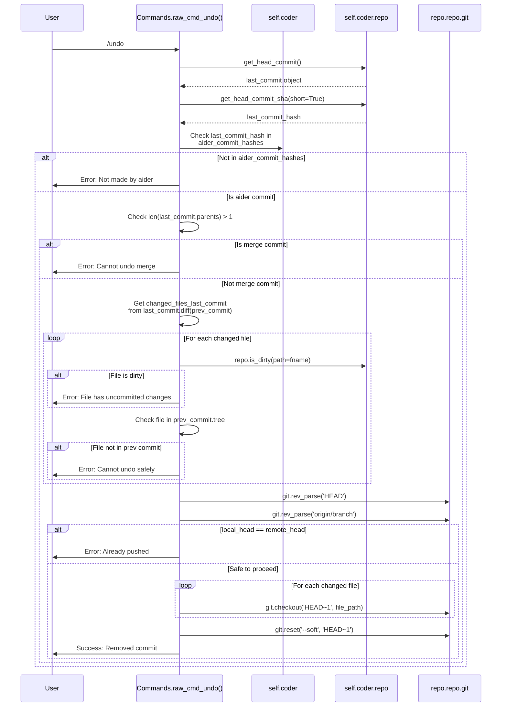

Sources: [aider/website/docs/git.md:30](), [tests/basic/test_repo.py:84-113]()

### /diff Command

The `/diff` command displays changes made since the last user message [aider/website/docs/git.md:29]().

**cmd_diff() Execution Flow**

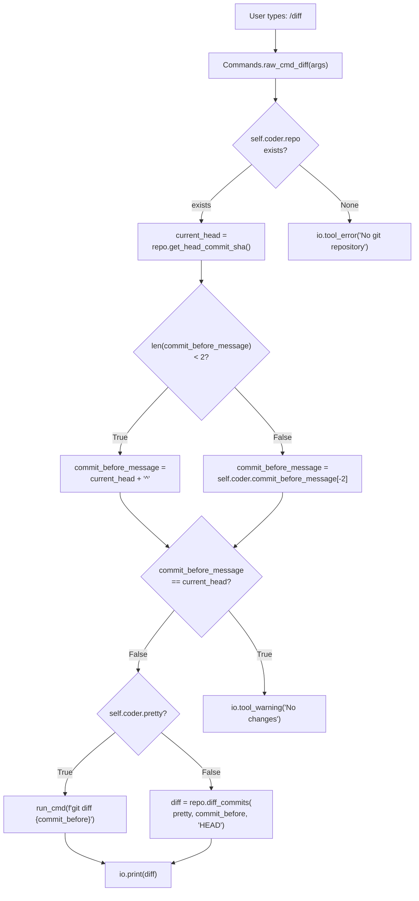

Sources: [aider/website/docs/git.md:29](), [tests/basic/test_repo.py:22-38]()

## Commit Message Generation

Aider uses the LLM to generate concise, one-line commit messages based on the diff of changes. It defaults to Conventional Commits format [aider/website/docs/git.md:47-50]().

**Commit Message Generation Sequence**

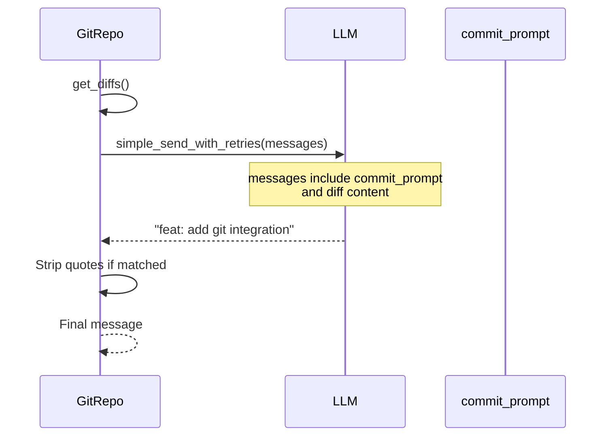

Sources: [aider/website/docs/git.md:45-56](), [aider/repo.py:317-360](), [tests/basic/test_repo.py:131-154]()

## Integration with Coder Class

The `Coder` class integrates `GitRepo` throughout its lifecycle to track changes and manage version control.

### Coder-GitRepo Class Relationship

**Key Attributes and Methods**

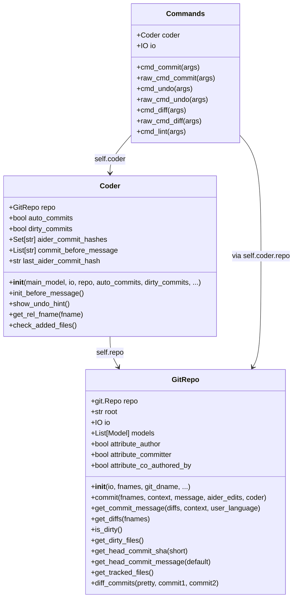

Sources: [aider/repo.py:52-448](), [tests/basic/test_commands.py:15-20](), [tests/basic/test_coder.py:9-16]()

## Error Handling

The `GitRepo` class defines a broad tuple `ANY_GIT_ERROR` [aider/repo.py:9-36]() to catch various exceptions from GitPython and underlying system errors. Aider also performs sanity checks to ensure repo compatibility, such as checking the git index version [tests/basic/test_sanity_check_repo.py:10-11]().

**ANY_GIT_ERROR Exception Tuple**

```mermaid
graph TB
    AnyGitError["ANY_GIT_ERROR<br/>tuple in repo.py"]
    
    subgraph "GitPython_Exceptions"
        GitError["git.exc.GitError"]
        ODBError["git.exc.ODBError"]
        InvalidRepo["git.exc.InvalidGitRepositoryError"]
        GitCmdNotFound["git.exc.GitCommandNotFound"]
    end
    
    subgraph "Python_Builtins"
        OSError["OSError"]
        IndexError["IndexError"]
        BufferError["BufferError"]
        TypeError["TypeError"]
        ValueError["ValueError"]
        AttributeError["AttributeError"]
        AssertionError["AssertionError"]
        TimeoutError["TimeoutError"]
    end
    
    AnyGitError --> GitError
    AnyGitError --> ODBError
    AnyGitError --> InvalidRepo
    AnyGitError --> GitCmdNotFound
    AnyGitError --> OSError
    AnyGitError --> IndexError
    AnyGitError --> BufferError
    AnyGitError --> TypeError
    AnyGitError --> ValueError
    AnyGitError --> AttributeError
    AnyGitError --> AssertionError
    AnyGitError --> TimeoutError
```

Sources: [aider/repo.py:6-36](), [tests/basic/test_sanity_check_repo.py:103-134]()