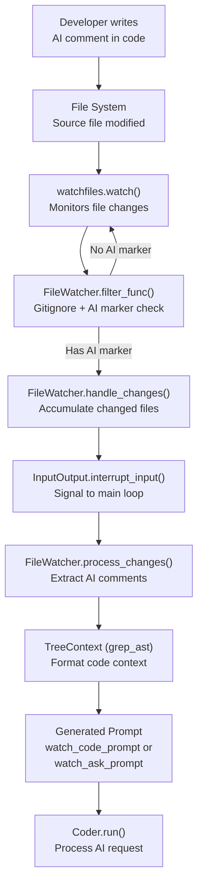
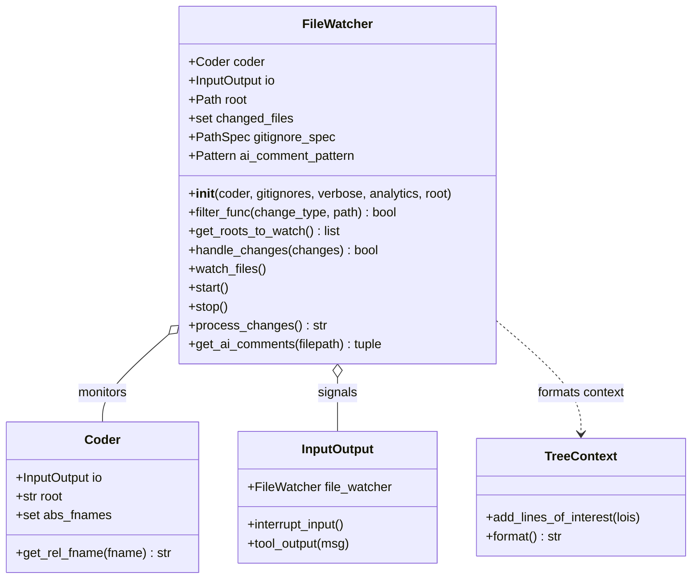
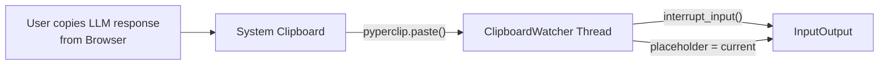

# File Watching and AI Comments

Relevant source files

The following files were used as context for generating this wiki page:

- [aider/copypaste.py](aider/copypaste.py)
- [aider/watch.py](aider/watch.py)
- [aider/watch_prompts.py](aider/watch_prompts.py)
- [aider/website/assets/copypaste.jpg](aider/website/assets/copypaste.jpg)
- [aider/website/assets/copypaste.mp4](aider/website/assets/copypaste.mp4)
- [aider/website/assets/watch.jpg](aider/website/assets/watch.jpg)
- [aider/website/assets/watch.mp4](aider/website/assets/watch.mp4)
- [aider/website/docs/usage/copypaste.md](aider/website/docs/usage/copypaste.md)
- [aider/website/docs/usage/watch.md](aider/website/docs/usage/watch.md)
- [benchmark/prompts.py](benchmark/prompts.py)
- [tests/basic/test_watch.py](tests/basic/test_watch.py)
- [tests/fixtures/watch.js](tests/fixtures/watch.js)
- [tests/fixtures/watch.lisp](tests/fixtures/watch.lisp)
- [tests/fixtures/watch.py](tests/fixtures/watch.py)

## Purpose and Scope

This document describes the file watching system that monitors source code files for special AI comment markers. When developers add comments containing `ai`, `ai!`, or `ai?` to their code, the file watcher detects these markers and automatically triggers Aider to process the instructions or answer questions embedded in the comments. This feature allows for an asynchronous, editor-centric workflow where Aider acts as an automated background agent.

**Sources:** [aider/watch.py:65-71](), [aider/website/docs/usage/watch.md:35-62]()

## Overview

The file watching system enables a workflow where developers can annotate their code with AI instructions directly in comments. Aider automatically detects and processes these annotations, providing an alternative interface to the command-line chat. This allows developers to request code changes or ask questions without leaving their IDE.

### Data Flow and System Interaction

The following diagram illustrates how a file system event translates into an AI processing task within the Aider architecture.

**Sources:** [aider/watch.py:90-143](), [aider/watch.py:181-255](), [aider/watch_prompts.py:1-12]()

## AI Comment Syntax and Detection

The system detects AI comments using a compiled regex pattern that matches various comment styles across different programming languages.

### Comment Pattern

The `ai_comment_pattern` is defined as a case-insensitive regex that looks for standard comment prefixes (`#`, `//`, `--`, `;`) followed by "ai" keywords and optional action markers.

[aider/watch.py:68-71]()

### Action Types

| Marker | Purpose | Prompt Used |
|--------|---------|-------------|
| `ai` or `AI` | Add file to chat context | None - just adds file to `coder.abs_fnames` |
| `ai!` or `AI!` | Request code changes | `watch_code_prompt` |
| `ai?` or `AI?` | Ask questions | `watch_ask_prompt` |

### Multi-Language Support

The system is tested against various language fixtures to ensure the regex handles diverse comment syntaxes:

*   **Python/Bash (`#`)**: [tests/fixtures/watch.py:1-22]()
*   **JavaScript/C (`//`)**: [tests/fixtures/watch.js:1-39]()
*   **Lisp/Assembly (`;`)**: [tests/fixtures/watch.lisp:1-20]()
*   **SQL/Lua (`--`)**: [aider/watch.py:70]()

**Sources:** [aider/watch.py:186-216](), [aider/watch_prompts.py:1-12](), [tests/basic/test_watch.py:115-167]()

## FileWatcher Architecture

The `FileWatcher` class manages the background monitoring thread and the logic for filtering relevant file system events.

### Class Definition and Key Entities

The relationship between the watcher and the core `Coder` and `InputOutput` systems is shown below.

**Sources:** [aider/watch.py:65-88](), [aider/watch.py:234-245]()

### Monitoring Lifecycle

1.  **Start**: `FileWatcher.start()` initializes a `threading.Event` and launches `watch_files()` in a daemon thread. [aider/watch.py:164-170]()
2.  **Filter**: `watchfiles` calls `filter_func()`. It checks if the file is within the root, not gitignored, under 1MB, and contains an AI marker. [aider/watch.py:90-119]()
3.  **Interrupt**: If a valid change is found, `handle_changes()` updates `self.changed_files` and calls `io.interrupt_input()` to break the main chat loop. [aider/watch.py:135-143]()
4.  **Process**: The main loop calls `process_changes()`, which iterates through `changed_files`, adds them to the coder context, and generates the instruction prompt. [aider/watch.py:181-255]()

**Sources:** [aider/watch.py:90-170](), [aider/watch.py:181-255]()

## Gitignore Integration

The `FileWatcher` respects project-specific `.gitignore` files and includes a comprehensive set of built-in patterns to avoid unnecessary processing of artifacts, caches, and IDE metadata.

### load_gitignores Logic

The `load_gitignores` function merges built-in rules with patterns read from provided `.gitignore` paths into a `pathspec.PathSpec` object.

[aider/watch.py:15-62]()

### Built-in Exclusions

| Category | Patterns |
| :--- | :--- |
| **Aider Internal** | `.aider*`, `.git` |
| **Python** | `*.pyc`, `__pycache__/`, `.venv/`, `.pytest_cache/` |
| **IDE/Editors** | `.idea/`, `.vscode/`, `*.swp`, `*~`, `.project` |
| **Web/Node** | `node_modules/`, `vendor/` |
| **Media/Docs** | `*.svg`, `*.pdf`, `Thumbs.db` |

**Sources:** [aider/watch.py:20-56](), [tests/basic/test_watch.py:18-72]()

## Processing and Context Assembly

When a change is processed, the system must extract the specific comments and provide enough surrounding code context for the LLM to understand the request.

### AI Comment Extraction

The `get_ai_comments` function reads the file and identifies lines matching the AI pattern, returning the line numbers, the cleaned comment text, and the highest priority action marker found (`!` > `?` > none).

[aider/watch.py:257-281]()

### TreeContext Formatting

To provide context, the system uses `grep_ast.TreeContext`. Lines containing AI comments are treated as "Lines of Interest" (LOI).

[aider/watch.py:234-253]()

*   **Padding**: Includes 3 lines of padding around each LOI (`loi_pad=3`). [aider/watch.py:241]()
*   **Marking**: Uses the █ symbol to highlight lines of interest for the LLM. [aider/watch.py:240]()
*   **Prompt Selection**:
    *   `watch_code_prompt`: Used for `AI!`. Instructs the LLM to perform edits and then remove the AI comments. [aider/watch_prompts.py:1-7]()
    *   `watch_ask_prompt`: Used for `AI?`. Switches to `/ask` mode context. [aider/watch_prompts.py:9-12]()

**Sources:** [aider/watch.py:213-255](), [aider/watch_prompts.py:1-12]()

## Copy/Paste Mode Interaction

While distinct from the file-based `AI!` comments, Aider also includes a `ClipboardWatcher` in `aider/copypaste.py` that follows a similar pattern of background monitoring and input interruption.

### ClipboardWatcher Architecture

The `ClipboardWatcher` monitors the system clipboard for changes. When a user copies a response from a web-based LLM (like ChatGPT or Claude), the watcher detects the change and interrupts Aider's input loop to suggest the new content as a placeholder.

**Sources:** [aider/copypaste.py:7-43](), [aider/website/docs/usage/copypaste.md:81-92]()

### Comparison of Watcher Systems

| Feature | FileWatcher (`watch.py`) | ClipboardWatcher (`copypaste.py`) |
| :--- | :--- | :--- |
| **Trigger** | File system modification | Clipboard content change |
| **Library** | `watchfiles` | `pyperclip` |
| **Action** | Triggers AI edit/ask loop | Populates input placeholder |
| **Scope** | Source files in repo | System-wide clipboard |

**Sources:** [aider/watch.py:9](), [aider/copypaste.py:4](), [aider/copypaste.py:29-30]()