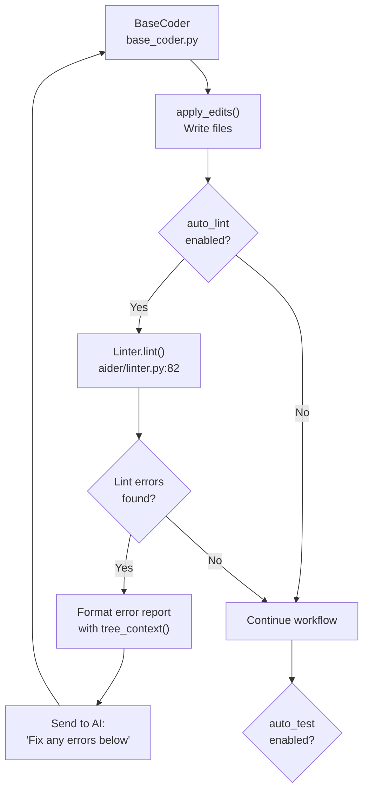
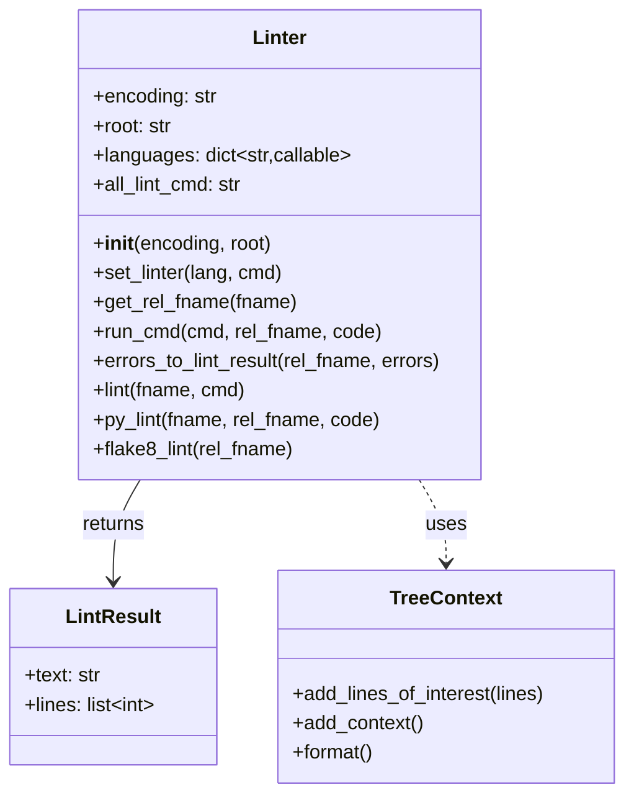
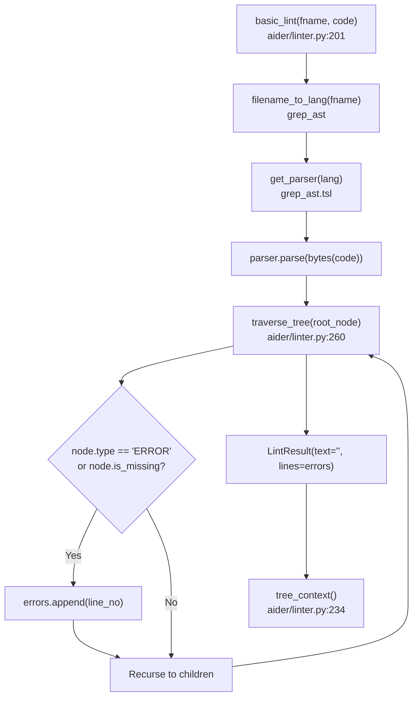
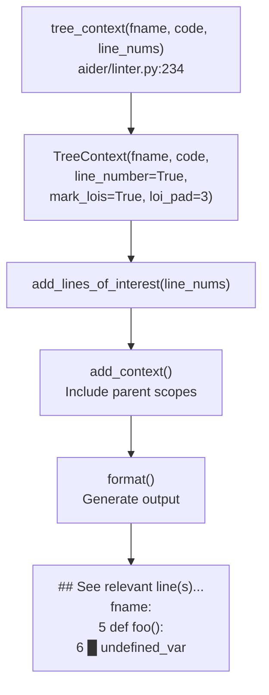
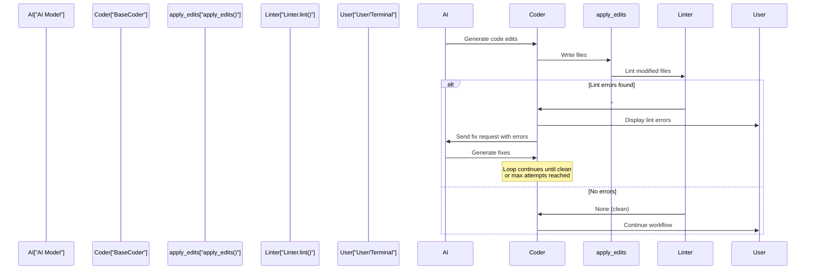

# Code Quality and Linting

<details>
<summary>Relevant source files</summary>

The following files were used as context for generating this wiki page:

- [aider/linter.py](aider/linter.py)
- [aider/run_cmd.py](aider/run_cmd.py)
- [aider/website/docs/usage/lint-test.md](aider/website/docs/usage/lint-test.md)
- [tests/basic/test_linter.py](tests/basic/test_linter.py)
- [tests/basic/test_run_cmd.py](tests/basic/test_run_cmd.py)

</details>


Aider's code quality system provides automated linting and testing integration to ensure generated code meets quality standards. The `Linter` class [aider/linter.py:21-36]() analyzes code for syntax errors, undefined names, and critical issues, while the test integration system runs user-specified test commands to validate functionality. Both integrate with the code modification pipeline through automatic feedback loops that allow the AI to detect and fix issues immediately after generating code.

## Overview

The `Linter` class [aider/linter.py:21-36]() provides language-specific error detection capabilities. When `auto_lint` is enabled in the Coder, modified files are automatically linted after edits are applied. If errors are detected, the Coder requests fixes from the AI in an iterative loop until the code is clean or a maximum number of attempts is reached [aider/website/docs/usage/lint-test.md:9-12]().

The linting system focuses on identifying critical issues:
- Syntax errors that prevent code from parsing [aider/linter.py:201-204]()
- Undefined names and variables [aider/linter.py:137-142]()
- Control flow errors (break/continue/return outside valid context) [aider/linter.py:143-146]()
- Module import issues [aider/linter.py:143-144]()
- Compilation errors [aider/linter.py:177-181]()

### Lint-and-Fix Reflection Cycle

The following diagram illustrates how the `Coder` orchestrates the feedback loop between the LLM and the linting subsystem.



Sources: [aider/linter.py:21-36](), [aider/linter.py:82-116](), [aider/linter.py:111-116](), [aider/website/docs/usage/lint-test.md:9-31]()

## Core Linting Architecture

The `Linter` class [aider/linter.py:21-36]() provides a pluggable framework for running code quality checks. It supports both built-in tree-sitter-based syntax checking and external linting tool integration.

### Linter Class Structure



Sources: [aider/linter.py:21-36](), [aider/linter.py:171-174](), [aider/linter.py:234-256]()

### Key Methods

| Method | Purpose | Return Type |
|--------|---------|-------------|
| `lint(fname, cmd)` | Main entry point for linting a file [aider/linter.py:82]() | `str` or `None` |
| `py_lint(fname, rel_fname, code)` | Python-specific multi-layer linting [aider/linter.py:118]() | `LintResult` or `None` |
| `flake8_lint(rel_fname)` | Run flake8 with fatal error codes [aider/linter.py:136]() | `LintResult` or `None` |
| `set_linter(lang, cmd)` | Register custom linter for language [aider/linter.py:31]() | `None` |
| `run_cmd(cmd, rel_fname, code)` | Execute external linting tool [aider/linter.py:47]() | `LintResult` or `None` |

Sources: [aider/linter.py:31-36](), [aider/linter.py:82-116](), [aider/linter.py:118-135](), [aider/linter.py:136-168]()

The `languages` dictionary [aider/linter.py:26-28]() maps language names to linting functions. By default, only `"python"` is mapped to `self.py_lint`. Users can register custom linters via `set_linter()`.

## Language Support and Extensibility

The linting system supports multiple programming languages through a combination of built-in and custom linters.

### Python Linting Pipeline

Python files undergo a three-stage linting process in `py_lint()` [aider/linter.py:118-135]():

```mermaid
sequenceDiagram
    participant Coder["BaseCoder"]
    participant Linter["Linter"]
    participant basic_lint["basic_lint()<br/>aider/linter.py:201"]
    participant lint_python_compile["lint_python_compile()<br/>aider/linter.py:177"]
    participant flake8_lint["flake8_lint()<br/>aider/linter.py:136"]
    participant tree_context["tree_context()<br/>aider/linter.py:234"]
    
    Coder->>Linter: lint("file.py")
    Linter->>Linter: py_lint(fname, rel_fname, code)
    
    Linter->>basic_lint: Check tree-sitter syntax
    basic_lint-->>Linter: LintResult(lines=[...])
    
    Linter->>lint_python_compile: compile(code, fname, "exec")
    lint_python_compile-->>Linter: LintResult(text=traceback)
    
    Linter->>flake8_lint: Run flake8 with fatal codes
    flake8_lint-->>Linter: LintResult(text=errors)
    
    Linter->>Linter: Merge all results
    Linter->>tree_context: Format with TreeContext
    tree_context-->>Linter: Formatted output
    
    Linter-->>Coder: "# Fix any errors below\\n\\n..."
```

Sources: [aider/linter.py:118-135](), [aider/linter.py:136-168](), [aider/linter.py:177-198](), [aider/linter.py:201-231](), [aider/linter.py:234-256]()

#### Flake8 Fatal Error Codes

The `flake8_lint()` method [aider/linter.py:136-168]() runs flake8 with `--select` filtering to only report critical issues:

| Code | Description |
|------|-------------|
| E9 | Runtime syntax errors [aider/linter.py:137]() |
| F821 | Undefined name [aider/linter.py:137]() |
| F823 | Local variable referenced before assignment [aider/linter.py:137]() |
| F831 | Duplicate argument name in function definition [aider/linter.py:137]() |
| F406 | Import module from `__future__` after other statements [aider/linter.py:137]() |
| F407 | `__future__` feature not defined [aider/linter.py:137]() |
| F701 | `break` statement outside loop [aider/linter.py:137]() |
| F702 | `continue` statement outside loop [aider/linter.py:137]() |
| F704 | `yield` or `yield from` outside function [aider/linter.py:137]() |
| F706 | `return` statement outside function [aider/linter.py:137]() |

Sources: [aider/linter.py:137-146]()

#### Python Compilation Check

The `lint_python_compile()` function [aider/linter.py:177-198]() uses Python's built-in `compile()` to catch syntax errors. It formats the traceback to only show relevant lines by filtering out internal stack frames above the `# USE TRACEBACK BELOW HERE` marker [aider/linter.py:188-195]().

Sources: [aider/linter.py:177-198]()

### Fallback: Tree-sitter Syntax Checking

When no language-specific linter is registered, the system falls back to `basic_lint()` [aider/linter.py:201-231](), which uses tree-sitter parsers to detect syntax errors. This provides universal syntax checking for any language with a tree-sitter grammar supported by `grep_ast`.

The `traverse_tree()` function [aider/linter.py:260-269]() recursively walks the AST to find nodes with `type == "ERROR"` or `is_missing == True`, indicating parse failures.

Sources: [aider/linter.py:201-231](), [aider/linter.py:260-269]()

### Custom Linter Registration

Users can register custom linters via CLI [aider/website/docs/usage/lint-test.md:20-34]():

```bash
aider --lint-cmd "eslint"
aider --lint "javascript: eslint"
```

The `set_linter()` method [aider/linter.py:31-36]() either sets a language-specific linter or, if `lang=None`, sets a universal linter command in `all_lint_cmd` that applies to all files.

Sources: [aider/linter.py:31-36](), [aider/linter.py:96-99](), [aider/website/docs/usage/lint-test.md:20-34]()

## Tree-sitter Error Detection

The `basic_lint()` function [aider/linter.py:201-231]() provides language-agnostic syntax checking using tree-sitter parsers from the `grep_ast` library.

### Detection Pipeline



Sources: [aider/linter.py:201-231](), [aider/linter.py:260-269](), [aider/linter.py:234-256]()

### Error Node Detection

The `traverse_tree()` function [aider/linter.py:260-269]() recursively examines each node in the AST:

```python
def traverse_tree(node):
    errors = []
    if node.type == "ERROR" or node.is_missing:
        line_no = node.start_point[0]
        errors.append(line_no)
    
    for child in node.children:
        errors += traverse_tree(child)
    
    return errors
```

Nodes with `type == "ERROR"` indicate parse failures. Nodes with `is_missing == True` indicate expected syntax elements that are absent (e.g., a missing closing brace) [aider/linter.py:262]().

Sources: [aider/linter.py:260-269]()

### Language Exclusions

TypeScript is explicitly excluded from tree-sitter linting [aider/linter.py:210-212]() due to parser limitations that cause false positives.

Sources: [aider/linter.py:210-212]()

## Error Reporting with Context

The linting system generates formatted error reports with code context to help the AI understand and fix issues.

### Report Format

The `lint()` method [aider/linter.py:82-116]() returns a formatted string:

```
# Fix any errors below, if possible.

[Error output from linter]

## See relevant line(s) below marked with █.

[Code with highlighted error lines]
```

Sources: [aider/linter.py:111-116]()

### TreeContext Integration

The `tree_context()` function [aider/linter.py:234-256]() uses `TreeContext` from `grep_ast` to format code with visual error markers:



Sources: [aider/linter.py:234-256]()

The `TreeContext` is configured to:
- Display line numbers (`line_number=True`) [aider/linter.py:239]()
- Mark lines of interest with `█` (`mark_lois=True`) [aider/linter.py:243]()
- Include 3 lines of padding around errors (`loi_pad=3`) [aider/linter.py:244]()
- Include parent scope context [aider/linter.py:250]()

Sources: [aider/linter.py:235-250]()

## External Tool Execution

The linting system executes external tools through `run_cmd_subprocess()` [aider/run_cmd.py:42-86]().

### Command Execution Flow

```mermaid
flowchart TD
    run_cmd["Linter.run_cmd(cmd, rel_fname, code)<br/>aider/linter.py:47"] --> quote["oslex.quote(rel_fname)"]
    quote --> call["run_cmd_subprocess(cmd)<br/>aider/run_cmd.py:42"]
    
    call --> popen["subprocess.Popen(<br/>shell=True,<br/>stdout=PIPE,<br/>stderr=STDOUT)"]
    
    popen --> read["Read output byte-by-byte"]
    read --> wait["process.wait()"]
    
    wait --> check{"returncode == 0?"}
    check -->|Yes| return_none["return None"]
    check -->|No| format_errors["errors_to_lint_result()"]
    
    format_errors --> find_lines["find_filenames_and_linenums()<br/>aider/linter.py:272"]
    find_lines --> result["LintResult(text, lines)"]
```

Sources: [aider/linter.py:47-68](), [aider/run_cmd.py:42-86](), [aider/linter.py:70-80](), [aider/linter.py:272-285]()

### Path Quoting and Safety

The `run_cmd()` method [aider/linter.py:47-68]() uses `oslex.quote()` to safely quote file paths before passing them to shell commands. This prevents shell injection and handles special characters in filenames (parentheses, brackets, etc.) [tests/basic/test_linter.py:61-80]().

Sources: [aider/linter.py:47-48](), [tests/basic/test_linter.py:61-80]()

### Error Parsing

The `errors_to_lint_result()` method [aider/linter.py:70-80]() extracts line numbers from linter output using `find_filenames_and_linenums()` [aider/linter.py:272-285](), which searches for patterns like `filename:123` in the error text.

Sources: [aider/linter.py:70-80](), [aider/linter.py:272-285]()

## Auto-Lint Feedback Loop

The auto-lint feature creates an automatic feedback loop where the AI detects and fixes its own errors immediately after generating code [aider/website/docs/usage/lint-test.md:9-12]().

### Feedback Loop Integration

When `auto_lint=True` is configured (default behavior), the system automatically lints modified files after applying edits [aider/website/docs/usage/lint-test.md:29]():



Sources: [aider/linter.py:82-116](), [aider/website/docs/usage/lint-test.md:9-31]()

## Test Command Integration

Aider can run tests via the `/test` command or automatically after edits [aider/website/docs/usage/lint-test.md:61-73]().

### Configuration and Execution

Users specify test commands using `--test-cmd` [aider/website/docs/usage/lint-test.md:72](). If a test command returns a non-zero exit code, Aider captures the output and sends it back to the LLM for a fix [aider/website/docs/usage/lint-test.md:67-68]().

| Feature | CLI Switch | Purpose |
|---------|------------|---------|
| Auto Test | `--auto-test` | Run tests after every AI edit [aider/website/docs/usage/lint-test.md:73]() |
| Test Command | `--test-cmd <cmd>` | Command to execute for testing [aider/website/docs/usage/lint-test.md:72]() |
| Manual Run | `/run <cmd>` | Execute command and optionally share output [aider/website/docs/usage/lint-test.md:97]() |

Sources: [aider/website/docs/usage/lint-test.md:61-101](), [aider/run_cmd.py:11-16]()

### Subprocess vs Pexpect

`run_cmd.py` provides two ways to execute commands:
1. `run_cmd_subprocess()` [aider/run_cmd.py:42-86](): Used for non-interactive execution, captures output via pipes. It handles shell selection and Windows-specific parent process checks [aider/run_cmd.py:47-54]().
2. `run_cmd_pexpect()` [aider/run_cmd.py:89-133](): Used for interactive shell commands on non-Windows systems, allowing user interaction during the command run via `child.interact()` [aider/run_cmd.py:124]().

Sources: [aider/run_cmd.py:11-16](), [aider/run_cmd.py:42-86](), [aider/run_cmd.py:89-133]()

## Linter Test Suite

The linting system includes comprehensive tests in `tests/basic/test_linter.py` and `tests/basic/test_run_cmd.py`.

### Test Coverage

The test suite covers:
- Linter initialization and path resolution [tests/basic/test_linter.py:13-29]()
- Command execution with and without errors [tests/basic/test_linter.py:31-60]()
- Handling special characters in filenames [tests/basic/test_linter.py:61-80]()
- Basic echo command execution [tests/basic/test_run_cmd.py:6-12]()

Sources: [tests/basic/test_linter.py:1-84](), [tests/basic/test_run_cmd.py:1-12]()