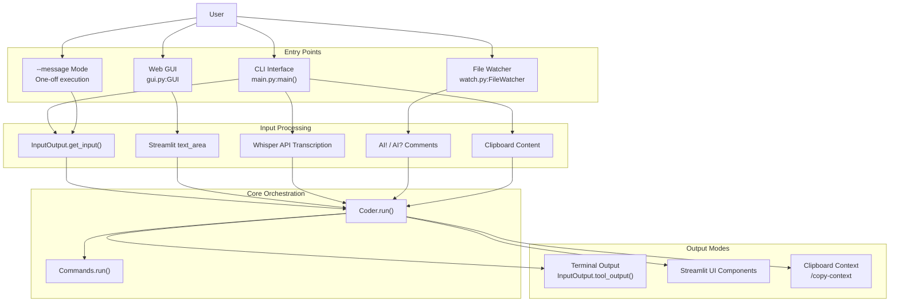
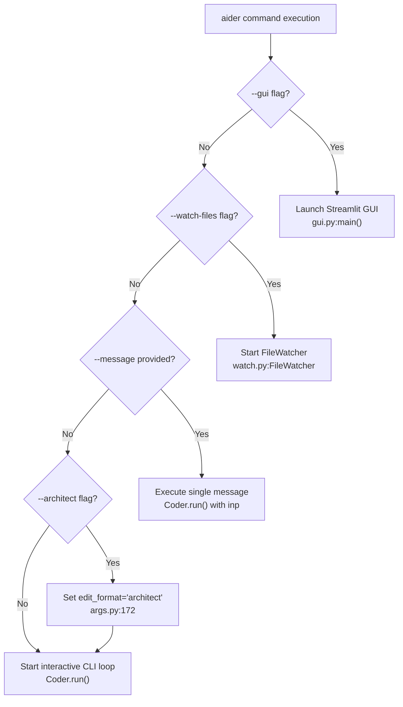
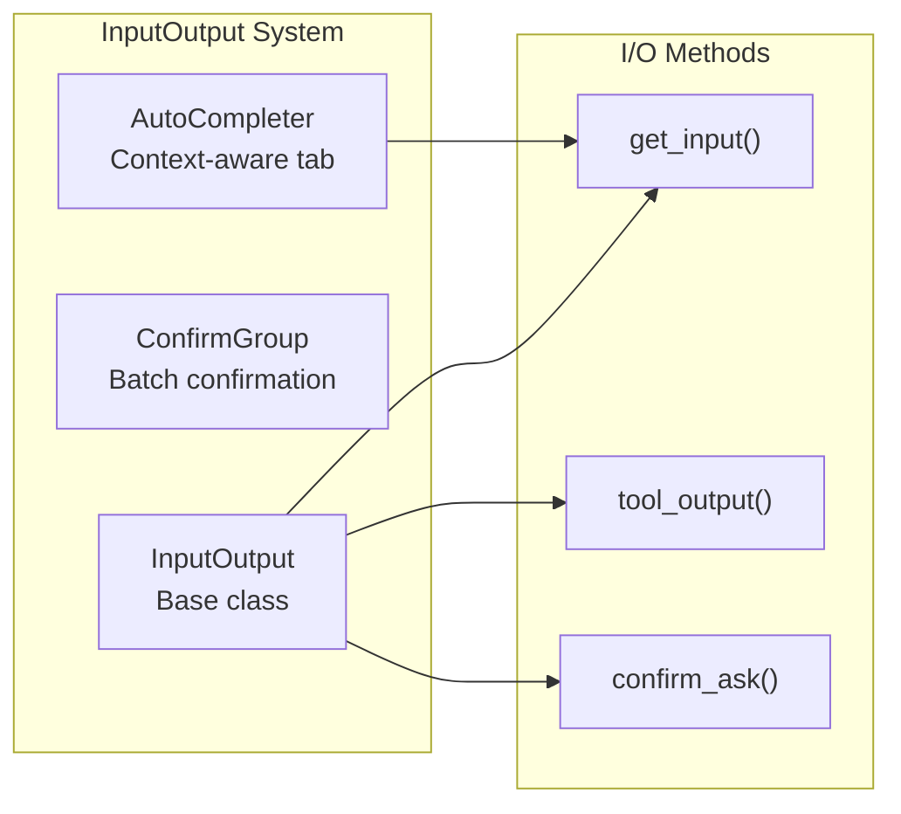

# User Interaction Modes

Relevant source files

The following files were used as context for generating this wiki page:

- [aider/args.py](aider/args.py)
- [aider/coders/architect_coder.py](aider/coders/architect_coder.py)
- [aider/coders/architect_prompts.py](aider/coders/architect_prompts.py)
- [aider/coders/base_coder.py](aider/coders/base_coder.py)
- [aider/coders/editor_editblock_coder.py](aider/coders/editor_editblock_coder.py)
- [aider/coders/editor_whole_coder.py](aider/coders/editor_whole_coder.py)
- [aider/commands.py](aider/commands.py)
- [aider/io.py](aider/io.py)
- [aider/main.py](aider/main.py)
- [aider/models.py](aider/models.py)
- [aider/repo.py](aider/repo.py)
- [aider/repomap.py](aider/repomap.py)
- [aider/voice.py](aider/voice.py)
- [aider/website/_data/architect.yml](aider/website/_data/architect.yml)
- [aider/website/_posts/2024-09-26-architect.md](aider/website/_posts/2024-09-26-architect.md)
- [aider/website/_sass/custom/custom.scss](aider/website/_sass/custom/custom.scss)
- [aider/website/docs/languages.md](aider/website/docs/languages.md)
- [aider/website/docs/usage/modes.md](aider/website/docs/usage/modes.md)
- [tests/basic/test_io.py](tests/basic/test_io.py)

Aider provides multiple interaction modes to accommodate different workflows and use cases. This document provides an overview of the various ways users can interact with Aider, from the standard command-line interface to browser-based GUIs, voice input, and reasoning-heavy architect modes.

For detailed information about specific modes:
- **CLI fundamentals**: See [Command Line Interface](#5.1)
- **Web-based interface**: See [Streamlit Web GUI](#5.2)
- **Voice input**: See [Voice-to-Code Mode](#5.3)
- **Web chat integration**: See [Copy/Paste Integration with Web Chat UIs](#5.4)
- **Two-stage reasoning**: See [Architect Mode](#5.5)

## Overview of Interaction Modes

Aider supports several distinct modes of user interaction, each optimized for different workflows. All modes ultimately interact with the same core `Coder` class [aider/coders/base_coder.py:88-206]() but provide different interfaces for user input and output.

### Interaction Modes Architecture

Sources: [aider/main.py:1-40](), [aider/coders/base_coder.py:88-123](), [aider/io.py:15-36]()

## Mode Comparison

| Mode | Use Case | Interactive | Input Method | Output Format |
|------|----------|-------------|--------------|---------------|
| CLI | Primary development workflow | Yes | Terminal prompts | Terminal with color/formatting |
| Web GUI | Browser-based interaction | Yes | Web form/text area | Streamlit components |
| Voice | Hands-free coding | Yes | Whisper API transcription | Terminal |
| Copy/Paste | Use with ChatGPT/Claude web | Semi | Manual clipboard operations | Formatted context blocks |
| Architect | Complex reasoning tasks | Yes | Terminal / GUI | Multi-model reasoning + edits |

Sources: [aider/main.py:208-216](), [aider/voice.py:106-181](), [aider/args.py:164-184]()

## Mode Selection Flow

Sources: [aider/main.py:208-214](), [aider/args.py:164-184](), [aider/watch.py:1-38]()

## Common Components Across Modes

All interaction modes share common infrastructure:

### InputOutput System

The `InputOutput` class [aider/io.py:81-330]() provides a unified abstraction for terminal I/O that works across all modes. In GUI mode, it is extended by a `CaptureIO` adapter (found in `aider/gui.py`) to capture output for Streamlit display.

Sources: [aider/io.py:81-330](), [aider/io.py:91-126]()

### Coder Integration

Each mode creates and configures a `Coder` instance. The CLI is the primary entry point, while other modes wrap or modify how the `Coder` receives instructions:

| Mode | Coder Creation | Configuration |
|------|----------------|---------------|
| CLI | `Coder.create()` in `main.py` | Full arg parsing via `args.py` |
| Architect | `SwitchCoder(edit_format='architect')` | Triggered via command or arg |
| Watch | `FileWatcher` monitoring | Detects `AI!` in comments |

Sources: [aider/main.py:24](), [aider/commands.py:30-34](), [aider/watch.py:1-38]()

## Mode-Specific Features

### CLI Features
- **Auto-completion**: Uses `AutoCompleter` [aider/io.py:91-126]() to provide completions for files and commands.
- **Syntax Highlighting**: Uses `PygmentsLexer` [aider/io.py:23-28]() for rich terminal output.
- **External Editor**: Integrated via `pipe_editor` [aider/io.py:39]() to allow complex message drafting.

### Voice Mode Features
- **Whisper Integration**: Uses `litellm.transcription` [aider/voice.py:169-171]() with the `whisper-1` model.
- **Real-time Feedback**: Displays a recording bar [aider/voice.py:93-104]() based on audio RMS levels.

### Architect Mode Features
- **Two-Stage Workflow**: Separates reasoning (Architect) from file editing (Editor) [aider/args.py:194-205]().
- **Auto-Accept**: Optional `auto_accept_architect` [aider/args.py:179-183]() for seamless edits after the reasoning phase.

### File Watcher Mode
- **IDE Integration**: Monitors for `AI!` or `AI?` comments in source files [aider/watch.py:1-38]().
- **Automated Trigger**: Triggers a chat cycle when a file is saved with specific comment markers.

## Mode Switching at Runtime

Users can switch between chat modes and models during an active session using slash commands:

- `/chat-mode <mode>`: Switches between `ask`, `code`, `architect`, etc. [aider/commands.py:138-203]().
- `/model <model>`: Changes the main LLM [aider/commands.py:87-112]().
- `/voice`: Triggers a voice recording session [aider/commands.py:37-79]().

Sources: [aider/commands.py:37-203](), [aider/coders/base_coder.py:125-201]()