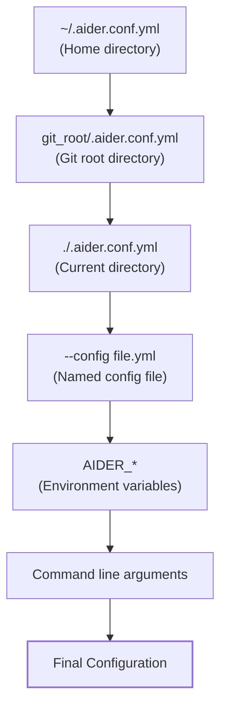
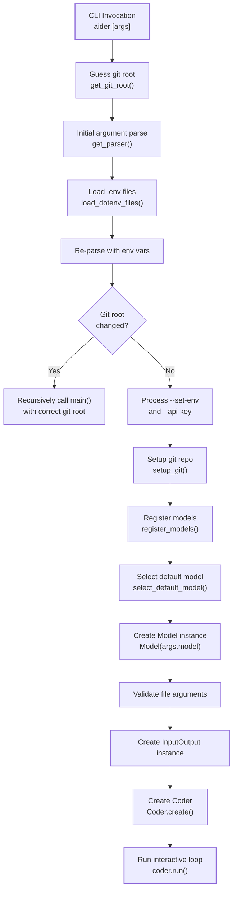

# Command Line Interface

Relevant source files

The following files were used as context for generating this wiki page:

- [aider/args.py](aider/args.py)
- [aider/args_formatter.py](aider/args_formatter.py)
- [aider/coders/base_coder.py](aider/coders/base_coder.py)
- [aider/commands.py](aider/commands.py)
- [aider/io.py](aider/io.py)
- [aider/main.py](aider/main.py)
- [aider/models.py](aider/models.py)
- [aider/onboarding.py](aider/onboarding.py)
- [aider/repo.py](aider/repo.py)
- [aider/repomap.py](aider/repomap.py)
- [aider/voice.py](aider/voice.py)
- [aider/website/docs/languages.md](aider/website/docs/languages.md)
- [tests/basic/test_io.py](tests/basic/test_io.py)
- [tests/basic/test_onboarding.py](tests/basic/test_onboarding.py)

## Purpose and Scope

This document describes Aider's command line interface (CLI), which is the primary method for users to invoke and configure Aider. The CLI handles argument parsing, configuration file loading, environment variable processing, model selection, and the initialization sequence that prepares the system for interactive use.

For information about interactive commands during a session (slash commands), see [aider/commands.py](). For details about the main execution loop after initialization, see [aider/main.py]().

**Sources:** [aider/main.py:451-1183](), [aider/args.py:1-714]()

---

## Argument Parsing System

Aider uses the `configargparse` library to manage CLI arguments, which extends Python's standard `argparse` with support for configuration files and environment variables. The `get_parser()` function in [aider/args.py:35-714]() defines all available arguments organized into logical groups.

### Parser Configuration

The parser is configured with several key features:

- **Config file support**: Uses `YAMLConfigFileParser` to read `.aider.conf.yml` files [aider/args.py:40]().
- **Environment variable mapping**: Automatically maps environment variables with `AIDER_` prefix to arguments [aider/args.py:41]().
- **Default config files**: Accepts a list of default configuration files searched in order [aider/args.py:39]().
- **Shell completion**: Integrates with `shtab` for shell autocompletion support [aider/args.py:58]().

**Sources:** [aider/args.py:35-42]()

### Argument Groups

Arguments are organized into functional groups for clarity in the help output and internal logic:

| Group | Purpose | Key Arguments |
|-------|---------|---------------|
| Main model | Primary LLM configuration | `--model`, `files` [aider/args.py:55-64]() |
| API Keys and settings | Authentication | `--openai-api-key`, `--api-key`, `--set-env` [aider/args.py:67-112]() |
| Model settings | Model behavior | `--edit-format`, `--weak-model`, `--reasoning-effort`, `--thinking-tokens` [aider/args.py:113-220]() |
| Cache settings | Prompt caching | `--cache-prompts`, `--cache-keepalive-pings` [aider/args.py:356-372]() |
| Repomap settings | Code context | `--map-tokens`, `--map-refresh` [aider/args.py:373-404]() |
| History Files | Persistence | `--input-history-file`, `--chat-history-file` [aider/args.py:255-274]() |
| Output settings | Display | `--dark-mode`, `--light-mode`, `--pretty`, `--stream` [aider/args.py:228-254]() |
| Git settings | Version control | `--git`, `--auto-commits`, `--attribute-author` [aider/args.py:405-470]() |

**Sources:** [aider/args.py:55-586]()

---

## Configuration Precedence and Layering

Configuration in Aider follows a strict precedence hierarchy where later sources override earlier ones. This allows for global settings in the home directory, project-specific settings in the git root, and temporary overrides via CLI flags.

### Precedence Diagram

**Sources:** [aider/main.py:464-505](), [aider/args.py:35-42]()

### Configuration File Discovery

The `get_git_root()` function [aider/main.py:60-67]() attempts to find the repository root to locate project-specific configuration. Files are searched in order, with later files overriding earlier ones. The parser processes all found files before applying environment variables and command line arguments.

**Sources:** [aider/main.py:305-332](), [aider/main.py:60-67]()

---

## Environment Variable Processing

Aider loads environment variables from multiple `.env` files and also processes environment variable overrides specified via CLI arguments.

### .env File Loading

The system searches for and loads `.env` files in this order:

Later files override earlier ones using `load_dotenv(..., override=True)`. The OAuth keys file is loaded first to ensure it can be overridden by project-specific or user-specified `.env` files.

**Sources:** [aider/main.py:361-387]()

### Command Line Environment Variable Overrides

The `--set-env` and `--api-key` arguments allow setting environment variables directly from the command line:

- `--set-env VAR_NAME=value`: Sets arbitrary environment variables [aider/args.py:97]().
- `--api-key provider=key`: Sets `PROVIDER_API_KEY=key` [aider/args.py:104]().

**Sources:** [aider/main.py:590-610]()

---

## Initialization Sequence

The `main()` function in `aider/main.py` orchestrates the complex initialization sequence that prepares Aider for use.

### Initialization Flow

**Sources:** [aider/main.py:451-1183]()

### Key Initialization Steps

1. **Git Root Detection**: `get_git_root()` attempts to find the git repository containing the current directory [aider/main.py:60-66]().
2. **Git Repository Verification**: `guessed_wrong_repo()` checks if the actual repository differs from the initial guess [aider/main.py:69-86]().
3. **Model Registration**: 
   - `register_models()` loads model settings from `.aider.model.settings.yml` files [aider/main.py:335-358]().
4. **Model Selection**: `select_default_model()` determines which model to use, potentially triggering OAuth flows for providers like OpenRouter [aider/onboarding.py:116-151]().
5. **Coder Creation**: The `Coder.create()` factory method instantiates the appropriate coder implementation [aider/coders/base_coder.py:124-201]().

**Sources:** [aider/main.py:451-1183]()

---

## Model Selection and Registration

### Model Settings and Metadata

Model behavior is configured via YAML and JSON files. The `ModelInfoManager` handles the retrieval and caching of these settings [aider/models.py:161-240]().

- **Model Settings**: Defined in `model-settings.yml` (bundled in `aider/resources/`) and custom `.aider.model.settings.yml` files [aider/models.py:154-159]().
- **Model Metadata**: `ModelInfoManager` fetches and caches LiteLLM model prices and context windows from a remote JSON database [aider/models.py:162-165]().

### Model Aliases

The `MODEL_ALIASES` dictionary maps shorthand names (like `sonnet`, `4o`, `r1`, or `flash`) to full model identifiers [aider/models.py:99-123](). These can be extended via the `--alias` CLI argument [aider/args.py:133]().

**Sources:** [aider/models.py:99-159](), [aider/main.py:765-775]()

---

## Special CLI Flags and Exit Paths

Several CLI flags cause Aider to perform a specific action and exit without entering the interactive chat loop.

| Flag | Behavior |
|------|----------|
| `--exit` | Exit immediately after initialization [aider/args.py:605]() |
| `--list-models` | List matching models [aider/args.py:115]() |
| `--gui` | Launch Streamlit GUI [aider/args.py:612]() |
| `--shell-completions` | Generate shell completions [aider/args.py:633]() |
| `--upgrade` | Install upgrade from PyPI [aider/args.py:600]() |

**Sources:** [aider/main.py:506-762]()

---

## Color and I/O Configuration

The `InputOutput` class handles terminal interactions, including styling and autocompletion [aider/io.py:31-35]().

### Color Theme Presets
- **Dark Mode (`--dark-mode`)**: Configures colors optimized for dark backgrounds [aider/args.py:236]().
- **Light Mode (`--light-mode`)**: Configures colors optimized for light backgrounds [aider/args.py:242]().

### Autocompletion
The `AutoCompleter` class [aider/io.py:91-126]() provides intelligent completions for commands and file names. It tokenizes files in the chat using Pygments lexers to provide symbol-based completion [aider/io.py:127-147]().

**Sources:** [aider/io.py:31-147](), [aider/main.py:532-579]()

---

## Onboarding Flow

For new users, Aider includes an onboarding flow triggered during initialization:

1. **API Key Check**: If no API keys are found, Aider offers OpenRouter OAuth via `offer_openrouter_oauth()` [aider/onboarding.py:79-113]().
2. **Model Selection**: If no model is specified, `select_default_model()` attempts to find a default based on environment keys or OAuth. It checks OpenRouter tiers to prefer `deepseek-r1:free` for free users or `claude-sonnet-4` for paid users [aider/onboarding.py:116-151](), [aider/onboarding.py:52-60]().
3. **Git Setup**: If no git repo is found, `setup_git()` offers to create one [aider/main.py:101-153]().
4. **Gitignore Check**: `check_gitignore()` offers to add `.aider*` and `.env` to `.gitignore` [aider/main.py:155-207]().

**Sources:** [aider/main.py:101-207](), [aider/onboarding.py:44-151]()