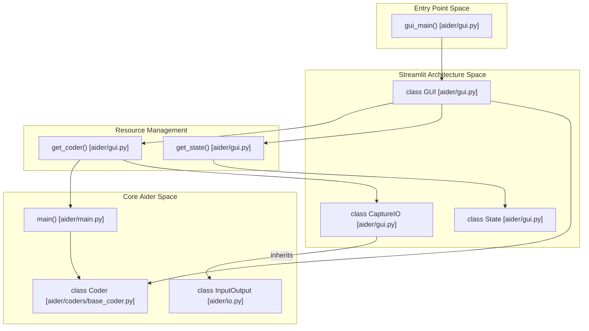
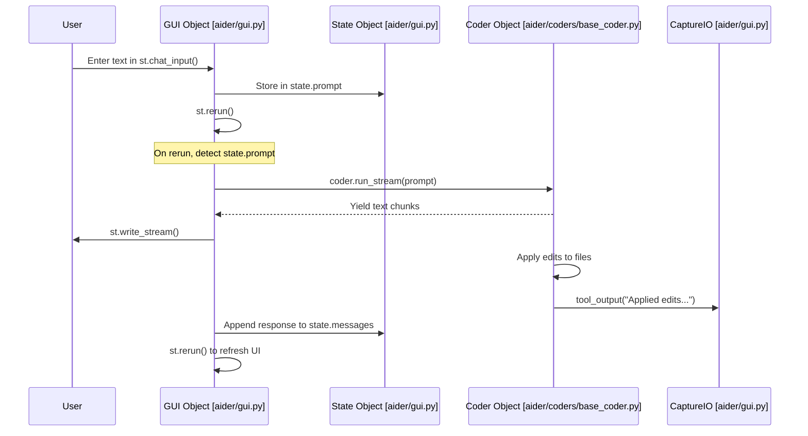

# Streamlit Web GUI

Relevant source files

The following files were used as context for generating this wiki page:

- [aider/gui.py](aider/gui.py)
- [aider/report.py](aider/report.py)
- [aider/scrape.py](aider/scrape.py)
- [aider/urls.py](aider/urls.py)
- [aider/utils.py](aider/utils.py)
- [aider/versioncheck.py](aider/versioncheck.py)
- [scripts/update-docs.sh](scripts/update-docs.sh)
- [tests/browser/test_browser.py](tests/browser/test_browser.py)

## Purpose and Scope

This page documents the browser-based graphical user interface (GUI) for Aider, implemented using Streamlit. The GUI provides an alternative interaction mode to the command-line interface. While the CLI runs in a terminal, the GUI runs in a web browser and provides a chat-like interface with visual file selection, web content integration, and interactive undo functionality.

The GUI implementation is primarily contained within `aider/gui.py`, which bridges the Streamlit frontend with the core `Coder` system.

## Architecture Overview

The Streamlit GUI is built around a single-page application pattern with persistent state management and integration with the core Coder system. It utilizes Streamlit's resource caching to ensure that the backend AI state persists across browser refreshes.

### Component Relationship Diagram

This diagram maps the natural language components of the GUI to their specific code entities.

**Sources:** [aider/gui.py:1-546](), [aider/main.py:1-620]()

## Entry Point and Initialization

The GUI is launched through the `gui_main()` function, which configures the Streamlit page and instantiates the main `GUI` class.

### Page Configuration

Page configuration is set at [aider/gui.py:525-534]() with the following settings:

| Configuration | Value | Purpose |
|---------------|-------|---------|
| `layout` | `"wide"` | Uses full browser width |
| `page_title` | `"Aider"` | Browser tab title |
| `page_icon` | `urls.favicon` | Browser tab icon [aider/urls.py:6-6]() |
| `menu_items` | Help, bug report, about links | Navigation menu |

### GUI Class Initialization

The `GUI` class constructor [aider/gui.py:360-403]() performs the following initialization sequence:

1. Retrieves cached `Coder` instance via `get_coder()` [aider/gui.py:361]().
2. Retrieves cached `State` instance via `get_state()` [aider/gui.py:362]().
3. Forces streaming configuration: `yield_stream=True`, `stream=True`, `pretty=False` [aider/gui.py:364-367]().
4. Initializes state variables like `messages` and `input_history` [aider/gui.py:328-349]().
5. Renders the messages container and sidebar [aider/gui.py:372-373]().

**Sources:** [aider/gui.py:524-545](), [aider/gui.py:360-403]()

## Cached Resource Management

The GUI uses Streamlit's `@st.cache_resource` decorator to maintain persistent instances across browser reloads, ensuring the AI context and file state remain intact.

### Coder Instance Caching

The `get_coder()` function at [aider/gui.py:69-89]() creates the Coder instance:

- Calls `cli_main(return_coder=True)` to leverage existing CLI initialization logic [aider/gui.py:71]().
- Validates that a git repository exists, as the GUI currently requires one [aider/gui.py:74-75]().
- Replaces the `Commands` system's IO with a `CaptureIO` instance to intercept terminal output for the web interface [aider/gui.py:84]().

### State Instance Caching

The `State` class at [aider/gui.py:52-62]() provides persistent storage for UI-specific data:

- `keys`: Set of initialized state keys [aider/gui.py:53]().
- `init(key, val)`: Initializes a key if not already present [aider/gui.py:55-61]().
- Attributes are set dynamically via `setattr()` to store chat history and UI toggles.

**Sources:** [aider/gui.py:64-89](), [aider/gui.py:52-62]()

## Custom I/O Handling: CaptureIO

The `CaptureIO` class extends the base `InputOutput` class to capture tool output for display in the GUI components rather than just the terminal.

### CaptureIO Implementation

Located at [aider/gui.py:17-36](), the class overrides methods to buffer messages:

| Method | Behavior | Line Numbers |
|--------|----------|--------------|
| `tool_output()` | Appends to `lines` list unless `log_only=True` | [aider/gui.py:20-23]() |
| `tool_error()` | Appends to `lines` list | [aider/gui.py:25-27]() |
| `tool_warning()` | Appends to `lines` list | [aider/gui.py:29-31]() |
| `get_captured_lines()` | Returns and clears the internal `lines` buffer | [aider/gui.py:33-36]() |

This captured output is vital for showing the results of background operations like `/undo` or shell commands within the Streamlit UI.

**Sources:** [aider/gui.py:17-36]()

## Chat Processing Flow

The chat processing system handles streaming responses from the LLM and manages the interaction loop between the user and the `Coder` system.

### Data Flow Diagram: User Prompt to Code Change

This diagram shows how a natural language prompt flows through the GUI entities to reach the code modification logic.

### Processing Implementation

The `process_chat()` method at [aider/gui.py:412-454]() implements the core loop:

1. **Retrieves pending prompt** from `state.prompt` and clears it [aider/gui.py:414-416]().
2. **Streaming Loop**: Calls `st.write_stream(coder.run_stream(prompt))` to display the LLM's thought process and code blocks in real-time [aider/gui.py:422]().
3. **Reflection Handling**: Checks for `coder.reflected_message` (e.g., linting errors or test failures) and recurses to allow the LLM to fix its own mistakes [aider/gui.py:427-431]().
4. **Edit Information**: Collects file change data and commit hashes to create "edit" role messages for the history [aider/gui.py:436-448]().

**Sources:** [aider/gui.py:412-454](), [aider/gui.py:104-136]()

## Web Content Integration

The GUI integrates web scraping to allow users to add documentation or web pages directly into the AI's context window.

The `do_web()` method at [aider/gui.py:464-496]() manages this:

- It uses the `Scraper` class from `aider/scrape.py` [aider/gui.py:476]().
- It checks for Playwright availability via `has_playwright()` to determine the scraping strategy [aider/gui.py:477]().
- If Playwright is missing, it falls back to `scrape_with_httpx()` [aider/scrape.py:109-109]().
- Retrieved content is converted to Markdown via `html_to_markdown()` [aider/scrape.py:120-120]() and injected into the chat as a "text" message [aider/gui.py:488-492]().

**Sources:** [aider/gui.py:464-496](), [aider/scrape.py:79-122](), [aider/scrape.py:35-37]()

## Undo Functionality

The GUI provides a visual way to revert the most recent AI-generated commit.

- **`add_undo()`**: Checks if the latest commit hash matches `coder.last_aider_commit_hash` and renders an undo button [aider/gui.py:138-148]().
- **`do_undo()`**: When clicked, it calls `coder.commands.cmd_undo(None)` [aider/gui.py:509]().
- The result of the undo operation (captured via `CaptureIO`) is displayed as an info notification [aider/gui.py:512-515]().

**Sources:** [aider/gui.py:138-148](), [aider/gui.py:498-522]()

## UI Components and State

The GUI maintains a complex set of UI state variables within the `State` class initialized at [aider/gui.py:328-349]():

| Variable | Purpose |
|----------|---------|
| `messages` | List of dicts representing the conversation history [aider/gui.py:329](). |
| `input_history` | Deduplicated list of previous user prompts [aider/gui.py:339](). |
| `initial_inchat_files` | Tracks which files were added to the chat context at startup [aider/gui.py:338](). |
| `scraper` | Cached `Scraper` instance for web content [aider/gui.py:337](). |

The sidebar at [aider/gui.py:149-164]() provides controls for adding files via `st.multiselect` [aider/gui.py:188](), clearing history [aider/gui.py:250](), and managing web content.

**Sources:** [aider/gui.py:328-349](), [aider/gui.py:149-164](), [aider/gui.py:187-208]()