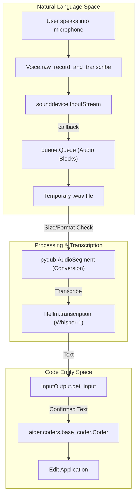
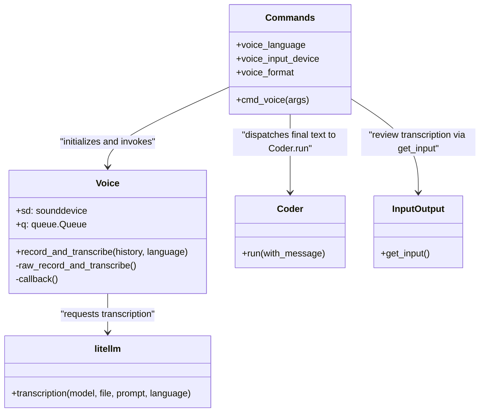

# Voice-to-Code Mode

Relevant source files

The following files were used as context for generating this wiki page:

- [aider/args.py](aider/args.py)
- [aider/coders/base_coder.py](aider/coders/base_coder.py)
- [aider/commands.py](aider/commands.py)
- [aider/io.py](aider/io.py)
- [aider/main.py](aider/main.py)
- [aider/models.py](aider/models.py)
- [aider/repo.py](aider/repo.py)
- [aider/repomap.py](aider/repomap.py)
- [aider/voice.py](aider/voice.py)
- [aider/website/docs/languages.md](aider/website/docs/languages.md)
- [aider/website/docs/usage/tips.md](aider/website/docs/usage/tips.md)
- [aider/website/docs/usage/tutorials.md](aider/website/docs/usage/tutorials.md)
- [aider/website/docs/usage/voice.md](aider/website/docs/usage/voice.md)
- [tests/basic/test_io.py](tests/basic/test_io.py)
- [tests/basic/test_voice.py](tests/basic/test_voice.py)

## Purpose and Scope

This document covers Aider's voice input capability, which allows users to interact with the AI coding assistant using spoken language. Voice input is captured using the `sounddevice` library, transcribed to text using OpenAI's Whisper API via `litellm`, and processed as a standard chat message.

For information about other user interaction methods, see [Command Line Interface](5.1), [Streamlit Web GUI](5.2), and [Copy/Paste Integration with Web Chat UIs](5.4).

## Overview

Voice-to-Code mode enables hands-free interaction with Aider. Users record audio through their microphone, which is transcribed to text via the Whisper API. The transcription is reviewed and can be optionally edited before being submitted to the `Coder` for processing.

The voice input feature is implemented in `aider/voice.py` and integrated into the CLI via the `/voice` command in `aider/commands.py`.

**Sources:** [aider/voice.py:1-40](), [aider/commands.py:16-17](), [aider/commands.py:465-485]() (Note: Reference to `cmd_voice` based on standard command dispatch in `Commands`).

## Voice Input Flow

The voice input system follows a multi-stage pipeline from audio capture to code modification.

**Voice Input Processing Pipeline**

The `Voice` class manages the lifecycle of a recording. It uses a separate thread via `sounddevice` to capture audio blocks, which are stored in a `queue.Queue` before being written to a temporary file using `soundfile`.

**Sources:** [aider/voice.py:77-92](), [aider/voice.py:116-142](), [aider/voice.py:167-171]()

## Key Classes and Functions

### The `Voice` Class
Located in `aider/voice.py`, this class handles hardware interaction and transcription logic.

- `__init__(audio_format, device_name)`: Initializes the sound device. It queries available devices using `sd.query_devices()` and selects the one matching `device_name` if provided [aider/voice.py:40-75]().
- `callback(indata, frames, time, status)`: The audio processing callback. It calculates the Root Mean Square (RMS) to provide a visual volume meter in the terminal [aider/voice.py:77-92]().
- `get_prompt()`: Generates a dynamic string showing recording duration and a volume bar (using `░` and `█` characters) [aider/voice.py:93-104]().
- `record_and_transcribe(history, language)`: The main entry point that wraps the recording process in a try-except block to handle `KeyboardInterrupt` and `SoundDeviceError` [aider/voice.py:106-115]().
- `raw_record_and_transcribe(history, language)`: Performs the actual recording loop using `sounddevice.InputStream` and handles the transcription call to `litellm` [aider/voice.py:116-181]().

### Integration in `Commands`
The `/voice` command logic is handled within `aider/commands.py`:

- The `Commands` class maintains state for `voice_language`, `voice_input_device`, and `voice_format` [aider/commands.py:77-79]().
- During initialization, it handles the "auto" language setting by converting it to `None` [aider/commands.py:74-77]().

**Sources:** [aider/voice.py:33-40](), [aider/voice.py:106-115](), [aider/commands.py:74-80]()

## Audio Processing and Constraints

### Format Validation and Conversion
Aider supports `wav`, `mp3`, and `webm` formats. If a recording in `wav` format exceeds 24.9 MB (near the OpenAI API limit), the system automatically attempts to convert it to `mp3` using `pydub` to reduce file size.

| Step | Implementation | Logic |
|--------------|------|---------|
| **Capture** | `sounddevice` | Raw PCM data into `queue.Queue` [aider/voice.py:133-136]() |
| **Storage** | `soundfile` | Written to temporary `.wav` [aider/voice.py:140-142]() |
| **Conversion** | `pydub` | Triggered if file > 24.9MB or non-wav requested [aider/voice.py:147-165]() |
| **API Call** | `litellm` | Sent to `whisper-1` model [aider/voice.py:169-171]() |

**Sources:** [aider/voice.py:140-165](), [aider/voice.py:167-171]()

### Whisper API Integration
Transcription is performed via `litellm.transcription`. Aider passes the current chat history to the Whisper API as a `prompt`. This is a key optimization: providing the LLM with the context of the conversation helps it correctly transcribe technical terms, variable names, and project-specific jargon that appeared earlier in the chat.

**Sources:** [aider/voice.py:169-171]()

## System Architecture

The following diagram illustrates how the voice components bridge user interaction with the core `Coder` logic.

**Sources:** [aider/commands.py:53-80](), [aider/voice.py:106-115](), [aider/voice.py:169-171](), [aider/coders/base_coder.py:88-102]()

## Configuration and Setup

Voice support requires optional dependencies. Aider uses `check_pip_install_extra` to guide users to install the `voice` extra (`aider-chat[voice]`).

### Command Line Arguments
Configuration is handled via `aider/args.py`:

- `--voice-language`: Specifies the language for transcription (default is "auto") [aider/args.py:536-541]().
- `--voice-input-device`: Selects a specific microphone by name [aider/args.py:542-547]().
- `--voice-format`: Sets the preferred audio format (`wav`, `mp3`, or `webm`) [aider/args.py:548-554]().

### Runtime Requirements
- **FFmpeg**: Required by `pydub` for audio conversion [aider/voice.py:14-16]().
- **PortAudio**: Required by `sounddevice` for microphone access [aider/voice.py:137-138]().
- **OpenAI API Key**: Required for the Whisper API transcription [aider/voice.py:184-186]().
- **SoundFile**: Used for writing audio data to disk [aider/voice.py:23-26]().

**Sources:** [aider/args.py:530-555](), [aider/voice.py:14-26](), [aider/voice.py:184-186]()