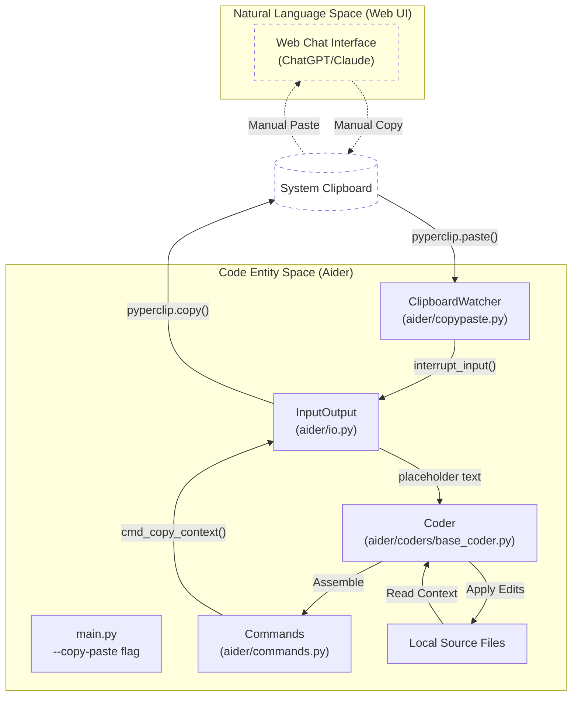
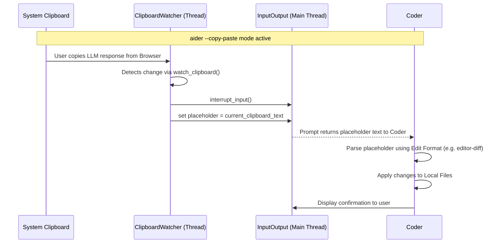

# Copy/Paste Integration with Web Chat UIs

Relevant source files

The following files were used as context for generating this wiki page:

- [aider/copypaste.py](aider/copypaste.py)
- [aider/website/assets/copypaste.jpg](aider/website/assets/copypaste.jpg)
- [aider/website/assets/copypaste.mp4](aider/website/assets/copypaste.mp4)
- [aider/website/assets/watch.jpg](aider/website/assets/watch.jpg)
- [aider/website/assets/watch.mp4](aider/website/assets/watch.mp4)
- [aider/website/docs/usage/copypaste.md](aider/website/docs/usage/copypaste.md)
- [aider/website/docs/usage/watch.md](aider/website/docs/usage/watch.md)

## Purpose and Scope

Aider's copy/paste integration provides a bridge between the local terminal-based file management system and LLM web chat interfaces (such as ChatGPT, Claude, or internal corporate LLM portals). This feature is particularly useful when API access is restricted by workplace policies, cost-prohibitive for specific models (like o1 or Claude 3.5 Sonnet), or when a model is only available via a web UI [aider/website/docs/usage/copypaste.md:37-49]().

The integration centers on two primary flows:
1.  **Exporting Context**: Assembling local file contents and repository maps into the clipboard to paste into a browser [aider/website/docs/usage/copypaste.md:55-68]().
2.  **Importing Edits**: Monitoring the clipboard for LLM responses and automatically applying those code changes to local files using efficient edit formats like `editor-diff` or `editor-whole` [aider/website/docs/usage/copypaste.md:79-92]().

## Architecture and Data Flow

The copy/paste system is integrated into the core `Coder` orchestration and `InputOutput` subsystems. It utilizes the `pyperclip` library for cross-platform clipboard access [aider/copypaste.py:4-5]().

### Component Interaction Diagram
This diagram maps the interaction between the user's browser (Natural Language Space) and the internal Aider classes (Code Entity Space).

**Sources:** [aider/copypaste.py:7-17](), [aider/website/docs/usage/copypaste.md:57-78]()

## Key Components

### ClipboardWatcher
The `ClipboardWatcher` class in `aider/copypaste.py` runs a background thread that polls the system clipboard for changes [aider/copypaste.py:7-17]().

*   **Polling**: It checks `pyperclip.paste()` every 0.5 seconds [aider/copypaste.py:34]().
*   **Triggering**: When a change is detected (i.e., the user copies the LLM's response from the web UI), it calls `self.io.interrupt_input()` to break the user's current prompt wait and sets `self.io.placeholder` to the clipboard content [aider/copypaste.py:27-30]().
*   **Formatting**: If the clipboard contains multiple lines, it wraps the content in newlines to ensure it is treated as a distinct block of instructions within the chat interface [aider/copypaste.py:31-32]().

### Command Integration
Slash commands facilitate the manual part of this workflow:

| Command | Function | Implementation |
| :--- | :--- | :--- |
| `/copy-context` | Copies all added files, read-only files, and the repo-map to the clipboard for the LLM. | `cmd_copy_context` [aider/website/docs/usage/copypaste.md:57-68]() |
| `/paste` | Manually triggers the application of the current clipboard content as an edit to local files. | `cmd_paste` [aider/website/docs/usage/copypaste.md:69-78]() |

### Coder Logic for Copy/Paste
When Aider is started with the `--copy-paste` flag, the `Coder` is configured to use specialized "editor" edit formats. These formats (like `editor-diff` or `editor-whole`) are optimized for applying changes that come from a model's chat response rather than a raw API stream [aider/website/docs/usage/copypaste.md:90-92]().

**Sources:** [aider/copypaste.py:18-43](), [aider/website/docs/usage/copypaste.md:79-92]()

## Technical Implementation Details

### Context Assembly
When `/copy-context` is called or when `--copy-paste` automatically triggers a copy, Aider performs the following:
1.  **Gathers Files**: Collects content from files added via `/add` and read-only files added via `/read` [aider/website/docs/usage/copypaste.md:57-62]().
2.  **Generates Repo Map**: Includes the repository map to provide the web-based LLM with structural context from elsewhere in the git repo [aider/website/docs/usage/copypaste.md:62]().
3.  **Formats Instructions**: Includes specific instructions asking the LLM to output change instructions concisely, which Aider can then parse [aider/website/docs/usage/copypaste.md:63-64]().

### Automated Edit Application
The integration bridges the gap between the user's clipboard and the `Coder`'s edit application loop.

**Sources:** [aider/copypaste.py:23-43](), [aider/website/docs/usage/copypaste.md:86-89]()

## Workflow Comparison

| Step | Standard API Mode | Copy/Paste Mode |
| :--- | :--- | :--- |
| **Context** | Sent via API request | Copied to clipboard automatically or via `/copy-context` |
| **LLM Processing** | Handled by `litellm` | Handled by user in browser (ChatGPT/Claude) |
| **Response** | Streamed to terminal | Copied from browser to clipboard by user |
| **Application** | Automatic via `base_coder.py` | Automatic via `ClipboardWatcher` + user pressing ENTER |

**Sources:** [aider/website/docs/usage/copypaste.md:79-92](), [aider/copypaste.py:23-34]()

## Terms of Service Considerations
Aider's `--copy-paste` mode is designed to be compliant with the terms of service (TOS) of most LLM web chats by keeping the interaction with the web UI itself 100% manual [aider/website/docs/usage/copypaste.md:99-111](). Aider only automates the internal steps of preparing context for the user to paste and processing the text the user copies back into the tool [aider/website/docs/usage/copypaste.md:112-114]().

**Sources:** [aider/website/docs/usage/copypaste.md:93-122]()