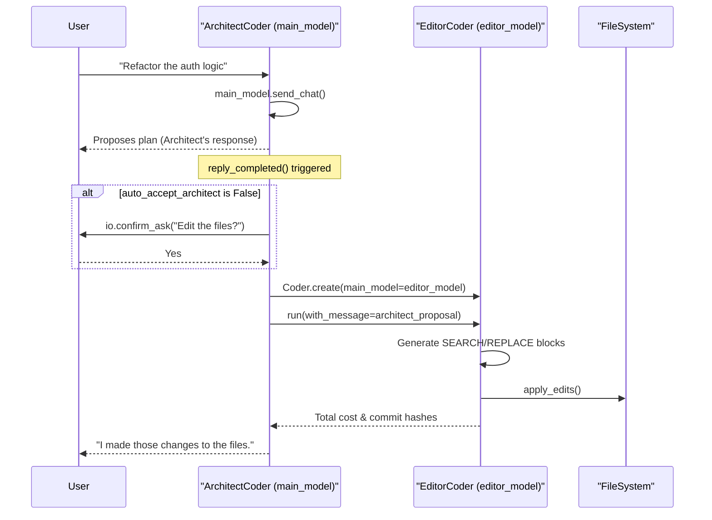
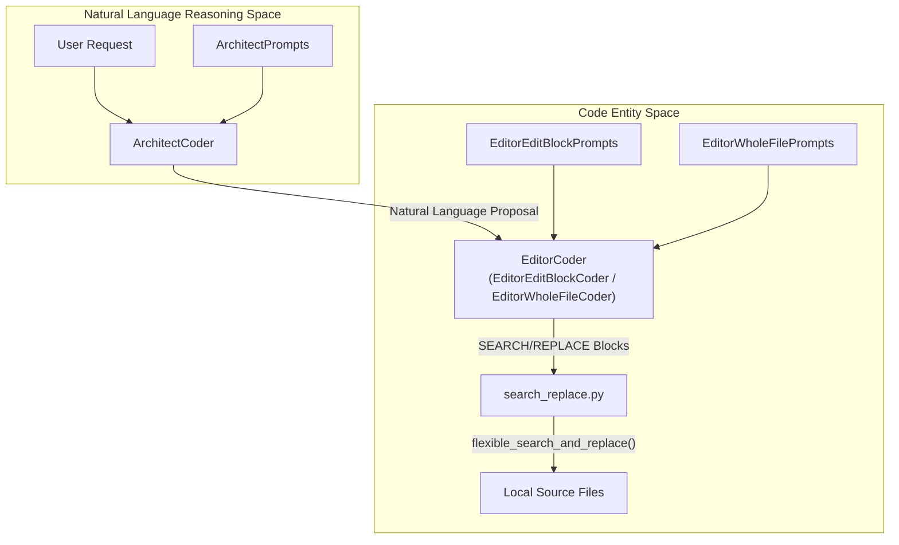

# Architect Mode

Relevant source files

The following files were used as context for generating this wiki page:

- [aider/coders/architect_coder.py](aider/coders/architect_coder.py)
- [aider/coders/architect_prompts.py](aider/coders/architect_prompts.py)
- [aider/coders/editblock_fenced_prompts.py](aider/coders/editblock_fenced_prompts.py)
- [aider/coders/editor_diff_fenced_coder.py](aider/coders/editor_diff_fenced_coder.py)
- [aider/coders/editor_diff_fenced_prompts.py](aider/coders/editor_diff_fenced_prompts.py)
- [aider/coders/editor_editblock_coder.py](aider/coders/editor_editblock_coder.py)
- [aider/coders/editor_editblock_prompts.py](aider/coders/editor_editblock_prompts.py)
- [aider/coders/editor_whole_coder.py](aider/coders/editor_whole_coder.py)
- [aider/coders/editor_whole_prompts.py](aider/coders/editor_whole_prompts.py)
- [aider/website/_data/architect.yml](aider/website/_data/architect.yml)
- [aider/website/_posts/2024-09-26-architect.md](aider/website/_posts/2024-09-26-architect.md)
- [aider/website/_sass/custom/custom.scss](aider/website/_sass/custom/custom.scss)
- [aider/website/docs/usage/modes.md](aider/website/docs/usage/modes.md)

Architect Mode is a two-stage workflow that separates code reasoning from code editing. It leverages the high-level planning capabilities of advanced reasoning models (the "Architect") and delegates the precise file modifications to specialized editing models (the "Editor"). This approach has produced State-of-the-Art (SOTA) results on aider's code editing benchmarks, notably when pairing reasoning-heavy models like `o1-preview` or `Claude 3.7` with efficient editors like `DeepSeek` or `gpt-4o`.

## Purpose and Workflow

The core philosophy of Architect Mode is that "code reasoning" and "code editing" are distinct skills. Some models excel at understanding complex requirements and planning multi-file changes but struggle with the specific syntax or formatting required by aider's edit formats.

- **Architect Phase**: A reasoning model (configured via `--model`) analyzes the request and describes how to solve it in natural language or pseudo-code. [aider/website/docs/usage/modes.md:113-118]()
- **Editor Phase**: An editor model (configured via `--editor-model`) takes the architect's proposal and translates it into specific file edits using a structured format. [aider/website/docs/usage/modes.md:119-123]()

Sources: [aider/website/_posts/2024-09-26-architect.md:12-23](), [aider/website/docs/usage/modes.md:111-130]()

## Two-Stage Execution Flow

The implementation of this workflow is encapsulated in the `ArchitectCoder` class, which extends `AskCoder`. Instead of applying edits itself, it triggers a second `Coder` instance. [aider/coders/architect_coder.py:6-7]()

Title: Architect-Editor Sequence Flow

Sources: [aider/coders/architect_coder.py:6-49](), [aider/website/docs/usage/modes.md:113-123]()

## Technical Implementation: ArchitectCoder

The `ArchitectCoder` manages the transition between reasoning and editing. Key logic resides in the `reply_completed` method. [aider/coders/architect_coder.py:11]()

- **Model Selection**: It retrieves the `editor_model` from the `main_model` configuration. If no specific editor is defined, it defaults to using the `main_model` itself for the second pass. [aider/coders/architect_coder.py:22-25]()
- **Editor Initialization**: It creates a new `Coder` instance dynamically using `Coder.create()`. This editor uses the `editor_edit_format` specified in the model settings. [aider/coders/architect_coder.py:26-37]()
- **Context Passing**: The architect's response content is passed directly to the editor model as the input message via `editor_coder.run(with_message=content, preproc=False)`. [aider/coders/architect_coder.py:44]()
- **Cost and History Management**: After the editor completes, the `ArchitectCoder` updates its `total_cost` and `aider_commit_hashes` from the editor's results to ensure accurate tracking and git integration. [aider/coders/architect_coder.py:47-48]()

Sources: [aider/coders/architect_coder.py:11-49](), [aider/website/docs/usage/modes.md:113-123]()

## Model Configuration and Benchmarks

Architect mode is particularly effective for models with high reasoning but poor formatting skills. The following table illustrates configurations and results derived from aider's benchmarks. [aider/website/_data/architect.yml:1-255]()

| Architect Model | Editor Model | Editor Format | Pass Rate (Benchmark) |
| :--- | :--- | :--- | :--- |
| `o1-preview` | `claude-3.5-sonnet` | `diff` | 82.7% |
| `o1-preview` | `gpt-4o` | `diff` | 80.5% |
| `o1-mini` | `deepseek` | `whole` | 71.4% |
| `claude-3.5-sonnet`| `claude-3.5-sonnet` | `diff` | 80.5% |

Sources: [aider/website/_data/architect.yml:1-198](), [aider/website/_posts/2024-09-26-architect.md:22-23]()

## Editor Edit Formats

The "Editor" phase uses specialized edit formats. While standard modes often use `diff`, architect mode frequently employs `editor-diff` or `editor-whole` to minimize extraneous conversational filler.

- **`EditorEditBlockCoder`**: Implements the `editor-diff` format. It is a subclass of `EditBlockCoder` but uses `EditorEditBlockPrompts` which instruct the model to "ONLY EVER RETURN CODE IN A SEARCH/REPLACE BLOCK!". [aider/coders/editor_editblock_coder.py:5-9](), [aider/coders/editor_editblock_prompts.py:7-12]()
- **`EditorDiffFencedCoder`**: A variant that uses fenced code blocks for better parsing in certain models. [aider/coders/editor_diff_fenced_coder.py:5-9]()
- **`EditorWholeFileCoder`**: Implements the `editor-whole` format. It instructs the model to output a copy of each file that needs changes. [aider/coders/editor_whole_coder.py:5-9](), [aider/coders/editor_whole_prompts.py:7-10]()

Sources: [aider/coders/editor_editblock_coder.py:1-9](), [aider/coders/editor_whole_coder.py:1-9](), [aider/website/docs/usage/modes.md:142-151]()

## User Interaction and Commands

Users can trigger Architect Mode using the following methods:

- **Slash Command**: Use `/architect <instruction>` for a one-off request. [aider/website/docs/usage/modes.md:18-19]()
- **Sticky Mode**: Switch the active mode using `/chat-mode architect` or simply `/architect`. [aider/website/docs/usage/modes.md:22-38]()
- **CLI Flag**: Launch aider directly in architect mode with `--architect` or `--chat-mode architect`. [aider/website/docs/usage/modes.md:40-41]()

The `auto_accept_architect` setting (defaulting to `False`) determines if aider asks for permission via `io.confirm_ask("Edit the files?")` before the Editor phase begins. [aider/coders/architect_coder.py:9-18]()

## Data Flow: Reasoning to Entity Modification

This diagram bridges the natural language reasoning of the Architect to the concrete file modifications performed by the Editor, highlighting the internal logic used to apply patches.

Title: Reasoning to Code Entity Space Mapping

Sources: [aider/coders/architect_coder.py:44-49](), [aider/coders/architect_prompts.py:7-17](), [aider/coders/editor_editblock_prompts.py:7-12](), [aider/coders/editor_whole_prompts.py:7-10]()

## Comparison of Coding Modes

| Mode | Model Count | Goal | Edits Files? |
| :--- | :--- | :--- | :--- |
| `code` | 1 | Direct editing | Yes |
| `ask` | 1 | Discussion/Analysis | No |
| `architect` | 2 | Reasoning then Editing | Yes |
| `help` | 1 | Aider documentation | No |

Sources: [aider/website/docs/usage/modes.md:9-14](), [aider/coders/architect_coder.py:6-9]()