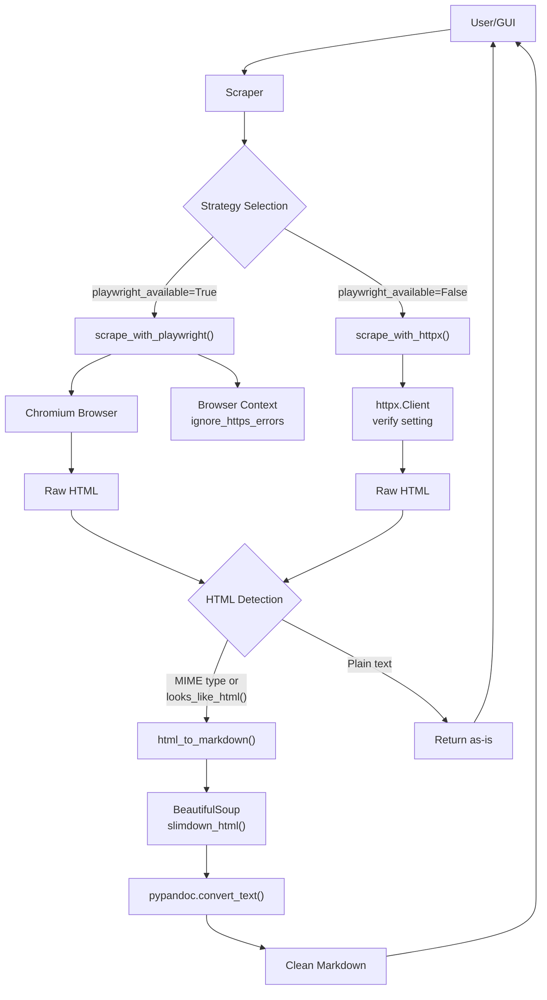
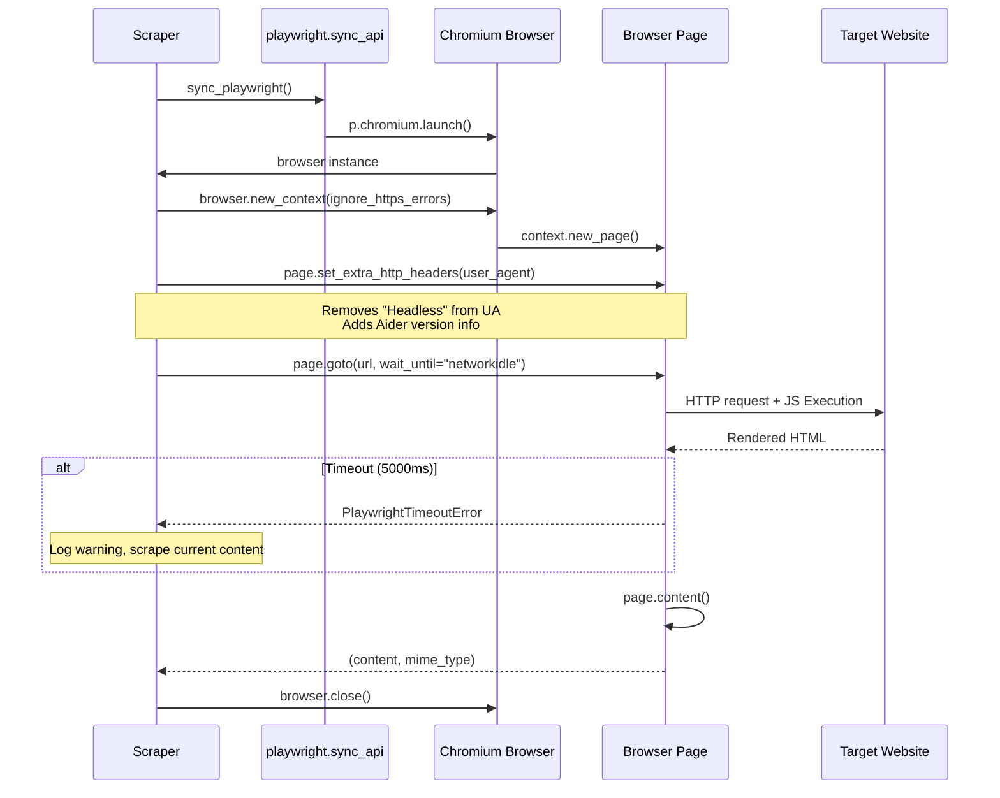
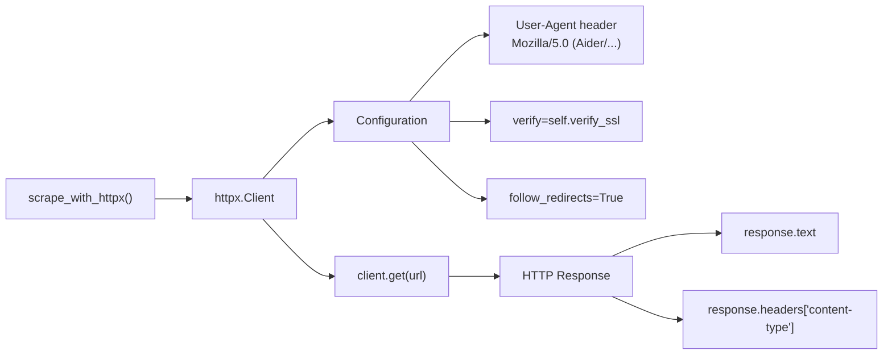
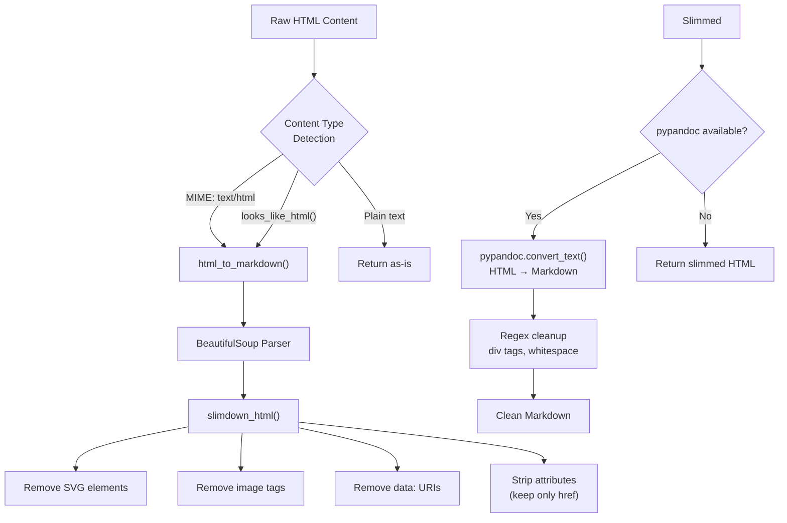
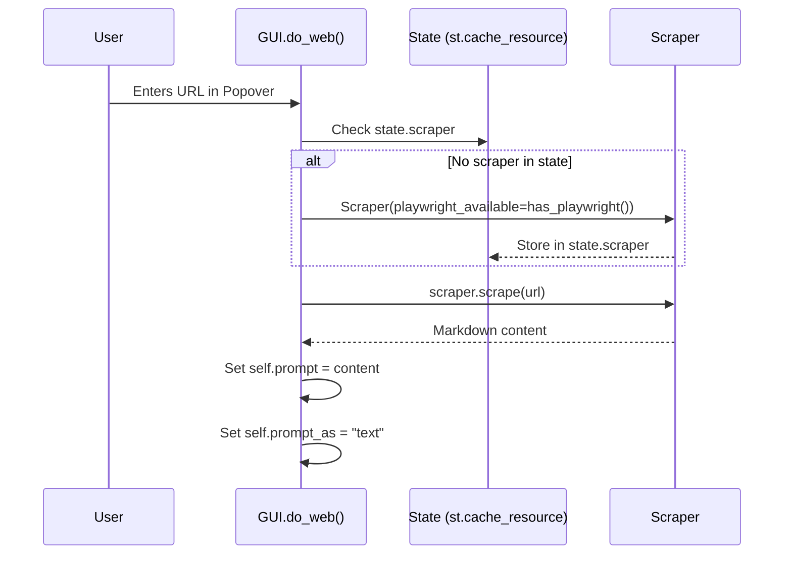

# Web Content Integration

Relevant source files

The following files were used as context for generating this wiki page:

- [aider/gui.py](aider/gui.py)
- [aider/report.py](aider/report.py)
- [aider/scrape.py](aider/scrape.py)
- [aider/urls.py](aider/urls.py)
- [aider/utils.py](aider/utils.py)
- [aider/versioncheck.py](aider/versioncheck.py)
- [pytest.ini](pytest.ini)
- [scripts/update-docs.sh](scripts/update-docs.sh)
- [tests/basic/test_main.py](tests/basic/test_main.py)
- [tests/basic/test_model_info_manager.py](tests/basic/test_model_info_manager.py)
- [tests/basic/test_ssl_verification.py](tests/basic/test_ssl_verification.py)
- [tests/scrape/test_scrape.py](tests/scrape/test_scrape.py)

This document describes how Aider retrieves and processes web content for inclusion in chat conversations. The system allows users to scrape web pages and convert their content into clean markdown format that can be provided to the LLM as context.

For information about other content integration methods, see:
- File management and tracking: [File Management and Tracking](#4.2)
- Voice input integration: [Voice-to-Code Mode](#5.3)
- Copy/paste integration with web chat UIs: [Copy/Paste Integration with Web Chat UIs](#5.4)

## Scraper Architecture

The `Scraper` class in `aider/scrape.py` provides the core web scraping functionality. It implements a two-tier strategy: preferring Playwright for JavaScript-rendered pages but falling back to `httpx` for simple HTTP requests.

**Scraper Strategy Overview**

**Scraper Class Public API**

The `Scraper` class is initialized with configuration parameters and exposes a single public method:

| Method | Purpose | Parameters |
|--------|---------|------------|
| `__init__` | Initialize scraper | `print_error`: error callback function `playwright_available`: bool flag `verify_ssl`: enable SSL verification |
| `scrape` | Scrape URL and return markdown | `url`: URL string to scrape |

Sources: [aider/scrape.py:79-122]()

## Playwright Strategy

When Playwright is available, Aider uses it to scrape web pages. This approach handles JavaScript-rendered content that static HTTP requests cannot retrieve.

**Playwright Navigation Flow**

**Installation and Availability**

Playwright requires both the Python package and browser dependencies. The `install_playwright(io)` helper manages this flow:

1. Checks environment via `check_env()` [aider/scrape.py:17-32]().
2. Prompts user for installation via `io.confirm_ask` [aider/scrape.py:62-63]().
3. Installs `aider-chat[playwright]` and the Chromium binary [aider/scrape.py:45-47]().

**User Agent Configuration**

Playwright modifies the default user agent to appear less like a headless browser by evaluating `navigator.userAgent` and stripping "Headless" strings before appending `aider_user_agent` [aider/scrape.py:161-166]().

Sources: [aider/scrape.py:17-77](), [aider/scrape.py:143-192]()

## httpx Fallback Strategy

When Playwright is unavailable or disabled, the `Scraper` falls back to `httpx.Client` for simple HTTP GET requests.

The `httpx` strategy is suitable for static documentation and handles redirects automatically [aider/scrape.py:199-204]().

Sources: [aider/scrape.py:194-209]()

## HTML to Markdown Conversion

After retrieving HTML content, the `Scraper` converts it to clean markdown using `pypandoc`.

**HTML Slimming Process**

The `slimdown_html()` function removes visual and extraneous elements (SVGs, image tags, and all attributes except `href`) to minimize token usage [aider/scrape.py:253-272]().

Sources: [aider/scrape.py:124-141](), [aider/scrape.py:230-251](), [aider/scrape.py:253-272]()

## SSL Verification Configuration

The `verify_ssl` parameter controls SSL certificate verification across both scraping strategies and LLM provider connections.

| Component | Configuration Point | Effect |
|-----------|-------------------|--------|
| Playwright | `ignore_https_errors=not self.verify_ssl` | Inverted boolean; False means verify [aider/scrape.py:158]() |
| httpx | `verify=self.verify_ssl` | Direct boolean; True means verify [aider/scrape.py:200]() |
| ModelInfoManager | `requests.get(..., verify=self.verify_ssl)` | Controls SSL for model metadata updates [tests/basic/test_model_info_manager.py:35]() |

The default behavior is `verify_ssl=True`. When the `--no-verify-ssl` flag is used, it propagates to `ModelInfoManager` and sets the `SSL_VERIFY` environment variable to an empty string [tests/basic/test_ssl_verification.py:61-68]().

For details, see [SSL Verification Configuration](#6.2).

Sources: [aider/scrape.py:85-96](), [aider/scrape.py:158-159](), [aider/scrape.py:199-201](), [tests/basic/test_ssl_verification.py:54-68]()

## Integration with GUI

The Streamlit GUI in `aider/gui.py` provides a popover interface for adding web content.

**GUI Integration Points**

- `do_add_web_page()`: Creates the UI popover element [aider/gui.py:210-213]().
- `do_web()`: Orchestrates the scraping flow and updates the chat state [aider/gui.py:464-497]().

Sources: [aider/gui.py:210-213](), [aider/gui.py:464-497](), [aider/gui.py:70-89]()

## Error Handling and Fallbacks

The scraping system implements several recovery paths:
- **Playwright Failure**: If `chromium.launch()` fails, `playwright_available` is set to `False` and the scraper falls back to `httpx` [aider/scrape.py:151-155]().
- **Pandoc Absence**: If `pypandoc` is not installed, `try_pandoc()` attempts to download it [aider/scrape.py:223](). If it still fails, the system returns slimmed HTML instead of markdown [aider/scrape.py:249]().

For details on the implementation of these strategies, see [Web Scraping Architecture](#6.1).

Sources: [aider/scrape.py:98-122](), [aider/scrape.py:143-192](), [aider/scrape.py:211-229]()