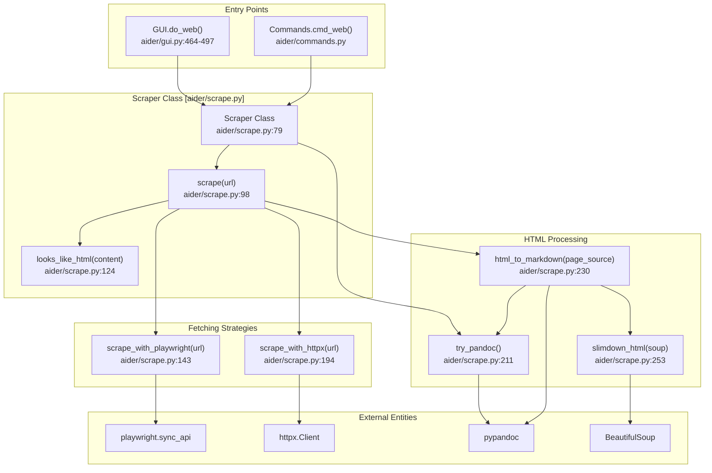
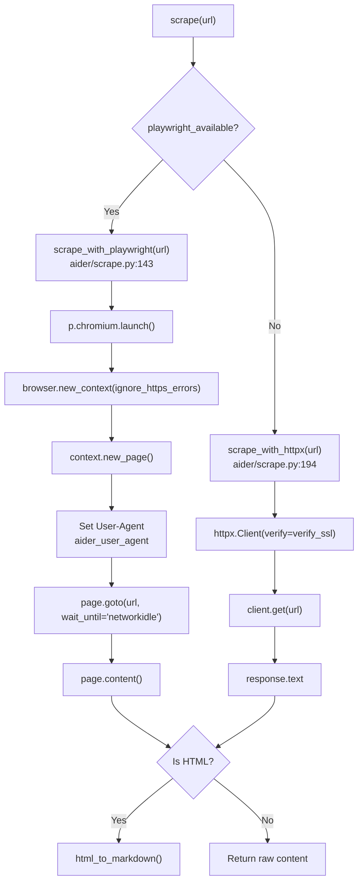

# Web Scraping Architecture

<details>
<summary>Relevant source files</summary>

The following files were used as context for generating this wiki page:

- [aider/gui.py](aider/gui.py)
- [aider/report.py](aider/report.py)
- [aider/scrape.py](aider/scrape.py)
- [aider/urls.py](aider/urls.py)
- [aider/utils.py](aider/utils.py)
- [aider/versioncheck.py](aider/versioncheck.py)
- [pytest.ini](pytest.ini)
- [scripts/update-docs.sh](scripts/update-docs.sh)
- [tests/basic/test_main.py](tests/basic/test_main.py)
- [tests/basic/test_model_info_manager.py](tests/basic/test_model_info_manager.py)
- [tests/basic/test_ssl_verification.py](tests/basic/test_ssl_verification.py)
- [tests/scrape/test_scrape.py](tests/scrape/test_scrape.py)

</details>


This document describes Aider's web content scraping system, which fetches and processes web pages for inclusion in chat sessions. The scraping system supports both static HTML pages and JavaScript-rendered content, converting HTML to readable Markdown for LLM consumption.

For information about how scraped content is integrated into chat messages, see **Message Formatting and Chat History (3.5)**. For the web GUI that uses this scraping system, see **Streamlit Web GUI (5.2)**.

## Purpose and Scope

The web scraping architecture enables users to add web content to their Aider sessions via URLs. The system:
- Fetches web pages using either Playwright (for dynamic content) or `httpx` (for static pages).
- Converts HTML to clean Markdown using `pypandoc`.
- Handles SSL verification configuration.
- Manages optional dependencies (Playwright, pypandoc) through just-in-time installation helpers.
- Provides a simple public API for integration with the GUI and slash commands.

---

## Core Architecture

The following diagram bridges the high-level UI components to the internal `Scraper` class and its processing pipeline.



**Sources:** [aider/scrape.py:1-285](), [aider/gui.py:464-497](), [tests/scrape/test_scrape.py:39-47]()

---

## Scraper Class Public API

The `Scraper` class [aider/scrape.py:79]() provides a simple public interface for web scraping functionality.

### Constructor

```python
Scraper(print_error=None, playwright_available=None, verify_ssl=True)
```

| Parameter | Type | Default | Description |
|-----------|------|---------|-------------|
| `print_error` | callable | `print` | Function to call for error/debug output [aider/scrape.py:90-93]() |
| `playwright_available` | bool | `None` | Whether Playwright is available; auto-detected if `None` [aider/scrape.py:95]() |
| `verify_ssl` | bool | `True` | Whether to verify SSL certificates [aider/scrape.py:96]() |

### Main Method

```python
content = scraper.scrape(url)
```

The `scrape()` method [aider/scrape.py:98-122]():
1. Attempts to fetch the URL using `scrape_with_playwright` [aider/scrape.py:107]() or `scrape_with_httpx` [aider/scrape.py:109]().
2. Detects if content is HTML based on MIME type or content inspection via `looks_like_html` [aider/scrape.py:116-118]().
3. Converts HTML to Markdown using `html_to_markdown` [aider/scrape.py:120]().
4. Returns the processed content as a string, or `None` if fetch fails.

**Sources:** [aider/scrape.py:79-122]()

---

## Two-Strategy Fetching System

Aider selects a fetching strategy based on the availability of Playwright.



### Playwright Strategy

The Playwright strategy [aider/scrape.py:143-192]() is used when available and handles:
- **JavaScript-rendered content**: Waits for `networkidle` (up to 5s) before scraping [aider/scrape.py:170-172]().
- **Dynamic applications**: Uses a full Chromium browser execution environment [aider/scrape.py:151]().
- **Anti-bot protection**: Uses real browser user agent (with "Headless" removed) [aider/scrape.py:161-164]().
- **SSL configuration**: Respects `verify_ssl` via `ignore_https_errors` [aider/scrape.py:158]().

### httpx Strategy

The `httpx` strategy [aider/scrape.py:194-209]() is used as a fallback for:
- **Static HTML pages**: No JavaScript execution required.
- **Performance**: Faster than launching a browser.
- **SSL configuration**: Respects `verify_ssl` parameter in the `httpx.Client` constructor [aider/scrape.py:199-201]().

**Sources:** [aider/scrape.py:143-209](), [tests/scrape/test_scrape.py:11-35]()

---

## HTML Processing Pipeline

### HTML Detection and Conversion

The `looks_like_html()` method [aider/scrape.py:124-140]() checks for common HTML patterns like `<!DOCTYPE html`, `<html`, `<body`, and `<div` using regex [aider/scrape.py:130-139]().

The `html_to_markdown()` method [aider/scrape.py:230-250]() performs the following steps:
1. Parses HTML with `BeautifulSoup` [aider/scrape.py:232]().
2. Applies `slimdown_html()` to remove non-textual noise [aider/scrape.py:234]().
3. Converts the result to Markdown via `pypandoc.convert_text` [aider/scrape.py:241]().

### HTML Slimming

The `slimdown_html()` function [aider/scrape.py:253-271]() reduces token usage by removing:
- **SVG elements** [aider/scrape.py:254-255]().
- **IMG elements** [aider/scrape.py:257-258]().
- **Data URIs** in `href` and `src` [aider/scrape.py:260-264]().
- **Attributes** except for `href` [aider/scrape.py:266-269]().

**Sources:** [aider/scrape.py:124-271]()

---

## Dependency Management and Installation

Aider provides helpers to install the heavy dependencies required for scraping.

### install_playwright Helper

The `install_playwright(io)` function [aider/scrape.py:40-76]() orchestrates the installation:
1. Checks the environment via `check_env()` [aider/scrape.py:41]().
2. If missing, prompts the user to install the `aider-chat[playwright]` python package and the Chromium browser [aider/scrape.py:45-53]().
3. Uses `utils.run_install()` to execute the pip command [aider/scrape.py:66]() and the `playwright install` command [aider/scrape.py:71]().

### check_env Logic

`check_env()` [aider/scrape.py:17-32]() returns two booleans:
- `has_pip`: Whether the `playwright.sync_api` module can be imported [aider/scrape.py:19-23]().
- `has_chromium`: Whether a Chromium instance can successfully launch via `p.chromium.launch()` [aider/scrape.py:26-30]().

**Sources:** [aider/scrape.py:17-77](), [aider/utils.py:213-261]()

---

## SSL Verification Configuration

The architecture propagates SSL settings from the CLI/GUI down to the HTTP clients.

- **Global Flag**: The `--no-verify-ssl` CLI flag triggers `ModelInfoManager.set_verify_ssl(False)` [tests/basic/test_ssl_verification.py:60-61]().
- **Scraper Propagation**: The `Scraper` class accepts a `verify_ssl` argument in its constructor [aider/scrape.py:85-96]().
- **httpx Implementation**: The `httpx.Client` is initialized with `verify=self.verify_ssl` [aider/scrape.py:199-201]().
- **Playwright Implementation**: The browser context is initialized with `ignore_https_errors=not self.verify_ssl` [aider/scrape.py:158]().
- **Environment Variable**: Setting `--no-verify-ssl` also sets the `SSL_VERIFY` environment variable to an empty string [tests/basic/test_ssl_verification.py:68]().

**Sources:** [aider/scrape.py:158, 199](), [tests/basic/test_ssl_verification.py:11-85](), [tests/basic/test_model_info_manager.py:25-41]()

---

## Integration with Aider Components

### Web GUI Integration

In `aider/gui.py`, the `do_add_web_page` method triggers a popover that uses the `Scraper` class [aider/gui.py:210-213](). It captures output via a `CaptureIO` adapter [aider/gui.py:17-37]() and adds the resulting markdown to the chat context.

### User Agent Branding

All scraping requests are identified by a specific User-Agent string defined as `aider_user_agent` [aider/scrape.py:11]():
`Aider/{__version__} +https://aider.chat/`

In Playwright, this is injected into the browser context [aider/scrape.py:161-166](). In `httpx`, it is added to the request headers [aider/scrape.py:197]().

**Sources:** [aider/scrape.py:11, 161-166, 197](), [aider/gui.py:17-37, 210-213]()