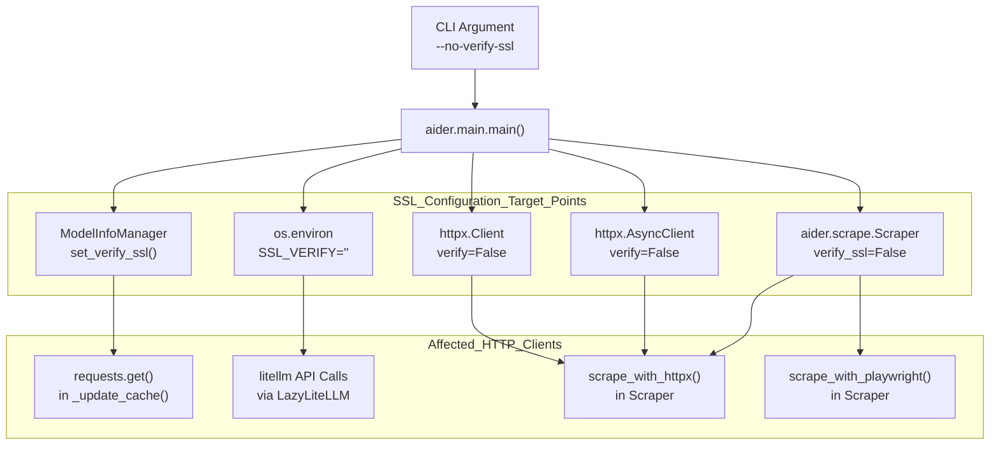
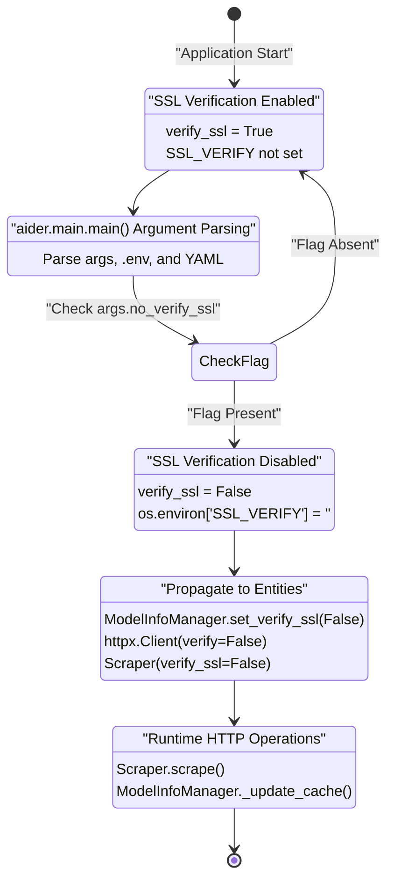
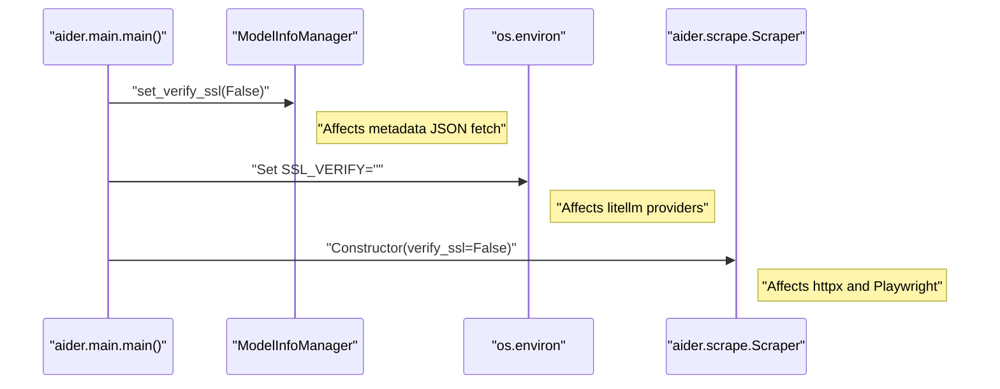

# SSL Verification Configuration

Relevant source files

The following files were used as context for generating this wiki page:

- [pytest.ini](pytest.ini)
- [tests/basic/test_main.py](tests/basic/test_main.py)
- [tests/basic/test_model_info_manager.py](tests/basic/test_model_info_manager.py)
- [tests/basic/test_ssl_verification.py](tests/basic/test_ssl_verification.py)
- [tests/scrape/test_scrape.py](tests/scrape/test_scrape.py)

## Purpose and Scope

This document explains how SSL/TLS certificate verification is configured and propagated throughout Aider's HTTP clients. SSL verification controls whether HTTPS connections validate server certificates against trusted Certificate Authorities. This configuration affects all outbound HTTPS requests including LLM API calls, model metadata fetching, and web content scraping.

For details on web scraping functionality that uses SSL configuration, see [Web Scraping Architecture](6.1). For LLM provider integration, see [Multi-Provider LLM Integration](7.3).

## Overview

Aider makes HTTPS requests to multiple external services during normal operation. By default, all HTTPS connections verify SSL/TLS certificates to ensure secure communication. However, environments with corporate proxies, self-signed certificates, or certificate issues may require disabling verification.

The `--no-verify-ssl` command-line flag provides centralized control over SSL verification across all HTTP clients in the system.

**Services affected by SSL verification:**
- LLM provider APIs (OpenAI, Anthropic, Google, etc.) via `litellm`.
- Model metadata updates from `litellm`'s pricing database via `ModelInfoManager`.
- Web content scraping via `httpx` (static pages).
- Web content scraping via Playwright (JavaScript-rendered pages).

## SSL Verification Control Flow

The following diagram illustrates how the `no-verify-ssl` setting propagates from the entry point to various code entities.

Sources: [tests/basic/test_ssl_verification.py:28-68](), [tests/scrape/test_scrape.py:21-35](), [tests/basic/test_model_info_manager.py:25-41]()

## Configuration Entry Point

### Command-Line Flag

The `--no-verify-ssl` flag is processed during application initialization in `main()`. When present, it triggers SSL verification disabling across all HTTP clients.

**Configuration logic in `aider/main.py` (simulated in tests):**
1. Calls `model_info_manager.set_verify_ssl(False)` [tests/basic/test_ssl_verification.py:60-61]().
2. Sets `os.environ["SSL_VERIFY"] = ""` to signal `litellm` [tests/basic/test_ssl_verification.py:67-68]().
3. Instantiates `httpx.Client(verify=False)` and `httpx.AsyncClient(verify=False)` [tests/basic/test_ssl_verification.py:64-65]().

**Configuration precedence:**
1. CLI flag `--no-verify-ssl` (highest priority).
2. Environment variable `AIDER_NO_VERIFY_SSL`.
3. YAML configuration file setting `no-verify-ssl`.
4. Default: SSL verification enabled [tests/basic/test_ssl_verification.py:72-84]().

Sources: [tests/basic/test_ssl_verification.py:28-68](), [tests/basic/test_ssl_verification.py:72-84]()

## Component-Level SSL Configuration

### ModelInfoManager

The `ModelInfoManager` class maintains a cache of model metadata (pricing, context windows, capabilities). This cache is updated via HTTPS requests to `MODEL_INFO_URL` [tests/basic/test_model_info_manager.py:35]().

**SSL Verification Control:**
The `_update_cache` method uses the `requests` library and respects the `verify_ssl` attribute set via `set_verify_ssl()` [tests/basic/test_model_info_manager.py:34-41]().

**Lazy Loading Pattern:**
- Cache is not loaded on initialization [tests/basic/test_model_info_manager.py:48-49]().
- First access to `get_model_from_cached_json_db()` triggers loading [tests/basic/test_model_info_manager.py:51-54]().
- SSL verification setting must be configured before this first access to ensure the update request uses the correct setting [tests/basic/test_model_info_manager.py:71-80]().

Sources: [tests/basic/test_model_info_manager.py:26-41](), [tests/basic/test_model_info_manager.py:64-80](), [aider/models.py]() (referenced via class name)

### Scraper Class

The `Scraper` class in `aider/scrape.py` handles web content retrieval. It accepts a `verify_ssl` parameter in its constructor [tests/scrape/test_scrape.py:21-23]().

**SSL Verification in Playwright:**
The scraper can use Playwright for JavaScript-heavy sites. When `verify_ssl` is false, the underlying browser context is configured to ignore certificate errors [tests/scrape/test_scrape.py:29-35]().

**SSL Verification in httpx:**
The scraper uses `httpx` for standard scraping tasks. It initializes the client with the `verify` parameter set to the value of `self.verify_ssl` [tests/scrape/test_scrape.py:87-90]().

Sources: [tests/scrape/test_scrape.py:21-35](), [tests/scrape/test_scrape.py:87-90]()

### litellm Integration

The `litellm` library (used for LLM provider abstraction) respects the `SSL_VERIFY` environment variable. Aider sets this to an empty string to disable verification [tests/basic/test_ssl_verification.py:67-68](). This affects all API calls to providers like OpenAI, Anthropic, and local providers like Ollama.

Sources: [tests/basic/test_ssl_verification.py:67-68]()

## SSL Configuration State Diagram

This diagram maps the natural language configuration states to code-level logic.

Sources: [tests/basic/test_ssl_verification.py:28-84](), [tests/scrape/test_scrape.py:21-35]()

## Testing SSL Configuration

### Functional Testing against BadSSL

The test suite includes functional tests against `https://self-signed.badssl.com` to verify real SSL verification behavior [tests/scrape/test_scrape.py:11-35]().

**Behavior observed in tests:**
- **With verification enabled**: `scraper.scrape()` returns `None` and calls `print_error()` due to certificate failure [tests/scrape/test_scrape.py:21-26]().
- **With verification disabled**: `scraper.scrape()` returns content and `print_error()` is not called [tests/scrape/test_scrape.py:29-35]().

### Test Coverage Table

| Test File | Target Component | Verification Mechanism |
|-----------|------------------|------------------------|
| `tests/basic/test_ssl_verification.py` | `main()` entry point | Mocks `httpx` and `ModelInfoManager` [tests/basic/test_ssl_verification.py:25-34]() |
| `tests/basic/test_model_info_manager.py` | `ModelInfoManager` | Mocks `requests.get` with `verify` param [tests/basic/test_model_info_manager.py:25-41]() |
| `tests/scrape/test_scrape.py` | `Scraper` | Live connection to `badssl.com` [tests/scrape/test_scrape.py:11-35]() |

Sources: [tests/basic/test_ssl_verification.py:1-85](), [tests/scrape/test_scrape.py:11-35](), [tests/basic/test_model_info_manager.py:1-81]()

## Implementation Sequence

Sources: [tests/basic/test_ssl_verification.py:28-68](), [tests/scrape/test_scrape.py:21-35]()

## Security Considerations

**Disabling SSL verification removes critical security protections:**
- **Man-in-the-Middle Attacks**: Attackers can intercept and modify traffic.
- **Impersonation**: Malicious servers can impersonate legitimate services.
- **Data Exposure**: Sensitive data (API keys, source code) may be compromised.

**Alternative approaches:**
- Install corporate CA certificates in the system trust store.
- Use `REQUESTS_CA_BUNDLE` environment variable for components using the `requests` library.
- Configure proxy settings properly instead of disabling verification.

Sources: [tests/scrape/test_scrape.py:11-35]()