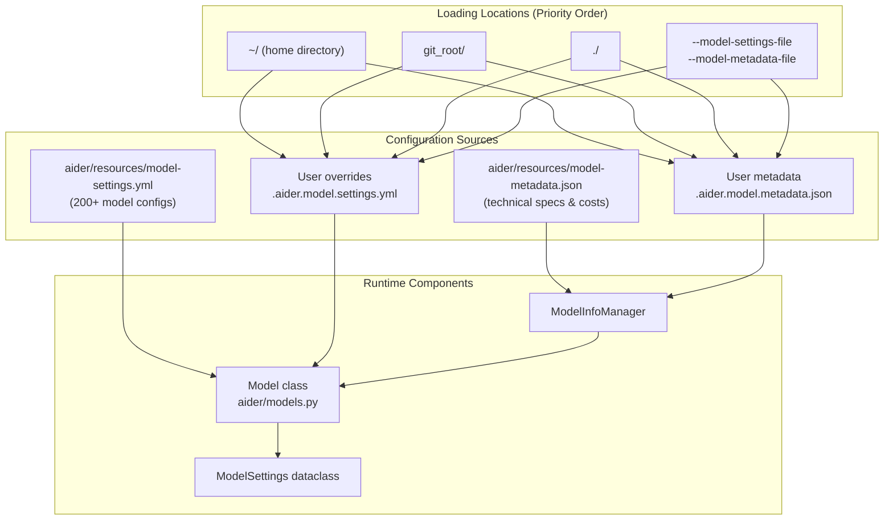
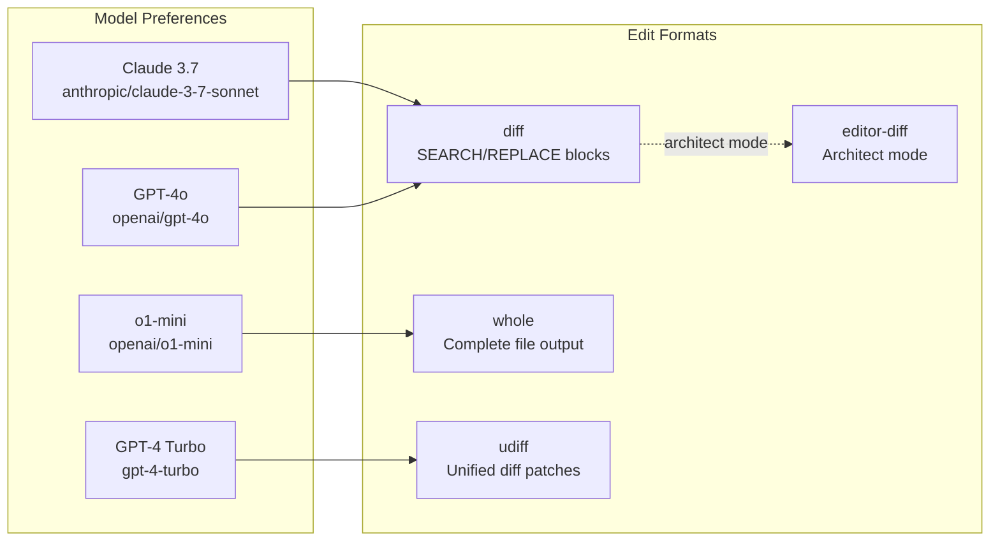
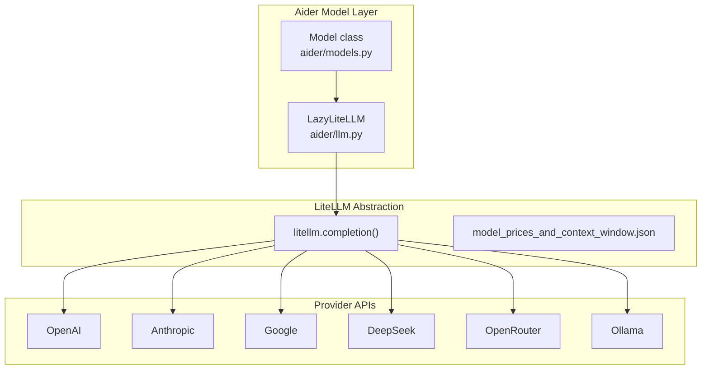

# Model Configuration and Capabilities

Relevant source files

The following files were used as context for generating this wiki page:

- [README.md](README.md)
- [aider/resources/__init__.py](aider/resources/__init__.py)
- [aider/resources/model-metadata.json](aider/resources/model-metadata.json)
- [aider/resources/model-settings.yml](aider/resources/model-settings.yml)
- [aider/website/_data/polyglot_leaderboard.yml](aider/website/_data/polyglot_leaderboard.yml)
- [aider/website/assets/sample-analytics.jsonl](aider/website/assets/sample-analytics.jsonl)
- [aider/website/docs/config/adv-model-settings.md](aider/website/docs/config/adv-model-settings.md)
- [aider/website/docs/config/model-aliases.md](aider/website/docs/config/model-aliases.md)
- [aider/website/docs/faq.md](aider/website/docs/faq.md)
- [aider/website/docs/leaderboards/index.md](aider/website/docs/leaderboards/index.md)
- [aider/website/docs/more/infinite-output.md](aider/website/docs/more/infinite-output.md)
- [aider/website/index.html](aider/website/index.html)
- [tests/basic/test_models.py](tests/basic/test_models.py)
- [tests/basic/test_reasoning.py](tests/basic/test_reasoning.py)

This document describes how Aider configures and manages 200+ LLM models from multiple providers. It covers the dual configuration system (behavioral settings and technical metadata), model capabilities, provider integration, and the three-tier model architecture.

For information about connecting to specific LLM providers, see [Multi-Provider LLM Integration](#7.3). For configuration file precedence and loading, see [Configuration System](#9.1).

## Configuration Architecture

Aider's model configuration system separates behavioral settings from technical metadata, allowing independent configuration of how models behave versus their capabilities and costs.

Title: Model Configuration Flow

**Sources:** [aider/models.py:146-151](), [aider/models.py:154-170](), [aider/website/docs/config/adv-model-settings.md:21-31](), [aider/website/docs/config/adv-model-settings.md:74-82]()

## Model Settings System

### Behavioral Configuration

Model settings in `model-settings.yml` control how Aider interacts with each model. Each model entry is a dictionary with the model name and its behavioral parameters, which are loaded into the `ModelSettings` dataclass [aider/models.py:121-143]().

| Setting | Type | Purpose |
|---------|------|---------|
| `edit_format` | string | Code edit format: `whole`, `diff`, `udiff`, `diff-fenced`, `patch` |
| `weak_model_name` | string | Model for commit messages and simple tasks |
| `editor_model_name` | string | Model for architect mode's editor phase |
| `use_repo_map` | boolean | Whether to include repository context map |
| `lazy` | boolean | Minimize token usage, exclude examples |
| `overeager` | boolean | Extra prompting to constrain scope (e.g., Claude 3.7) |
| `reminder` | string | Where to send the reminder: `sys`, `user` |
| `examples_as_sys_msg` | boolean | Include examples as system message vs user message |
| `cache_control` | boolean | Enable prompt caching |
| `accepts_settings` | list | Supported settings: `thinking_tokens`, `reasoning_effort` |

For details, see [Model Settings and Behavioral Configuration](#7.1).

**Sources:** [aider/models.py:121-143](), [aider/resources/model-settings.yml:1-265](), [aider/website/docs/config/adv-model-settings.md:139-160]()

### Technical Metadata

The `model-metadata.json` file contains technical specifications and cost information managed by `ModelInfoManager` [aider/models.py:154-240]().

| Field | Purpose |
|-------|---------|
| `max_tokens` | Total context window size |
| `max_input_tokens` | Maximum input tokens |
| `max_output_tokens` | Maximum output tokens |
| `input_cost_per_token` | Cost per input token in USD |
| `output_cost_per_token` | Cost per output token in USD |
| `litellm_provider` | Provider name for LiteLLM routing |
| `supports_vision` | Image input support |
| `supports_prompt_caching` | Prompt caching capability |
| `supports_assistant_prefill` | Support for "infinite output" prefill |

For details, see [Model Metadata and Technical Capabilities](#7.2).

**Sources:** [aider/models.py:154-240](), [aider/resources/model-metadata.json:1-185](), [aider/website/docs/config/adv-model-settings.md:33-47]()

## Model Capabilities

### Edit Format Support

Different models perform best with different code edit formats. Aider configures the optimal format per model in `model-settings.yml`. The `Coder.create` method resolves these formats at runtime [aider/coders/base_coder.py:125-149]().

Title: Model to Edit Format Mapping

**Sources:** [aider/resources/model-settings.yml:35-85](), [aider/resources/model-settings.yml:187-244](), [aider/website/_data/polyglot_leaderboard.yml:3-4](), [aider/website/_data/polyglot_leaderboard.yml:237-238]()

### Reasoning and Thinking Tokens

Models with extended reasoning capabilities (Claude 3.7, o1/o3, DeepSeek-R1) support special parameters. Aider manages these via `set_thinking_tokens` [aider/models.py:656-673]() and `reasoning_effort` [aider/args.py:139-142](). Aider can also extract and display reasoning content wrapped in specific tags [aider/reasoning_tags.py:8-12]().

| Setting | Models | Purpose |
|---------|--------|---------|
| `thinking_tokens` | Claude 3.7 Sonnet | Budget for extended thinking tokens |
| `reasoning_effort` | o1/o3 models | Reasoning intensity: `low`, `medium`, `high` |

For details, see [Reasoning and Thinking Token Configuration](#7.5).

**Sources:** [aider/models.py:656-673](), [aider/resources/model-settings.yml:200-244](), [aider/reasoning_tags.py:8-12](), [tests/basic/test_reasoning.py:16-76]()

## Multi-Provider Integration

Aider uses the `litellm` package to abstract provider-specific APIs into a unified interface. This allows support for OpenAI, Anthropic, Google, DeepSeek, and local providers like Ollama.

Title: Multi-Provider LLM Abstraction

For details, see [Multi-Provider LLM Integration](#7.3).

**Sources:** [aider/llm.py:1-40](), [aider/website/docs/config/adv-model-settings.md:57-59](), [aider/website/docs/more/infinite-output.md:46-51]()

## Three-Tier Model System

Aider orchestrates three model roles to balance intelligence and cost:
1. **Main Model**: The primary architect/coder (e.g., GPT-4o, Claude 3.7).
2. **Weak Model**: Handles commit messages and history summarization (e.g., GPT-4o-mini).
3. **Editor Model**: Executes specific code changes in Architect mode.

For details, see [Three-Tier Model System](#7.4).

**Sources:** [aider/resources/model-settings.yml:35-43](), [aider/resources/model-settings.yml:148-158](), [aider/website/assets/sample-analytics.jsonl:1-1]()

## Model Aliases

Aider provides a mapping of short aliases to canonical model names in `MODEL_ALIASES` [aider/models.py:92-116]().

| Alias | Canonical Name |
|-------|----------------|
| `sonnet` | `claude-sonnet-4-6` |
| `4o` | `gpt-4o` |
| `3` | `gpt-3.5-turbo` |
| `opus` | `claude-opus-4-7` |
| `haiku` | `claude-haiku-4-5` |

**Sources:** [aider/models.py:92-116](), [tests/basic/test_models.py:120-145]()