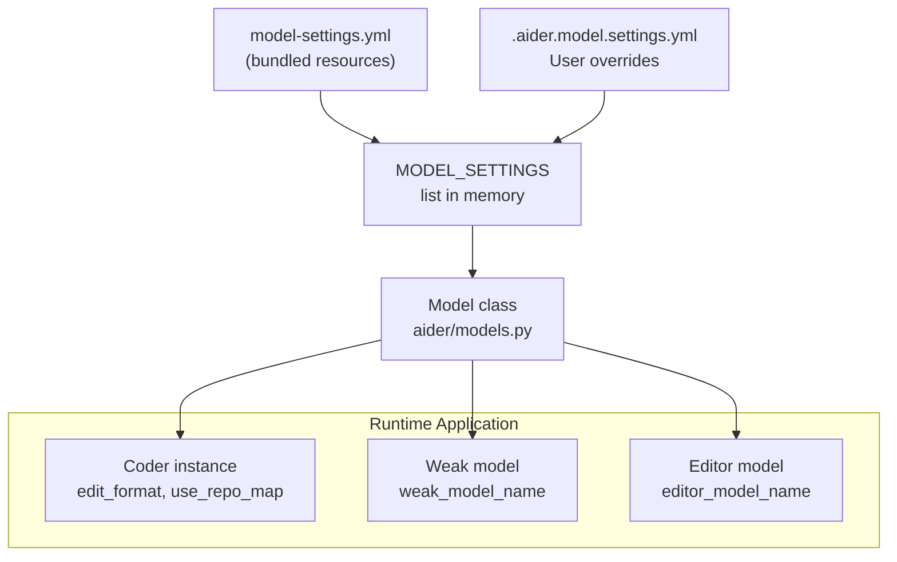
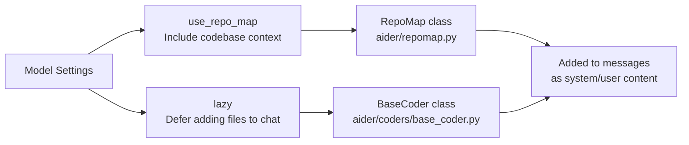
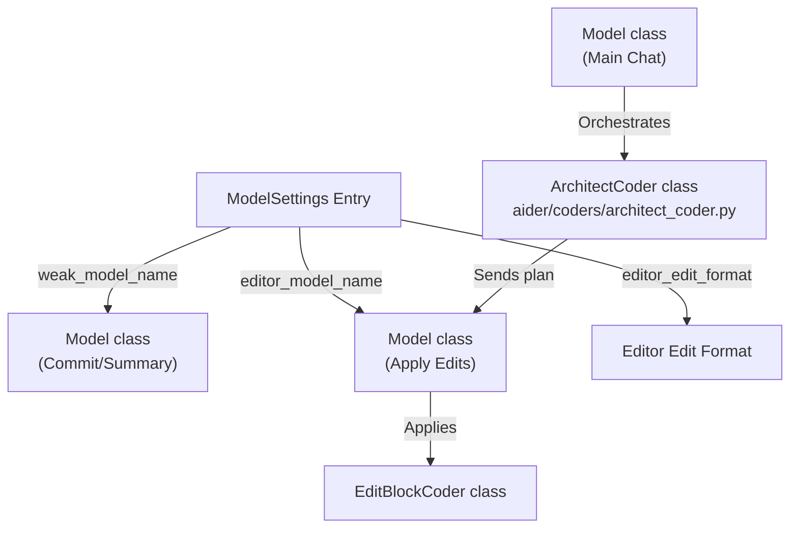

# Model Settings and Behavioral Configuration

<details>
<summary>Relevant source files</summary>

The following files were used as context for generating this wiki page:

- [README.md](README.md)
- [aider/resources/__init__.py](aider/resources/__init__.py)
- [aider/resources/model-metadata.json](aider/resources/model-metadata.json)
- [aider/resources/model-settings.yml](aider/resources/model-settings.yml)
- [aider/website/_data/polyglot_leaderboard.yml](aider/website/_data/polyglot_leaderboard.yml)
- [aider/website/assets/sample-analytics.jsonl](aider/website/assets/sample-analytics.jsonl)
- [aider/website/assets/sample.aider.conf.yml](aider/website/assets/sample.aider.conf.yml)
- [aider/website/assets/sample.env](aider/website/assets/sample.env)
- [aider/website/docs/config/adv-model-settings.md](aider/website/docs/config/adv-model-settings.md)
- [aider/website/docs/config/aider_conf.md](aider/website/docs/config/aider_conf.md)
- [aider/website/docs/config/dotenv.md](aider/website/docs/config/dotenv.md)
- [aider/website/docs/config/model-aliases.md](aider/website/docs/config/model-aliases.md)
- [aider/website/docs/config/options.md](aider/website/docs/config/options.md)
- [aider/website/docs/faq.md](aider/website/docs/faq.md)
- [aider/website/docs/leaderboards/index.md](aider/website/docs/leaderboards/index.md)
- [aider/website/docs/more/infinite-output.md](aider/website/docs/more/infinite-output.md)
- [aider/website/index.html](aider/website/index.html)
- [tests/basic/test_models.py](tests/basic/test_models.py)
- [tests/basic/test_reasoning.py](tests/basic/test_reasoning.py)

</details>


This document explains the `model-settings.yml` file structure and how it configures the behavior of 200+ LLM models supported by Aider. Model settings control which edit format a model uses, whether it receives repository context, how messages are formatted, and other behavioral parameters that optimize each model's performance.

For technical specifications like context windows and pricing, see [Model Metadata and Technical Capabilities](7.2). For the litellm abstraction layer that routes requests to providers, see [Multi-Provider LLM Integration](7.3). For the three-tier main/weak/editor model architecture, see [Three-Tier Model System](7.4). For reasoning-specific settings, see [Reasoning and Thinking Token Configuration](7.5).

---

## Model Settings File Structure

The `aider/resources/model-settings.yml` file contains a list of model configurations, each defining how Aider should interact with a specific model. Each entry is a YAML dictionary with a `name` key and various optional behavioral settings.

### Configuration Application Flow



**Basic Entry Structure:**

```yaml
- name: gpt-4o
  edit_format: diff
  weak_model_name: gpt-4o-mini
  use_repo_map: true
  lazy: true
  reminder: sys
  examples_as_sys_msg: true
  editor_edit_format: editor-diff
```

Each setting controls a specific aspect of model behavior, from which edit strategy to use to how messages are formatted.

**Sources:** [aider/resources/model-settings.yml:76-83](), [aider/models.py:4-11](), [aider/website/docs/config/adv-model-settings.md:74-84]()

---

## Edit Strategy Configuration

The `edit_format` setting determines which Coder implementation handles code modifications for the model. Different models perform better with different edit formats based on their training and instruction-following capabilities.

### Edit Format Settings

| Setting Value | Coder Class | Description |
|--------------|-------------|-------------|
| `diff` | `EditBlockCoder` | SEARCH/REPLACE blocks (default for Claude, GPT-4o) |
| `udiff` | `UnifiedDiffCoder` | Unified diff patch format (GPT-4 Turbo) |
| `whole` | `WholeFileCoder` | Complete file replacement (o1, o3, smaller models) |
| `diff-fenced` | `EditBlockFencedCoder` | Fenced SEARCH/REPLACE blocks (Gemini) |
| `architect` | `ArchitectCoder` | Two-stage reasoning + editing workflow |
| `editor-diff` | `EditorEditBlockCoder` | Edit format for editor in architect mode |

**Examples from model-settings.yml:**

```yaml
# Claude prefers diff format
- name: anthropic/claude-3-5-sonnet-20241022
  edit_format: diff

# GPT-4 Turbo uses unified diffs
- name: gpt-4-turbo
  edit_format: udiff

# Gemini uses whole file format often
- name: gemini/gemini-2.0-pro-exp-02-05
  edit_format: whole
```

The `editor_edit_format` setting specifies the edit format for the editor model in architect mode, allowing a reasoning model to plan changes while a different model applies them.

**Sources:** [aider/resources/model-settings.yml:174-175](), [aider/resources/model-settings.yml:28-29](), [aider/website/_data/polyglot_leaderboard.yml:3-4](), [aider/resources/model-settings.yml:42](), [aider/website/docs/config/adv-model-settings.md:140-155]()

---

## Repository Context Settings

Settings that control how repository information is provided to the model.

### Context Logic Flow



### use_repo_map

**Type:** Boolean  
**Default:** Varies by model  
**Effect:** When `true`, Aider includes a ranked map of repository symbols in the chat context via the `RepoMap` system, helping the model understand the codebase structure.

### lazy

**Type:** Boolean  
**Default:** `false`  
**Effect:** When `true`, files are only added to the chat when the model explicitly requests them (typically via the `ArchitectCoder`), reducing token usage.

**Sources:** [aider/resources/model-settings.yml:38-39](), [aider/resources/model-settings.yml:87](), [aider/website/docs/config/adv-model-settings.md:142-144]()

---

## Message Formatting and Prompt Engineering

Settings that control how messages and prompts are structured for the model.

### Message Placement Settings

| Setting | Type | Values | Effect |
|---------|------|--------|--------|
| `reminder` | String | `sys`, `user` | Where to place format reminder messages |
| `examples_as_sys_msg` | Boolean | `true`, `false` | Include examples as system vs user messages |
| `use_system_prompt` | Boolean | `true`, `false` | Whether model supports system prompts |
| `system_prompt_prefix` | String | Any text | Prefix added to system prompts |

### reminder

Controls where reminder messages about edit format are placed:
- `sys`: Added to the end of the system message.
- `user`: Added as the last user message before the response.

**Examples:**
```yaml
# Most models use system reminders
- name: gpt-4o
  reminder: sys

# Some models need user reminders
- name: fireworks_ai/accounts/fireworks/models/qwq-32b
  reminder: user
```

### examples_as_sys_msg

Whether to include edit format examples as system messages (`true`) or user messages (`false`). This is crucial for models like Claude and GPT-4o that perform better with examples in the system prompt.

**Sources:** [aider/resources/model-settings.yml:40-41](), [aider/resources/model-settings.yml:178](), [aider/resources/model-settings.yml:915-916](), [aider/website/docs/config/adv-model-settings.md:146-147]()

---

## Provider-Specific Parameters

Settings that pass additional parameters to specific LLM providers via the `litellm` layer.

### extra_params

**Type:** Dictionary  
**Effect:** Arbitrary key-value pairs passed to the provider's API. This is used extensively for Anthropic beta headers and token limits.

```yaml
# Claude 3.7 Sonnet uses prompt caching and high output limits
- name: anthropic/claude-3-7-sonnet-20250219
  extra_params:
    extra_headers:
      anthropic-beta: prompt-caching-2024-07-31,pdfs-2024-09-25,output-128k-2025-02-19
    max_tokens: 64000
  cache_control: true
```

### cache_control

**Type:** Boolean  
**Effect:** Enables prompt caching for providers that support it (Anthropic).

**Sources:** [aider/resources/model-settings.yml:193-197](), [aider/resources/model-settings.yml:157](), [aider/website/docs/config/adv-model-settings.md:89-101]()

---

## Multi-Model Architecture Settings

Settings that define which models to use for different roles in Aider's three-tier architecture.

### Model Role Delegation



### weak_model_name

**Type:** String (model identifier)  
**Effect:** Specifies a cheaper/faster model for simple tasks like commit messages and chat history summarization.

### editor_model_name

**Type:** String (model identifier)  
**Effect:** In architect mode, specifies which model performs the actual editing after the main model plans changes.

**Sources:** [aider/resources/model-settings.yml:78](), [aider/resources/model-settings.yml:158-159](), [aider/resources/model-settings.yml:198-199](), [aider/website/docs/config/adv-model-settings.md:154-155]()

---

## Advanced Runtime Configuration

### Accepts Settings

**Type:** List of strings  
**Effect:** Declares which advanced settings the model accepts, such as `thinking_tokens` for Claude 3.7 or `reasoning_effort` for OpenAI o1.

```yaml
- name: anthropic/claude-3-7-sonnet-20250219
  accepts_settings: ["thinking_tokens"]
```

### Reasoning and Thinking

| Setting | Type | Effect |
|---------|------|--------|
| `thinking_tokens` | Integer | Budget for reasoning tokens (e.g., for Claude 3.7) |
| `reasoning_effort` | String | Effort level for o1/o3 models (low, medium, high) |

The `Model` class in `aider/models.py` provides `set_thinking_tokens` to configure these parameters dynamically, parsing values like "8k" into integers.

**Sources:** [aider/resources/model-settings.yml:200](), [aider/models.py:188-194](), [aider/models.py:160-180](), [aider/website/docs/config/aider_conf.md:137-141]()

---

## Settings Loading and Priority

Aider loads model settings in a hierarchical fashion:

1.  **Internal Defaults:** Hardcoded in `aider/models.py`.
2.  **Base Settings:** Loaded from the bundled `aider/resources/model-settings.yml`.
3.  **User Settings File:** Loaded from `.aider.model.settings.yml` (checked in home dir, git root, and current dir).
4.  **CLI Overrides:** Arguments like `--edit-format` or `--weak-model` take final precedence.

The `ModelInfoManager` class handles the retrieval of these settings and metadata from both `model-settings.yml` and `model-metadata.json`.

**Sources:** [aider/models.py:7-11](), [aider/models.py:28-31](), [aider/website/docs/config/adv-model-settings.md:74-84](), [aider/website/docs/config/aider_conf.md:123-128]()