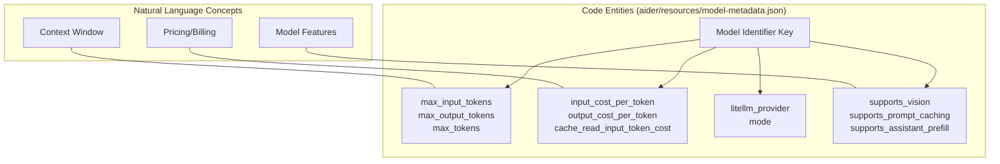
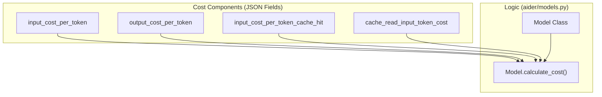
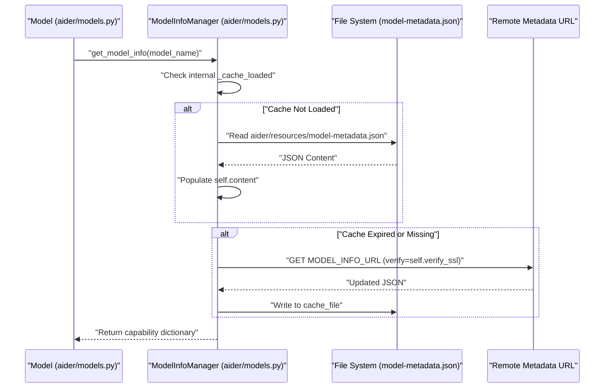

# Model Metadata and Technical Capabilities

<details>
<summary>Relevant source files</summary>

The following files were used as context for generating this wiki page:

- [aider/resources/__init__.py](aider/resources/__init__.py)
- [aider/resources/model-metadata.json](aider/resources/model-metadata.json)
- [aider/resources/model-settings.yml](aider/resources/model-settings.yml)
- [aider/website/_data/polyglot_leaderboard.yml](aider/website/_data/polyglot_leaderboard.yml)
- [pytest.ini](pytest.ini)
- [scripts/clean_metadata.py](scripts/clean_metadata.py)
- [tests/basic/test_main.py](tests/basic/test_main.py)
- [tests/basic/test_model_info_manager.py](tests/basic/test_model_info_manager.py)
- [tests/basic/test_models.py](tests/basic/test_models.py)
- [tests/basic/test_reasoning.py](tests/basic/test_reasoning.py)
- [tests/basic/test_ssl_verification.py](tests/basic/test_ssl_verification.py)
- [tests/scrape/test_scrape.py](tests/scrape/test_scrape.py)

</details>


## Purpose and Scope

This page documents the `model-metadata.json` file and how Aider defines technical capabilities, token limits, costs, and other immutable characteristics of LLM models. This metadata is distinct from behavioral configuration covered in [Model Settings and Behavioral Configuration](). While model settings define *how* Aider uses a model (edit format, repo map usage), model metadata defines *what* a model can do (token limits, cost, supported features).

For information about how Aider integrates with multiple LLM providers, see [Multi-Provider LLM Integration](). For the three-tier model architecture, see [Three-Tier Model System]().

## Overview

The model metadata system stores technical specifications for LLM models in [aider/resources/model-metadata.json](). This JSON file contains structured information about:

- Context window sizes and token limits.
- Input and output costs per token (including cache hits/misses).
- Provider identification and routing via LiteLLM.
- Feature support flags (vision, prompt caching, assistant prefill).
- Modality support (text, image, audio, video, PDF).

Unlike behavioral settings which can be overridden by users in YAML configs, metadata represents fundamental model capabilities.

**Metadata vs Settings Distinction:**

| Aspect | Model Metadata | Model Settings |
|--------|---------------------|---------------------|
| File | `model-metadata.json` | `model-settings.yml` |
| Nature | Technical facts | Behavioral preferences |
| Mutability | Fixed by provider | User-configurable |
| Examples | Token limits, cost | Edit format, use_repo_map |

Sources: [aider/resources/model-metadata.json:1-185](), [aider/resources/model-settings.yml:1-265]()

## Metadata Structure

Each model entry in `model-metadata.json` follows a consistent structure. The metadata is keyed by the full model identifier used by the `Model` class.

**Model Metadata Entity Mapping**


**Example Metadata Entry:**

```json
{
    "deepseek/deepseek-chat": {
        "max_tokens": 8192,
        "max_input_tokens": 128000,
        "max_output_tokens": 8192,
        "input_cost_per_token": 0.00000028,
        "input_cost_per_token_cache_hit": 0.000000028,
        "output_cost_per_token": 0.00000042,
        "litellm_provider": "deepseek",
        "mode": "chat",
        "supports_assistant_prefill": true,
        "supports_prompt_caching": true
    }
}
```

Sources: [aider/resources/model-metadata.json:18-33]()

## Token Limits and Context Windows

Aider tracks distinct token limit fields to accurately represent model capabilities. The `Model` class uses `parse_token_value` to handle various input formats (integers, strings with 'k' or 'm' suffixes) when processing these limits [tests/basic/test_models.py:160-187]().

- `max_input_tokens`: The context window size. This determines how much code and history can be sent in a single request.
- `max_output_tokens`: The maximum length of a single response. This is critical for models with reasoning or long-form code generation.
- `max_tokens`: Often represents the total token limit or a legacy output limit.

**Token Limit Examples:**

| Model | max_input_tokens | max_output_tokens | Notes |
|-------|-----------------|-------------------|-------|
| `deepseek/deepseek-reasoner` | 128,000 | 64,000 | High output for reasoning [aider/resources/model-metadata.json:2-5]() |
| `anthropic/claude-3-7-sonnet-20250219` | 200,000 | 8,192 | Large context [aider/resources/model-metadata.json:149-152]() |
| `openai/gpt-4.5-preview` | 128,000 | 16,384 | Standard flagship limits [aider/resources/model-metadata.json:169-172]() |

Sources: [aider/resources/model-metadata.json:1-185](), [tests/basic/test_models.py:33-48](), [tests/basic/test_models.py:160-187]()

## Cost and Cache Structure

Cost metadata enables Aider to calculate and display pricing for API calls. The system supports prompt caching costs which are significantly lower than standard input costs.



**Cost Comparison ($ per Million Tokens):**

| Model | Input | Output | Cache Read |
|-------|-------|--------|------------|
| `deepseek/deepseek-chat` | $0.28 | $0.42 | $0.028 [aider/resources/model-metadata.json:22-26]() |
| `anthropic/claude-3-7-sonnet-20250219` | $3.00 | $15.00 | $0.30 [aider/resources/model-metadata.json:153-156]() |
| `openai/gpt-4.5-preview` | $75.00 | $150.00 | $37.50 [aider/resources/model-metadata.json:173-175]() |

Sources: [aider/resources/model-metadata.json:1-185]()

## ModelInfoManager Retrieval Interface

The `ModelInfoManager` class handles the retrieval and caching of model metadata. It acts as the gateway between the `Model` class and the JSON metadata files.

### Key Functions and Data Flow

1. **Initialization**: `ModelInfoManager` is defined in `aider/models.py`. It manages a local cache file typically named `model_prices_and_context_window.json` [aider/models.py:7-11](), [tests/basic/test_model_info_manager.py:17]().
2. **Retrieval**: `get_model_info(model_name)` looks up a model in the cached dictionary. If the model is not found, it returns an empty dictionary [tests/basic/test_models.py:28-31]().
3. **Lazy Loading**: The manager implements lazy loading, only reading the JSON database from disk when `get_model_from_cached_json_db` is first called [tests/basic/test_model_info_manager.py:43-62]().
4. **Cache Updates**: The manager can update its cache from a remote URL (`MODEL_INFO_URL`) while respecting SSL verification settings [tests/basic/test_model_info_manager.py:25-42]().
5. **SSL Configuration**: `set_verify_ssl(False)` disables certificate validation for network requests. This setting is propagated to `httpx` clients and the internal `_update_cache` logic [tests/basic/test_model_info_manager.py:39-41](), [tests/basic/test_ssl_verification.py:63-65]().



Sources: [aider/models.py:7-11](), [tests/basic/test_model_info_manager.py:10-81](), [tests/basic/test_ssl_verification.py:22-36]()

## Technical Capabilities and Flags

Capability flags determine which Aider features are enabled for a specific model.

| Flag | Impact |
|------|--------|
| `supports_vision` | Allows sending images/screenshots to the model [aider/resources/model-metadata.json:160]() |
| `supports_prompt_caching` | Enables Anthropic or DeepSeek style prompt caching headers [aider/resources/model-metadata.json:164]() |
| `supports_assistant_prefill` | Allows Aider to pre-type the model's response start [aider/resources/model-metadata.json:162]() |
| `supports_pdf_input` | Allows sending PDF content directly [aider/resources/model-metadata.json:163]() |
| `supports_tool_choice` | Enables forcing the model to use a specific tool [aider/resources/model-metadata.json:167]() |

### Reasoning and Thinking
For models with extended reasoning capabilities (e.g., Claude 3.7, o1, DeepSeek-R1), Aider manages reasoning tokens and tags:
- **Thinking Budget**: Managed via `set_thinking_tokens()`, which sets `budget_tokens` in `extra_params["thinking"]` and disables `use_temperature` [tests/basic/test_models.py:188-200]().
- **Reasoning Extraction**: The `reasoning_tags` module defines `REASONING_START` and `REASONING_END` to wrap reasoning content. The `Coder` class uses `remove_reasoning_content()` to strip these blocks before processing the final code output [tests/basic/test_reasoning.py:8-12](), [tests/basic/test_reasoning.py:66-68]().
- **Streaming Reasoning**: During streaming, reasoning content is captured from `delta.reasoning_content` or `delta.reasoning` and displayed first in the output [tests/basic/test_reasoning.py:107-134](), [tests/basic/test_reasoning.py:70-75]().

Sources: [aider/resources/model-metadata.json:1-185](), [tests/basic/test_reasoning.py:16-76](), [tests/basic/test_models.py:188-200](), [aider/reasoning_tags.py:8-12]()

## Relationship to Benchmarks

The technical metadata directly influences a model's performance on the Polyglot Leaderboard.
- **Context Exhaustion**: Models with low `max_input_tokens` may fail complex tasks in the benchmark [aider/website/_data/polyglot_leaderboard.yml:70]().
- **Malformed Responses**: Models lacking specific capabilities may produce more malformed edits, tracked as `num_malformed_responses` in the benchmark results [aider/website/_data/polyglot_leaderboard.yml:90-91]().
- **Cost Efficiency**: Total task cost is calculated based on the metadata's token pricing [aider/website/_data/polyglot_leaderboard.yml:25]().

Sources: [aider/website/_data/polyglot_leaderboard.yml:1-273]()