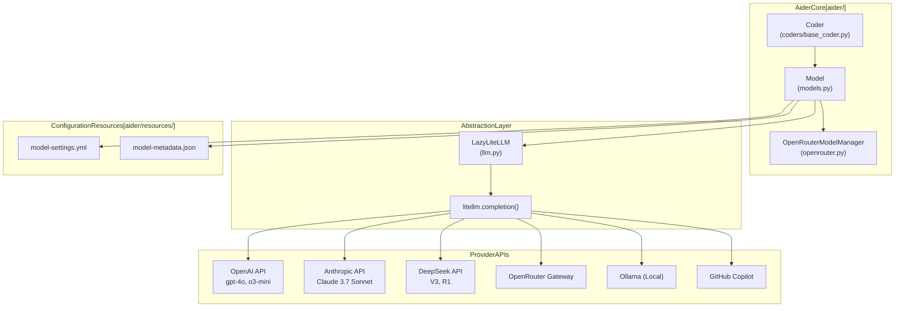
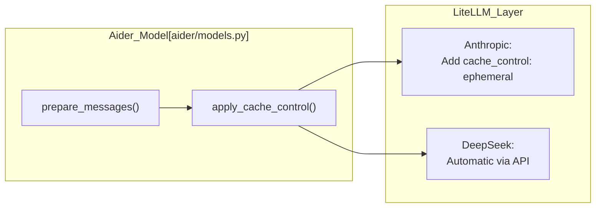
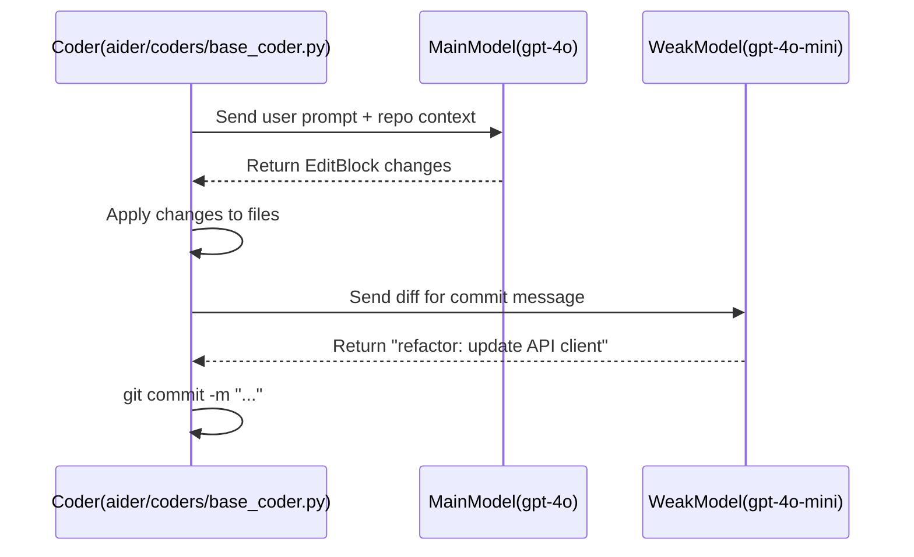

# Multi-Provider LLM Integration

Relevant source files

The following files were used as context for generating this wiki page:

- [aider/openrouter.py](aider/openrouter.py)
- [aider/website/docs/llms/anthropic.md](aider/website/docs/llms/anthropic.md)
- [aider/website/docs/llms/azure.md](aider/website/docs/llms/azure.md)
- [aider/website/docs/llms/cohere.md](aider/website/docs/llms/cohere.md)
- [aider/website/docs/llms/deepseek.md](aider/website/docs/llms/deepseek.md)
- [aider/website/docs/llms/github.md](aider/website/docs/llms/github.md)
- [aider/website/docs/llms/groq.md](aider/website/docs/llms/groq.md)
- [aider/website/docs/llms/lm-studio.md](aider/website/docs/llms/lm-studio.md)
- [aider/website/docs/llms/ollama.md](aider/website/docs/llms/ollama.md)
- [aider/website/docs/llms/openai-compat.md](aider/website/docs/llms/openai-compat.md)
- [aider/website/docs/llms/openai.md](aider/website/docs/llms/openai.md)
- [aider/website/docs/llms/openrouter.md](aider/website/docs/llms/openrouter.md)
- [aider/website/docs/llms/other.md](aider/website/docs/llms/other.md)
- [aider/website/docs/llms/xai.md](aider/website/docs/llms/xai.md)
- [aider/website/docs/usage/browser.md](aider/website/docs/usage/browser.md)
- [tests/basic/test_openrouter.py](tests/basic/test_openrouter.py)

This document explains how Aider integrates with multiple LLM providers through a unified abstraction layer. It covers the architecture, configuration, and provider-specific features that enable Aider to work with 200+ models across various API providers including OpenAI, Anthropic, Google, DeepSeek, xAI, OpenRouter, and local inference servers.

## Architecture Overview

Aider uses the `litellm` library as an abstraction layer to communicate with different LLM providers through a unified interface. This design allows Aider to add support for new providers without changing core orchestration logic.

### High-Level Architecture Diagram

**Sources:** [aider/models.py:3-15](), [aider/openrouter.py:29-33](), [aider/llm.py:1-20]()

The `Model` class encapsulates LLM communication. It retrieves technical specifications from `model-metadata.json` and behavioral settings from `model-settings.yml`. Actual API calls are delegated to `litellm` via the `LazyLiteLLM` wrapper to optimize startup time. For OpenRouter specifically, Aider uses `OpenRouterModelManager` to fetch and cache dynamic model metadata directly from the OpenRouter API [aider/openrouter.py:29-38]().

## Provider Configuration

### API Key Management

Aider recognizes provider-specific API key environment variables. Key variables include:

| Provider | Environment Variable | Reference |
|----------|----------------------|-----------|
| OpenAI | `OPENAI_API_KEY` | [aider/website/docs/llms/openai.md:20]() |
| Anthropic | `ANTHROPIC_API_KEY` | [aider/website/docs/llms/anthropic.md:20]() |
| DeepSeek | `DEEPSEEK_API_KEY` | [aider/website/docs/llms/deepseek.md:19]() |
| OpenRouter | `OPENROUTER_API_KEY` | [aider/website/docs/llms/openrouter.md:18]() |
| xAI | `XAI_API_KEY` | [aider/website/docs/llms/xai.md:17]() |
| Ollama | `OLLAMA_API_KEY` (Optional) | [aider/website/docs/llms/ollama.md:49]() |
| Azure | `AZURE_API_KEY` | [aider/website/docs/llms/azure.md:18]() |
| Cohere | `COHERE_API_KEY` | [aider/website/docs/llms/other.md:73]() |
| Groq | `GROQ_API_KEY` | [aider/website/docs/llms/other.md:85]() |

**Sources:** [aider/website/docs/llms/other.md:58-116](), [aider/website/docs/llms/anthropic.md:8-12]()

### Local and Compatible Providers

*   **Ollama:** Connects via `ollama_chat/` prefix. Users set `OLLAMA_API_BASE` (default `http://127.0.0.1:11434`) [aider/website/docs/llms/ollama.md:17-18](). Aider automatically sets Ollama's context window (`num_ctx`) to be large enough for the request plus 8k tokens for the reply to prevent silent data discarding [aider/website/docs/llms/ollama.md:61-63]().
*   **GitHub Copilot:** Aider connects to the standard OpenAI-style endpoint at `https://api.githubcopilot.com` [aider/website/docs/llms/github.md:8-13](). Users must provide an `oauth_token` (retrieved from IDE configs) as the `OPENAI_API_KEY` [aider/website/docs/llms/github.md:25-30](). Models are accessed by prefixing Copilot IDs with `openai/` (e.g., `openai/gpt-4o`) [aider/website/docs/llms/github.md:70-73]().
*   **LM Studio:** Connects via `lm_studio/` prefix. Requires `LM_STUDIO_API_BASE` (default `http://localhost:1234/v1`) and a dummy `LM_STUDIO_API_KEY` to satisfy client headers [aider/website/docs/llms/lm-studio.md:18-26]().
*   **Azure:** Requires `AZURE_API_KEY`, `AZURE_API_BASE`, and `AZURE_API_VERSION`. Models are accessed via `azure/<deployment_name>` [aider/website/docs/llms/azure.md:17-35]().

## Model Registration and Selection

### Model Discovery and OpenRouter Integration

Users can list available models using fuzzy matching via `aider --list-models <name>` [aider/website/docs/llms/other.md:12-15]().

For OpenRouter, Aider implements a specialized `OpenRouterModelManager` that:
1.  Downloads the model list from `https://openrouter.ai/api/v1/models` [aider/openrouter.py:30]().
2.  Caches it locally in `~/.aider/caches/openrouter_models.json` with a 24-hour TTL [aider/openrouter.py:31-35]().
3.  Maps OpenRouter pricing and context length fields to the internal `get_model_info` format [aider/openrouter.py:47-83]().

**Sources:** [aider/openrouter.py:29-83](), [tests/basic/test_openrouter.py:18-45]()

### Technical Capability Mapping

Technical capabilities are stored in `aider/resources/model-metadata.json`. This includes:
*   **Context Windows:** `max_input_tokens` and `max_output_tokens`.
*   **Pricing:** `input_cost_per_token` and `output_cost_per_token`.
*   **Features:** `supports_vision`, `supports_prompt_caching`, and `supports_assistant_prefill`.

## Provider-Specific Features

### Reasoning and Thinking Tokens

Aider supports models with internal "thinking" processes:

*   **Claude 3.7 Sonnet:** Supports "thinking tokens". Users can enable this by configuring `thinking` with a `budget_tokens` value in `.aider.model.settings.yml` [aider/website/docs/llms/anthropic.md:58-75]().
*   **Reasoning Effort:** Models like `o3-mini` and `grok-3-mini-beta` support the `--reasoning-effort` flag (low, medium, high) to control the depth of internal reasoning [aider/website/docs/llms/xai.md:43-49](), [aider/website/docs/llms/openai.md:54-55]().
*   **OpenRouter Routing:** Users can control OpenRouter provider selection (e.g., "Anthropic" vs "Together") and fallback behavior via the `extra_params.extra_body.provider` field in model settings [aider/website/docs/llms/openrouter.md:57-70]().

### Prompt Caching and Prefill

Aider enables prompt caching for providers that support it (Anthropic, DeepSeek, OpenRouter) to reduce latency.

**Sources:** [aider/website/docs/llms/anthropic.md:65-72](), [aider/openrouter.py:75-83]()

## Three-Tier Model System

Aider orchestrates three distinct model roles to balance intelligence and cost:

| Tier | Role | Typical Model |
|------|------|---------------|
| **Main Model** | Primary code generation and architecting. | `claude-3-7-sonnet`, `gpt-4o`, `deepseek-chat` |
| **Weak Model** | Summarization, commit messages, and chat history management. | `gpt-4o-mini`, `claude-3-5-haiku` |
| **Editor Model** | Applying specific edits in Architect mode. | `gpt-4o`, `claude-3-7-sonnet` |

**Sources:** [aider/website/docs/llms/github.md:94-98](), [aider/website/docs/llms/anthropic.md:59-75]()

### Model Logic Flow Diagram

**Sources:** [aider/website/docs/llms/github.md:97-98](), [aider/website/docs/llms/anthropic.md:61-73]()