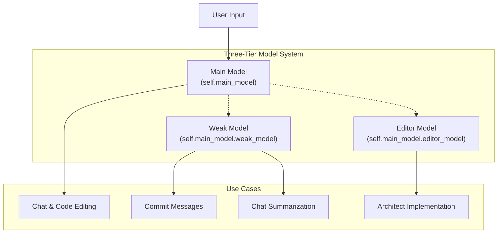
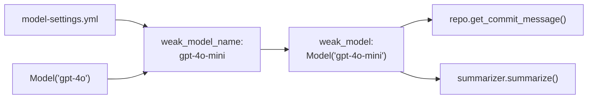
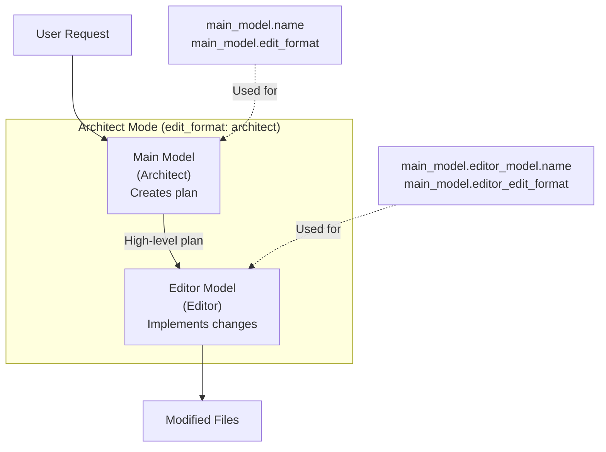
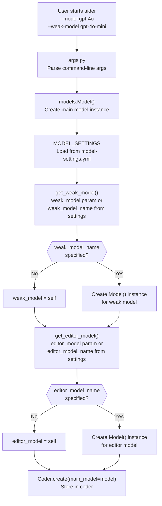
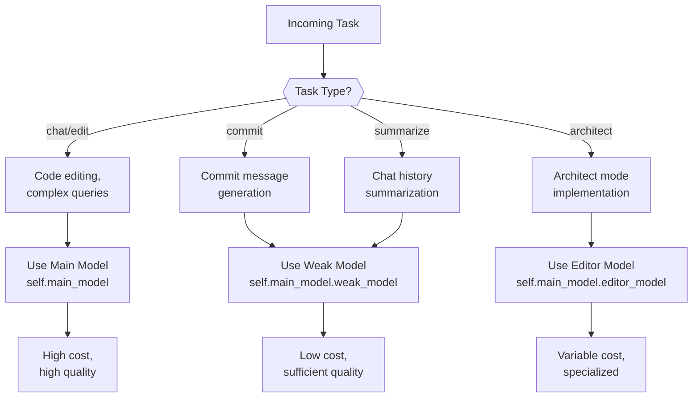

# Three-Tier Model System

<details>
<summary>Relevant source files</summary>

The following files were used as context for generating this wiki page:

- [aider/args.py](aider/args.py)
- [aider/coders/base_coder.py](aider/coders/base_coder.py)
- [aider/commands.py](aider/commands.py)
- [aider/io.py](aider/io.py)
- [aider/main.py](aider/main.py)
- [aider/models.py](aider/models.py)
- [aider/repo.py](aider/repo.py)
- [aider/repomap.py](aider/repomap.py)
- [aider/resources/__init__.py](aider/resources/__init__.py)
- [aider/resources/model-metadata.json](aider/resources/model-metadata.json)
- [aider/resources/model-settings.yml](aider/resources/model-settings.yml)
- [aider/voice.py](aider/voice.py)
- [aider/website/_data/polyglot_leaderboard.yml](aider/website/_data/polyglot_leaderboard.yml)
- [aider/website/docs/languages.md](aider/website/docs/languages.md)
- [scripts/__init__.py](scripts/__init__.py)
- [scripts/my_models.py](scripts/my_models.py)
- [tests/basic/test_io.py](tests/basic/test_io.py)
- [tests/basic/test_models.py](tests/basic/test_models.py)
- [tests/basic/test_reasoning.py](tests/basic/test_reasoning.py)

</details>


## Purpose and Scope

This document describes Aider's three-tier model system, which uses multiple LLMs with different capabilities and costs to optimize performance and expenses. The system automatically selects cheaper models for simpler tasks like commit messages and summarization, while reserving more capable (and expensive) models for complex code editing tasks.

For information about model configuration and metadata, see [7.1 Model Settings and Behavioral Configuration]() and [7.2 Model Metadata and Technical Capabilities](). For details on LLM provider integration, see [7.3 Multi-Provider LLM Integration]().

## Overview

The three-tier model system consists of:

1.  **Main Model**: The primary LLM used for chat interactions and code editing.
2.  **Weak Model**: A cheaper, faster model used for commit messages and chat history summarization.
3.  **Editor Model**: A specialized model used in architect mode to implement designs.

This architecture allows Aider to balance quality and cost by using the most appropriate model for each task.



**Diagram: Three-tier model architecture and use cases**

Sources: [aider/models.py:318-358](), [aider/coders/base_coder.py:212-248]()

## The Three Model Tiers

### Main Model

The main model (`self.main_model`) is the primary LLM used for all chat interactions and code editing tasks. It is initialized from the `--model` command-line argument and defaults to `gpt-4o` [aider/models.py:30-30]().

Key characteristics:
*   Defined by the user via `--model` argument [aider/args.py:60-64]().
*   Used for all code editing operations.
*   Determines the default edit format based on model capabilities [aider/models.py:516-524]().
*   Supports advanced features like `reasoning_effort` [aider/args.py:139-142]() or `thinking_tokens` [aider/args.py:144-150]().

```python
# Initialization in Model class
def __init__(self, model, weak_model=None, editor_model=None, 
             editor_edit_format=None, verbose=False):
    model = MODEL_ALIASES.get(model, model)
    self.name = model
    # ... configuration ...
    self.get_weak_model(weak_model)
    self.get_editor_model(editor_model, editor_edit_format)
```

Sources: [aider/models.py:318-358](), [aider/models.py:92-116]()

### Weak Model

The weak model (`self.main_model.weak_model`) is a cheaper, faster alternative used for tasks that don't require the full capabilities of the main model. If no weak model is specified, it defaults to the main model [aider/models.py:592-594]().

Primary uses:
*   **Commit message generation**: Creates descriptive commit messages from diffs using the `commit_system` prompt [aider/prompts.py:8-22]().
*   **Chat history summarization**: Condenses conversation history via `ChatSummary` [aider/history.py:30-30]() when it exceeds token limits [aider/coders/base_coder.py:510-513]().

The weak model is configured via:
*   `weak_model_name` in `model-settings.yml` [aider/resources/model-settings.yml:2-2]().
*   `--weak-model` command-line argument [aider/args.py:185-192]().
*   `/weak-model` slash command [aider/commands.py:126-136]().



**Diagram: Weak model configuration and usage flow**

Sources: [aider/models.py:588-605](), [aider/resources/model-settings.yml:76-85]()

### Editor Model

The editor model (`self.main_model.editor_model`) is a specialized model used in architect mode [aider/args.py:172-177](). In this two-stage process:

1.  The **main model** acts as an architect, creating a high-level plan.
2.  The **editor model** implements the specific code changes using `editor_edit_format` [aider/models.py:139-139]().

Configuration:
*   `editor_model_name` and `editor_edit_format` in `model-settings.yml` [aider/resources/model-settings.yml:35-43]().
*   `--editor-model` and `--editor-edit-format` command-line arguments [aider/args.py:194-205]().
*   `/editor-model` command to switch at runtime [aider/commands.py:114-124]().



**Diagram: Architect mode with main and editor models**

Sources: [aider/models.py:610-630](), [aider/coders/base_coder.py:239-244]()

## Model Configuration in Settings

### ModelSettings Dataclass

The `ModelSettings` dataclass defines all configurable attributes for models, including their tiered associations:

```python
@dataclass
class ModelSettings:
    name: str
    edit_format: str = "whole"
    weak_model_name: Optional[str] = None
    # ...
    editor_model_name: Optional[str] = None
    editor_edit_format: Optional[str] = None
```

Sources: [aider/models.py:121-144]()

### Configuration File Structure

Model settings are stored in `model-settings.yml` with one entry per model. For example, `gpt-4o` is configured to use `gpt-4o-mini` as its weak model [aider/resources/model-settings.yml:76-83]().

## Model Initialization Flow

The `Model` class handles the resolution of weak and editor models during initialization.



**Diagram: Model initialization and three-tier setup process**

Sources: [aider/main.py:822-828](), [aider/models.py:318-358](), [aider/models.py:588-630]()

## Switching Models at Runtime

Users can switch any of the three models during a chat session using slash commands.

| Command | Purpose | Implementation |
|---------|---------|----------------|
| `/model <name>` | Switch main model | [aider/commands.py:87-112]() |
| `/weak-model <name>` | Switch weak model | [aider/commands.py:126-136]() |
| `/editor-model <name>` | Switch editor model | [aider/commands.py:114-124]() |

All three commands raise a `SwitchCoder` exception [aider/commands.py:30-34]() that triggers the creation of a new `Coder` instance [aider/coders/base_coder.py:124-201]().

## Cost Optimization Strategy

The three-tier system optimizes costs by routing tasks to appropriate models based on complexity and cost data found in `model-metadata.json` [aider/resources/model-metadata.json:1-185]().

### Task Routing



**Diagram: Task routing for cost optimization**

Sources: [aider/coders/base_coder.py:510-513](), [aider/models.py:607-608](), [aider/resources/model-metadata.json:1-148]()

### Disabling the Weak or Editor Model

Users can explicitly disable the weak or editor model by passing `false` to the CLI arguments [aider/args.py:185-198](). In the `Model` class, if a model name is not provided or is empty, it defaults to the main model instance (`self`) [aider/models.py:592-594](), [aider/models.py:614-616]().

Sources: [aider/models.py:588-630](), [aider/args.py:185-198]()