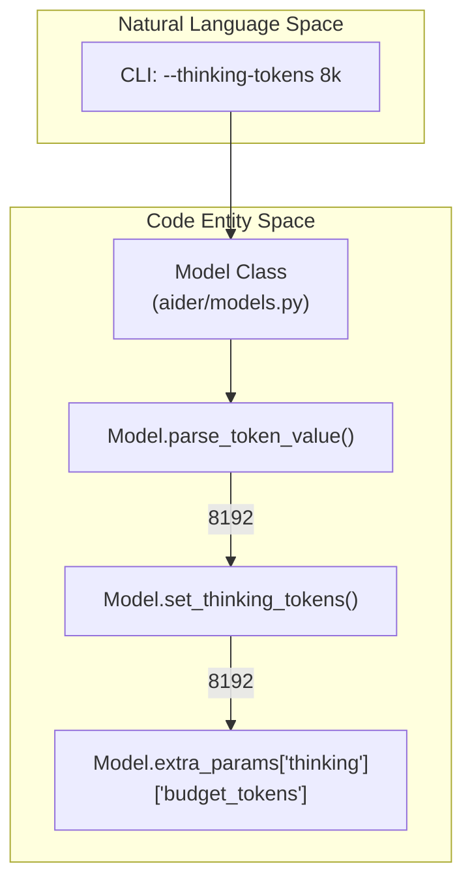
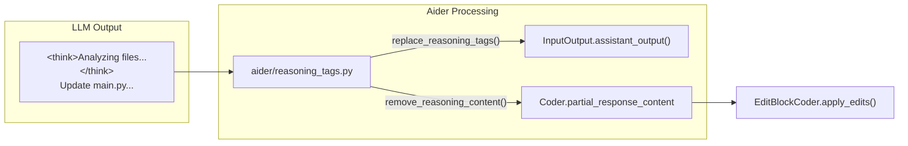

# Reasoning and Thinking Token Configuration

<details>
<summary>Relevant source files</summary>

The following files were used as context for generating this wiki page:

- [aider/reasoning_tags.py](aider/reasoning_tags.py)
- [aider/resources/__init__.py](aider/resources/__init__.py)
- [aider/resources/model-metadata.json](aider/resources/model-metadata.json)
- [aider/resources/model-settings.yml](aider/resources/model-settings.yml)
- [aider/website/_data/polyglot_leaderboard.yml](aider/website/_data/polyglot_leaderboard.yml)
- [aider/website/assets/thinking.jpg](aider/website/assets/thinking.jpg)
- [aider/website/docs/config/reasoning.md](aider/website/docs/config/reasoning.md)
- [tests/basic/test_models.py](tests/basic/test_models.py)
- [tests/basic/test_reasoning.py](tests/basic/test_reasoning.py)

</details>


This page documents Aider's support for extended reasoning capabilities in large language models. Some models support extended reasoning through either **thinking tokens** (Claude, Gemini) or **reasoning effort levels** (OpenAI o-series, DeepSeek-R1), allowing them to perform deeper analysis before generating responses.

## Overview

Extended reasoning capabilities allow certain models to allocate additional computational resources to "think" before responding, often resulting in better code modifications for complex tasks. Aider supports three distinct configuration mechanisms:

| Configuration Type | Models | Values | Purpose |
|-------------------|---------|--------|---------|
| `thinking_tokens` | Claude 3.7+, Gemini 2.0+ | Token count (e.g., `8k`, `32k`) | Allocates a budget of tokens for internal reasoning |
| `reasoning_effort`| OpenAI o1/o3, o3-mini | `low`, `medium`, `high` | Sets the depth of reasoning effort |
| `reasoning_tag`   | DeepSeek-R1, Reasoner | Tag name (e.g., `think`) | Extracts reasoning from specific XML tags |

These settings are configured per-model in `aider/resources/model-settings.yml` [aider/resources/model-settings.yml:200]() and can be controlled via CLI arguments like `--thinking-tokens` and `--reasoning-effort` [aider/website/docs/config/reasoning.md:16-25]().

## Thinking Tokens Configuration

### Supported Models and Settings

Models that accept `thinking_tokens` configuration, such as Claude 3.7 Sonnet, declare this capability in `model-settings.yml` via the `accepts_settings` field [aider/resources/model-settings.yml:200](). For these models, Aider often increases `max_tokens` (e.g., to 64,000) and includes specific beta headers for extended output [aider/resources/model-settings.yml:195-196]().

```yaml
- name: anthropic/claude-3-7-sonnet-20250219
  overeager: true
  edit_format: diff
  extra_params:
    extra_headers:
      anthropic-beta: prompt-caching-2024-07-31,pdfs-2024-09-25,output-128k-2025-02-19
    max_tokens: 64000
  accepts_settings: ["thinking_tokens"]
```
Sources: [aider/resources/model-settings.yml:187-201](), [aider/website/docs/config/reasoning.md:44-50]()

### Implementation in Model Class

The `Model` class handles the conversion of user-provided strings (like "8k") into integer token budgets using `parse_token_value` [tests/basic/test_models.py:160-187](). When `set_thinking_tokens` is called, it updates the `budget_tokens` within the `extra_params` dictionary and disables temperature sampling, as reasoning models often require `temperature=0` [tests/basic/test_models.py:188-200]().


Sources: [tests/basic/test_models.py:160-200](), [aider/website/docs/config/reasoning.md:44-50]()

## Reasoning Effort Configuration

For OpenAI models like `o3-mini`, Aider uses the `reasoning_effort` setting. This is a discrete level rather than a token count.

- **Models**: `o1`, `o3-mini` [aider/resources/model-settings.yml:846]().
- **Values**: `low`, `medium`, `high` [aider/website/docs/config/reasoning.md:42]().
- **Constraint**: These models often require `use_temperature: false` to be explicitly set in the configuration [aider/resources/model-settings.yml:181]().

Sources: [aider/resources/model-settings.yml:838-856](), [aider/website/docs/config/reasoning.md:38-43]()

## Reasoning Tags and Extraction

Models like DeepSeek-R1 output their reasoning inside XML-like tags (e.g., `<think>`). Aider uses the `reasoning_tag` configuration to identify and extract this content so it doesn't interfere with code editing logic.

### The reasoning_tags Module

The `aider/reasoning_tags.py` utility provides functions to process these tags:
- `remove_reasoning_content(res, reasoning_tag)`: Strips the thinking process from the LLM response using regex patterns before Aider processes file edits [aider/reasoning_tags.py:14-40]().
- `replace_reasoning_tags(text, tag_name)`: Replaces raw tags with human-readable UI markers defined by `REASONING_START` and `REASONING_END` [aider/reasoning_tags.py:43-64]().

### UI Rendering Flow

When streaming or receiving a full response, the `Coder` uses these utilities to separate the "thought" from the "action". The reasoning is displayed to the user but stripped from the final content used for edits [tests/basic/test_reasoning.py:67-68]().


Sources: [aider/reasoning_tags.py:1-83](), [tests/basic/test_reasoning.py:16-76](), [aider/reasoning_tags.py:10-11]()

## Configuration and Metadata

### Model Settings (YAML)
The `accepts_settings` key in `model-settings.yml` acts as a guard. If a user tries to set `--thinking-tokens` on a model that doesn't list it, Aider issues a warning to prevent API errors [aider/website/docs/config/reasoning.md:64-70]().

### Model Metadata (JSON)
The `aider/resources/model-metadata.json` file contains provider-specific details like `supports_assistant_prefill` or `supports_prompt_caching`, which are often critical for high-latency reasoning models like `deepseek-reasoner` [aider/resources/model-metadata.json:2-17]().

### Benchmark Performance
Aider's leaderboard tracks the impact of these settings. For example, `o1-2024-12-17 (high)` shows significantly higher pass rates but also higher costs and time per case compared to standard models [aider/website/_data/polyglot_leaderboard.yml:131-155]().

Sources: [aider/resources/model-settings.yml:1-300](), [aider/resources/model-metadata.json:1-168](), [aider/website/_data/polyglot_leaderboard.yml:131-155](), [aider/website/docs/config/reasoning.md:83-108]()