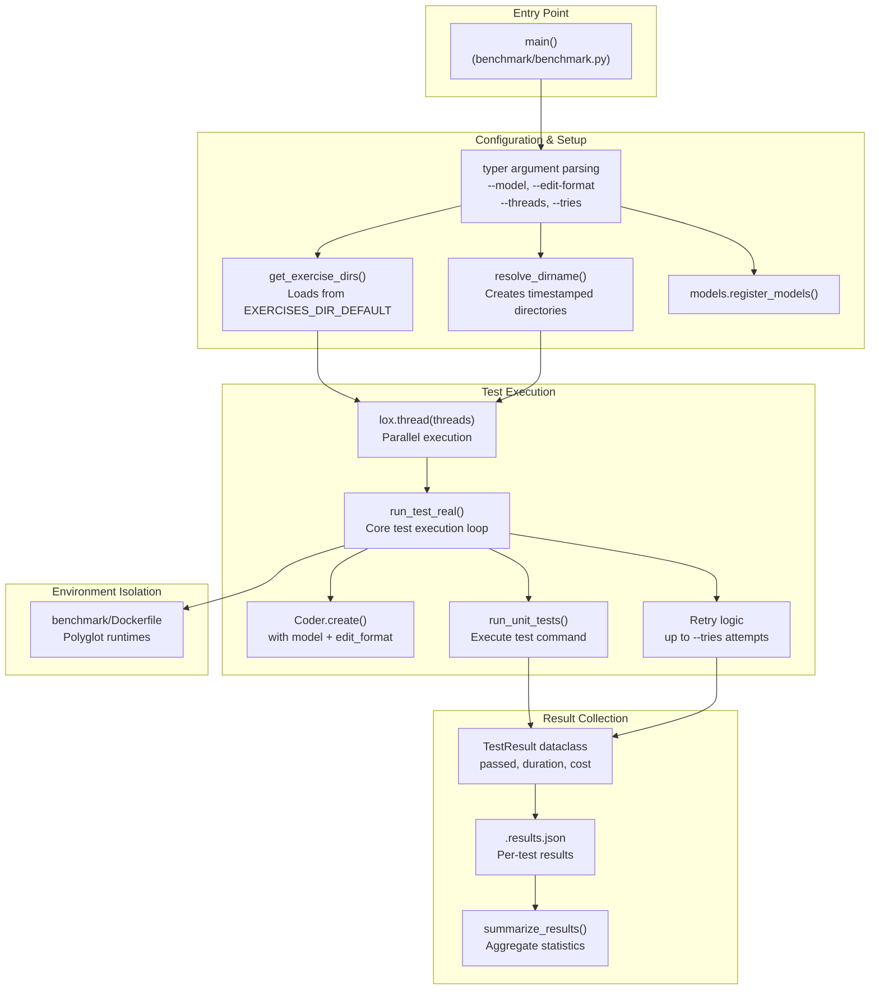
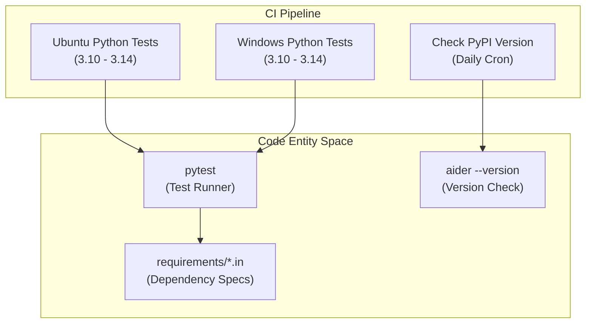

# Development and Quality Assurance

Relevant source files

The following files were used as context for generating this wiki page:

- [.github/workflows/check_pypi_version.yml](.github/workflows/check_pypi_version.yml)
- [.github/workflows/ubuntu-tests.yml](.github/workflows/ubuntu-tests.yml)
- [.github/workflows/windows-tests.yml](.github/workflows/windows-tests.yml)
- [.github/workflows/windows_check_pypi_version.yml](.github/workflows/windows_check_pypi_version.yml)
- [.gitignore](.gitignore)
- [benchmark/Dockerfile](benchmark/Dockerfile)
- [benchmark/benchmark.py](benchmark/benchmark.py)
- [requirements/pydub.in](requirements/pydub.in)
- [requirements/python-compat.in](requirements/python-compat.in)

## Purpose and Scope

This document describes the systems Aider uses to ensure code quality, measure performance, and track development progress. It covers the benchmarking infrastructure that evaluates LLM coding performance across multiple languages, the testing framework that validates core functionality, and the leaderboards that track model performance metrics. The QA process is integrated into the CI/CD pipeline via GitHub Actions to ensure cross-platform compatibility on Ubuntu and Windows.

---

## Benchmarking System

Aider's benchmarking system evaluates LLM code editing performance using a comprehensive suite of programming exercises across multiple languages. The primary benchmark is the **Polyglot Benchmark**, which tests models on 225 challenging exercises from Exercism across C++, Go, Java, JavaScript, Python, and Rust.

### Benchmark Architecture

**Benchmark Execution Flow**  
Sources: [benchmark/benchmark.py:162-218](), [benchmark/benchmark.py:1-35](), [benchmark/Dockerfile:1-65]()

### Test Execution and Isolation

The benchmark orchestrator manages the lifecycle of a test run, including environment isolation via Docker. The `benchmark/Dockerfile` provides a consistent environment with Python 3.11, Go 1.21, Rust, Node.js 20, and OpenJDK 21 [benchmark/Dockerfile:1-58](). This ensures that the `run_unit_tests` phase can execute polyglot test suites without host machine contamination.

**Key Configuration Parameters**

| Parameter | Purpose | Default |
|-----------|---------|---------|
| `--model` | LLM model to test | `gpt-3.5-turbo` |
| `--edit-format` | Code edit format (diff/whole/udiff) | Model default |
| `--threads` | Parallel test execution count | `1` |
| `--tries` | Retry attempts per test | `2` |
| `--replay` | Replay previous chat history responses | None |

Sources: [benchmark/benchmark.py:162-218]()

For details, see [Benchmarking System Architecture](#8.1).

---

## Testing Infrastructure

Aider uses `pytest` as its primary testing framework. The suite is executed automatically on every push and pull request via GitHub Actions for both Ubuntu and Windows environments [.github/workflows/ubuntu-tests.yml:1-57](), [.github/workflows/windows-tests.yml:1-53]().

### CI/CD and Version Verification

The infrastructure includes specialized checks to ensure that the version published to PyPI is installable and matches the latest Git tags across platforms [.github/workflows/check_pypi_version.yml:1-87]().

**Testing and Deployment Verification**  
Sources: [.github/workflows/ubuntu-tests.yml:23-57](), [.github/workflows/windows-tests.yml:23-53](), [.github/workflows/check_pypi_version.yml:26-87]()

### Dependency and Compatibility Testing

The test suite validates compatibility across Python versions 3.10 through 3.14, including specific shims for dependencies like `pydub` and `numpy` on newer Python versions [requirements/pydub.in:1-3](), [requirements/python-compat.in:1-12]().

For details, see [Testing Infrastructure](#8.2).

---

## Performance Leaderboards

Aider maintains public leaderboards that track LLM performance on coding tasks. These results inform the default model recommendations and edit strategies.

### Leaderboard Metrics

The system tracks several critical performance indicators to rank models:

| Metric | Description |
|--------|-------------|
| **Pass Rate** | Percentage of exercises passed (attempt 1 vs attempt 2). |
| **Well-formedness** | How often the model correctly followed the specified `edit_format`. |
| **Efficiency** | Total API cost and token usage for the benchmark suite. |

### Data and Visualization

Results are aggregated using `summarize_results` and can be visualized using `plot_refactoring` which generates performance graphs [benchmark/benchmark.py:91-134](). The benchmarking directory `tmp.benchmarks/` is excluded from version control but used for local analysis [.gitignore:18]().

For details, see [Performance Leaderboards](#8.3).