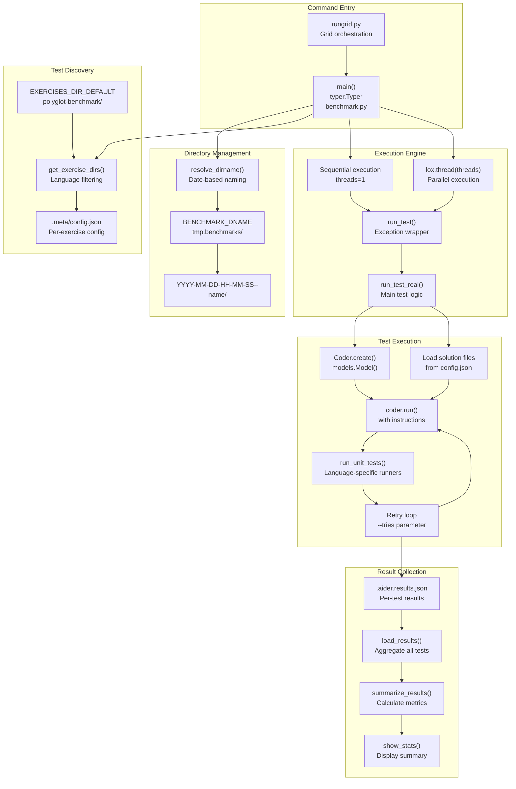
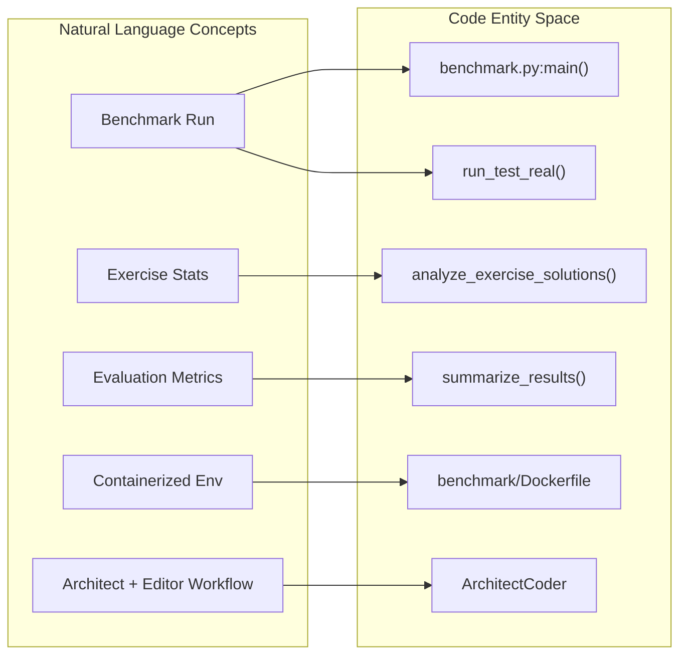

# Benchmarking System Architecture

<details>
<summary>Relevant source files</summary>

The following files were used as context for generating this wiki page:

- [.dockerignore](.dockerignore)
- [.gitignore](.gitignore)
- [aider/website/_data/r1_architect.yml](aider/website/_data/r1_architect.yml)
- [aider/website/_posts/2025-01-24-r1-sonnet.md](aider/website/_posts/2025-01-24-r1-sonnet.md)
- [benchmark/Dockerfile](benchmark/Dockerfile)
- [benchmark/benchmark.py](benchmark/benchmark.py)
- [benchmark/clone-exercism.sh](benchmark/clone-exercism.sh)
- [benchmark/docker.sh](benchmark/docker.sh)
- [benchmark/docker_build.sh](benchmark/docker_build.sh)
- [benchmark/install-docker-ubuntu.sh](benchmark/install-docker-ubuntu.sh)
- [benchmark/problem_stats.py](benchmark/problem_stats.py)
- [benchmark/rsync.sh](benchmark/rsync.sh)
- [benchmark/rungrid.py](benchmark/rungrid.py)
- [benchmark/swe_bench.py](benchmark/swe_bench.py)

</details>


## Purpose and Scope

The Benchmarking System evaluates Aider's code editing capabilities across multiple programming languages using the Polyglot Benchmark suite. It executes 225 exercises across 6 languages (Python, Rust, Go, JavaScript, C++, Java), tracks performance metrics, and generates comparative results for different model and edit format combinations.

For information about how benchmark results inform model configuration, see [Performance Leaderboards](#8.3). For information about the pytest-based test suite used for Aider's internal testing, see [Testing Infrastructure](#8.2).

**Sources:** [benchmark/benchmark.py:1-40]()

---

## Architecture Overview

The benchmarking system consists of a test orchestrator, exercise directory scanner, parallel execution engine, and result aggregator.

### System Orchestration Diagram



**Sources:** [benchmark/benchmark.py:33-407](), [benchmark/rungrid.py:1-62]()

---

## Test Discovery and Organization

### Exercise Directory Structure

The benchmark system expects exercises to be organized in a polyglot structure with language-specific subdirectories [benchmark/benchmark.py:35](). The `clone-exercism.sh` script is used to populate these from Exercism repositories [benchmark/clone-exercism.sh:1-21]().

```
polyglot-benchmark/
├── python/
│   └── exercises/practice/
│       ├── hello-world/
│       └── ...
├── rust/
│   └── exercises/practice/
├── go/
│   └── exercises/practice/
├── javascript/
│   └── exercises/practice/
├── cpp/
│   └── exercises/practice/
└── java/
    └── exercises/practice/
```

### Exercise Configuration

Each exercise directory contains a `.meta/config.json` file [benchmark/benchmark.py:718-730]() that defines the solution and test files. The system automatically ignores build artifacts and metadata directories like `.meta/**/*` and `.docs/**/*` [benchmark/benchmark.py:731-748]().

### Directory Naming and Resolution

Benchmark run directories use timestamp-based naming: `YYYY-MM-DD-HH-MM-SS--<name>` [benchmark/benchmark.py:152-158](). The `resolve_dirname()` function handles:
- Auto-detection of prior runs with `--cont` [benchmark/benchmark.py:140-143]().
- Creation of new dated directories with `--new` [benchmark/benchmark.py:152-155]().

**Sources:** [benchmark/benchmark.py:33-35, 136-158, 718-748](), [benchmark/clone-exercism.sh:1-21]()

---

## Test Execution Flow

### Initialization and Setup

The initialization phase in `main()` includes extracting the Git commit hash for version tracking [benchmark/benchmark.py:219-222](), registering model metadata [benchmark/benchmark.py:323-325](), and filtering exercises by keywords or language [benchmark/benchmark.py:339-345]().

### Single Test Execution Lifecycle

The `run_test_real()` function [benchmark/benchmark.py:679-978]() manages the lifecycle of a single exercise:

1.  **Result Caching**: Skips execution if `.aider.results.json` already exists [benchmark/benchmark.py:707-715]().
2.  **File Restoration**: Copies original solution files to the test directory [benchmark/benchmark.py:750-770]().
3.  **Instruction Assembly**: Combines introduction and problem descriptions from `.docs/` [benchmark/benchmark.py:774-784]().
4.  **Coder Configuration**: Initializes a `Coder` instance with specific settings like `reasoning_effort` and `thinking_tokens` [benchmark/benchmark.py:803-834]().
5.  **Retry Loop**: Executes the AI edit and runs unit tests up to `--tries` times [benchmark/benchmark.py:848-906]().

### Language-Specific Test Execution

The `run_unit_tests()` function [benchmark/benchmark.py:981-1049]() maps file extensions to specific test runners:

| Language | Extension | Command |
| :--- | :--- | :--- |
| Python | `.py` | `pytest` |
| Rust | `.rs` | `cargo test -- --include-ignored` |
| Go | `.go` | `go test ./...` |
| JavaScript | `.js` | `/aider/benchmark/npm-test.sh` |
| C++ | `.cpp` | `/aider/benchmark/cpp-test.sh` |
| Java | `.java` | `./gradlew test` |

**Sources:** [benchmark/benchmark.py:679-1049]()

---

## Result Collection and Metrics

### Natural Language Space to Code Entity Space Mapping

This diagram maps high-level benchmark concepts to the specific code entities in `benchmark.py` and `problem_stats.py`.



### Result File Format

Each test produces a `.aider.results.json` file [benchmark/benchmark.py:942-976]() containing:
- `tests_outcomes`: Boolean list of test results per try [benchmark/benchmark.py:950]().
- `cost`: Total API cost for the exercise [benchmark/benchmark.py:951]().
- `num_malformed_responses`: Count of unparseable AI outputs [benchmark/benchmark.py:959]().
- `syntax_errors` / `indentation_errors`: Language-specific error counts [benchmark/benchmark.py:960-961]().

### Evaluation Metrics

The `summarize_results()` function [benchmark/benchmark.py:468-629]() calculates:
- **Pass Rate N**: Success rate after N attempts [benchmark/benchmark.py:507-511]().
- **Well-formedness**: Percentage of responses that followed the edit format [benchmark/benchmark.py:534]().
- **Cost Efficiency**: Average cost per completed case [benchmark/benchmark.py:541]().

**Sources:** [benchmark/benchmark.py:468-629, 942-976](), [benchmark/problem_stats.py:62-210]()

---

## Docker and Infrastructure

### Containerization

The system requires execution within a Docker container to safely run unvetted AI-generated code [benchmark/benchmark.py:252-254](). The `benchmark/Dockerfile` sets up a polyglot environment [benchmark/Dockerfile:1-65]():
- **Python 3.11** as the primary runtime [benchmark/Dockerfile:3-21]().
- **Go, Rust, Node.js** for language-specific benchmarks [benchmark/Dockerfile:23-58]().
- **OpenJDK 21** for Java exercises [benchmark/Dockerfile:16]().

### Grid and Replay Modes

- **Grid Execution**: `rungrid.py` orchestrates multiple runs across different models and formats [benchmark/rungrid.py:1-62]().
- **Replay Mode**: The `--replay` option in `benchmark.py` allows re-running a benchmark using cached responses from `.aider.chat.history.md` files [benchmark/benchmark.py:175-179, 810-819]().

### Resource Cleanup

After each test, the system cleans up build artifacts to save space, such as `target/debug` for Rust, `build` for Java, and `node_modules` for JavaScript [benchmark/benchmark.py:908-940]().

**Sources:** [benchmark/benchmark.py:252-254, 810-940](), [benchmark/Dockerfile:1-65](), [benchmark/rungrid.py:1-62]()